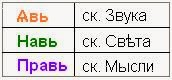
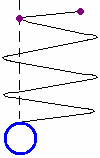

# Голосовая речь человека

Сейчас люди больше общаются посредством речи или как раньше говорили – рекущие. По звучанию схоже с рекой, т.е. **речь – это река**. Река – это поток, поток энергетики, есть поверхностная, срединная и глубинная; и разное течение: у берегов медленно, на фарватере быстро. Образно речь можно разделить на 3 структуры - Явь, Навь, Правь или Звук, Свет, Мысль.

1. Звук, Свет, Мысль  
2. Передача образа через речь  
3. Воздействие речи на организм человека

## Звук, Свет, Мысль

**1. В Яви информация передаётся со скоростью Звука**, но мы не пишем конкретное число 300 м/с, потому что скорость звука различна. В воздухе одна скорость звука, в воде - другая, в камне – третья. Т.е. в зависимости от плотности, даже в воздухе, скорость звука будет различна. Допустим, днём на остановке в 5 метрах от вас будут разговаривать два человека, но вы не услышите, о чём они говорят; зато ночью в поле вы можете услышать шорох или скрип за 1,5 км. Почему так меняется слышимость? Потому что днём и ночью плотность воздуха различная: днём сильный поток солнечного ветра, который тоже энергия. Поэтому не пишем конкретную цифру, просто упоминаем, что идёт скорость звука.

**2. В Нави (Слави) распространение идёт со скоростью Света**. Здесь также не ставится конкретная цифра. Материалисты рассчитали, что скорость света = 299 792 458 м/с, и солнечному свету требуется около 8 минут, чтобы достигнуть Земли. Но где находилась в этот момент Земля (Мидгард)? Ведь на неё влияют и ближние Земли, и дальние Земли (Земля Орея – Марс, Земля Перуна – Юпитер и т.д.) – это планеты-гиганты, их гравитационное и магнитное поле как бы оттягивает нашу Землю дальше от Солнца, и расстояние не всегда одинаковое. Поэтому когда проводили опыты, у одних получалось 289 000 км/с, у других 489 000 км/с, 370 000 км/с… в итоге современные учёные решили взять среднее значение 300 000 км/с. Но заметьте, ещё в начале 1990-х американские учёные, замеряя поток света от квазаров, определили, что от одного квазара скорость идёт порядка 1 млрд. км/с, от других 4 млрд, и даже 12 млрд. км/с. Т.е. скорость света различна, она может быть и 300 тысяч и 12 млрд. км/с. Поэтому точную цифру скорости света не ставим.

**Отклонение светового луча.** Современные учёные классифицируют Звёзды по спектральному излучению и берут за основу наши земные мерки. Потом берут коэффициент спектрального смещения и говорят: «Свет летит от той звезды до нас 100 000 световых лет». Но даже на наших допотопных кораблях дотуда можно за месяц долететь. Почему сейчас получаются такие большие расстояния? До ближайшей Альфа Центавра 4,36 св. лет. Кто мерил, какой линейкой? Свет – это очень хитрая система. Мы смотрим на небеса и видим звёздочку, а на самом деле она может быть по отношению к Земле совсем в другом месте, потому что **свет не идёт по прямой**, на пути встречается много Звёзд и планетарных систем, каждая имеет свою гравитационную и электромагнитную составляющие. Уже доказано, что даже лёгкое напряжение отклоняет световой луч. Пример: экран телевизора - от лёгкого напряжения луч отклоняется, вычерчивает полосы, и мы видим изображение. Если даже такое небольшое напряжение отклоняет световой луч, представьте насколько его могут увести Звёзды и Земли, ведь они имеют гораздо более мощное излучение. Представьте сколько луч гуляет от Звезды к Звезде, поэтому у современных учёных и получается такой громадный путь.

**3. В Прави скорость Мысли** (т.е. только подумал и информация уже получена). Скорость Мысли в не фактора времени, она мгновенна, а может даже опережать время. Допустим: сидим мы в аудитории, ректор на лекции ещё только открыл рот, чтобы сказать, а мы уже знаем что он произнесёт, потому что наш мозг поймал его образ мысли. Т.е. информацию мы получили на уровне Прави.

Вот это мы разобрали образную структуру, которая касается речи человека.

## Передача Образа через речь

**Суггестия**. Если уберём Явь (явную составляющую), т.е. скорость звука, мы получим безсловесное внушение (суггестия). Допустим, посмотрел на ребёнка и подумал: «Подойди сюда», можешь жестом показать, и ребёнок подойдёт. То есть, чтобы ребёнок подошёл, мы смотрим на него и как бы внушаем что надо сделать - это суггестивное воздействие.

**Телепатия**. Если уберём Явь и Навь (звук и свет), останется только мысль, это уже телепатия. Т.е. передача образа мыслью (не сама мысль, а образ), причём мгновенно.

Существуют и другие формы. Если мы не используем образ Мысли, а только Звук или Свет – это уже будет **рефлекторная** форма. Допустим, разные цвета оказывают различное влияние на человека, одни успокаивают, другие наоборот возбуждают, активизируют. Звук также влияет на человека (гудок, звук будильника, инфразвук и т.п.) - эти звуки не передают образ, но человек на них реагирует, они вызывают у нас определённые формы, которые воспринимаются уже не мозгом (головой), а спинным мозгом.

## Воздействие речи на организм человека

Речь всегда имела большое значение в системе восстановления здоровья. Речь имеет волновую форму (**энергетическая волна**), поэтому бабушки-знахарки заговаривают, нашёптывают, отчитывают… Возьмёт бабушка стакан родниковой воды, пошепчет, человек выпьет эту воду и болезнь пропадает. Вот сила человеческой речи. Но, заметьте, бабушка нашёптывает не на современном языке, она читает старые заговоры, старые молитвы, гимны, обращения, и читает их на руском языке, а не на советском. Потому что руский язык образный, и она знает суть образа. Бабушки, дедушки-староверы вообще читают на древлесловенском, тот ещё более богатый. Современный «руский язык» (советский) безОбразный.
