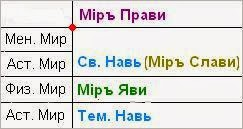

# Явь, Навь, Славь, Правь

**Явь** – это наш *физически плотный Мир*, мы его ощущаем органами чувств.

**Навь** – это незнакомая нам Явь, так называемый «*тонкий Мир*». Но славяне разграничивали Навь на Светлую и Тёмную: в Светлой Нави наши Предки, а в Тёмной – бесы. Схематично, Тёмная Навь снизу, Светлая Навь сверху, а Мир Яви как рубеж. Раньше Предков славили, поэтому Светлую Навь называли ещё Мир Слави, а Тёмную просто Навь.

**Славь** – это Мир Предков (*Светлая Навь*). Но в отличие от современной системы, в славянской Светлая Навь охватывает и Астральный и Ментальный Миры, а уже над ним Мир Прави.

**Правь** – это *Мир Богов*.

> Поэтому:  
> Явь – Мир людей и живых существ.  
> Навь – Мир Духов и Бесов.  
> Славь – Мир Предков и Покровителей.  
> Правь – Мир Богов.

## Современная структура Миров

Сравним современную (слева) и Славяно-Арийскую (справа) структуру миров. В современной системе выделяют три Мира: Физический, Астральный и Ментальный. Сегодня не любят говорить «Явь» или «Явный Мир», привыкли говорить **Физический Мир**, то есть физически плотный. Следующий - **Астральный Мир** – это Звёздный Мир (от греч. «астери» – звезда) - это Мир меж звёзд, т.е. разряженный. Наш Мир более плотный, а там более тонкий. Поскольку Астральный Мир вокруг физического, то схематично изобразим его сверху и снизу Физического Мира. Выше Астрального - **Ментальный Мир**, его ещё называют заоблачным или Божественным.

На этом современная система заканчивается, потому что за основу взяты всевозможные восточные методики, которые урезаны. Наши Предки, когда обучали другие народы, давали им знания в урезанном виде, упрощённые, поэтому Вышнее они не знают. Допустим, в буддизме, синтоизме, индуизме и т.п. когда человек доходит до верхней точки (граница ментального мира; см. рисунок), для него начинается **Мир Нирваны**… и дальше ничего нет. Но если они не знают что дальше, это не значит, что там ничего нет. На самом деле их «высокий» уровень, это 3-й класс при 11-летнем обучении.

## Небо и Небеса

В руском языке образное обозначение даже похожих структур различно, поэтому есть Небо и Небеса. В таблице Тёмная Навь внизу, но это образно, на самом деле там Небо. Отличие в том, что **Небо – где нет Бога**, а в Мире Слави и Прави **Небеса – нет беса**.
