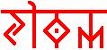

# Юджизм – мировосприятие славян

**Начало урока. Гимн обращения к Роду:**

> «Пращур-Род, Род Небесный! Укрепи сердце моё в Святой Вере, даруй мне Мудрость Предков моих, сынов и внуков Твоих. Даруй счастье и мир народам Твоим, ныне и присно и от века до века! Тако бысть, тако еси, тако буди!».

Этот гимн должен быть у вас в конспектах на обложке. То есть прочитали его, и только тогда уже можно познавать информацию. Он для того, чтобы нормально воспринимать то, что вы здесь будете изучать.

**Информация и знания - отличие.**  
Хочу сразу сказать, вы здесь не получаете знания, как многие думают, вы получаете определённую информацию, которая проходя сквозь ваше сердце, Душу, сознание, разум – меняет вас, становится образом жизни, и только тогда это становится знанием.

Если кто просто записывает, он будет просто как энциклопедический словарь, пришедший на «Поле чудес». Не зря же древние говорили: *«Мудрый не тот кто много знает, мудрый тот, кто знает нужное, и в этом разбирается»*.

## Что такое Юджизм

**Юджизм – это мировосприятие**. У наших Предков существовало особое восприятие мира, отличное от восприятия других народов. Чтобы понять Юджизм, надо научиться мыслить образно. Образ передаёт гораздо больше информации, нежели фонемика, жест или зрительно-слуховая информация.

**Мировосприятие отличается от мировоззрения** тем, что надо не только взирать на Мир, наблюдать его, но ещё и понимать. Кто поймёт структуру Юджизма, мировосприятие раскроется; кто поймёт не до конца, мировосприятие будет мировоззрением.

## Руническое обозначение Юджизма

Сами Руны, их начертание дают много информации, вызывают определённые образы.

**1.** Первая руна – **ЮДЖ** (она же ЙОГА, когда стоит отдельно). Направление в две стороны, как бы расширение сознания в обе стороны, но при этом объединяя. Т.е. руна «юдж» показывает две противоположные структуры. Вспомните восточно-китайскую структуру «Инь-Янь» - два противоположных действия. У славян эта система называлась «Ха-Тха». ХА – это положительная структура, ТХА – противоположная ей (не отрицательная, а противоположная, т.е. оставшаяся где-то ХА). Когда это всё соединяется, получается Ха-Тха-Йога – соединение двух противоположностей.

**2.** Следующий трёхрунник означает – **Истина Земного Мира**. Существует множество истин: прописные, родовые, природные, вселенские... а ЮДЖ - Истина Земного Мира.
