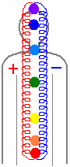

# Как кошки лечат людей?

**Кошки сохраняют энергетический баланс**, являются гармонизаторами.  
У человека два внутренних энергетических потока: положительный и отрицательный. Когда один поток начинает преобладать над другим, человек болеет. Кошка, как правило, ложится в основание (первая чакра), либо если нарушение в верхних чакрах, ложится на плечи, или если нарушение в районе 4 чакры, ложится на грудь. И кошка не забирает положительную или отрицательную энергию, а гармонизирует её.

Есть такой неправильный термин, что кошки забирают энергию - это бред, потому что кошка работает и живёт в одном частотном диапазоне, а человек работает в другом. **Кошка энергию не забирает, а гармонизирует** – пропуская через себя, она восстанавливает баланс. Поэтому, кошки всегда считались гармонизаторами, т.е. сохраняют одинаковый баланс между «плюсом» и «минусом». И одновременно, допустим, те же египтяне считали, что кошка – это страж Врат в потусторонний Мир; она как бы разделяет Мир Явный (Мир живых) и Мир умерших, т.е. как защитник и гармонизатор: не пропускает оттуда, чтобы здесь негативом не переполнилось.
