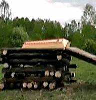
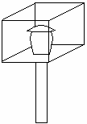

# Крода – погребальный костёр

**Крода** – это погребальный костёр, на котором происходит всесожжение тела умершего, чтобы его Душа легко поднялась в Небесный Мир, т.е. к-Роду. Пламя, это наиболее быстрый способ оборвать связь Души с телом.

При погребении тела (этот обряд к нам принесли христиане) остаются нити, которые связывают сущность человека с физическим телом, и полностью Душа освобождается от мёртвого тела только через год, когда завершается распад органики. А при сгорании, органика расщепляется быстро и **Душа сразу освобождается от мёртвой оболочки**. Наши Предки прекрасно знали, что происходит с Душой, поэтому погребение называли глупостью:

«Вы, арабы, глупы. Вы берёте самого любимого вами из людей и самого уважаемого вами и оставляете его в прахе, и едят его насекомые и черви, а мы [русы] сжигаем его во мгновение ока, так что он немедленно и тотчас входит в рай»  
*«Записки» о похоронах русов, Ибн Фадлан - арабский путешественник Х века.*

## Курган

После кремации тела на Кроде **пепел собирали в домовину** (сейчас называют урной), а оставшийся пепел рассыпали над полями этого Рода. Затем делали следующую конструкцию: столб, на нём набита площадка, на площадке 4 столбика, в центре домовина и рядом зажигали огневицу. У центрального столба размещали вещи необходимые для следующей жизни. Затем на 4 столбика надевалась крышка, и сверху всё покрывал белый плат, который полностью закрывал квадрат с домовиной, опускался ниже подножья. Все родственники брали горсть земли и бросали, получался курган, который полностью скрывал всю утварь, всё, что было пожертвовано. Рядом или сверху ставили поминальный камень. Т.е. могилу покойного засыпали только руками, и до наших дней сохранилась традиция бросать горсть земли в могилу.

Курганы делались на погосте, рядом стоял Куммир Рода, и череп который оставался от кремации (потому что кость более плотная) ложился рядом с другими черепами у этого Куммира. Там же горел огонь и приносились требы, дары. Рядом, если это был воин, **устраивалось представление** - прошлые бои, в которых он участвовал, т.е. как бы Богам показывали, как он побеждал врагов. Потом накрывались столы и поминали умершего.

## Погребальная Ладья

Или делали погребальную ладью, на которой было всё необходимое умершему. Если дети уже были взрослые, то на ладью также входила и жена, т.е. оставалась со своим мужем. Потом лучники зажжёнными стрелами поджигали ладью, и она с мужем как бы уносилась на этой огненной ладье в Сваргу. Если оставались малые дети, т.е. жена должна была заниматься детьми, то по желанию любая женщина могла взойти вместо жены на ладью, чтобы умершему не скучно было дожидаться, и уйти в Высший Мир. Перед тем как взойти на ладью, жене давали специальный напиток, она засыпала, чтобы для неё это всё происходило безболезненно.

После того, как эти обряды увидели индусы (как у арийцев сами женщины всходили на погребальный костёр или ладью), они чтобы уподобиться белым Богам ввели это и у себя, но в обязательном порядке, т.е. муж умер, жена обязана идти на погребальный костёр. До этого индусы прятали умерших в пещерах, замуровывали.

## Заповеди о Кроде

**Заповеди Стрибога:**  
\* Да не оскверните вы тленом своим Святу землю Предков ваших, коия полита Кровью и Потом Дедов ваших.  
\* Облегчайте уход близким вашим через Кроды Великие и Лодьи просторные, дабы могли Души близких ваших с дымом Кродным подняться во Сваргу Пречистую к Предкам вашим.

**Заповеди Одина:**  
\* Каждый умерший должен отправляться в Небесный Мир на Огненном Корабле или через Великий костёр Кроды, и добро его должно возноситься на Корабль или Кроду. Ибо каждый должен прийти в Волхаллу с тем добром, которое было с ним на костре, и пользоваться тем, что сам закопал в Землю.  
\* Пепел умершего надо бросать в воды реки или моря, или собрав в кувшин, зарывать в землю, а в Память о Ведающих людях необходимо насыпать курган, а по всем Стоящим людям надо ставить Памятный Камень.

*\* Корда*

«Не оскверняйте и не отравляйте, Вы, тленом людским Святую землю Предков Ваших, погребая умерших близких своих в ямы земные, как это сотворяют язычники. А сотворяйте для умерших близких своих, Кроды великие и Лодьи просторные, соединяя всех умерших своих с Чистым Священным Огнём» - Волхв Велимудр.

\* Похороны (ритуалы славян)  
\* Обряд Крода
