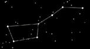

# Крошечка-Хаврошечка (смысл сказки)

Вспоминаем, в чём суть сказки «Крошечка-Хаврошечка» - осталась девочка сиротой, и была у неё любимая корова, когда Хаврошечке что-либо надо было, она влезала в левое ушко коровы, а в правое вылезала, и получала всё, что ей было необходимо.

Такая большая девочка и может лазить по коровьим ушам, что-то здесь не так. Речь идёт о **Небесной Корове Зимун** (созвездие Малая Медведица). Четыре Звезды этого созвездия образуют квадрат, который и назывался «коровье ушко». Но в сказке ведь не будут писать: «Девочка прошла Врата Междумирья, направленные на коровье ушко». В сказке всё пишут образами. То есть Хаврошечка через Врата Междумирья проходила к Дажьбог-Солнцу к Земле Ингард, к Предкам (она всё просила у мамы, а мама – это как образ коровы Зимун, прародина Предков). После общения с Предками девочка выходила уже через другое «ушко», в другом месте по движению Звёзд, и пробиралась домой. Т.е. она постоянно общалась со своими Предками - при входе использовала один Чертог Сварожьего Круга, а после посещения, через другой Чертог спускалась на Мидгард-Землю.

У мачехи было три дочери: **Одноглазка, Двуглазка, Трёхглазка**, и чтобы Хаврошечке пробраться домой, она говорила: «спи глазок, усни глазок». Первая и вторая дочери ничего не заметили, а когда следила третья дочь, Хаврошечка не учла, что у неё третий глаз – **энергозрение**, и она даже в спящем состоянии это всё уяснила и поведала. После чего, в сказке корову зарезали. Но Хаврошечка мяса не ела, закопала косточки, и выросла на этом месте яблоня (или в другим варианте – берёзка), а это тоже родовой Образ: когда рождалась девочка – садили берёзку, если рождался мальчик – садили дубок. И дети росли между деревьев, получали от них силу. Поэтому, если где-то в военном походе сына ранили, родители видели по состоянию дерева (начинало сохнуть), что с сыном беда. Родители начинали ухаживать за этим деревом, подкармливать его, лечить, и в результате дерево расцветало, сын поправлялся. Также поступали и с берёзкой. Если дочка где-то заболела, у берёзки ветви поникли, тогда её подкормили, ветви подвязали, полили, и берёзка стала себя лучше чувствовать, и дочке полегчало.

Т.е. **в современной сказке объединили несколько древних сказов**. Чтобы понять древние сказы и смысл заложенный в них, необходимо отказаться от современного мировосприятия и взглянуть на мир глазами людей живших в древние времена, в те времена, когда и появлялись сами сказы. Ключом к настройке на древнее восприятие являются неизменные образные корни той или иной сказки.
