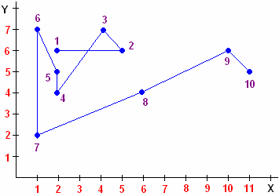

# Как определить направление молитвы?

1. Пример молитвы  
2. Молитва к Иисусу Христу — созвездие Рыбы  
3. Можно ли придумать свою молитву?

Речь – это вибрация, она имеет направление. Каждое обращение к Богу (молитва) идёт в определённый участок Звёздного неба. Чтобы узнать куда направлена молитва, надо объединить слова попарно и посчитать количество букв. **Каждая пара слов – это координаты Х и Y**. На системе координат отметить точки и соединить их между собой - показать от какой Звезды к какой идёт направление энергии, потому что энергия идёт не прямо (мы уже это разбирали, см. Голосовая речь человека). Если есть повторяющиеся цифры в одной точке - обведите кружком. В результате получится определённое Созвездие и конечная точка, т.е. Земля к которой пришла молитва.  
  
Поэтому всегда говорили – нужен Образ, к кому мы обращаемся, т.е. сосредоточиться. Для этого наши Предки делали Куммиры и Образа, чтобы лучше настраиваться. Христиане переняли эту традицию: западные стали делать статуи, а восточные - иконы.

## Пример молитвы

«Ей, святче божий, услыши насъ молящих ся тебе съ верою и любовию, и не презри насъ, требующихъ твояго заступления. Аминь».  
\* Ся – это форма «себя», поэтому пишется отдельно (молящих ся = молящих себя).

Раскладываем слова попарно и считаем буквы. Первая пара - «Ей святче» (Х=2, Y=6). Отмечаем точки на системе координат (см. выше).

Для примера взяли христианскую молитву, но можно любую (славянскую, христианскую, иудейскую, мусульманскую и т.д.) все они строятся по одному принципу. Как правило, славянские гимны не идут в те созвездия, в которые идут христианские, мусульманские, индуистские... То есть наши в основном идут в Сваргу, а те в восточную сторону.

## Молитва к Иисусу Христу - созвездие Рыбы

. Ихтис - акроним имени Иисуса Христа")Молитва к Иисусу Христу на арамейском языке показывает **созвездие Рыбы**. Поэтому по-гречески имя Иисуса – ИХТИС (рыба), и символ первых христиан (вернее назарян) - рыба, и кормил Иисус их рыбой и называл рыбаками, и они его называли «великим рыбаком». А современное христианство - это паулеанство (Павел создал, он же Саул), и символ у них не рыба, а крест.

## Можно ли придумать свою молитву?

Нет, потому что всё уже давно придумано (всё новое – хорошо забытое старое). Даже если сейчас что-нибудь придумать и молитва дойдёт, там никто её не поймёт, потому что современный советский язык отличается от славянского. Если вам рассказать сказку на китайском языке, вы её поймёте? Нет. Вот и наши Предки не поймут современную молитву, потому что к ним надо обращаться на родном языке, а не на советском.
