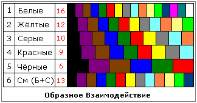

# Образное Взаимодействие между народами

Мы уже разбирали, что у народов различное количество каналов (см. энергоновая система): у белых 16 каналов приёма информации, которыми они могут пользоваться одновременно (16-тиэнергоновый уровень), у жёлтых 12 каналов, у серых 10, у красных 9, у чёрных 6. И каждому народу этих каналов достаточно для существования в Мире Яви. Различие в количестве каналов абсолютно не говорит, что этот хороший, а этот плохой. Нет, это говорит о том, что **каждому народу дана своя система жизни**, своя система выживания. В соответствии с этим и построен Образ.

## Таблица: Образное Взаимодействие

Для наглядности составим таблицу, где разными цветами обозначены каналы, и сразу видны различия. Таблицу можно продолжать смешанными народами, но приведём только один такой пример (смесь: Белые с Серыми = 13 каналов).

**\* Расстояние от первого до последнего канала** у всех одинаковое – это жизнь человека, т.е. показывает плотность получения информации за единицу жизни. Допустим, на том участке, где у белых 3 канала, у серых там только 2, т.е. разная плотность получения образов. Белые получают образы одновременно по 16-ти каналам, чёрные по 6-ти. Поэтому белых и называют Созидателями (см. Философия Духа разных народов).

**\* Ширина канала** не означает больше объём информации, это плотность. Допустим, по второму каналу мы получили некий Образ, информацию, она нам понятна, мы не зацикливаемся на этом. А у чёрных плотность-то образа широкая, информации может и не много, но пока он развился в 1-ом чёрном канале, пока он осмыслит образ из 2-го канала… Т.е. понятно? Здесь и длительность образа, и разрежённость, и время на его обдумывание. Поэтому Образ, Образное восприятие разные, значит и отношение к природе, к окружающему миру тоже различное.

**\* Цвет каналов** одинаковый у всех народов (1-й канал – чёрный, 2 – фиолетовый, 3 – коричневый и т.д. Но это лишь пример, сам цвет значения не имеет). Тогда хорошо видно, что народы совершенно разные, получаемые Образы, энергии не совпадают. Цвет показывает, что получаемые Образы по этим каналам лишь схожи, но разные по качеству. Допустим, по 5-у каналу получили информацию о деревьях, но у нас это дуб, берёза, клён и т.д. они нам понятны. А чёрные народы не знают сибирского кедра, берёзы, у них пальмы, баобабы, лианы. Когда мы говорим «деревья» – все их представляют по-своему, но образ: там – древо, и там – древо. Также если мы говорим «пища» - мы подразумеваем то, что употребляем в пищу, но у них она своя. И то, что хорошо в питании для нас, это не обязательно хорошо в питании для них, и наоборот. Чужой едой можно отравиться, или организм не получит витаминов из чужой пищи, а если её постоянно есть, будешь сытый, но больной. Поэтому не забывайте, каждый родился в определённых геомагнитных точках (даже среди одного народа), значит и образную энергетику мы получаем в соответствие с нашей системой индивидуально, и то, что полезно одному, не обязательно полезно для кого-то другого. Пример: обливание холодной водой будет полезно тем, кто родился под водным знаком, а кто родился, допустим, под огненным знаком, может и заболеть.

Поэтому, когда в школе, в СМИ говорят, что все люди одинаковые независимо от цвета кожи – это бред. На низших уровнях действительно все почти совпадают, есть общее, похожее, потому что мы все живём на одной Земле (планете), поэтому у нас есть общие структуры, но только внешние. А что касается Духовных, Душевных систем, то есть последние каналы, они у белых с другими вообще ничего общего не имеют, и по таблице это хорошо видно, **чем дальше по развитию, тем больше расхождений**. И раз меньше совпадений, значит меньше образных взаимодействий, поэтому белые всегда созидали, развивались своим путём. И когда говорят об «общечеловеческих ценностях» - это не совсем понятно о чём, просто словоблудие; нельзя скрестить ужа и ежа (в принципе конечно можно, получится колючая проволока). Или как современная пропаганда - все одинаковые, поэтому могут между собой перемешиваться. Нет. Пример перед глазами – «система 13» (смешение белых с серыми), тут уже идут системы расхождения, т.е. и энергии мы получаем совершенно другие. **При смешении портится чистота вида**. Хотя для народов с малым числом каналов иногда выгодно смешиваться, тогда у результата смешения будет больше каналов. Но если система смешения перейдёт в качающуюся частоту, т.е. в нестабильную, непостоянную – это уже система разрушения, поэтому, вот у этих нестабильных систем, типа «13-ой», самая высокая смертность при рождении, высокий процент суицида, и самый высокий процент сумасшествия на 1000 человек.

## Выводы

**1**. Каждый народ развивается самодостаточно в своей собственной среде, имея при этом Образные Взаимодействия с другими народами на первоначальных уровнях.  
**2**. То, что свойственно одному народу и приносит ему благо, не обязательно подходит другому народу, ибо оно может принести ему вместо блага горе.  
**3**. Единственная общечеловеческая ценность, как вывод отсюда, это Жизнь на Земле. Т.е. я не сказал: жизнь белых, жёлтых, жизнь деревьев, собак, тараканов и так далее, а вообще – Жизнь. Вот эта Жизнь на Земле - это единственная общечеловеческая, общебожеская, вселенская ценность.

Поэтому изучать жизнь, структуру и образ жизни других народов для взаимодействия с ними не только можно, но и нужно. Но это не значит, что надо принять чуждое себе за основу и отречься от своего родного.

Кроме того, мы разобрали Образное Взаимодействие между различными народами, но точно так же надо учитывать и взаимодействие между человеком и животным миром, растительным и пр. для каждого народа. Т.е. на прошлом уроке (см. Единая Система) вы узнали, что каждый народ имеет свой Дух, свою Душу. А также и Мать Сыра Земля имеет свой Дух, свой Образ, система Ярилы-Солнца имеет свой Дух, и соединение всех этих Образов между собой порождает **Образное Взаимодействие**, это взаимодействие Образов порождает образные связи, и одно без другого как бы не существует. Т.е. между всем существующим в Яви есть взаимосвязь, и события, которые происходят с одной образной структурой, так или иначе через Взаимодействие влияют на другие образные структуры.
