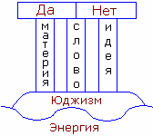

# Плоская Земля (Земля на трёх слонах) – значение

**Плоская Земля – это плоское суждение человека**. Люди мыслят дуально, категориями ДА или НЕТ. Но заметьте, у славян понятие «ду» означает не конкретное число 2, а «два и более» (пример: слово «раДУга» означает - 2 и более сияющих путей). Точно также и **дуальное мышление** (2 и более) - мы видим две основы Да и Нет, но между ними ещё: возможно, конечно, приблизительно и т.п. до безконечости.  
Плоская Земля – это дуальная структура восприятия.

Каждый человек на этой Земле получает знания от одного из трёх слонов.

## Три Слона

**Три Слона – это символы трёх Миров**, трёх мировоззрений, трёх форм жизни...

**1-й слон – материальный мир**. Его основа – материя.  
**2-й слон – идеализм**. Его основа – идея, мысль. Т.е. это мир всевозможных образных планов.  
**3-й слон – мистицизм** или трансцендентный мир. Его основа – слово, т.е. материализованная идея. Трансцендентный мир составляет как бы дополнение двум слонам, потому что одно без другого не бывает. Мистика – это мудрость истинного слова, так как материализовать мысль (идею) можно через слово.

Три слона (материализм, идеализм, мистицизм) - это основные формы мировосприятия. При этом материализм и идеализм стараются очернить, затмить мистицизм, сказать, что его не существует, хотя оба пользуются его услугами.

У нас только трёхмирье, трёхточье, три формы существования. Примеры:  
\* Семя – древо – плод  
\* Икринка – головастик – лягушонок  
\* Гусеница – кокон – бабочка  
\* Человек – Душа – Дух

Слоны получают информацию от Черепахи.

## Черепаха и Океан

**Черепаха – это Юджизм - мировосприятие**.  
Информацию Черепаха черпает из *Океана безграничного Знания и абсолютной Истины*. Этот Океан – Энергия. **Всё есть энергия**: свет, информация – это энергия. Материя - это плотно концентрированная энергия, во всех её проявлениях. Идея, мысль - это энергия, снабжённая информацией, или энергетический образ. Поэтому основа Юджизма – Энергия.

\* «Плоская Земля покоится на трёх слонах. Слоны стоят на черепахе. Черепаха плывёт в безграничном океане» - это единственно верная и правильная модель строения Земли.
