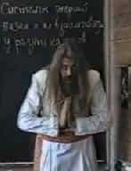
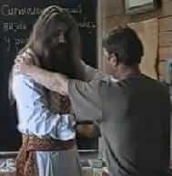

# Приветствие у разных народов

Приветствие – это одна из систем взаимосвязи энергий у людей.

**Рукопожатие**. У серых народов передача энергии шла через выходы каналов на ладонях, поэтому они здоровались за руку (рукопожатие). Т.е. активизация только одного канала на ладони, от одного к другому. При этом они как бы чувствуют у белых энергию более высшего плана, поэтому здороваются иногда на полурукопожатии, то есть не всей ладонью, а пальцами обхватывают.

**Приветствие за предплечье**. У белых народов (РАСА) была другая система взаимодействия, наши Предки рукопожатием не здоровались, они здоровались за предплечье. Т.е. шёл охват, активизация сразу по всем каналам излучения на руке до локтя. И плюс ещё сравнивали вышитую Родовую обережь на рукаве на запястье, по которой определяли к какому Роду-Племени относится человек, братский это Род или чуждый.

**Приветствие в виде поклона**. У многих народов вообще не принято рукопожатие, у них приветствие в виде поклона. Т.е. они соединяют два центра на ладонях между собой, как бы зацикливаются внутри и всё. Но чтобы получить энергию от другого человека, при этом синхронизировать её со своим ритмом, допустим, как здороваются индусы с духовным учителем? Идёт духовный учитель, он на лестнице духовного развития стоит на несколько порядков выше, поэтому индусы припадают к земле и руками прикасаются к стопам учителя. Тоже самое индусы и многие другие восточные народы делают по отношению к своим родителям. Т.е. встали на колени и прикоснулись к стопам родителей, как бы проявляют к ним дань уважения, и синхронизируя свою внутреннюю энергию духовного развития и внутреннего состояния, т.е. энергию жизни, с энергией жизни родителей. Т.е. по любому они старше, поэтому так и синхронизируют.

А у белых совершенно другая система, **у нас все равны**. Даже чтобы обратиться к ребёнку, позвать его, белый человек присядет на корточки, т.е. обратится как к равному: «иди сюда, маленький». Т.е. в этом Мире Яви мы все на одном уровне, наш внутренний мир – это наш внутренний мир, мы его синхронизируем через общение с другими на равных. Вспомните, как проявлялось, что мы находимся как бы на одной вибрации? Встретились с родственниками, которых давно не видели, и объятие, трёхкратный поцелуй, т.е. синхронизация жизненной энергии идёт на верхних уровнях. Поэтому взаимодействие и происходит у белых на высших уровнях, у жёлтых уровень поменьше, у серых ещё меньше, у чёрных ещё меньше. Но заметьте, красные стоят вровень с белыми. Потому что у них свой уровень синхронизации, т.е. они не целуются, а как эскимосы носами трутся – «**эскимосский поцелуй**».

**Закольцованность**. Одну из форм синхронизации на высших уровнях мы уже разобрали – белые здоровались за предплечье. А была дополнительная полная синхронизация – это закольцованность. Т.е. правые руки соединяют за предплечья, а левыми берутся за плечи, т.е. левая рука – принимающая, поэтому идёт на излучающую плечевую чакру с правой стороны. И получается закольцованность. Посмотрите на руки, между двумя человеками получилась перуница (молния), т.е. идёт энергетический разряд, как бы синхронизирующий. И это даёт уравновешивание. Допустим, вои – дружинники, вот так друг друга поприветствовали (за предплечье и плечо), многие говорят: «они прощаются перед битвой». Ничего подобного, никто не собирается умирать. Они, таким образом, синхронизируя, как бы вошли в одну амплитуду, чувствуют друг друга. Т.е. поприветствовали, синхронизацию сделали, и всё - чувствуют другого, знают, что его соратник будет защищать его жизнь, того будет защищать другой и т.д. (см. принцип кулака) - никто не думает о своей жизни, потому что знает, что его соратник, которому он доверил свою жизнь, будет его защищать; они все синхронизировались. Заметьте, любой мужской танец, который сохранился с древних времён, воинские хороводы, воинские пляски вкруг, там везде руки лежат на плечах друг друга – вот это идёт синхронизация. Поэтому и могли, как говорят: налево махнул – улочка, на право – переулочек. Потому что он использует не только свою силу, но и силу своих соратников, ведь они синхронизированы, и плюс перед боем проходят обряд, т.е. полностью находятся под властью и поддержкой наших Богов. Поэтому и говорили: это идёт Дружина Перуна, эта Дружина Велеса, эта Дружина Сварога, эта Дружина Семаргла, т.е. каждый подпитывается ещё и вышней системой. Вот эти системы они все синхронизированы, и они ведут человека к дальнейшему развитию.
