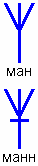

# Руна Ман и Манн

**Руна МАН** означает – **человек живущий, познающий окружающий мир**, т.е. мир Яви. Сегодня человека обычно рисуют с опущенными вниз руками - такой рисунок означает: человек только что рождённый, или «*идущий*». Человек «*живущий*» изображался с руками, разведёнными в стороны и вверх. Т.е. руки не перед собой, как у молящих: «дайте что-нибудь покушать», а в стороны, руки воспринимающие.

**Руна МАНН** (перечёркнутая) означает, что человек не только познал этот мир, он и ушёл **за грань понимания**. Вторая «Н» означает Навь, т.е. запредельный мир.

## МАН - человек в Яви, МАНН - человек в Нави

Руна МАН – человек в Яви, в явном мире, а МАНН – человек в Нави, ушёл за Поднебесную. Эти символы использовались издревле. Допустим, на памятных камнях очень часто изображалась руна МАНН, и не только у славян и скандинавов, но и в Индии, Тибете, как символ ушедшего за Поднебесную.

Кстати после экспедиции Ананербе в Тибет, в Гималаи, было принято на кладбищах СС ставить вместо крестов такие символы, т.е. **символы вечной жизни** (так их называли).
