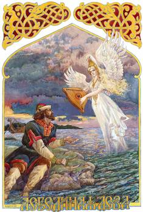

# Русалка – это дева-птица

Последнюю тысячу лет славянские образы в сказках искажают, одним из таких примеров является Русалка. Все ссылаются на произведение Ханса Кристиана Андерсена «Русалочка», в этом произведении говорится о девушке с рыбьим хвостом. Но кто-нибудь видел это произведение в оригинале - где там написано, что речь идёт о Русалке? Там совсем другое слово, просто «наши» переводчики решили назвать девушку с рыбьим хвостом Русалкой. А на самом деле **Русалка – это дева-птица** (или как христиане рисуют – ангел женского рода с крылышками). Даже Пушкин писал: «Русалка на ветвях сидит», не на камнях у берега, а на ветвях, и волосы у неё русые, а не зелёные, как в произведении Андерсена.

**Рус-АЛ-ка – это русая мудрая дева-птица**. Понятие «АЛ» сохранилось в английском языке «all», означает «всё», т.е. «АЛ» - это полнота, всё что принято в себя, т.е. Мудрость. Поэтому Русалки – это мудрые девы, которые прилетают что-то подсказать, посоветовать, поведать мудрость Предков.

## Мавки - девы с рыбьим хвостом

Андерсен описывал не Русалку, а **Мавку – зеленоволосую деву с рыбьим хвостом**. Мавки по одним преданиями, это дочери Водяного, по другим, помощницы Водяного - это хранитель водоёмов, рек, озёр и болот (хотя у болота, там ещё свой Болотник был, и Кикиморы в лесных болотах).

Так вот, Мавки - по одним преданиям, это помощницы Водяного, а папа у них Ний – Бог морей и океанов. Иначе его ещё называли «Морской царь», уже в последующем, когда убирали выражение «Ний», допустим: «Из моря Ний выходит в туне», вот «Ний в туне» латиняне перевели как «Нептуний». А раз океаны давали жизнь рекам, а «река» по-гречески, одна из форм была «Дон» - «Посей-Дон», то есть «посеял реки». Мавок было множество, но восемь из них были самые главные Мавки – это дочери Бога Ния, они смотрели за порядком в морях и океанах.
