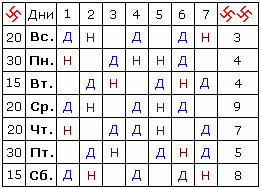

# Сивиллы Правды (таблица предсказаний)

**Сивиллы Правды** – это таблицы, по которым славяне просчитывали ответы на вопрос, на определённый день недели. Допустим, спрашивали произойдёт ли в понедельник то или иное событие, и по таблице вычисляли ответ: «да», «нет», «возможно». Пример: «Будет ли дождь?» или «Придут ли ко мне гости?», т.е. если собрались ехать куда-то на торжище использовали таблицу, чтобы не получилось: вы уехали, а гости пришли.

\* Когда инородцы увидели, что это имеет под собой действительную основу, таблицы предсказаний начали использовать греки, вавилонцы, персы, египтяне, евреи и другие народы, но всё идёт от нас.  
\* Здесь приведён современный вариант таблицы, т.е. под семидневную неделю и советский алфавит, чтобы понять сам принцип, чем пользовались наши Предки.

## Буквенный код

|  |  |  |  |  |  |
| --- | --- | --- | --- | --- | --- |
| А – 1  Б – 9  В - 2  Г – 70  Д – 400 | Е – 200  Ж – 8  З – 30  И – 6  К – 60 | Л – 30  М – 5  Н – 50  О – 80  П – 4 | Р – 100  С – 3  Т – 20  У – 40  Ф -7 | Х – 150  Ц – 500  Ч – 15  Ш – 90  Щ – 250 | Ь Ы Ъ – 0  Э – 25  Ю – 220  Я - 350 |

**Вопрос записывается вертикально** и напротив каждой буквы записывается её цифровое значение, все цифры складываются, и после этого с полученным многозначным числом производится х’Арийское сложение (допустим, получилось 2928, теперь надо сложить эти цифры 2+9+2+8 = 21). Если полученное число больше 7, то из него вычитается 7, пока не получим число равное или меньше 7.

**Два постоянных числа: 150** и **40** (в таблице они обозначены свастикой: 150 (+) и 40 (++). Эти цифры нужны, если вопрос задаётся не на конкретный день, а вообще, тогда вместо цифр дня подставляются крайние числа в таблице, а ответ ищем в той графе, в какой день недели гадаем. Т.е. будем складывать = Число Вопроса + 150 + 40.

**Пустой квадрат в таблице** означает: несбыточность, препятствие, невозможность, сомнение в том, о чём задан вопрос.

## Сивиллы Правды - правила

Таблица предсказаний помогает получать ответ на свой вопрос. На Руси пользовались Сивиллами Правды с осторожностью, и очень редко, чтобы не испытывать судьбу. Считалось, что **лучше всего обращаться к Сивиллам Правды утром**, когда встаёт Ярило-Солнце, и при этом необходимо соблюдать 7 правил:

**1**. Вопрос должен быть точным, немногословным, и состоять по возможности из кратких слов, чтобы не ошибиться в сложении цифр.  
**2**. Один и тот же вопрос не задавать дважды, не гадать дважды об одном деле, иначе гадание будет неверным.  
**3**. Соблюдать русскую орфографию.  
**4**. Записать буквы вопроса в столбик и записать цифры из азбуки Сивилл; сложить их в сумму, затем сложить цифры в этой сумме, из полученной второй суммы вычесть семь или цифры кратные семи. Необходимо, чтобы в ответе всегда было число меньшее, либо равное семи.  
**5**. Взять из таблицы под одной свастикой (+) число дня, на который задаётся вопрос (не путать с днём, когда задаётся вопрос). Написать это число над остатком. Под остатком пишется двухсвастичное число (++). Далее сложить все числа в одну сумму. В полученной сумме сложить цифры между собой и из неё вычесть число семь, либо число кратное семи, остаток пометить для себя.  
**6**. По полученному остатку найти в таблице ответ на свой вопрос: Да или Нет.  
**7**. Если выпадает пустой квадрат, то это явная несбыточность.

## Пример

\* Сумма вопроса получилась 1397, складываем эти числа (1+3+9+7) = 20.  
\* Отнимаем от 20 число кратное семи, т.е. 14, получаем (20-14) = 6.  
\* Прибавляем число дня, на который гадаем, допустим: суббота, значит к 6 добавляем 15 и 8, т.е. (6+15+8) = 29.  
\* В полученной сумме надо сложить цифры между собой и вычесть 7 или кратное 7, т.е. (2+9)-7 = **4**. Находим по таблице в верхней строке цифру 4, и по этому столбцу смотрим Субботу – ответ «Да».  
Быть Добру!
