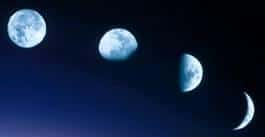

# Сказка «Колобок» – это Луна

Сказка «Колобок» рассказывает о природном явлении, как **Луна катится по Созвездиям** (в славянском «зодиаке» названия: Вепрь, Ворон, Медведь, Волк, Лиса и т.д. – Сварожий Круг). В каждом созвездии (Чертоге) Луна становится меньше, т.е. Вепрь откусил, Ворон отклевал, Медведь примял, а когда остаётся серпик, Лиса его съедает и наступает новолуние. С помощью сказки «Колобок» детям показывали созвездия, наблюдали как Луна (колобок - «коло» - круглый бок) катится через эти созвездия, и образно у неё откусывают бок. Так дети изучали звёздную карту неба. Удобно и наглядно.

## Славянская сказка «Колобок»

> Попросил Дед Тарх Дживу испечь Колобок.  
> Она по амбарам по Сварожьим помела,  
> По сусекам по Чертожьим поскребла,  
> Слепила Колобок, испекла и на окошко Рады стыть положила.  
>   
> Пошёл Звёздный дождь, опрокинул Колобка,  
> Покатился он по Перунову пути, да по древнему пути:  
> Вепрь кусочек откусил, Ворон отклевал,  
> Медведь бок примял, Волк часть съел,  
> Пока Лиса совсем не съела.

Затем цикл повторяется, вновь Джива испекла Колобок и положила в Чертоге Рады – полнолуние, Колобок покатился по древнему пути (по Сварожьему Кругу), и как только Колобок вступает в Чертог Вепря, кусочек от него откусили, затем Ворон отклевал и т.д.
