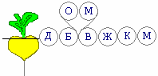

# Сказка «Репка» (славянский смысл)

«**Сказка про репку**» указывает на взаимоотношения поколений, указывает на взаимодействие временных структур, форм жизни и форм существования.

**Репка** как бы объединяет земное, подземное и надземное - три формы жизни, три структуры. Т.е. земля дала свою силу, через вершки репка получает солнечную энергию, и подходит дед, начинает тянуть репку (достояние Рода, которое он посадил). Но он ведь не для себя посадил, а для своего Рода, поэтому начинает звать бабку, но вытянуть не могут, зовут (отца, мать) внучку, опять не получается, внучка зовёт жучку, жучка кошку, кошка мышку, и только тогда вытянули репку.

## Отец и мать — почему их нет в христианском варианте

В сказе не хватает двух персонажей – отца и матери. Почему христиане сделали обрезание сказки, оставили 7 элементов?  
**Во-первых**, в христианстве всё построено на семеричности (7 – это сакральное число в христианстве). Точно также христиане сократили славянскую неделю: было 9 дней, стало 7. У славян круговая или девятеричная система, у христиан семеричная.  
**Во-вторых**, у христиан защита и опора – это Церковь, а любовь и забота – Христос, т.е. как бы вместо отца с матерью, ведь обряд крещения смывает связь с отцом и матерью, и устанавливает связь между ребёнком и христианским богом. Т.е. отца с матерью почитают только за то, что они родили, и всё!

## Образы

**1. Дед** – мудрость (самый старший, он посадил и вырастил репку, т.е. достояние Рода, и посадил не для себя, а для своего Рода).  
**2. Бабка** – традиции, хозяйственность.  
**3. Отец** – защита и опора.  
**4. Мать** – любовь и забота.  
**5. Внучка** – потомство.  
**6. Жучка** – достаток в Роду (собаку заводили, чтобы охраняла достаток).  
**7. Кошка** – благостная обстановка.  
**8. Мышка** – благосостояние (т.е. в доме есть пища и пр., иначе как сейчас говорят: «в холодильнике мышь повесилась»).  
**9. Репка** – сокровенная мудрость Рода, достояние Рода. Репка в земле – намёк на связь с Предками, а хранится достояние Рода, Мудрость, как правило, в голове, отсюда выражение «*дать по репе*», чтобы мозги сработали, мудрость вспомнил и не делал зла другим.
