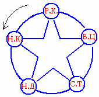

# Сказка о рыбаке и золотой рыбке (философия)

Философский смысл «Сказки о рыбаке и рыбке» можно подвести к древней мудрости:

> «**Кто меньше всех возжелает, тот больше всех обретёт**. А обретёт сколько захочется тот, кому захочется наименьшего. А стало быть, и богатство лучше исчислять не мерой поместий и прибыли, но мерою Души человеческой» - *Апулей (древнеримский писатель, философ, ритор)*.

По сюжету сказки у нас получается *звезда*, данный символ – жизнь человеческая, т.е. ничего не даётся на халяву, всего надо добиваться своим трудом, или останешься у разбитого корыта.

РК - разбитое корыто  
НК - новое корыто  
НД - новый дом  
СД - столбовая дворянка  
ВЦ - вольная царица

## Сказка о рыбаке и золотой рыбке

**1**. Жили старик со старухой **30 лет и 3 года**. Образом числа 33 у нас очень много чего выражается – это и Мудрость и Заповеди и пр. (см. Священные числа).

**2**. Старик трижды забросил невод, и третий вытянул с золотой рыбкой, она взмолилась, просила, чтобы старик отпустил её, тогда получит всё что пожелает. Но старик просто отпустил золотую рыбку, не прося награды. Вернувшись домой, старик рассказал о произошедшем старухе, та удивилась и обругала старика, заставила вернуться к морю и потребовать у золотой рыбки **новое корыто**.

**3**. Когда человек получает что-то не вкладывая в это свою Душу, свой труд, эта халява начинает портить человека. Дальше старуха начала требовать **новый дом**. Но и этого ей мало, надоело быть вольной крестьянкой, хочет быть **столбовою дворянкой**. Затем **вольною царицей**, т.е. получила власть, слуг гоняет, охрана у неё и пр. А источник своего обогащения (старика) вообще послала служить на конюшню.

**4**. Затем старуха захотела стать владычицей морскою, и чтобы золотая рыбка была у неё на посылках. В результате осталась старуха **у разбитого корыта**.

Мораль: кто хочет всё получить на халяву, вернётся к исходной точке, т.е. будет сидеть у разбитого корыта.
