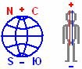

# Спать надо головой на север

Мы уже разобрались с энергопотоками (см. Энергетические потоки): один поток идёт наверх, другой нисходит вниз, т.е. происходит взаимообмен. Так вот, **чтобы взаимообмен был нормальный – расположение человека во время сна должно быть адекватным, одинаковым с Природой**. Духовная энергия (т.е. Небесная) у нас вверху, ставим здесь как бы знак «+», а внизу у нас Природная энергия (Земная), её почему-то любят как противоположным потоком означать, ставим здесь знак «-». Поэтому когда что-то касается нижних чакр, говорят: «Думает на низменном уровне, на уровне земли»; а когда человек верхними чакрами думает, говорят: «Куда-то всё в Небеса забрался».

Южный полюс у нас внизу, Северный полюс вверху, поэтому и располагать человека надо так – **головой на север**, т.е. человек будет повторять те же энергетические процессы, он будет в гармонии с Природой, будет высыпаться и прочее...

## Головой на восток или запад - дисгармония

Многие говорят: надо спать на восток, т.е. по движению как бы учитывают. Но если человек спит на восток или на запад, у него **отдыхает только одна половина мозга**, т.е. идёт преобладание одного потока над другим, а преобладание одного потока над другим – есть дисгармония, а дисгармония есть зло. А когда оба потока в равных количествах – это уже есть добро.

Дальше: Кошки лечат людей
