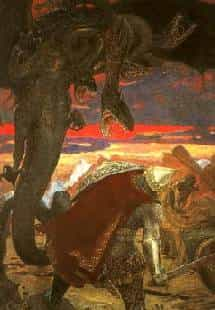

# Змей Горыныч – это смерч

Сказок про Змея Горыныча множество, на основе одних переделывались другие, менялись персонажи (Иван-Царевич, Иван-дурак, Никита Кожемяка и т.д.), вариантов много, но картина описывается одна и та же:

«Налетела туча чёрная скрыла Ярило-Красное, поднялся ветер сильный, это налетел тучей чёрною Змей Горыныч, Виев сын. Стога разметал, крыши с изб посрывал, людей и скот в полон увёл.  
Сколько смельчаков не ездило сражаться, никто не справился. Меч шею рубит, а она опять отрастает».

Современный человек из этого текста ничего не поймёт, воспримет как сказку. Но давайте разберём этот текст как славяне, что нам хотели сказать наши Предки?

## Образы

**Змей** – значит круглый как змея.

**Горыныч** – значит высотой с гору.

**Виев сын** – именем Бога Вия была названа одна из Земель нашей Солнечной системы – Земля Вия (или Плутон). В древности отмечали (и современной наукой доказано), что смерчи чаще возникают, когда Плутон находится близко к Мидгард-Земле, поэтому его назвали сыном Вия. Летом можно часто видеть как маленькие змеевики пыль, листву закручивают.

**Многоголовость Змея** – в разных сказках у чёрной тучи (Змея Горыныча) разное количество голов, бывает 3, 6, 9 и т.д. - это количество хоботов из тучи.

**Бой со Змеем Горынычем** – оружием победить Горыныча никто не мог. И что делали богатыри? Бросали щит или рукавицу, шапку - всё богатырское кованное. Эти вещи попадали в хобот смерча и разрушали систему восходящего и нисходящего потоков, Змей умирал, а его смерь (разрушение вихря) сопровождалась звуком напоминающим тяжкий вздох: «и испустил свой дух». Т.е. было народное средство борьбы со смерчем.

\* В 1406 году под Нижним Новгородом смерч поднял в воздух упряжку вместе с лошадью и человеком и унёс так далеко, что их не стало видно. На следующий день телегу и мёртвую лошадь нашли висящими на дереве по другую сторону Волги, а человек пропал без вести. (Это реальная история, как Змей Горыныч людей и скот в полон увёл).
