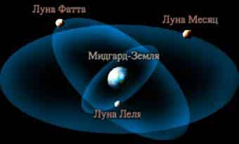

# Три Луны Мидгард-Земли – Леля, Фатта, Месяц

В древности система Мидгард-Земли имела сначала две Луны – Леля и Месяц, потом перед завозом чернокожих людей стало три Луны, сейчас осталась одна Луна Месяц. Память о трёх Лунах сохранилась в преданиях только Индии и России.

## Три Луны Мидгард-Земли

**ЛЕЛЯ** – самая ближняя к Мидгарду Луна, с периодом обращения 7 суток. Древние предания говорят, что на Леле было 50 морей, т.е. это не просто холодный камень, а у неё была своя атмосфера. 111 тысяч лет назад на Леле собрались Силы Мрака, чтобы напасть на Мидгард-Землю и захватить её. Даждьбогу пришлось разрушить Лелю, одним ударом. Об этом пишут старшая и младшая Эдда, Вишну-пурана, Махабхарата и Саньтии Веды Перуна нам ведают о разрушении Лели и **первом Потопе на Мидгард-Земле**.

> Воды Луны, тот Потоп сотворили,  
> на Землю с небес они радугой пали,  
> ибо Луна раскололась на части,  
> и ратью сварожичей в Мидгард спустилась.  
> *Веды Перуна, Саньтия 9.*

**ФАТТА** – период обращения 13 суток. Фатту наши Предки перетащили от Земли Деи. В греческих мифах Фатту называют Фаэтоном. Луна Фатта была уничтожена 13 тысяч лет назад. Большой осколок Фатты попал в Тихий океан, и гигантская волна по экватору трижды обогнула Землю. Считается, что в это время погибла Антлань (Атлантида). В то время много людей погибло, поэтому число 13 стало как бы страшное, и название «Фатта» дало новое словосочетание – фатальность, как неизбежность, нечто предопределённое.

**МЕСЯЦ** – самая большая и отдалённая от Мидгарда Луна, период обращения 29,5 суток. В древних сказах говорится: «Вот и Леля в небе светит, вот и Месяц подошёл». Или в сказке: «Месяц похитил Зарю-Мерцану», т.е. на небосклоне Месяц закрыл Землю Зари Мерцаны (Венера), как бы похитил, а потом она получила освобождение - всё в поэтических образах.
