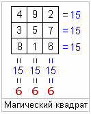

# Число 666 у славян – число живущего

**Число 666** (шестьсот шестьдесят шесть) очень пугает людей находящихся на низком уровне развития, их приучили, что 666 - это число сатаны, «число зверя», так написано в современной Библии: «Здесь мудрость. Кто имеет ум, тот сочти число зверя, ибо это число человеческое; число его шестьсот шестьдесят шесть» [Откровение Иоанна Богослова, глава 13, стих 18]. Но в Библии на древнегреческом языке, и особенно в апокрифах, которые писались на арамейском, сказано «число живущего». Греки перевели «живущего», как «животное», а потом животное превратили в зверя. Т.е. число 666 – это число живущего, в Библии так и сказано: «**ибо это число человеческое**».

## Жреческий квадрат - 666

«Система 666» позволяет определить, что дано живущему, что получил человек при рождении. Называется система «магический квадрат» (слав. жреческий квадрат), в котором сумма чисел по горизонтали, вертикали и диагоналям одинакова, равна 15, но по правилам х’Арийской арифметики временные структуры складываются до одной цифры, т.е. **1 + 5 = 6**, и получается на каждой стороне жреческого квадрата число 666. Этой системой славяне пользовались до христианизации. Затем **церковники начали бороться с ведизмом**, стали запугивать людей, придумали «число зверя», сказали что 666 – это дьявольщина. У них ведь принцип какой: «от многие познания, многие печали», или другое их выражение: «много будешь знать - скоро состаришься». Потому что, если человек будет знать своё предопределение, никто не сможет им манипулировать.
