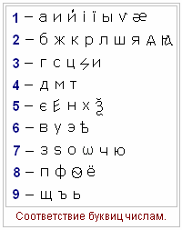

# Число имени (цифра имени)

Запишем таблицу соответствия буквиц числам. Заметьте, в таблице буквицы дореволюционные, а не советские, т.е. у каждой буквицы свой образ и эти образы соответствуют определённым числам. Допустим, единице соответствуют: буквица Азъ - т.е. единый, или как сейчас говорят «Я»; буквица Иже – какое-то единое состояние, состояние гармонии; буквица Iжеи – единая Вселенная, и т.д. То есть буквицы разбиты по группам, у них как бы единое удельное весовое значение.

**Пример:** Ольга Соколова  
Ольга: 7+2+9+3+1 = 22 = **4**  
Соколова: 3+7+2+7+2+7+6+1 = 35 = **8**

В данном примере получилось Число Имени = 4, а Число Родового Имени = 8. Теперь надо сложить эти два числа (4+8 = 12 = 3). Таким образом, **число имени = 3**.

**Вопросы:**  
1. Какое имя считать, детское или взрослое? Можете для себя посчитать детское, а кто прошёл обряд Имянаречения, пишет взрослое.  
2. Какое имя писать, руское или украинское (Павел или Павло)? Как назвали, так и считайте, т.е. как в свидетельстве о рождении записано.  
3. Фамилию считать девичью или по мужу? Можно посчитать оба числа, чтобы увидеть изменился Покровитель или нет.

## Система гармоничных соответствий

В следующей таблице вы найдёте своего Покровителя, и с кем гармонирует. Т.е. в каждом человеке горит свой собственный свет, а эти Земли его подпитывают, наполняют внутреннее содержание своей энергией. Есть люди, которые светятся как Солнце, ведут за собой. Есть люди, предпочитающие находиться в тени тех, кто ведёт, но при этом они гармонично соответствуют, т.е. по типам людей. Так и здесь: цифры справа показывают, с кем гармонирует данная Земля. Допустим, Ярило-Солнце гармонирует с такими же Солнцами (поэтому ставим 1), т.е. и с собой и с другими Солнцами и Звёздами; гармонирует с Луной (2), с Варуной (4), потому что Солнце жизнь даёт и Бог Варуна может вернуть жизнь человеку. Также жизнь даёт вода, поэтому гармонирует с Нием (7).

|  |  |  |
| --- | --- | --- |
| **Число имени** | **Покровитель** | **С кем гармонирует** |
| **1** | Ярило-Солнце | 1, 2, 4, 7 |
| **2** | Месяц (Луна) | 1, 7, 8 |
| **3** | Земля Перуна | 3, 6, 9 |
| **4** | Земля Варуны (Уран) | 1, 2, 7 |
| **5** | Земля Хорса (Меркурий) | 5 |
| **6** | Земля Зари-Мерцаны (Венера) | 3, 6, 9 |
| **7** | Земля Ния (Нептун) | 2, 8 |
| **8** | Земля Стрибога (Сатурн) | 2, 7 |
| **9** | Земля Орея (Марс) | 3, 6, 9 |

Дальше: Число дня (определение качества дня)
