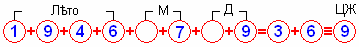

# Число жизни (цифра жизни)

Чтобы узнать число жизни, надо **сложить год, месяц и день рождения до одной цифры**. Для этого нарисуем 11 кругов, в первые 8 впишем свою дату рождения по григорианскому календарю, в следующие 2 – полученную сумму, а в последнем кружке - цифру жизни.  
\* Правильнее говорить «цифра жизни», потому что мы пишем по-современному, т.е. цифрами, а не числами (числа записывают буквами или рунами, тьрагами).

  
**Пример:** 9 июля 1946 года (1+9+4+6+0+7+0+9 = 3+6 = 9)  
\* В пустых кругах нули: месяц 07, день 09. В конце знак соответствия.

## Образ цифры жизни

**1 – Точка опоры**. Человек, на которого можно положиться, который для достижения цели берёт всё на себя, решает всё сам.

**2 – Таран**. Человек, который идет напролом к своей цели, невзирая ни на какие препятствия. Достижение цели для него важнее всего, может и закон нарушить. Для таких людей есть выражение: «цель оправдывает средства».

**3 – Мужское начало**. Мужественный человек, стойко переносящий любые невзгоды, любящий покровительствовать и устраивать вокруг себя доброжелательную обстановку.

**4 – Женское начало**. Уравновешенная натура, способная решать любые задачи и находить выход из различных запутанных ситуаций. Эта натура легко ранима и обидчива.

**5 – Замкнутый круг**. Любвеобильная, очень эксцентричная натура, склонная к музыке, живописи, путешествиям, изучению древних культур и языков, но при этом внутренне замкнутая натура, потому что всю жизнь её преследуют проблемы, стоит решить одну, появляется другая. Т.е. эти люди замкнуты не внешне, а внутренне, никого не пускают в свой внутренний мир, итак проблем в жизни хватает.

**6 – Страх, скептик, невера**. Страх не в современном понимании, а страх – это неизведанность, т.е. не ведаю, значит, не верю. Отсюда и скептицизм. Скажи такому человеку, что вода мокрая, он пока палец туда не засунет, не поверит. Эта натура впечатлительная, не верящая никому на слово, проверяющая всё на собственном опыте, но при этом не замкнута, общительна и сверх любвеобильна (любовь к противоположному полу, к природе, к животным, ко всему, к жизни вообще), и при этом ужасно ревнива.

**7 – Непоседа**. Общительный человек, которому необходима постоянная смена обстановки, новые компании, ибо общение с ними расширяют кругозор. У таких людей вечно новые планы, проекты, т.е. энергия из них бьёт фонтаном, а всё потому, что при таком человеке постоянно находится Лег-Охранитель.

**8 – Двойное женское начало**. Очень чувствительная, легкоранимая натура, склонная попадать под чужое влияние, скрытна, при этом берётся за самую тяжёлую работу, ведёт за собой людей и всё делает, чтобы скрыть свою мягкую, нежную внутреннюю сущность.

**9 – Гармония**. Гармоничные люди, полностью обустраивающие свою жизнь, они находят общий язык и с Богами, и со всеми, кто к ним приходит. В народе про них говорят: «они и с Богом и с чёртом найдут общий язык», потому что в них две великие силы Ха и Тха, которые они используют по своему усмотрению. Они всегда целеустремлённые, но жизнь для «девяток» складывается тяжело, ибо они помимо стремления к цели, гармонично дополняют жизнь других людей, а для девятки необходима только девятка, т.к. Гармония и Гармония дают полную Гармонию.

## Гармоничные пары

Есть пять гармоничных пар, которые в сумме дают 9 (гармонию).

**1+8 – дерево  
2+7 – металл  
3+6 – земля  
4+5 – вода  
9+9 – огонь**

Почти гармоничные пары, это все с девяткой, потому что 9 с любым числом в сумме даёт тоже число, т.е. не нарушает его гармонию. Пример: 9+2=11=2, 9+5=5, 9+8=8.

\* Обереговая цифра жизни
