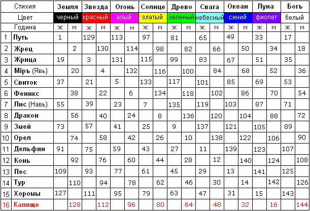

# Даарийский Круголет Числобога (таблица)

**Даарийский** – пишем без апострофа, потому что означает не Род Да’Арийский, а древнюю страну Даарию, т.е. он был основным в Даарии.  
**Круголет** – Круг Лет (славяне считают кругами: Круг = 16, Полный Круг = 144).  
**Числобог** – Бог-Хранитель Даарийского Круголета.

**Строение ДКЧ** схоже с восточной системой исчисления, но у них 12-тиричная система, а в Круголете Числобога используется 16-тиричная система. Кроме того, Круг Стихий состоит не из 5, а из 9 стихий, соответственно и цветов 9, а не 5. Полный Круг в восточной системе 60 лет, а в славянской 144 Лета (т.е. 16 годин проходят через 9 стихий), поэтому период в **144 Лета назвали Кругом Жизни**.

## Таблица (Круг Жизни)

\* Сущность годов Круголета Числобога

## Лета и годины

У нас Летоисчисление, т.е. считаем **Лета**, а слово «**година**» раньше означало «период», но не временной, а структурный. Допустим, сейчас у нас Лето 7522, а период по Круголету 133. Но чтобы не путаться, временно будем использовать принятое сегодня название «год» вместо «година» (период). Т.е. чтобы у вас было различие - Лето 7522, а когда надо указать определённую годину в Круголете, будем говорить 133-й год Круголета.

Начало всех годов Круголета приходится на **День Осеннего Равноденствия**, потому что этот день совпадает с днями, когда наши Предки прибыли на Мидгард-Землю, и вообще с днями начала Летоисчисления на Земле. Кроме того, в этот День вводили новое Летоисчисление, если в жизни народа происходило какое-то глобальное событие (см. примеры Летоисчислений).

Другие таблицы Круголета Числобога и примеры перевода дат на славянские, смотрите в Славяно-Арийских Ведах – перейти к таблицам.
