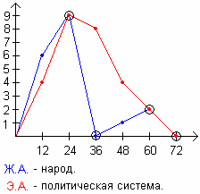

# Графики жизненной и энергетической активности (1917 год)

Для примера рассмотрим дату **26 октября 1917 года – Октябрьская революция**. Каким образом Ленин и компания вычислили эту дату, и почему Ленин говорил: «Сегодня рано, завтра будет поздно, поэтому выступаем ночью».

Ленин учился в Университете, где хоть и факультативно (кружки по интересам), но преподавались какие-то оккультные части, в том числе изучали Нострадамуса. Этот французский еврей-аптекарь «настрадал» в своих катренах, что в далёкой северной стране установится **деспотичный режим, который просуществует 73 года и 7 месяцев**. Дело не в том, как он это настрадал, а в том, как это восприняли другие. Ленин и компания, изучив эти системы, как оккультисты вычислили дату для свершения революции, чтобы воплотить предсказание Нострадамуса. То есть не просто переворот на 1-2 недели и потом всех посадят, а так чтобы на всю оставшуюся жизнь хватило.

## Графики жизненной и энергетической активности

Чтобы вычислить определённую систему, надо знать принцип построения. Даты были по-старому стилю: **1917. 10. 26** (25-го они провели собрание, а в 2 часа ночи пришли в Зимний Дворец, т.е. уже 26 октября). Для вычисления графиков Жизненной и Энергетической активности используют **Перунов Цикл** (цикл года Юпитера) = 12 лет, и формулы:  
ГОД х (М + Д) = Ж.А. (жизненная активность)  
ГОД х (М х Д) = Э.А. (энергетическая активность)  
1917 х (10 + 26) = **69012**  
1917 х (10 х 26) = **498420**

Рисуем график: нижний вектор – это ось Времени (Перунов Цикл), а ось Y – это Уровень Активности (от 1 до 9, т.к. 9 – высшее). Точка НОЛЬ - это время события: 1917 год.  
**График жизненной активности (69012)** – отмечаем первую цифру (6), это то, что произошло через 12 лет, затем вторую цифру (9) через 24 года, третья цифра (0) через 36 лет и т.д. Соединяем точки линией.  
**График энергетической активности (498420)** – точно также, первая цифра (4) через 12 лет, вторая цифра (9) через 24, третья (8) через 36…

Жизненная активность – это народ.  
Энергетическая активность – это политическая система.  
**Критические годы** - пересечение графиков между собой и осью Времени.

Революция произошла в **1917** году, затем начался подъём активности и через 12 лет (**1929**) наступает НЭП, после которого рост достиг пика и превратился в критическую точку (**1941**), которая привела к войне. В результате жизненная активность народа пошла вниз, до нуля (**1953**) – это и смерть Сталина, 113 дней правления Берии, власть Булганина, Маленкова, а потом перешла к Хрущёву. Т.е. пока народ восстанавливает жизненные силы, верхушка дерётся за власть (на графике Э.А. совсем на небольшом спаде). Но затем Никита Сергеевич захватывает власть, Культ личности, и политическая система покатилась вниз. Следующие 12 лет (**1965**) – меняют Хрущёва на Брежнего. Жизнь народа начинает повышаться, но политическая система катится вниз, что приводит к **1977** году (критическая точка) - в день еврейского Нового года (Адам появился на Земле 7 октября по еврейскому календарю) принимают Брежневскую конституцию, т.е. даже меняют основной Закон, но и это не помогло, народ начинает существовать сам по себе, независимо от системы, а система к **1989** году опять уходит в критическую точку, до нуля.

\* Черномырдин говорил: «хотели как лучше, а получилось как всегда». Нет, они всегда заранее знали, что и когда произойдёт, поэтому вовремя перекрасились из коммунистов в демократы, и опять остались на вершине власти.

Дальше: Судьбоносные годы
