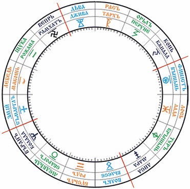

# Космограмма: Дома на Сварожьем Круге

Сварожий Круг разделён на 16 Чертогов, в каждом Чертоге 9 Залов (Залы - это как бы сейчас сказали - созвездия).

**Дома:**  
1. Дом развития.  
2. Дом восприятия мира.  
3. Дом профессии.  
4. Дом семейного созидания.  
5. Дом потомства.  
6. Дом духовного становления.  
7. Дом мудрости (дом познания сокровенного).  
8. Дом наставничества.  
9. Дом смерти (дом духовного здоровья и преображения).

Далее запишем цифры, которые понадобятся для вычисления Домов.

**Обереговые цифры:**  
Ж – обереговая цифра жизни.  
В - обереговая цифра времени = Время рождения + Год Круголета + Число дня Недели.  
Б - обереговая цифра Бога-Покровителя (цифра дня Недели, т.е. понедельник - 1, вторник - 2, третейник - 3 и т.д.).

**Сопутствующие цифры-покровители:**  
Цифра поведения (ЦП) = Ж + В  
Цифра творчества (ЦТ) = В + Б  
Цифра взаимоотношений (ЦВ) = Ж + В + Б + ЦП + ЦТ

## Как определяются Дома

I Дом = Ж \* 3 (т.е. Обереговая цифра жизни перемножается на три. Допустим, если Обереговая цифра жизни 8, то в первом Доме будет 24 Зала).  
II Дом = ЦВ \* 3  
III Дом = ЦТ \* 3  
IV Дом = (ЦТ + ЦВ) \* 3  
V Дом. Пятый Дом соответствует одной триаде (3), если этот Дом приходится на мужские Чертоги. Если окончание триады попадает в женские Чертоги, то пятый Дом будет охватывать все Залы до конца женских Чертогов.

Оставшиеся Залы всех Чертогов поровну разделяются между Домами, при этом весь остаток переходит в девятый Дом. Пример: осталось 39 Залов. Мы делим их на 9 (т.е. 4\*9 = 36), значит, Дома: 5, 6, 7, 8 будут по 9 Залов, а остаток (3 Зала) идёт к девятому Дому.

**Звёздные времена года:**  
Кроме того, на Космограмме Сварожьего Круга в центре необходимо обозначать Звёздные времена года (не надо путать их с Земными временами года).  
**Зима** = 22 Айлетъ – 20 Дайлетъ  
**Весна** = 20 Дайлетъ – 19 Хейлетъ  
**Оусень** = 19 Хейлетъ – 22 Айлетъ

## Космограмма (видеоурок)

\* Звёзды и Земли, Курс 1, Урок 15 – Космограмма.
