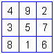
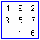

# Магический квадрат по дате рождения

**Магический квадрат** (по-славянски *жреческий квадрат*) – это таблица 3 х 3, заполненная таким образом, что при сложении цифр по горизонтали, вертикали и диагоналям сумма получается одинаковой (15). С помощью магического квадрата можно определить, какие качества вам даны от рождения и сколько чакр у вас было открыто.

1. Как составить свой магический квадрат  
2. Сочетания цифр в магическом квадрате  
3. Значения цифр магического квадрата

## Как составить свой магический квадрат

Для составления магического квадрата по дате рождения, надо знать все цифры жизни и время рождения.

Пример: 09 июля 1943 г., время: 23 часа 54 минуты.

**Цифры жизни:** **1 9 4 3** 0 **9** 0 **7** = **33** = **6** (учитываются все цифры: год, месяц, день, промежуточные цифры (33) и число жизни (6), см. как узнать число жизни).

**Время рождения:** **2 3 5 4** = 14 = **5** (при расчете времени промежуточные цифры (14) не учитываются, используются только часы, минуты и результат их сложения (5) по правилам х’Арийской арифметики, т.е. до одной цифры).

Таким образом, мы определили все цифры жизни (выделены красным цветом). Теперь нарисуйте магический квадрат с пустыми клетками, и впишите в него свои цифры жизни. Если цифры повторяются, пишите только одну из них, если какой-то цифры нет, оставьте клетку пустой (в данном примере нет цифры 8).

## Сочетания цифр в магическом квадрате

**Триады** (т.е. сочетания трёх цифр) – это **качества которые вам даны от рождения**. Если нет ни одной триады, это означает свободу выбора, человек сам как бы выбирает, каким путём идти.

Горизонталь:  
492 – сила воли.  
357 – семейный уклад.  
816 – решение вопросов.

Вертикаль:  
438 – твердый жизненный стержень (целеустремленность).  
951 – благосостояние.  
276 – талант.

Диагональ:  
456 – любовь к ближнему.  
852 – жизнь, отмеченная Богом.

Вопрос: Откуда такие трактовки?  
Мы уже разбирали на арифметике, что пишем не просто какие-то закорючки (цифры), а под каждой цифрой, числом есть ОБРАЗ (см. образы цифр жизни), сложили образы и становится понятен смысл. Пример:  
951 – (9 – это гармония, 5 - любовь, 2 – созидание) дают благосостояние.  
276 – (2 – упорство, 7 – Божья помощь, 6 – скептицизм, т.е. опыт). Опыт, упорство и Божья помощь дают талант.  
456 – (4 - нежность, 5 - любовь, с элементами ревности – 6) дают любовь к ближнему.

## Значения цифр магического квадрата

Цифры магического квадрата соответствуют 9-ти чакрам. На каждую чакру при открытии поступает определённое количество потоков энергии. То есть, по цифрам жизни можно определить, **какие чакры были открыты при рождении**, и сколько потоков энергии на них поступило. Допустим: две цифры 5 означают, что при рождении была открыта пятая чакра, и на неё поступило два потока энергии Любви. Если какой-то цифры нет, это означает, что при рождении данная чакра была закрыта, и у человека такого потока нет.

**1 – Энергия Жизни.**

**2 – Энергия других жизненных сущностей**. Т.е. эта энергия может идти от кого угодно: от другого человека, от животного, от призрака, от духа… Через неё передаются не только образы Крови и Духа, но и сглазы, порчи, наговоры, болезни и т.д.

**3 – Вселенская энергия жизни** или космическая энергия жизни.

**4 – Творческая энергия.**

**5 – Энергия Любви.**

**6 – Энергия Интуиции**. Шестая чакра находится в районе левого плеча, её иногда называют «сердечная чакра», и говорят, что человек сердцем чует, т.е. интуиция подсказывает.

**7 – Энергия Чувств.**

**8 – Энергия Судьбы**. На восточный манер её называют «энергия кармы», кармическая энергия.

**9 – Энергия Разума** или как её многие называют – «энергия интеллекта».

Таким образом, мы получили энергетический пси-портрет.
