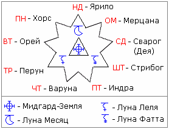

# Покровители дням славянской Недели

|  |  |
| --- | --- |
| **Понедельник** | Земля Хорса (Меркурий) |
| **Вторник** | Земля Орея (Марс) |
| **Третейник** | Земля Перуна (Юпитер) |
| **Четверик** | Земля Варуны (Уран) |
| **Пятница** | Земля Индры (Хирон) |
| **Шестица** | Земля Стрибога (Сатурн) |
| **Седьмица** | Земля Деи (пояс астероидов) |
| **Осьмица** | Земля Мерцаны (Венера) |
| **Неделя** | Ярило-Солнце |

\* Земли-Покровители дням славянской Недели и Боги-Покровители сим дням соответствующие. Седьмица - раньше там была Земля-Покровительница Дея, а потом это всё перешло под управление Сварога.

Считается, что день Недели в который родился человек, будет для него счастливым, потому что в этот день его Бог-Покровитель вступает в свои права. У каждого человека получается свой **пантеон Богов-Покровителей**:  
- Бог-Покровитель Чертога вашего рождения;  
- Бог-Покровитель Лета вашего рождения;  
- Бог-Покровитель Месяца вашего рождения;  
- Бог-Покровитель дня Недели вашего рождения.
