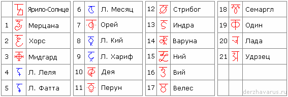

# Символы Земель, Солнца, Лун и их значения

Все Небесные тела в нашей системе Ярилы-Солнца имеют свой собственный путь и своё неповторимое влияние друг на друга. Это влияние сохранено в образном виде и записывалось определённой Руной (Руна – это сокрытый Образ).

## Влияние Природы на человека

**Ярило-Солнце**. Светлый, ясный ум, познающий образ, который несёт в себе Чертог. Великодушное стремление к руководству людьми, идущим по светлой стороне Силы. Нетерпимость к фальши, к навязыванию мнения с которым Ярила не согласен. Данный образ высвечивает упрямство и упорство. Люди-Ярилы лидеры по натуре, невероятно сильные личности, которые никогда не остаются в тени, это увлекающиеся, деловые, импульсивные создания. Если вы находитесь под влиянием покровителя Ярилы, не замыкайтесь в своих ощущениях, не ограничивайтесь в собственном восприятии, иначе у вас начнут возникать конфликты с окружающим миром. Люди, находящиеся под покровительством Ярилы всегда добиваются успеха, если не испугаются трудностей и не опустят руки перед якобы неразрешимой задачей. Им присуще великодушие, гордость, стремление создавать что-то новое и прекрасное.  
\* Ярило является источником всего живого, поэтому даже в числовой форме, Ярило является источником всех чисел. В состав любого числа входит единица, но само по себе в Явном Мире оно неделимо, на него оперяется единство Вселенной.

**1. Земля Зари-Мерцаны**. Даёт человеку стремление быть на виду, любвеобильность в рамках Чертога, в котором она находится, хитросплетение ума, это очень часто приводит к различным интригам, кокетству, если нахождение Мерцаны попадает на женские Чертоги. Серьёзность и рассудительность - если Мерцана находится в Чертогах Змия, Медведя, Тура и Коня. Целеустремлённость, вплоть до агрессивности - если Мерцана попадает в Чертоги Вепря, Ворона, Волка или Орла. Застенчивость, скромность, нежность – проявляется, когда Мерцана попадает в другие Чертоги.

**2. Земля Хорса**. Даёт активность в управлении делами в зависимости от Чертога, в котором находится Хорс, созидательную наклонность, творчество. Но если Хорс находится в чертоге Вепря, Ворона, Лисы, Коня, то он наделяет человека хитростью, лукавством, склонностью к необдуманным поступкам, т.е. к авантюрам.

**3. Мидгард-Земля**. Даёт человеку уживчивость, способность налаживать взаимоотношения с людьми, трудолюбие, созидательность, стремление к выполнению долга. Всё вышеперечисленное зависит от того, в каком Чертоге и Зале находится Мидгард-Земля. Мидгард также даёт дополнительную силу, которая, сочетаясь с полученной силой от Ярилы, порождает гармоничное Душевное равновесие.

**4. Луна Леля**. Вносит Душевное разногласие в зависимости от Чертога, в котором она находится. Наделяет человека нервозностью, даёт склонность к ревности, порождает в Душах недоверие. Особенно Леля влияет на женщин, когда проходит через Зал Милосердия и Иринации.

**5. Луна Фатта**. Она навивает мысли о неизбежности, трагичности, вызывает у людей апатию, безразличные состояния при которых у людей опускаются руки. Фатта проецирует на Мидгард силу, которая вызывает у человека чувства и мысли о конечности бытия, эти мысли могут отвернуть человека от его Родовой связи с Богами и ввергнуть его на путь атеизма, т.е. безбожия. Фатта прививает людям скептицизм, но его уровень зависит от Зала Чертога, в котором находится сия Луна.

**6. Луна Месяц**. Наделяет человека чувством страха, неуверенностью в своих силах, но при этом даёт человеку возможность приспосабливаться к окружающему миру и обстановке, используя различные обстоятельства, которыми сглаживает негативное влияние. Месяц наделяет человека религиозностью, склонностью к Духовному развитию, сия склонность проявляется, когда Месяц попадает в Чертоги Змия, Волка, Вепря, Раса, Финиста. Это даёт религиозный фанатизм, агрессивность к тем, кто не принимает Духовный путь развития, самоотдача религиозному изысканию, вплоть до самопожертвованию. В случае попадания в Чертог Бусла, даёт философский склад ума, тягу к духовным беседам, всевозможным рассуждениям и разглагольствованиям.

**7. Земля Орея**. Даёт человеку работоспособность, силу воли, активность, способность докопаться до истины, самопожертвование до безрассудства при защите Родовых интересов, мудрость в профессиональном подходе, любовь к Родной земле, самопожертвование при защите своего Рода, Отчизны и Веры. Всё это активно дополняется той мудростью и силой, которые дают Чертоги, через которые двигается Орей.  
\* Т.е. здесь идёт жёсткость на сохранение Рода, Державы, Веры, поэтому многие и называли Орей - как символ войны, защиты, т.е. как покровитель воинов («сыны Орея»), каста воинов. Греки назвали Орей – «Арес», а латиняне уже «Мир Ареса», т.е. Марс.

**8. Луна Кий**. Даёт человеку упрямство, целеустремлённость, стремление к прекрасному, и к зодчеству, т.е. создавать, строить.

**9. Луна Хариф**. Даёт чувство ритма, способность убеждать собеседника в споре или философской беседе, но при этом в своих рассуждениях человек находящийся под влиянием Харифа добавляет много «тумана» и много «воды». Образы Кия и Харифа добавляют образ Орея. Кий и Харив, если они выпадают на момент рождения человека, на его космограмме они ставятся рядом, Кий с правой стороны, Хариф с левой.

**10. Земля Деи**. Даёт человеку разнообразность, всеохватность, склонность к переменам от радости в общении до скуки в одиночестве. Для того чтобы определить местонахождение Деи, нужно знать, что период обращения вокруг Ярилы составляет 5,25, и в месяц Рамхатъ 1-го дня, 1-го Лета от СМЗХ Дея вошла в Чертог Вепря. Т.е. Дея даёт человеку воспринимать чужой жизненный опыт целиком, не подвергая его каким-то критическим разборам. Но рождённые под влиянием Деи, т.е. когда Солнце и Дея рядом – этот человек абсолютно не принимает учений, идей, работ, которые связаны с разрушением Мира Природы; для него всё что есть в Природе - священно и должно существовать для потомков.  
\* Первое поселение было на Деи, потом на Ореи, потому уже на Мидгарде.

**11. Земля Перуна**. Даёт человеку упорство, мужественность, стремление к совершенствованию, защите обездоленных, высокую Духовность, стремление к наведению справедливости и порядка, нетерпимость к кривде (фальшь) и неправде (ложь) в соответствии с Чертогом, в котором находится Земля Перуна. Наибольшая активность проявляется, когда Перун находится в Чертоге Орла, это очень часто приводит к разрешению споров силовым методом. Человек рождённый под сиянием Земли Перуна старается не оставлять зло не наказанным, для восстановления справедливости он не щадит даже своей жизни, очень сильно это проявляется, когда Перун находится в Чертоге Волка. Умиротворённость, покровительство проявляется, если Перун находится в Чертоге Лося, это нахождение проявляется большой отеческой заботой и сыновней любовью.

**12. Земля Стрибога**. Даёт человеку ветреность, многословие, иногда доходящее до словоблудия, в зависимости от Чертога в котором он находится. Основная задача Стрибога - истреблять всяческие злодеяния и разрушать злобные замыслы, поэтому человек, рождённый под сиянием Стрибога, получает достаточно силы (физической), хитрости, изворотливый ум и способность решать свои неразрешимые вопросы. Кроме того, когда Стрибог находится в чётных Чертогах, он наделяет людей громадной изворотливостью и способностью создавать иллюзии, это зависит от того, в каком из Чертогов находится Стрибог. Стрибог помогает человеку избавиться в своей жизни от подневольно подчинённого положения, если он в него попадает.

**13. Земля Индры**. Даёт человеку стойкость, множество профессий, которые позволяют ему создать благо для себя и своего Рода, могущественную силу при помощи, которой может постоять не только за себя, но и за свой Род, свою землю и Веру, это особенно проявляется, когда Индра находится в мужских Чертогах: Волка, Орла, Раса, Вепря, Медведя. В Чертоге Финиста Индра даёт возможность человеку выходить с победой из любых запутанных ситуаций; также у него появляется возможность черпать силы из любых духовных резервов. У рождённых под сиянием Индры, проявляются успехи в наблюдении за Звёздным небом, это очень хорошо проявляется в системах связанных с изучением движения небесных тел (астрономия, астрология). На бытовом уровне в человеке пробуждается любовь к домашним животным, особо любимые животные - бык и корова, особенно, когда Индра проходит через Чертог Тура. Когда Индра находится в Чертоге Коня, Волка, Медведя у них очень ярко проявляется любовь к коням. Когда Индра находится в других Чертогах, эта любовь менее выражена.

**14. Земля Варуны**. Варуна раскрывает человеку тягу к мистицизму, оккультизму, познанию всего необычного и потустороннего. Нередко, когда Варуна находится в структурной зоне, у человека происходит конфликт не только с окружающим миром, но и с самим собой, это частенько приводит к отшельничеству, а если к тому же в Чертоге вместе с Варуной находится Вий, Удрзец и Чур, это может привести к переходу в Мир Нави (на Земле это проявляется в виде детской смертности или суицида). Варуна приводит человека к совершенству, когда находится в Чертоге Ворона, он раскрывает в человеке Духовные и Душевные силы, и они могут проявиться с такой мощью, что человек может стать не только жрецом, но и Странником (духовный наставник, пророк, или как многие говорят - воплощение Бога на Земле).

**15. Земля Ния**. Ний посылает человеку несчётные дары свои и даёт человеку возможность везде чувствовать себя «как рыба в воде». Также наделяет человека способностью достигать совершенства в любой из профессий кои направлены на созидание и на благо Рода. Человек, рождённый под сиянием Ния, в своей жизни достигает любых результатов путём созидательного труда. Рождённые под покровительством Ния достигает открытий в научной деятельности, они способны облагораживать искусства, достигая в нём гармонии и совершенства. Особенно это проявляется при прохождения Ния через женские Чертоги, в этих Чертогах рождаются такие чувства, как любовь, благородство, взаимопонимание и хозяйственность. В мужских Чертогах проявляется любвеобильность, способность действовать для достижения любви невзирая ни на какие преграды вплоть до самопожертвования.

**16. Земля Вия**. Вий привносит в характер человека осторожность, скептицизм, иногда даже страх перед малообъяснимым, но при этом он наделён способностью докапываться до сути. Если Вий пребывает в мужских Чертогах и начинает постигать суть их вещей, то уже ничто не утаится от его взора. В минуту опасности Вий даёт человеку силу в соответствии с Чертогом, в котором он находится для уничтожения врагов как внутренних, так и внешних. Силу Вия всегда использовали для наказания за неправедные деяния. В древние времена считалось, что люди, к которым благосклонен Вий, способны убивать взглядом, поэтому таких людей призывали вершить праведный суд.

**17. Земля Велеса**. Велес давал возможность человеку принимать природу такой, как она есть, и обживаться на любой местности. Кроме того, он наделял человека свободолюбием, чувством правоты и человек наделённый данными чувствами выражал резкое неприятие к отрицательной жизни (т.е. безделье, отрицание Законов, волю родителей и т.п.). Велес активизирует в человеке гармоничное отношение к окружающей Матери-Природе. Всё это зависит от Чертогов, в которых находится Велес. Когда Велес в Чертоге Орла - у людей возникают споры, разногласия, неприязнь к чужому мнению. Если Велес входит в Чертог Тура, то целью жизни становятся - животноводство и скотоводство. Велес наделяет человека заботой о своём потомстве и заставляет его создавать благо и достаток для своих потомков, невзирая на то, оценят потомки то, что получили или нет. Когда Велес проходит весенние Чертоги, он наделяет Земли жизньродящей силой, и человек может получать эти природные силы, трудясь на земле.

**18. Земля Семаргла**. Семаргл даёт человеку возвышенность, открытость, неуёмную тягу к огню, своенравность, весёлость, желание превратить свой труд и свою жизнь в сплошной праздник. Сияние Семаргла освещает все внутренние чувства человека, и его отношения к противоположному полу определяется по Чертогам, в которых он находится. В солнечных Чертогах (в огненных) влияние Огня на чувства максимальны и человек в своих деяниях доходит до жертвенности (т.е. живёт не для себя, а для того человека, которого любит). Родители должны обращать внимание на детей, которые рождены под покровительством Семаргла, ибо тяга к огню у этих детей неконтролируемая.

**19. Земля Одина**. Один даёт человеку мощь созидания, духовное прозрение, тягу к познанию древней мудрости. Соединяясь с Чертогом Лисы, Один приносит в жизнь человека хитрость, стремление к мене (обмену) и торгу доходящую до обмана. Находясь в Чертоге Щуки, он даёт человеку тягу к исследованиям, путешествиям. Соединяясь с Чертогом Ворона, наделяет человека чувством завести и накопления, а если в этом Чертоге будет ещё Орей, то это приводит к агрессивности доходящей до самопожертвования, а также приводит к разжиганию войны (допустим, два Рода перестали разговаривать между собой, торговать и т.п. – это считалось войной), вплоть до военных действий. Через все Чертоги, Один проносит смелость, гордость, независимость и самостоятельность.

**20. Земля Лады**. Лада привносит в жизнь человека домашний уют, дружелюбие, взаимопочитание, Любовь, продолжение Рода. Это ярко выражено, когда она находится в Чертоге Лося. В других женских Чертогах она проявляет следующие виды характера - в Чертоге Девы умение создавать «рай в шалаше»; в Чертоге Щуки она даёт многодетность, взаимовыручку и взаимопомощь; в Чертоге Лебедя - целеустремлённое следование древним Родовым устоям. В мужских Чертогах она даёт: лад, семейный уклад, взаимоуважение и взаимопочитание.

**21. Земля Удрзеца**. Даёт человеку стойкость, выносливость, способность не поступаться своими принципами, особенно, если они справедливы, но при этом Удрзец жестоко наказывает за отход от древних традиций и Родовых устоев. Данные свойства характера очень мощны при прохождении мужских Чертогов. Кроме того, Удрзец усиливает свойства каждого Зала в любом из Чертогов, когда он там находится.

\* Это основные Земли и Луны, на которых мы будем тренироваться вычислять. А когда научимся, тогда уже запишем все остальные Земли в системе Ярилы-Солнца.
