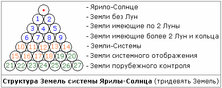
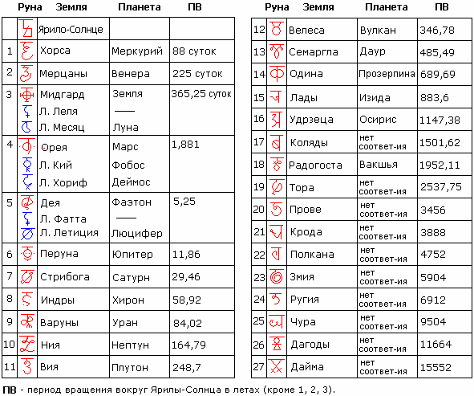

# Система Ярилы-Солнца

**Сколько планет в нашей Солнечной системе?** Какой порядок планет? Строение Солнечной системы? Наши Предки знали ответ на эти вопросы, и сегодня эти знания вновь доступны славянам.  
\* Раньше у нашей Мидгард-Земли было 2 Луны, т.е. в данной структуре она под №3, вместе с Землёй Орея (Марс) и Землёй Дея (Фаэтон). Но потом ещё от Деи (видите они в одном гармонично ряду) Фатту безболезненно перетащили и поместили вокруг Мидгарда, между орбитами 1-й и 2-й Лун, поэтому на нашей Земле появился Период Трёх Лун.

**Строение Солнечной системы**. В нашей Солнечной системе 27 Земель (планет), их общая масса равна массе Солнца. Первые 9 Земель общеизвестны; следующие 5 Земель являются мини-системами внутри системы Ярилы-Солнца; следующие 6 Земель – это Земли отображения, т.е. на них как бы отображаются все катаклизмы и процессы, происходящие на других Землях нашей Солнечной системы; а последние 7 Земель – это Земли порубежья, они выполняют защитную функцию, их гравитационные структуры сложены таким образом, чтобы ни одно небесное тело системы Ярилы-Солнца не покидало её, чтобы даже какая-нибудь комета или астероид не вышли за пределы системы.

Структура нашей Солнечной системы более сложная, нежели та, которую нам «открыли» современные астрономы, считающие многие Земли астероидами. У наших Предков была своя упорядоченная система всех Земель (тридевять Земель) и классификация небесных тел (см. Солнце, Звезда, Земля, Луна), упоминания о ней сохранились в славянских сказках, когда герои отправляются «за тридевять Земель, в тридесятое царство». С «царствами» мы уже разобрались – это Чертоги Сварожьего Круга, далее запишем название планет Солнечной системы (Земли и их символы, или правильнее назвать – Руны).

## Земли системы Ярилы-Солнца

  
\* **Луна Фатта** была помещена между орбитами Лели и Месяца, период обращения вокруг Мидгарда составлял 13 дней. Была уничтожена около 13000 лет назад.
