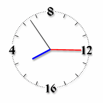

# Славяно-Арийские часы

Славяно-Арийские часы отображают текущее время, и позволяют перевести даты от РХ в СМЗХ, узнать славянскую дату рождения.

**1. Текущая дата**. Часы отображают Лето от Сотворения Мира в Звёздном Храме (СМЗХ), сороковник, число и день недели по славянскому календарю. Кликните мышкой на число, чтобы узнать какой сегодня праздник (если есть).  
\* К сожалению, оригинальные часы больше недоступны, а здесь праздники указаны неправильно. Но их можно посмотреть на странице Праздники.

**2. Время**. Видим славянские меры времени: час, часть, доля. При клики на цифровые значения, отображается дополнительная информация. В старой версии часов здесь был Суточный Круг, на котором указано, что сутки начинаются вечером и разделены на 16 часов (см. ниже).

**3. Название часа**. Каждый час имеет своё название, см. Названия славянских часов.

**4. Чертог**. На часах показан Чертог (Созвездие), через который сейчас проходит Ярило-Солнце, его символ и Бог-Покровитель. Кликните мышкой, чтобы увидеть информацию о Чертоге.

**5. Название года**. Под Чертогом видим название текущего года (слав. *годи́на*) по Даарийскому Круголету Числобога.

**6. Лето**. Текущее Лето, его порядковый номер в Круге Жизни и Круге Лет по Круголету Числобога.

**7. Дата рождения**. С помощью Славяно-Арийских часов вы можете узнать свою славянскую дату Рождения, для этого внизу укажите дату от РХ и время рождения (до или после 18:00), нажмите «Перевести». Диапазон дат 1868-2012 гг.

## Славяно-Арийские часы

Суточный Круг показывает текущие часы, части и доли. По славянскому времени в сутках 16 часов (1 славянский час = 1,5 современных), и новые сутки начинаются вечером после захода солнца, а не в полночь. Сутки - это состыкованные День и Ночь. По современному времени новые сутки начинаются в 18:00.

Суточный Круг (правильный)

\* 31 декабря 2020 года была прекращена поддержка Adobe Flash Player, поэтому старые Славяно-Арийские часы не отображаются (файл .swf).
