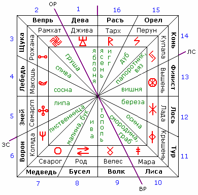

# Сварожий Круг (славянский зодиак): Чертоги

**Сварожий Круг** – это небесный путь, по которому движется Ярило-Солнце, проходя через **16 Небесных Чертогов** [славянский зодиак], в которых собраны Солнца, Звёзды и Звёздные скопления (созвездия). Из Сварожьего Круга Души людей приходят на Землю, при этом, когда Солнце проходит определённый Чертог, соединение его света со светом Чертога даёт силу, которую воспринимает Священное древо Чертога, которое растёт на Мидгард-Земле.

Сварожий Круг – 16 Чертогов / Название Чертога, Бог-Покровитель, Символ Чертога и Священное древо.

В западной традиции Небесный Круг Созвездий называют «**зодиак**» и делят его на 12 знаков, а наши Предки делили на 16 периодов, т.н. Небесные Чертоги («знаки зодиака»). Славяне должны знать свой **Чертог по дате рождения**, для этого можно просто перевести дату на Славяно-Арийских часах. Раньше символ Чертога проставляли в центре девятиконечной звезды, т.е. Инглия освещает ваш Чертог.

\* Линия на рисунке между Чертогами Дева и Вепрь, Лиса и Волк - это ось Земли. Отмечены точки: **ОР** - Осеннее равноденствие, **ВР** - Весеннее равноденствие, **ЛС** - Летнее солнцестояние, **ЗС** - Зимнее солнцестояние.  
\*\* Смена Чертогов происходит в 14-й час по славянскому времени, т.е. в 15:00 (зимой) или в 16:00 (летом) по современному времени.

## Сварожий Круг - Чертоги

|  |  |  |  |
| --- | --- | --- | --- |
| **Чертог** | **Покровитель** | **Древо** | **Период** |
| 1. Дева | Джива | Яблоня | 18 Тайлетъ - 1 Рамхатъ |
| 2. Вепрь | Рамхат | Груша | 1 Рамхатъ - 22 Рамхатъ |
| 3. Щука | Рожана | Слива | 22 Рамхатъ - 4 Айлетъ |
| 4. Лебедь | Макошь | Сосна | 4 Айлетъ - 25 Айлетъ |
| 5. Змей | Семаргл | Липа | 25 Айлетъ - 7 Бейлетъ |
| 6. Ворон | Коляда | Лиственница | 7 Бейлетъ - 29 Бейлетъ |
| 7. Медведь | Сварог | Малина, Бук | 29 Бейлетъ - 12 Гэйлетъ |
| 8. Бусел | Род | Ива | 12 Гэйлетъ - 37 Гэйлетъ |
| 9. Волк | Велес | Тополь | 37 Гейлетъ - 22 Дайлетъ |
| 10. Лиса | Марена | Смородина, Граб | 22 Дайлетъ - 4 Элетъ |
| 11. Тур | Крышень | Осина | 4 Элетъ - 26 Элетъ |
| 12. Лось | Лада | Берёза | 26 Элетъ - 9 Вейлетъ |
| 13. Финист | Вышень | Вишня | 9 Вейлетъ - 31 Вейлетъ |
| 14. Конь | Купала | Папоротник, Вяз | 31 Вейлетъ - 13 Хейлетъ |
| 15. Орёл | Перун | Дуб | 13 Хейлетъ - 35 Хейлетъ |
| 16. Рас | Тарх | Ясень, Игг | 35 Хейлетъ - 18 Тайлетъ |

В таблице указано название Чертога, Бог-Покровитель (соответственно ваш Бог-Покровитель), Священное древо, и период по славянскому календарю.

## Образы Чертогов Сварожьего Круга

1. **Дева** – это первый Чертог, отсюда и прообраз – Дева рождает. Но рождается же в первую очередь не тело, а Душа, поэтому покровитель данного Чертога - Богиня Жизни, т.е. Дева Жива (сокращенно **Джива**), а Руна Чертога - как бы женщина, приподнявшая руки. Священное древо – **яблоня**, т.е. Душа воплощается в своём Роду и потом идёт по стопам родителей, поэтому и говорят: «яблоко от яблони недалеко падает».

2. **Вепрь** – покровитель **Рамхат**. Священное древо – **груша**.

3. **Щука** – покровитель **Рожана**, она отвечает за рождение, покровительница рожениц и беременных, как бы их защита. Священное древо – **слива**, она набирает силу осенью и хранит поливитамины очень долго, когда уже фруктов не хватает, поэтому женщинам, особенно беременным, чтобы было побольше сил, давали больше слив. А летом давали больше яблок, и заметьте, даже христиане Яблочный Спас празднуют.

4. **Лебедь** – покровитель **Макошь** или Мать-Ковша, т.е. созвездие Большая Медведица. Символ Чертога – рог изобилия или небесный ковш. Священно древо – **сосна**.

5. **Змей** – это не гадюка подколодная, а змей всегда символизировал Мудрость. Покровитель - **Семаргл** (Огнебог). Священное древо – **липа**, её ещё называли «огненным деревом», она жар сгоняет своей силой, т.е. когда у человека температура, дают липовый отвар, измельчённую кору липы.

6. **Ворон** – покровитель **Коляда**. Священное древо – **лиственница**. Коляда отвечает за перемены, и лиственница – древо перемен, т.е. пока растёт она мягкая, а если поместить её в воду, она станет твёрдой как камень.

7. **Медведь** – покровитель **Сварог**. Чертог Медведя упоминается в Саньтиях, когда люди спасались от потопа, они схоронились в Чертоге Медведя. Священное древо – **малина, бук**. Малиновый сок называли «медвежьей кровью» и поливали им корни дуба, т.е. он сладкий, привлекает муравьёв, и они уничтожают в корнях дуба всяких личинок, паразитов.

8. **Бусел** (Аист) – покровитель **Род**. Символ Чертога – две стрелки в противоположных направлениях, т.е. образ – старцы уходят на Небеса, а младенцы приходят на Землю, и Род продлевается, а приносит детей аист. Священное древо – **ива**, её веточками неразумным отрокам через седалищное место вгоняли мудрость, которая не входит через уши.

9. **Волк** – покровитель **Велес**, сын Небесной Коровы Зимун, и символ Чертога похож на голову Зимун, а если правый «рог» убрать и добавить сверху точку, получится созвездие Малой Медведицы (символы Чертогов – это звёздные системы). Священное древо – **тополь**. Велес умел принимать различные облики, а для этого необходимо перекувыркнуться через пень тополя. Также тополь снимает напряжение, гармонизирует, его использовали как лечебное средство, допустим, если у человека нарыв пальца, то надо приложить дощечку из тополя, он вытягивает всё из раны, этому людей обучал тоже Велес.

10. **Лиса** – покровитель **Мара** – Богиня зимы, её неправильно называют Богиней смерти, т.е. Природа лишь засыпает, а не умирает насовсем. Тем более, вдумайтесь МА-РА, т.е. Мать Сияния, снег сияет, и она мать этого сияния, а когда уходит, снег теряет сияние. Священное древо – **смородина и граб**. Белая и красная смородина стабилизирует давление, т.е. вводит организм в состояние покоя, а если давление повышено, чёрная смородина снижает. Символ Мары – шестиконечный крест, раньше был изображён на гербах Литвы, Белоруссии, Польши, и никакого отношения к христианству не имеет, он символизирует Духовный путь через три Мира – Явь, Навь, Правь.

11. **Тур** (Бык, Корова, Буйвол) – покровитель **Крышень**. Священное древо – **осина**. Крышень у врагов забирает силу, тоже делает и осина. Хочешь избавиться от ворога, постели ему спать под осиной. Но также осина и полезна, она хворь забирает, поэтому стены в бане отделывают осиной.

12. **Лось** – покровитель **Лада-Матушка**, рождающая и пробуждающая. Древо – **берёза**.

13. **Финист** – это разновидность сокола (не путайте с Фениксом, возрождающимся из пламени). Вспомните сказ о Ясном Соколе, там Настенька отправилась за тридевять Земель, т.е. 27 планет, в тринадесятое царство – это 13-ый Чертог (три + десять). Покровитель – **Вышень**. Символ – Колесо Сансары. Священное древо - **вишня**. Вышень – это небесный справедливый судья, разрешающий любые споры, которые возникают между Богами или между людьми. И вишню раньше использовали для разрешения споров, степную чёрную. Т.е. чтобы определить, кто говорит правду, а кто ложь, оба съедали определённое количество вишни и потом им предлагали плюнуть, у того, кто солгал, во рту всё связало и слюны не было. Т.е. от волнения исчезает слюна.

14. **Конь** – покровитель **Купала**. Символ – Руна Йога – объединение стихий огня и воды, земли и воздуха, света и тьмы, т.е. всё соединяет во едино. Древо – **папоротник и вяз**.

15. **Орёл** – покровитель **Перун**. Священное древо – **дуб**.

16. **Рас** – это священный белый леопард, или как ещё говорят – белый пард (пардус), а рысь, это одна из разновидностей. Покровитель – **Тарх** (Даждьбог – дающий Бог). Предания сообщают, что в первый свой приезд Тарх завёз на Мидгард-Землю семейство кошачьих с Ингард-Земли. Священное древо – **ясень, игг**. У скандинавов Вселенское древо – Иггдрасиль (Игг – разновидность ясеня, Дра – дерево, Силь - Вселенское).

### Похожие статьи

- Сварожий Круг и сущность человека
- Характер человека, определяемый Чертогами
- Общие структуры Чертогов Сварожьего Круга
- Залы Чертогов Сварожьего Круга
- Стихии Чертогов
