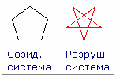
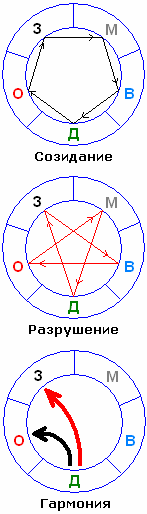
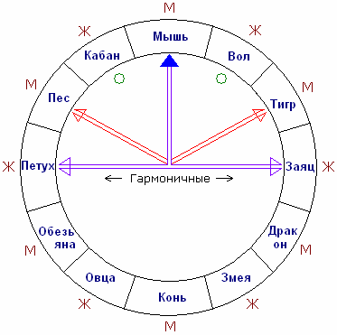
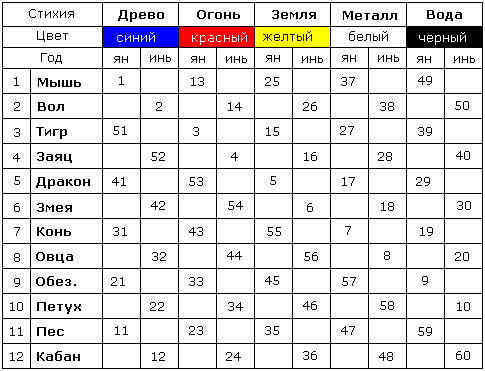

# Восточная система исчисления (Круг Стихий и Зодиак)

Существуют три системы: славянская, западная, восточная. Восточная система касается Индии, Вьетнама, Лаоса, Камбоджи, Китая и пр. Среди них китайская система считается самой древней, в этой системе **5 стихий** (Огонь, Земля, Металл, Вода, Древо) и **12 годов**. Всё это соединено в **цикл 60 лет**, т.е. 12 годов проходят через 5 стихий и получается цикличность 60 лет, по 2 года на стихию.

1. Круг Стихий  
2. Китайский зодиак (Круг животных)  
3. Таблица соответствия по годам  
4. Зодиакальные соответствия

**Почему 12 годов?** Потому что китайцы и другие восточные люди брали за основу движение «Царственной планеты», как они её называют, т.е. Земли Перуна (Юпитер), у которого средняя периодичность 11,867 – округлили до 12 лет. Т.е. восточнее люди для себя отмечали, что Юпитер совершил круг по небу - прошёл все знаки зодиака (Круг животных).

## Круг Стихий

Стихии располагали в определённой последовательности. Начиналось всё с Древа (заметьте, есть Родовое Древо, Древо Времён, Древо Мироздания и прочие, т.е. **Древо** – основа всего), затем по часовой стрелке: **Огонь, Земля, Металл, Вода**. При этом в восточной системе есть деление на светлое и тёмное, как Инь-Ян, сутки разделены на 12 часов дневных и 12 часов ночных, также и Круг Стихий имел светлую и тёмную сторону, т.е. он был и созидающей системой в одном случае, а в другом – разрушительной системой. Любое знание можно использовать как для Добра, так и для Зла.

**Созидающая система:**  
Древо даёт жизнь Огню;  
Огонь даёт жизнь Земле;  
Земля порождает Металл;  
Металл (по их преданиям) рождает Воду;  
Вода даёт жизнь Древу.

Получаем Символ Пяти - у восточных людей считался созидающей системой. \* В СССР таким был Знак качества, только с «рюмкой».

**Разрушающая система:**  
Древо иссушает Землю;  
Земля загрязняет, поглощает Воду;  
Вода гасит Огонь;  
Огонь разрушает, плавит Металл;  
Металл рубит Дерево.

Поэтому большевики взяли красную пятиконечную звезду (см. Орден Красного Знамени). Потом звезду перевернули, но это не меняет суть, её можно хоть как перевернуть – стихии-то вращаются.

**Гармоничная система:**  
Гармоничная объединяет два начала: Созидающую и Разрушительную системы, одна стрелка показывает созидающую, другая разрушительную (красная). Внутренний круг вращается, и когда подходит к какой-то стихии, стрелки показывают, с какой стихией она в гармонии, а с какой нет.  
\* Данный метод вычисления рассчитан на мужчин. Если женщины хотят посчитать на себя, то надо развернуть стрелки вправо (получится на Воду и Металл). Т.е. мужское в одном направление, женское в противоположном.

## Китайский зодиак (Круг животных)

Китайский зодиак начинается с Мыши (или крысы) - это мужской год (ян), следующий год Вол (корова) - женский год (инь) и т.д. года чередуются: мужской, женский.

**Гармоничные пары-года.**  
Во внутреннем круге изображены стрелки, и этот круг вращается. **Верхняя стрелка** – определяющая, т.е. когда мы её наводим на какой-то год, то видим, какие 2 года ему соответствуют. В данном случае стрелка показывает на Год Мыши (мужской год), ему соответствуют два женских года - Год Зайца и Год Петуха, т.е. получается две пары: Мышь-Заяц и Мышь-Петух - эти пары подходят по восточной системе друг другу ГАРМОНИЧНО. **Красные стрелки** показывают 2 года, которые НЕ ПОДХОДЯТ, т.е. мужской с мужским, или женский с женским не гармонируют. **Маленькие круги** показывают 2 года, которые могут подойти, а могут не подойти, т.е. НЕ ЖЕЛАТЕЛЬНЫЕ.

**Пример:** человек родился в год Древесной Мыши, значит ему соответствует само Древо, потому что это его год рождения по стихии, и ещё гармонично с Огнём (см. Круг Стихий), т.е. ему подходят Огненная Курица, Древесная Курица, и Огненный Заяц, Древесный Заяц.

## Восточная таблица соответствия по годам

  
\* Древо обозначают иногда зелёным цветом, иногда синим – потому что это Древо Мироздания, т.е. синий символизирует небо, Вселенское Древо.

Годы начала циклов: 1924 и 1984, т.е. 60 лет.  
**Ключи к данной системе: 1923 и 1983 год.**

**Примеры:**  
\* Год рождения 1980-й. Отнимаем от года рождения ключевой год (1980 – 1923 = 57). В таблице находим 57 – год Белой Обезьяны.  
\* Год рождения 2000-й. Отнимаем ключ 1983 (2000 – 1983 = 17) – Белый Дракон.  
\* Если надо просчитать более древнюю дату, отнимите от ключа 60.

## Зодиакальные соответствия

Все соответствия (за исключением Рыбы) между собой в сумме дают 12 - гармоничные.

Овен – Водолей;  
Телец – Козерог;  
Близнецы – Стрелец;  
Рак – Скорпион;  
Лев – Весы;  
Дева – Дева;  
Рыбы – Рыбы.

Ещё одно **соответствие – Декадное**, т.е. первая декада гармонирует с третьей декадой, вторая со второй (1+3=4 и 2+2 = 4).

Овен первой декады будет гармонировать с Водолеем третьей декады.  
Овен второй декады с Водолеем второй декады.  
Овен третьей декады с Водолеем первой декады.

Таким образом, зная свою Стихию, Год рождения и Декаду, по вышеприведённым таблицам **можно высчитать, когда и под каким знаком родилась ваша вторая половинка**. И ехать искать, жениться :) Кроме того, ещё учитывается время рождения, там вычисляется вплоть до минуты. Но это восточная система, она полностью гармонична только для восточных людей, т.е. тех, кто живёт по 12-тиричной системе. А славяне живут по Круговой, 16-тиричной системе, поэтому по восточной можем найти только примерное соответствие.

\* Восточная система приведена лишь для примера, чтобы вы на более простой системе научились считать. Но знать и жить должны по родной славянской системе, у нас цикл не 60, а 144 Лета (16 Лет проходят через 9 Стихий) - см. Даарийский Круголет Числобога.
