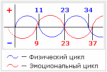

# Жизненные циклы (биоритмы человека)

Пять жизненных циклов человека - **биологические ритмы**:

**1. Физический цикл** – повторяется с интервалом в 23 дня, из них 11 в положительной зоне и 12 в отрицательной (см. ниже). Данный цикл отвечает за физическое состояние.

**2. Эмоциональный цикл** – 28 дней (+14; -14). Отвечает за эмоции, чувства.

**3. Интеллектуальный цикл** – 33 дня (+16; -17) - воплощение идей.

**4. Психокинетический цикл** – 54 дня (+27; -27) – воплощение мыслей.

**5. Астро-ментальный цикл** (или Духовно-целительный) – 84 дня (+42; -42) – отвечает за сон. Т.е. пока астро-ментальный цикл находится в положительной зоне, человек видит хорошие сны. Если в отрицательной – сны не очень хорошие, либо сознание их вообще блокирует, просыпаетесь и ничего не помните. В критические точки (пересечения с осью координат) могут сниться кошмары, если психика неуравновешенна. Вещие сны снятся с понедельника на вторник, и с четверга на пятницу в первую полную неделю месяца.

## Графики жизненных циклов (расчёт биологических ритмов)

Чтобы просчитать жизненные циклы на конкретную дату или месяц, надо высчитать сколько прожито дней на данный момент - т.е. умножить количество лет на 365, учитывая високосные годы, и прибавить количество дней с последнего дня рождения. Дальше рисуем систему координат: **ось Y** – это положительные и отрицательные зоны (чем выше в плюсе, тем день благоприятнее), **ось Х** – это дни месяца.

**Пример:** прожито 10210 дней. Чтобы просчитать физический цикл, надо разделить 10210 на 23. Получится целое число и остаток. Целое число – это количество прожитых полных циклов, а нам нужен остаток в днях. Точно также считаем остальные циклы.

Рисуем график:  
**1.** Если после деления получился ноль, значит начинается новый цикл, поэтому график рисуем с пересечения осей координат. При этом графики после рождения всегда идут вверх, и с определенной периодичностью опускаются.  
**2.** Если после деления получился остаток, допустим 6 дней, значит прошло 6 дней цикла, т.е. график начинаем не с нуля, а поднимаем по оси Y в определённую точку положительной зоны. По оси Х в этом случае начало координат будет соответствовать 6, и далее пойдёт 7, 8, 9 и т.д.  
**3.** Если остаток, допустим, 15 дней для физического цикла, значит 11 дней положительной зоны уже пройдены и на оси Y отмечаем минусовую зону, а по оси Х точка ноль будет соответствовать 15.

Точно также рисуем графики для всех пяти циклов, т.е. делим 10210 на 28, 33, 54, 84. **Рисуем биоритмы (циклы)** разными цветами на одном графике.  
- Пересечение циклов с линией Времени (ось Х) означает критический день.  
- Если 3 графика пересекли ось в одной точке, в этот день надо быть осторожнее.  
- Если 5 графиков пересекут в одной точке, этот день опасный для жизни.  
- Если все графики в отрицательной зоне, в эти дни человек обычно говорит: «что не делай, всё из рук валится». В этом случае наши Предки советовали найти другое занятие, сменить деятельность. Допустим, кузнец в «отрицательный период» может работать с землёй, грядки делать, рассаду готовить. Поэтому дома всегда была земля, она даёт силу.
