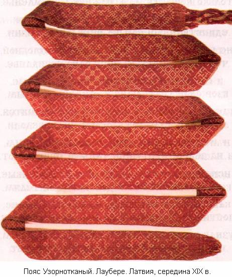
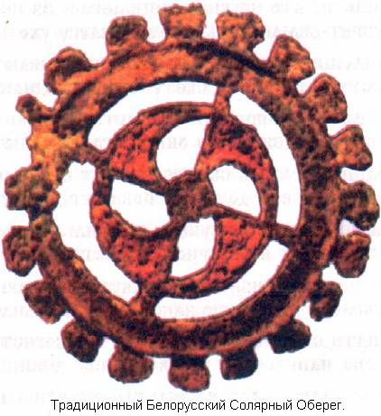

# Предание «Белый Путь»

Идут человече по пути жизни своей и не ведают, для чего они рождены. Для чего Боги послали их в Мир Яви коия цель в жизни и что после оной. Куда приведет их сей жизненный путь, то ли к Свету Белому, а то ли во Тьму. Такие мысли не покидают человече, от рождения в Мире Яви и до смерти. И сии размышления не чудны вовсе, ибо времена нынче - Ночь Сварожья.

Оная Ночь Сварога не на дворе стоит, а во сердцах человеческих лежит. И ежели забудет кто древний Род свой, то и ночная мгла на его сердце ляжет. И никто ведь, акромя человече самих, не в силах разогнать ночную Темень. И доколе не изведают человече Свет, и не последуют за ним по Белому Пути, до той самой поры, сия ночная Тьма будет жить во сердцах человеческих. Ибо самые злобные вороги человеков, ютятся в сердцах у них, и в Душах их. И только человече своими Деяниями, кои направлены на благолепие Родов, смогут исторгнуть из себя, всё то Зло, что поселилось в Душах и Сердцах их.

Лень и Чревоугодие, и Желание чужого замутнят весь Разум человеческий. И человече более не зрят Белого Пути, а скитаются непрекаенными по Миру. И все поиски их тщетны, ибо вот, холод Тьмы сковал Сердца и Души их. Великое cметение и nоска смертная, начинают глодать изнутри человеков. Только возврат к своим древним корням, помогает возвернуться на Белый Путь.

Путь сей, человече, начинают во Сварге, и только потом в Явный Мир попадают. Богородица Джива порождает их Души, даруя для жизни превеликую Мудрость. Стремительно Души летят ко Чертогам и на Земли цветущие затем попадают. Души для жизни себе Роды избирают, чтобы народиться в Родах тех Великих. И быть под призором Великих Богов, чье покровительство Роды охраняет.

Великая Макошь Судьбы их согласует, с Мирами, Богами и Совестью крепкой. Рождение в Яви их ведет к созиданию, и к жизни Духовной дает устремленье. Познанье всей Сварги и Мира Земного, для человече начнется с Мудрости Рода. Мудрость сия - не приложна, извечна, она в изначалье корнями Рода уходит. Но всех направляет в грядущее время, по Белу Пути, что во Правь проникает.

У разных народов cвой Путь-Назначенье и в разных Мирах ждут их возвращения. Для Расы Великой **Белый Путь** уготован и только она по нему лишь восходит. Во славны Миры, что наполнены Светом, в Миры, где потомков встречают их Боги. Связь неразрывна меж Мирами во Прави, и Свет первозданный им дан изначально. Души стремятся туда от рожденья во Яви, но не каждая Душа тех Миров достигает. Ибо Темные Силы, из Предвечных Миров, стремятся все Души завлечь в свое Пекло. Кривдой и Лестью, Обжорством и Похотью стараются Души они наполнять ежедневно. Чтобы сбились они, и метались во мраке, и не изведали Белый Путь свой заветный. А путь сей, не прост, он усердием славен, трудом созидательным и Верою древней.

Каждый рожденный сотворять начинает собственный Мир по Сварожьим Законам. В детстве шалашик из веток древесных, или Кремль песчаный на бреге речном. А после, согласно Родительской воле, во благо Родов он сотворять начинает. Только в труде, созидая лишь благость, в Яви рожденный Белый Путь обретает. Идя по Белому Пути, он Совести внемлет, и древние Боги его наставляют всемерно. От старцев Родов он познает всю Мудрость, что в Душу вложила Богородица Джива. Лишь Мудрость познав и телом окрепнув Семейный Союз он сотворять начинает.

Любовь, Радость, Счастье и древняя Вера даруют потомство в Союзе священном. Детей наполняя Светом Мудрости Рода у них обучаются наичистому взгляду. Коим охватывают Мир сей прекрасный и познают тайный смысл Мироздания. Сие раскрывает в рожденных Свет Силы, что освещает Белый Путь Восхожденья. Из Яви, рожденный, в Слави Мир попадает, где Предки Родов его радостно встретят. И там он продолжит творить созидание которое начал вершить в Явном Мире…  
  
Но всем Темным Мирам не угодны устои, по которым живут все рожденные в Свете. Не нравится им Белый Путь Восхожденья, и черная Зависть весь их взор затмевает. Им тяжко и тесно в том Пекельном Мире, где Алчность и Злоба узаконена всюду. Там нету Любви, Благоденствия, Счастья, только корысть, да к наживе стремленье. Желанье чужого, обман и распутство, единственный смысл Пекельной жизни. Не ведают в Мире том, жизни беззлобной, что выход дарует лишь одно Созиданье. И покидают свое Пекло, Силы Темные, взор свой устремляют к Мирам Светлым. Где недра Земные богатствами полнятся, а жители там, ложь, обман не изведали. И мчатся они по просторам безкрайним, и на Земли цветущие тайком прибывают.

Используя ложь и слова весьма льстивые, вельми проникают в доверие к жителям. Как только у жителей обретают доверие, постигать начинают их Наследие древнее. Узнав всё, что можно в Наследии древнем, его в свою пользу толковать начинают. Себя объявляют Посланцами Божьими, но Миру приносят лишь распри и войны. Используя хитрость и деянья порочные, они молодых отвращают от Мудрости. В безделии Праздном их жить приучают, к несоблюдению традиций отцовских. И те, кто внимает посланцам из Пекла, теряют свой Путь и безсмертную Душу. Безпутными бродят они в Своем Мире, но Душу потом они в Пекло ввергают…

Лишь те, кто не внял лицемерам из Пекла, узрят Белый Путь, что во Сваргу уходит. Идущие в Темень, во Тьме пребывают, устремленные к Свету, Сваргу познают. Каждый живущий свой Путь выбирает, своими деяниями он врата отворяет. Одним, врата в Сваргу откроет Бог Велес, другим, Вий до Пекла покажет дорогу…

Лишь только живущим Божьим устоем, помогают всемерно все Светлые Боги...

И человече измерно движутся в Сваргу, Белым Путем, по Законам Сварожьим. Идти сим Путем помогает им Совесть, она направляет на свершенье деяний. Во Славу Родов, во Величье Отчизны, и отвращает от всех дел непристойных. Все Предки Родов помогают идущим, чтоб не прервалась их нить Родовая...

Не хожены тропы за смертной чертою, для тех, кто родился под светом Ярилы. А посему Белый Путь указует живущим, где они обретут все древнейшие Силы...  

