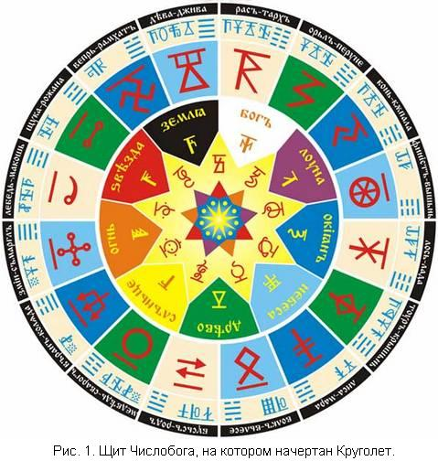
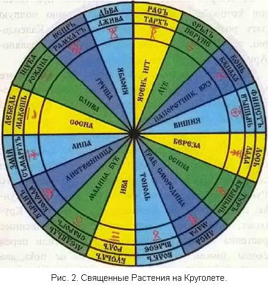

# Круголет. Сварожий Круг (сущность и характер человека)

Уважаемые читатели, в первых трех Книгах из серии «Славяно-Арийские Веды», вы частично ознакомились с Даарийским Круголетом Числобога. В данной Четвертой Книге, приводятся данные, которые помогают человеку, знающему свою дату рождения по Круголету Числобога, приблизиться к сути своего рождения на Мидгард-Земле.

1. Сварожий Круг  
2. Сварожий Круг и сущность человека  
3. Особенности характера  
4. Характер человека по четвертям месяца  
5. Четверть

Желание изведать, какие качества даны вам при появлении в этом Явном Мире, и чем наделили вас Светлые Боги, в месяц и день вашего рождения, свойственно многим людям, особенно тем, чья Душа проснулась от долгого наведенного сна.  
**В Первой Книге**, указана сущность годов Круголета. И человек, узнавший свое Лето рождения, мог получить необходимую краткую информацию, какими свойствами он был наделен при рождении именно в этот год Круголета («Славяно-Арийские Веды». Книга 1, Сущность Лет Круголета).  
**Во Второй Книге**, указана система, при помощи которой, можно было узнать свою полную дату рождения, по Славяно-Арийскому Календарю, т.е. Лето от СМЗХ, месяц и день («Славяно-Арийские Веды». Книга 2, таблицы и примеры).  
Зная эти исходные данные, по **Третьей Книге** можно было определить, на какой Небесный Чертог Сварожьего Круга пришлось ваше рождение («Славяно-Арийские Веды». Книга 3, Сварожий Кург).

## Сварожий Круг

  
На **рисунке 1** изображен Щит Числобога, на котором можно найти: свой Небесный Чертог Сварожьего Круга, под сенью которого вы рождены. Там же указан его Рунический символ, и многое другое. На **рисунке 2**, изображен Круголет, на котором можно найти свои священные растения и Древа-охранители. Их растили перед своим домом, чтобы дом никогда не покидала удача. Из своего священного древа, человек изготавливал посох, который использовал в священных обрядах и отправляясь в дальние путешествия.  
  
Далее мы приводим ограниченную информацию, чтобы белый человек из Родов Великой Расы или потомок Рода Небесного, возвращающийся к своим древним Родовым корням, мог узнать о своей сокрытой, внутренней сущности и о том, что даровали ему, для Явной Жизни на Мидгард-Земле, Небесные Боги. (*Нижеследующий текст, адаптирован под современное мировосприятие человека и печатается с сокращениями, более подробно будет описано в Книге Пятой*).

## Сварожий Круг и сущность человека

Сущность Небесных Чертогов объединялась нашими Предками попарно, ибо соседние Чертоги имеют некоторые общие свойства.

**Чертоги Девы и Вепря** дают человеку стремление к познанию окружающего Мира во всем его многообразии. Люди, рожденные в данных Чертогах, не признают давления на себя при принятии решений и сами стремятся быть лидерами, чтобы самостоятельно решать все вопросы.  
**Чертоги Щуки и Лебедя**. Люди, рожденные в данных Чертогах, стремятся к спокойной, размеренной Жизни, к традиционному укладу, наполненному чувственными сопереживаниями. Для них самой трудной задачей является принятие важного решения.  
**Чертоги Змия и Ворона**. Люди, рожденные в данных Чертогах, очень активны по своей природе. Самое тяжкое для них - это одиночество. Очень влюбчивы и считают, что только Любовь (Явная, физическая, плотская) должна стоять во главе угла, а потом уже все остальное.  
**Чертоги Медведя и Бусла**. Люди, рожденные в данных Чертогах, добролюбивы по своей природе. Их постоянное стремление - облагородить все вокруг себя. Они созидают во благо своего Рода и при созданном достатке в своем Роду стараются иметь богатое потомство.  
**Чертоги Волка и Лисы**. Люди, рожденные в данных Чертогах, искатели по своей природе. В Любви они ищут суть и смысл. Они любят экспериментировать над собой. Чувство любопытства у людей, рожденных в данных Чертогах, сильнее страха перед неизвестным и им интересно увидеть весь окружающий Мир.  
**Чертоги Тура и Лося**. Люди, рожденные в данных Чертогах, трудолюбивы, постоянно заняты каким-либо трудом, даже если этот труд однообразен. Их внутренняя сущность как бы пробуждается к жизни с началом весны, а когда наступает Новолетие, их творческий подход к Жизни впадает в спячку.  
**Чертоги Финиста и Коня**. Люди, рожденные в данных Чертогах, по своей необузданной неохватности пытаются делать сразу несколько дел. С детских лет они неусидчивы и поэтому они в течение дня могут браться за одно и то же дело, начиная его и бросая, но потом доводят его до конца. По своей природе они - максималисты, поэтому, совершая какие-либо деяния, их разум пытается решать глобальные Вселенские вопросы.  
**Чертоги Орла и Раса**. Люди, рожденные в данных Чертогах, добродушны и доброжелательны. В них очень развито чувство покровительства, но иногда это чувство может перерасти в назойливость и навязывания своего мнения другим. Обучение и познание этим людям дается легко, но познавать окружающий Мир и сущность Природы им мешает великая лень. Чтобы успокоить себя и окружающих людей, они придумали отговорку: «зачем познавать сейчас, со временем все само придет и встанет на свои места», а им говорили: «под лежачий камень и вода не течет».

## Особенности характера определяемые Небесными Чертогами Сварожьего Круга

*Чертог Девы*: дает упрямство, независимость, способность достигать  
поставленной цели.  
    *Чертог Вепря*: дает своевольность, решительность, умелое выполнение поставленной задачи, при условии, что не будет выбора.  
    *Чертог Щуки*: дает способность адаптироваться в любой среде и везде чувствовать себя как рыба в воде.  
    *Чертог Лебедя*: дает ветреность, своенравность и своевольность, а иногда, чрезмерную гордость и самовозвеличение.  
    *Чертог Змия*: дает холодный, ничем не прикрытый эгоизм, самовлюбленность, иногда переходящую в любвеобильность, а также неприятие критики в свой адрес.  
    *Чертог Ворона*: дает добродушный, открытый характер, влюбчивость и любвеобильность, иногда доходящую до ветрености. К 40 летам дает человеку Мудрый Жизненный опыт.  
    *Чертог Медведя*: дает мужество, стойкость, покровительство, способность разобраться в любом деле и способность найти выход в любой запутанной ситуации.  
    *Чертог Бусла*: открытость, взаимоуважение, Душевность, способность выбирать наиболее удобное и благоприятное место для Жизни, чтобы вырастить здоровое потомство.  
    *Чертог Волка*: воинственность, настороженность, стремление навести порядок любой ценой. По типу характера таких людей можно назвать «санитарами Жизни».  
    *Чертог Лисы*: дает хитрость, умение льстить, склонность к экспериментам и опытам для того, чтобы все проверить на себе и использовать для спокойной, безбедной Жизни.  
    *Чертог Тура*: дает человеку стойкость, трудолюбие и деловую устремленность даже в рутинных условиях, упорство в достижении поставленной цели при условии, что эту цель человек определил для себя сам.  
    *Чертог Лося*: веселый, любвеобильный, открытый характер, беззаботный и безмятежный образ жизни, стремление к безграничным идеалам.  
    *Чертог Финиста*: дает осмотрительность, склонность к опытам для того, чтобы познать различные стороны Жизни, способность не падать Духом в случае неудачи. Умение браться за дела для достижения цели.  
    *Чертог Коня*: дает человеку стремительность и всеохватную жажду Жизни, но очень часто за стремительным движением к какому-либо идеалу он пролетает мимо идеалов более величественных и ценных.  
    *Чертог Орла*: дает мощь, решительность в действиях, полет мысли и фантазии.  
    *Чертог Раса*: дает рассудительность, спокойствие при обдумывании проблемы и, в то же время, веселье и безмятежность во времена отдыха.

Все вышеперечисленные характеристики являются общими для Чертогов и усиление или ослабление каких-либо характеристик или качеств зависит от того, в каком Зале Чертога будет стоять какая-либо Луна, Земля, Солнце или Звезда.  
Далее вы можете узнать, по своему Славянскому дню Рождения, какими качествами наделили вас Небесные Боги, именно в день вашего появления на Свет Божий (*все данные адаптированы под современное мировосприятие человека*). Сначала необходимо найти, в ниже приведенных характеристиках, свой месяц Рождения. По своей дате Рождения смотрите, на какую четверть месяца пришлось ваше Рождение, и узнаете необходимые данные. Затем, в таблице дней четверти получаете дополнительную информацию, которая становится определяющей, для ваших данных, указанных ранее.  
    Чтобы получить наиболее полную информацию, необходимо знать свое Славянское время Рождения. А зная его, можно получить дополнительные данные, которые человек получает в определенное Богами время. Ибо дополнительные характеристики несут: час, часть, доля, мгновение, миг и т.д. вашего Рождения. Более подробно, будет описано, в Пятой Книге из серии «Славяно-Арийские Веды».

## Характер Человека по четвертям Месяца

**Рамхатъ**, I четверть (1-10): Эти дни дают рожденному силу воли, целеустремленность, мистический склад ума, неспособность воспринимать критику в свой адрес, ибо критика вызывает у него чувство агрессии, особенно если она несправедлива. Люди, рожденные в эти дни, очень любопытны и пытаются до всего дойти своим умом. В свободное время любят читать книги, слушать музыку, выращивать цветы, заниматься с животными.  
    II четверть (11-20): Люди, рожденные в эти дни идут только по им известному пути. Самое трудное для них - делать выбор между несколькими нужными вещами, идеями или целями. Они «могут остаться голодными перед обильно накрытым столом», ибо они не будут знать, с чего начинать есть. Кроме того, эти люди предпочитают коллектив, нежели одиночество. Они не любят самостоятельного чтения: им больше нравится слушать и смотреть. Они с радостью примут ответ на любой вопрос, нежели самим думать для достижения ответа.  
    III четверть (21-30): Люди, рожденные в эту четверть, наделяются ярким, самобытным характером. Они пытаются вникнуть в сущность всех вещей, даже внешне пытаясь быть как бы не у дел. Они постоянно просчитывают Конкретную ситуацию, ибо у них ум аналитика и экспериментатора. Такой человек всегда лидер по своей природе и, даже в семье, он пытается занять главную роль, что приводит к конфликтам в семье.  
    IV четверть (31-40): Эти люди от рождения наделены философско-аналитическим складом ума. Иногда они так глубоко окружают себя философией и философскими размышлениями, что могут заболтать любое дело. Про таких людей говорят: «с кем бы ни говорить, лишь бы говорить». У таких людей часто бывает тяжелая семейная Жизнь вследствие их чрезмерного многословия.  
    41 день: В этот день рождаются очень импульсивные, любвеобильные люди. Таких людей часто называют Душой общества. Они легко овладевают различными профессиями, так как их аналитический ум помогает вникнуть в суть любой профессии и любого труда.

**Айлетъ**, I четверть (1-10): В эту четверть рождаются люди, не выносящие одиночества. Они не могут существовать без Любви и ухаживания. Быть в центре внимания - их постоянная цель. При этом им лень тратить силы на привлечение внимания, считая, что все сами должны восхищаться ими. Великолепную память они используют, чтобы больше запоминать разговоров, сплетен, басен, анекдотов, чтобы всегда смочь поддержать разговор в любой компании. Иногда они очень удачно находят себя в сфере обслуживания.  
    II четверть (11-20): Люди, рожденные в эту четверть, наделены любвеобильностью и трудолюбием. Они домовитые, стараются сделать все для дома и семьи. При этом они нередко попадают под влияние вещизма и сохраняют вышедшие из обихода старые вещи. У них постоянно хранятся бабушкины и дедушкины старые вещи и идет накопление новых вещей, при этом, человек даже не задумывается, нужны ли они будут его потомкам. Такие люди часто любят бывать на чужих праздниках, а не проводить свои собственные, так как это для них, как они считают, пустая трата средств.  
    III четверть (21-30): Люди неимоверно трудолюбивые и работоспособные. Они всю Жизнь трудятся не для себя, а для своего Рода и для других: поднимают детей, потом детям помогают поднять внуков, внукам - правнуков. У них чистый, светлый, мистико-реалистический ум. Они не выносят лжи и фальши. Стремятся, чтобы вокруг них царили достаток, гармония и покой в отношениях. Они с детства прививают своим детям трудолюбие и чувство собственного достоинства.  
    IV четверть (31-40): Люди импульсивные, любвеобильные, любят быть в центре внимания, часто вмешиваются в разговоры, в Которых ничего не смыслят, чем вызывают к себе негативное отношение. Их природное любопытство не имеет границ. Их желания очень часто не совпадают с их возможностями, поэтому они стараются найти себе покровителя, который помог бы им осуществить их желания. При всем их независимом образе Жизни, о котором они постоянно говорят, эти люди постоянно почитают своих родителей, и в любом состоянии пытаются чем-то помочь им; особенно стараются помочь им в трудной обстановке.  
    41 день: Люди, рожденные в данный день, наделены внутренними противоречиями. Всю свою жизнь они сталкиваются со всевозможными проблемами, которые им приходится преодолевать. От рождения они наделены ясным, светлым умом и прагматизмом. Когда реальность не совпадает с задуманными планами, у них появляется депрессия, которая может привести их к нервному срыву, либо к применению химических или Природных препаратов для ухода из реальности (табак, алкоголь, наркотики).

**Бейлетъ**, I четверть (1-10): Люди, рожденные в эту четверть, наделены тягой к познанию, а также, громадной хитростью. Они любую ситуацию стараются повернуть в свою пользу и извлечь из нее выгоду. Они бывают очень самовлюбленные, любят, когда им оказывают знаки внимания, Когда за ними ухаживают, слушают их мнение, но также познавательны и любят познавать окружающий Миръ.  
    II четверть (11-20): Люди, рожденные в эту четверть, имеют переменчивый характер. Они живут по принципу: сейчас мне надо это, через минуту - другое. Они находятся в постоянном разброде и не знают что им Конкретно нужно, поэтому они находятся в постоянном поиске. Это великие экспериментаторы, старающиеся что-то создать, поэтому в их Жизни происходит постоянная смена обстановки, но вся Жизнь их идет с постоянными переменами: то белая полоса, то черная. Они прекрасно себя чувствуют в Религиозно-Духовной атмосфере.  
    III четверть (21-30): От рождения эти люди упрямые до невозможности. Они привыкли считаться только с собой и признают наставления только Родителей и Богов. Родителей они очень любят и помогают, потому что видят в них опору и убежище в черные дни, ибо помнят с детских лет, что Родители никогда не откажут в помощи и приюте. И в таком же ключе они воспитывают своих детей. Эти люди от рождения наделены хитростью и философским складом ума, поэтому часто становятся проповедниками, Священнослужителями либо артистами.  
    IV четверть (31-40): В эту четверть рождаются люди с веселым характером, трудолюбивые. Любят праздность в шумной компании и обычный семейный распорядок дня. Они любят трудиться на земле (сад, огород, дача), либо с выпуском предметов необходимых в семейном производстве. Они очень домовиты и любят детей. Жизнь без детей им кажется неправдоподобной, ибо от рождения им присуще чувство Долга перед Родом.  
    41 день: Люди, рожденные в этот день, наделены решительностью, Силой Воли, упрямством. Подсознательно они считают свое решение истиной в последней инстанции. Они охотно выслушивают все советы и соглашаются с теми, кто их дает, но в конце концов все будут делать по-своему. А в случае неудачи обвиняют советчиков в том, что они им неправильно насоветовали.

**Гейлетъ**, I четверть (1-10): Люди, рожденные в эту четверть, веселые, нередко сумасбродны, их считают Душой любой компании и порядочными людьми. Они умеют активно веселиться и так же активно трудиться. Стремление к трудолюбию дано им от рождения. В связи с тем, что от рождения им дано чувство справедливости и стремление к порядку, такие люди избирают путь служения обществу (органы правопорядка, защиты общества и правосудия).  
    II четверть (11-20): Люди, рожденные в эту четверть, обладают философско-познавательным складом ума. Вся их Жизнь - сплошные эксперименты, которые они ставят не столько на других, сколько на себе. А все, что испытано на себе они вводят в ранг незыблемой истины, не терпящей обсуждения. Про них говорят, что свои убеждения они отстаивают «с пеной у рта». Свою правоту они доказывают, если не фактами, то стремительными проявлениями своей Воли.  
    III четверть (21-30): Люди, рожденные в эту четверть, наделены чувством ритма, музыкальными способностями. Из них часто получаются прекрасные творцы произведений искусства (музыка, литература, зодчество и т. д.) Они в постоянном поиске и исследовании новых ощущений. Они любвеобильны, но и в Любви они в постоянном поиске новых ощущений. У них редко бывает семейное счастье, так как они постоянно стремятся к смене обстановки, чтобы своими очами узреть Мир.  
    IV четверть (31-40): В эту четверть рождаются люди с мягким, добродушным характером. Они наделены мнительностью, переживаниями, состраданием. У этих людей скорей материалистичный, чем идеалистический склад ума, и поэтому они пытаются до всего дойти своим умом. Для них важно, чтобы была цепь логических рассуждений или математических вычислений для получения ответа на какой-либо вопрос. Даже для познания сущности Бога они могут вывести специальные математические формулы, и если данные математические выражения подтверждают существование Бога, то эти люди начинают безгранично в него верить. Если математически они не могут подтвердить существование Бога, они начинают жить по принципу: «Есть Бог - хорошо, нет - проживем и без него».  
    41 день: Люди, рожденные в этот день, подвержены влиянию различных религиозных учений. Они пытаются познать все учения, которые попадаются им на Жизненном Пути. Они искренне верят в то учение, которое на данный момент изучают, но стоит им разочароваться в данном учении, они переходят в новое. И так в постоянном поиске проходит вся их Жизнь.

**Дайлетъ**, I четверть (1-10): Люди, рожденные в эту четверть, пытаются обрести себя в полезности своих деяний для окружающего мира. Их мягкая, нежная природа подвержена влиянию различных учений как религиозного, так и социально-бытового направления. Их добрый, мягкий, мнительный характер помогает приспособиться к любой обстановке. Чувство Любви и сопереживания помогает им строить семейную Жизнь, но подводные камни в течение Жизни создают много проблем для такого человека и он начинает паниковать перед якобы неразрешимой проблемой, хотя через некоторое время она решается сама собой.  
    II четверть (11-20): В эту четверть рождаются люди с противоречивым характером. Их настроение постоянно меняется и им свойственно все абсолютизировать. Маленькие внутренние победы могут вылиться в грандиозный праздник, а мелкие неудачи могут превратиться в величайшую трагедию. Причина всему кроется в мнительности, осторожности и недоверии, но при этом люди, рожденные в данную четверть, наделены любвеобильностью, которая преображает не только их самих, но и всех окружающих, а когда они чувствуют поддержку других людей, они могут свернуть горы.  
    III четверть (21-30): Люди, рожденные в эту четверть, по своей природе добродушные и мягкотелые. Они стремятся добиваться всего только своими силами и своим трудом, при этом цель их труда направлена на оказание помощи другим людям. Малейшие неудачи и проблемы повергают такого человека в состояние депрессии и тоски. Ему начинает казаться, что весь Мир отвернулся от него, тот Мир, для которого он старался изо всех сил. Это депрессивное состояние может увести человека из привычного ему общества и он становится отшельником. В современном Мире, такой человек идет в какую-нибудь религиозную общину или начинает искать забвение в алкоголе и наркотиках, чтобы попасть в иной Мир, где не существует его проблем.  
    IV четверть (31-40): В эту четверть рождаются люди Волевые и целеустремленные. Любое деяние буквально кипит в их руках. Они наделены чувством прекрасного и много свободного времени уделяют искусству. В современном Мире они часто становятся антикварами, археологами, собирателями древности не для того, чтобы иметь древние раритеты, а для того, чтобы через них прикоснуться к Древней Мудрости и к Жизни, существовавшей в прошлые времена. Но Природа их обделила мощной нервной системой, и они очень часто нервничают по мелочам. Из-за нервного состояния в них появляется множество болезней, которые они будут относить к каким угодно причинам, только не к своей нервозности.  
    41 день: В этот день рождаются люди с мистическим и философско-нравственным складом ума. Вся их Жизнь - сплошная тайна и загадка, которую они не стремятся обнародовать. Они многолики. На работе они одни, в семье - другие, в компании - третьи, а в свой собственный Мир они не допускают никого, даже самого близкого человека.

**Элетъ**, I четверть (1-10): В эту четверть рождаются люди, которые любят быть в центре внимания. Их доверчивость нередко доставляет им много проблем в Жизни. Они очень любят окружающий Мир Природы и не мыслят Жизни человека без какой-либо связи с животными. Их Жизнь всегда складывается так, что они постоянно вспоминают о своем детстве и, будучи маленькими, они не желают взрослеть, ибо детство для них кажется самой великолепной порой в Жизни. Вся их последующая Жизнь – как-бы отголосок детства.  
    II четверть (11-20): В эту четверть рождаются люди с авантюрным складом ума. Они стремятся к новой цели не взирая ни на какие преграды и часто добиваются своего, хотя при этом тратится много сил, а иногда и крови окружающих их людей, ибо они идут к своей цели по головам. При этом они так же любят Природу, окружающий Мир, постоянно заводят себе кошек и собак, постоянно любят собирать и коллекционировать старые вещи.  
    III четверть (21-30): В эту четверть рождаются люди, всего добивающиеся своими силами, несмотря на множество проблем, которые появляются на их пути. Главная их цель в земной Жизни - создать семейный уют и добиться достатка для своего Рода. Поэтому, наибольших результатов они, как правило, добиваются, будучи купцами или промышленниками.  
    IV четверть (31-40): В эту четверть рождаются люди, наделенные философско-мистическим складом ума. Они стремятся добиваться признания в Жизни общества. Из-за этого они очень мало времени уделяют семье. Поэтому семейная Жизнь этих людей не всегда удачная. Им постоянно необходима психологическая разгрузка, которую они могут обрести только тогда, когда окажутся на Природе. В случае отрыва от Природы Жизнь их бывает кратковременная и уход из Жизни, как правило, связан с нервным истощением.  
    41 день: Люди, рожденные в этот день, наделены необычными способностями, которые помогают им адаптироваться в любой среде. То есть, находясь в лесу, они не заблудятся, в воде - не тонут. Если этот человек находится в гостях, где много животных, то животные льнут к ним, как иногда и люди. У них великолепная память. Они прекрасно обучаются и любят изучать древние науки и искусства.

**Вэйлетъ**, I четверть (1-10): В эту четверть рождаются люди с ветреным характером. Им трудно планировать свой распорядок дня. Они живут как бы по Воле случая: день прошел и ладно. По этому им трудно существовать в обществе, где существует распорядок дня. У них не лады с математическим анализом. Они всегда надеются на удачу и постоянно рискуют, предпринимая какие-либо действия. В случае опасности они всегда надеются на Русский авось. Они всегда очень азартны и любят всевозможные игры. Они участвуют в них, абсолютно не задумываясь над тем, будет соприсутствовать удача или они потерпят неудачу. В игре, как и в Жизни, для них важен сам процесс. Но, несмотря на то, что у них проблемы с математическими вычислениями, их великолепная память помогает запоминать определенные стандартные ситуации, поэтому их любимой игрой очень часто становятся шахматы.  
    II четверть (11-20): В эту четверть рождаются люди с великой Любовью к Земле. Их любимое занятие - садоводство, цветоводство, огородничество. Эти люди от рождения привыкают просчитывать свою Жизнь на много лет вперед и трудятся, чтобы обеспечить достаток в Жизни не только себе, но и всем своим близким. Это прямолинейные люди, у которых в Жизни бывает мало друзей, ибо они всегда говорят в глаза то, что думают. Поэтому, если у них и есть друзья, то им они доверяют на 100% и эти друзья находятся рядом с ними и в горе и в радости. Про них говорят, что они «положат животы за други своя».  
    III четверть (21-30): В эту четверть рождаются люди, наделенные способностью находить общий язык со всеми людьми и создавать с ними хорошие отношения. Они, как правило, общительны и добродушны. В Народе про таких людей говорят: «ласковый теленок, который семь мамок сосет». Из любого знания они берут только то, что им нужно, а иногда и выгодно. Но в общении они даже частицу знания могут выдать за абсолютную целую истину и люди примут их слова к сердцу. Нередко они прибегают к хитрости и лести для того, чтобы избежать конфликтов или достичь определенной договоренности. Они часто становятся послами и дипломатами. В обычной Жизни, они очень домовитые, любят семейный уют, но при всем при этом очень любят шумные компании вне семейного круга.  
    IV четверть (31-40): В эту четверть рождаются люди, отличающиеся умом и изобретательностью. Они всегда приспосабливаются к любому окружающему миру. Любят показать свое «я», чтобы быть в центре внимания. Со всеми находят общий язык. С детских лет не любят читать и учиться, особенно в детстве, но любят внимательно слушать и запоминать то, что им выгодно. Природная ветреность и внутренняя независимость не мешает им создать крепкую и надежную семью. После 40 лет вся их деятельность бывает направлена на процветание и созидание своего Рода.  
    41 день: В этот день рождаются своевольные люди, живущие по принципу: «Родовой Закон соблюдаю, а во всем остальном, что хочу то и ворочу». Они очень часто берутся за многие дела, но не всегда доводят их до конца. Поэтому у них очень часто не складываются отношения с окружающими, что очень часто приводит к тому, что люди, рожденные в данный день, меняют место жительства. Народная молва называет таких людей «перекати-поле».

**Хейлетъ**, I четверть (1-10): Люди, рожденные в эту четверть, наделены светлым умом. Они стараются обеспечить себя и свой Род материальным достатком в начале Жизни. И только лишь после того, как им исполняется 40, они начинают задумываться о Душе и Духе. Но это происходит редко, так как у них материальная часть Жизни преобладает над Духовной.  
    II четверть (11-20): В эту четверть рождаются люди, которые стремятся жить в свое удовольствие и на широкую ногу. Они не думают о завтрашнем дне и живут только сегодняшним. При этом стремятся, чтоб Жизнь протекала в развлечении и получении удовольствия. Для таких людей материальные блага выше Духовных. Но среди этих людей есть исключения, то есть их полная противоположность, которая посвящает себя Духовной Жизни. Но и от этой Духовной Жизни они получают великую радость и удовольствие.  
    III четверть (21-30): Люди, рожденные в эту четверть, наделены чувством справедливости. Для них, правда и справедливость - не пустой звук. Такие люди готовы идти на смерть за правое дело. Они постоянно борются за справедливость. Им присуще чувство собственного достоинства. Они готовы прийти на помощь в любых обстоятельствах. Несправедливость в мире должна быть искоренена. Данные люди стремятся построить общество справедливости и начинают его строить со своей семьи и своего Рода.  
    IV четверть (31-40): Люди, рожденные в эту четверть, не мыслят Жизнь без труда. Они привыкли всего добиваться своими силами. Они не приемлют бездельную Жизнь и стараются своих детей приучить к труду. Поэтому их называют величайшими тружениками. Они достигают успехов в любой профессии, за какую бы ни брались. Особая удача их ждет при созидательном труде на благо Державы, ибо их творения потомки назовут памятниками истории и Культуры.  
    41 день: В этот день рождаются люди с экстрасенсорными и мистическими способностями. Они не признают над собой никакой власти, кроме Духовной власти тех людей, которые дают им Мудрость и Знания. Эти Знания они обращают в помощь, если они живут в светлом обществе (в обществе, живущем по Совести и Законам Рода) и во вред, если живут в тоталитарном государстве (монархия, империя, демократия, коммунизм, религиозное государство и т.д.).

**Тайлетъ**, I четверть (1-10): В эту четверть рождаются люди, привыкшие свои дела доводить до конца. Это самостоятельные, своевольные и Волевые личности. Они всегда действуют по своему усмотрению и на свой страх и риск. При этом они очень любознательны и тянутся к знаниям. Их вроде бы внешняя неусидчивость и неуживчивость не мешают им изучать все до мельчайших подробностей, чтобы быть в курсе всех дел.  
    II четверть (11-20): В эту четверть рождаются люди с добрым, меланхолическим характером. Их стремление к познанию в разных сферах, особенно Духовной Жизни, связано не столько с тем, чтобы получить материальную выгоду, сколько с тем, чтобы показать свою власть над стихиями, вызвав тем самым страх и удивление у людей, а стало быть, как они думают, уважение, ибо их логика Жизни строится на следующем: «боятся - значит уважают».  
    III четверть (21-30): Люди с образно-аналитическим (объемно-аналитическим) умом. В своей земной Жизни они всего достигают сами. Это великие экспериментаторы не принимающие слова на Веру и пытающиеся все доказать путем опытов или экспериментов, чтобы на собственном опыте убедиться в высказывании.  
    IV четверть (31-40): В эту четверть рождаются люди с традициональным аналитическим складом ума, который помогает им познать Древнюю Мудрость всех Родов человеческих. Познавая различные Духовные учения, они доходят до самой сути и находят в этих учениях изначальные точки событий. По своей природе это очень общительные люди, которые у всех на виду. Но, не смотря на то, что про них говорят что «все о них знают», это люди-загадки. Эти люди только с виду просты. У них свой огромный внутренний Мир, в который они никого не пускают, даже близких людей.  
    41 день: В этот день рождаются люди, наделенные особыми Духовно-мистическими способностями: суггестия, гипноз, левитация, телекинез, пирокинез и пр. Они легко познают различные Ведические и религиозные учения. Им от рождения ведомы основные ключи и тайны Мироздания, но, в связи с тем, что они большую часть времени посвящают Духовному Миру, в Мире Яви эти люди считаются отшельниками, ибо у них не складывается ни семейная Жизнь ни общественная. Окружающие их люди не в состоянии понять глубину и мощь их внутреннего Мира.

## Четверть

1 день – дает человеку особую форму Жизни и деятельности и это всегда помогает прийти к победному венцу.  
2 день – дает человеку возможность соединять различные формы Мудрости.  
3 день – дает человеку разумную форму размножения Знания и Закона.  
4 день – наделяет человека милосердием и состраданием.  
5 день - дает человеку возможность обрести др.Знание и тут же наделяет страхом перед ним.  
6 день – дает человеку успех во всех его делах и красоту.  
7 день – наделяет человека стремлением к победе Истины.  
8 день – дает человеку почести Судьбы при достижении своей цели.  
9 день – наделяет человека основанием для начала любого познания.  
10 день – наделяет человека способностью к познанию и способностью использовать Древнюю Мудрость в созидании.
