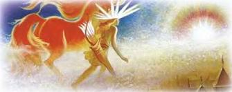

# Держава — как было, основы Державы

Русы и арии длительное время имели державную форму правления. Первоисточником наших знаний о державном правлении являются Славяно-Арийские Веды. Согласно им существует две системы социальной организации жизни людей: Держава и государство. В прошлом (и не таком уж далёком) русы и арии жили в Державе. Организация жизни людей в Державе предусматривала гармонию с Природой, потому что держалась не на интересах конкретных людей (государей, их чиновников и прочих потребителей), а на Традиции, Заповедях Светлых Богов и Великих Предков, и Совести людей.

1. Вера Первопредков – духовная основа Державы  
2. Род – социально-экономическая основа  
3. Врожденные качества людей  
4. Кастовая система  
5. Дружины – основа военной организации  
6. Управление в Державе  
7. Закат Державы

Светского единоличного (самодержавного) руководителя в Державе не было. В Державе осуществлялось самоуправление Родов русов и ариев. Мощь Державы покоилась на могуществе Родов и Духовности их представителей. **Держава управлялась народом, состоящим из Родов, и держалась его Духовностью**. В Державе к любому человеку относились как к потомку Светлых Богов, а перед ними все были равны, независимо от исполняемой роли в обществе. В понимании русов и ариев «народ» не просто жители, населяющие определённую территорию, а совокупность Родов и Племён. Понятие «народ» не тождественно понятию «*население*», потому что население может не жить Родами, а состоять из изгоев, чужестранцев и чужеземцев.

## Вера Первопредков – духовная основа Державы

Духовной основой Державы являлась Старая Вера Первопредков, которая объясняла и охватывала все стороны жизни Родов русов и ариев. Из неё они постоянно черпали Древнюю Мудрость и получали великую Духовную силу для своего бытия и творения. В Старой Вере Первопредков русы и арии находили ответы на все вопросы, которые появлялись в их жизни. Поэтому Старая Вера – это не религия, а свод Мудрости и Знаний Первопредков, который был дан им в незапамятные времена Светлыми Богами.

В русо-арийском обществе существовало духовное единство всех Родов, Общин и Племён, основой которого была Старая Вера Первопредков. Именно они удерживали народ в единстве. Отсюда прямо вытекает, что понятие «Держава» имеет отношение к такому обществу, в котором единство народа удерживается его духовностью, основанной на Старой Вере Первопредков.

## Род – социально-экономическая основа

Социально-экономической основой Державы был Род. Род состоял из индивидуальных семей, главной обязанностью которых было воспроизводство потомства для продолжения и укрепления Рода. Хозяйственная жизнь, воспитание и обучение детей осуществлялось в Роду. Род самообеспечивал себя жильём, питанием, одеждой, обувью, домашней утварью и прочими необходимыми предметами и приспособлениями, а также оружием. Чего не хватало для обеспечения жизнедеятельности, то выменивалось на торжищах. Основой жизни каждого члена Рода был его труд, направленный на его благо и благо Рода.

Родовым поселением был скит или скуф. Возглавлял Род Глава Рода. Однако он не решал вопросы единолично. Он сам решал только текущие вопросы и представлял Род на Державном Круге. Для решения общих вопросов Рода собирался **Круг глав** отдельных семей, имевших взрослых (имянаречённых) детей. На этом Кругу принимались решения, которым все члены Рода следовали неукоснительно. Все вопросы организации жизни в Роду решались согласно Заповедям Светлых Богов и Великих Предков, а также Родовых Устоев и Правил.

По мере роста численности Рода выявлялась необходимость его деления. Род, как правило, делился на две части. Старшая часть Рода оставалась на прежнем месте проживания, а младшая часть Рода уходила на новое место и основывала свой скит либо скуф. С образованием нового Рода появлялось Племя, которое могло иметь до 16 Родов. Если Племя превышало 16 Родов, то оно превращалось в Народ. В начале регулирование отношений между Родами, когда их было не более восьми, осуществлял глава древнего Рода.

Затем для регулирования межродовых отношений стали выбирать князя. Им становился либо глава древнего Рода, либо глава нового великого Рода. Вместо выбранного князя в Роду избирался новый глава. В обязанности выборного князя входили осуществление разбирательств при возникновении трений между Родами, подготовка дружины и защита племени (народа) и его территории.

После того как Рода русов и ариев, распространяясь с Ирийских (Саяно-Алтайских) и Рипейских (Уральских) гор, заселили всё Беловодье (нынешнюю Сибирь). Славянская Держава Расения почти полностью возродилась. Это произошло приблизительно девять тысяч лет до 2000 года современного летоисчисления. Сразу же появилась необходимость разграничения территорий между племенами и начавшими формироваться народами. Беловодье было разделено на **16 весей** (областей). Каждая весь имела стольный град, в котором имелось Весевое Капище.

С девятого тысячелетия до 2000 года современного летоисчисления начинается похолодание на севере Рассении. Природно-климатические условия там стали быстро ухудшаться. Расселение Родов Расы Великой на север прекратилось. Теперь Рода русов и ариев переселялись на запад, юг и восток. К восьмому тысячелетию до 2000 года современного летоисчисления на западе они расселились до нынешней реки Волги, на юге до Гиндукуша, Тибета и нынешней реки Хуанхэ. Ими были заселены нынешний остров Сахалин, Восточные (Японские) острова и область Ордос в нынешнем Китае. Таким образом, Славянская Держава Рассения и Даурия к восьмому тысячелетию до 2000 года современного летоисчисления занимали огромную территорию и вступили в контакты, причём далеко не дружественные, с другими народам. В это время Родо-Племенной строй в Рассеннии достиг пика своего развития.

## Врожденные качества людей

Социальная организация Славянской Державы строилась на врождённых качествах людей. Эти врождённые качества легко распознаются, если открыть информационно-энергетическую структуру человека, которая состоит из девяти основных информационно-энергетических центров, которые в индийских учениях называются чакрами. Каждый центр порождает энергетический вихрь, сияющий соответствующим цветом. Девять основных вихрей образуют девять тел человека, включая физическое тело, которые включены одно в другое и представляют собой своеобразную матрёшку. Совокупность энергетических излучений, исходящих из всех центров, образует «ауру» человека, индивидуальную по цвету и форме.

На голове человека находятся девятый, восьмой и седьмой информационно-энергетические центры, имеющие соответствующие название, цвет излучения и предназначение. Самый верхний, девятый центр называется «Родник». Находится он на лобном месте головы, сияет серебристо-белым цветом. Он принимает и излучает Жизненные энергии Мира Слави. Восьмой центр, который находится между глаз, называется «Чело», сияет фиолетовым цветом. «Чело» воспринимает и передаёт Мысленные Образы, управляет интеллектуальным и Духовным развитием. Седьмой центр называется «Устье» (Уста). Он находится в районе щитовидной железы. «Устье» обеспечивает человеку восприятие и передачу энергии Чувственных Образов. Этот центр сияет синим цветом. Таким образом, к первой категории относятся люди, аура которых светится серебристо-белым и фиолетово-синим цветами. Люди этой категории имеют потенциальные способности к Духовному развитию, к взаимодействию их с Мирами Слави и Прави.

Три других информационно-энергетических центра называются «Леля», «Лада» и «Перси» (Грудь). Шестой центр, «Леля», сияет голубым цветом. Вихрь, создаваемый им, вращается на уровне плеча левой руки. Этот центр обеспечивает интуитивное познание Мира Яви и интуитивное творчество в нём (технические изобретения и научные открытия). Пятый центр, «Лада», сияет зелёным цветом. Вихрь, созданный им, вращается на уровне плеча правой руки. Этот центр излучает энергию Любви. Четвёртый центр называется «Перси» (Грудь) сияет золотым (жёлтым) цветом. Вихрь, созданный им, вращается на уровне солнечного сплетения. Он принимает и излучает энергию Творческого Созидания, раскрывает способность к созданию предметов Явного Мира. «Перси» управляет также процессами обретения и передачи военных, производственных и административно-управленческих навыков, умением творчески упорядочивать Жизненное Пространство вокруг себя. Этот центр ещё называется «**Золотником**» или «**Центром Хара**». Отсюда владеющий данным центром, называется «**характерником**». Таким образом, ко второй категории относятся люди, аура которых светится зелёно-голубым и золотистым цветами. Люди этой категории имеют потенциальные способности к созиданию и управлению процессами в Мире Яви, к административно-управленческой и военной деятельности.

Следующие три информационно-энергетических центра называются «Живот», «Зарод», «Исток». «Живот» является третьим центром и сияет оранжевым цветом. Вихрь, созданный им, вращается на высоте пупка тела человека. Через «Живот» человек воспринимает Жизненную Силу и Мудрость Рода. «Живот» управляет Жизнью и трудовой деятельностью человека, включая зачатие его детей, их рождение и воспитание. Второй центр, «Зарод», сияет красным цветом. Вихрь, созданный им, вращается на уровне лобка тела. «Зарод» воспринимает энергию от других живых существ, а также впитывает и излучает энергию размножения. Первым центром является «Исток», по цвету воспринимается как чёрный. Вихрь, созданный им, вращается на уровне копчика. «Исток» вбирает Силу Земли, обеспечивая жизнедеятельность тела человека. Таким образом, к третьей категории относятся люди, аура которых светится оранжево-красно-тёмным свечением. Люди этой категории имеют максимальные потенциальные способности к воспроизводству потомства и обычному труду на земле.

Таким образом, врождённые качества людей делят их на три категории. Необходимо учесть, что форма ауры также зависит от генетики человека. Поэтому жрец или волхв видит не только цвет, но и форму ауры. У Ведунов форма ауры имеет вид перевёрнутой пирамиды, потому что максимальная интенсивность излучения находится вокруг головы. Форма ауры Правителя и Защитника напоминает игрушку юлу. Излучение максимально в грудной части тела. Труженик имеет ауру, напоминающую форму пирамиды, в которой максимальное излучение находится в нижней части тела.

Образ пирамиды рождает мысль об устойчивости социальной системы. И действительно, социальная структура общества тогда будет устойчива, когда будет достигнуто правильное соотношение между Ведунами, Правителями и Защитниками, а также Тружениками. Чем больше в обществе тружеников, тем больше основание социальной пирамиды, тем устойчивее общество. Общество непременно разрушится, если непомерно вырастет число Ведунов, Правителей и Защитников. Однако при недостаточном количестве Ведунов, Правителей и Защитников безграничное увеличение количества Тружеников может привести к их подчинению враждебным силам, либо к внутренним столкновениям, которые приведут к краху общества. Всё это нужно знать при создании социальной структуры общества.

## Кастовая система

Различие людей по их врождённым способностям к духовной, управленческо-военной и трудовой деятельности в Мире Яви как раз служит основой для создания устойчивого общества. Если брать всех членов общества, то способных заниматься духовной деятельностью рождается менее одного процента, способных заниматься управленческо-военной деятельностью – около 12%, способных заниматься трудовой деятельностью – около 85% и неспособных ни к какой положительной деятельности – около 2%. Всё это учитывалось в русо-арийском обществе. Ещё при рождении Ведуны определяли, к какому виду деятельности имеет способности родившийся ребёнок. Затем эти способности учитывались при воспитании и обучении. **Не знатность семьи учитывалась, а врождённые способности родившегося**.

Поэтому в русо-арийском обществе не было жёсткого деления на замкнутые касты, как в Индии. «Славяно-Арийские Веды» понятие «каста» определяют как союз людей того или иного вида деятельности. «Каста» есть Духовный Союз, объединяющий людей, стремящихся к реализации конкретной Духовной цели. «Каста» объединяет людей по их стремлению к выполнению определённого Духовного долга перед обществом, а не к союзу по профессии. На первое место становится уровень Духовного развития человека, который позволяет ему считать себя принадлежащим к той или иной касте, обозначающей вид общественно необходимой деятельности.

«Касты» – это не деление Родов и Державы на какие-то обособленные группы людей, живущие по своим правилам. Это — Духовная иерархия, на каждом уровне которой люди, в силу своих духовных качеств, добровольно выполняют в Роду, в Общине или в Державе соответствующие функции. **Целью кастовой системы** является улучшение благополучия Родов путём повышения эффективности добровольного труда человека, за счёт использования его врождённых качеств, определяющих его специализацию в конкретной трудовой деятельности.

Таким образом, войти в ту или иную «касту» можно было только в том случае, если человек имел соответствующие способности, проявлял трудовое усердие в стремлении стать тем, кем позволяли ему быть врождённые способности и понимание необходимости и полезности для Рода и Державы выбранного им вида деятельности. Отбор Ведунами людей по врождённым способностям избавлял русо-арийское общество от занятия людьми положения в обществе, не соответствующего их врождённым качествам.

Именно эта система организации управления обществом, основанная на знании информационно-энергетической структуры человека, позволяла создать устойчивую структуру общественного устройства. Поэтому в русо-арийском обществе было три основные касты, которые сами ещё делились на несколько более мелких каст.

- В первую касту входили Ведуны. К ним относились: жрецы и жрицы, волхвы и волхвини, кудесники и кудесницы.  
- Во вторую касту входили Правители и Защитники. К ним относились: князья (ханы, конунги), главы Родов и Общин, гетманы (атаманы, воеводы, кмети), витязи и воины.  
- В третью касту входили Труженики. К ним относились: рыболовы, охотники, пчеловоды, земледельцы, скотоводы, ремесленники и торговцы.

В Державе не было плохих и хороших Родов, высших и низших каст. В Державе не было смердов и холопов, которые бы служили высшим кастам. В Державе кастам никто не служил. Напротив, касты способствовали объединению людей и укреплению Родов и Державы посредством добровольной и эффективной деятельности членов каст. Однако в Родах появлялись не только полезные обществу люди, но также эгоисты, не желавшие трудиться на благо Рода и Державы. Главной особенностью таких людей было желание жить для себя, для удовлетворения своих личных прихотей и капризов, вопреки Родовым Устоям и Заповедям Вышних Богов и Великих Предков. Эти люди изгонялись из Родов и становились **изгоями**.

Принадлежность к касте тружеников позволяла человеку трудиться на своё личное благо и на благо Рода. Но эта принадлежность не закрывала ему переход в другие касты, если у него в процессе жизни и трудовой деятельности открывались новые качества и способности. Труженик мог стать воином, витязем и даже атаманом. Точно так же он мог, став Старцем, стать кудесником или волхвом. Однако следует отметить, что Труженик, будь он максимально готов в Духовном плане, не мог самостоятельно назначить себя кудесником, волхвом, воином, витязем или атаманом. Он должен был получить знания и посвящение от соответствующего Учителя. Для перехода из первых двух каст в третью не нужно было иметь Учителя, достаточно было прекратить выполнять кастовые функции этих двух каст и приступить к выполнению одной из функций третьей касты.

## Дружины – основа военной организации

Основу военной организации Державы составляли дружины. Дружины создавались Родами, Общинами и Жрецами при Капищах (так называемые храмовые сотни). Дружины состояли из профессиональных воинов, добровольно посвятивших свою жизнь защите Отечества. Этих воинов в древности называли гетами, вследствие чего дружины возглавляли гетманы. В случае возникновения угрозы войны дружины объединялись и создавали войско, которое возглавлял князь либо лучший из гетманов.

При необходимости для защиты Державы собиралось ополчение. В него включались все мужчины-труженики Родов и Общин, вследствие чего каждый мужчина в Роду и Общине обучался обращению с оружием и умению сражаться. Фактически в Рассении существовала **всеобщая воинская обязанность**, потому что защита Отечества была священным долгом каждого руса и ария. В случае отражения агрессии войско включало в себя дружины, состоящие из профессиональных воинов (гетов), и ополчение, состоявшее из тружеников (ратников).

Кроме дружин и ополчения, в Державе была организована порубежная служба. Она создавалась Родами порубежных весей (областей). Труженики Родов этих весей обозначали рубеж, создавали заграждения и ловушки разного рода, строили заставы. Дружины Родов этих весей выставляли конные разъезды, пешие дозоры и гарнизоны застав.

Русы и арии задолго до появления государств у других народов нашей Земли имели высокоорганизованную самоуправляемую общественную систему в форме Державы, которая была справедливой и обеспечивала все стороны жизни входивших в неё Родов. В Державе не существовало эксплуатации человека человеком. Рода сами добывали себе пропитание и добровольно содержали касты Ведунов, Правителей и Защитников. В свою очередь, Ведуны, Правители и Защитники добровольно способствовали Духовному развитию членов Родов и защищали их от врагов.

В Державе не существовало рабства. Даже пленные чужестранные воины не были рабами в прямом смысле этого слова. Они жили в Родах и были обязаны отрабатывать 3 года, возмещая ущерб, причинённый Роду или Общине за время участия в вооружённой агрессии. После указанного срока пленному давали возможность выбора: уехать в свою страну либо остаться жить в Державе.

## Управление в Державе

Управление жизнедеятельностью Родов и Общин в Державе, независимо от причин, будь то мирное или военное время, осуществлялось в выборной форме. Все управленческие должности были выборными и учреждались на время решения конкретной трудовой или военной задачи. После выполнения этих задач функция управления исчезала, и надобность в руководителе отпадала. Таким образом, управленческие функции в Державе всегда исполнялись временно и добровольно, но, тем не менее, высокопрофессионально. Таким образом, Держава представляла собой федерацию самоуправляемых Родов, Общин и Племён, скреплённую духовным руководством жрецов и защитой профессиональных воинов.

## Закат Державы

Благодаря своей социальной организации и уровню духовного развития членов Родов и Общин Славянская Держава Рассения просуществовала многие тысячелетия. Она прекратила своё существование по решению жрецов в середине второго тысячелетия современного летоисчисления, добровольно войдя в набиравшую силу Московскую Русь, передав ей своё название в трансформированном виде. Это добровольное вхождение послужило причиной превращения Московии в Россию. Главные причины, которые привели к такому обороту событий, следующие: **во-первых**, менявшиеся в худшую сторону на протяжении многих тысячелетий природно-климатические условия; **во-вторых**, ведущиеся на протяжении этих тысячелетий многочисленные и тяжелейшие войны; **в-третьих**, ускорившийся после ухода на запад и разложения ордынского войска распад духовной и социальной основ Рассении.

Первую причину доказывать нет смысла, она ясна как белый день. Вторую причину мы рассмотрим в процессе дальнейшего повествования. Что касается третьей причины, то распад духовной и социальной основ Рассении начал проявляться задолго до того, как ордынское войско ушло на запад. Толчок этому процессу дало увеличение численности русо-арийских народов. Это увеличение численности привело к тому, что отношения между ними становились всё более интенсивными, в том числе и за счёт увеличения обмена различными товарами. Поэтому наравне со стольными градами, скитами и скуфами на местах торжищ и перекрёстках торговых путей стали строить поселения, куда свозились различные товары и изделия. Туда же постепенно стали переезжать семьи ремесленников и торговцев из различных Родов. Стольные грады тоже стали центрами притяжения представителей различных Родов. В результате выявилась необходимость организации жизни и регулирования отношений в таких поселениях. Эта необходимость заставила создать Общины в таких поселениях.

Общее самоуправление в стольных градах возглавляли главы древних Родов, основавших стольный град. Однако теперь к управлению такой Общиной привлекались и представители других Родов. Они участвовали в Круге (вече, раде). Решения принимались согласно Заповедям Светлых Богов и Великих Предков, Родовому Устою стольного града, с учётом интересов переселенцев. Такой порядок принятия решений породил Копное право. Копа расшифровывается: «Круг общины постановил». В торгово-ремесленных поселениях Копное право нашло своё наибольшее применение. В них, как правило, не было родового ядра.

Поэтому управление таким поселением выстраивалось по-иному. В нём на Круге (вече, раде) избирались десятские, сотские и тысяцкие, которые возглавляли десять, сто и тысячу семей. В малых поселениях глава общины избирался из сотских. В больших поселениях – из тысяцких. Десятские, сотские и тысяцкие назывались «посадскими», так как их «садили» на должность. Решение на Круге принималось в соответствии с Заповедями Светлых Богов и Великих Предков и с учётом интересов всех жителей поселения. Здесь уже не руководствовались Родовыми Устоями представителей разных Родов. Поэтому Копное право (Копная Правда) в таких поселениях вытесняет Родовой Устой. Вместе с появлением общин начинает меняться социальная основа Державы. Родовая основа дополняется общинной. А так как общинная основа укрепляется в поселениях с интенсивным взаимодействием различных людей, то она постепенно начинает доминировать и в Державе. Родо-Племенной строй начинает подвергаться размыванию и постепенно заменяется Общинно-Племенным строем.

Увеличение количества контактов между людьми внутри Державы дополняется увеличением контактов с чужестранцами. Количество контактов в ходе войн и товарообмена (торговли) постепенно нарастает. Растёт и их влияние на развитие русо-арийского общества. Появление чужестранных торговцев на торжищах Рассении привело к тому, что к ним, прежде всего, потянулись изгои. Они стали наниматься к иностранцам в качестве охранников их товаров и даже грузчиков. Уходя с торговцами в иные страны, изгои часто вливались в число воинов этой страны, так как там не требовалось доказывать свои способности, и нередко становились проводниками для ополчений этих стран, нападавших на Рода Рассении.

**Влияние чужестранных торговцев** не ограничивалось только привлечением на свою сторону изгоев. Они также несли с собой иные упрощённые верования и иную нравственность. Их нравственность не выходила за рамки обогащения лично для себя и своей семьи, а их верования были сильно выхолощены. В них не было знаний о прошлом, либо они давались в искажённом виде, а также в них не было знаний о Мироздании и развитии жизни на нашей Земле. В силу своей упрощённости и искажённости они становились привлекательными для незрелых или опустившихся людей и особенно для тех, кто тянулся к богатству и к роскоши.

Естественно, что эта чуждая русам и ариям нравственность и упрощённые верования охватили торговцев и торгово-ремесленные общины. Со временем в поселениях этих общин чужестранцам стали разрешать строить дома для проживания, складские помещения для товаров и свои культовые сооружения. После чего влияние чужестранных верований стало ускоренно нарастать. К этому добавилось появление в торгово-ремесленных общинах, под влиянием торговли и чужестранных торговцев, различных партий, которые стали поддерживать только те торговые связи, которые давали им наибольшую выгоду и обогащение. Эти партии стали серьёзно влиять на принятие решений на Круге (вече, раде) торгово-ремесленного поселения.

При принятии решений на Круге (вече, раде) со временем перестали руководствоваться Заповедями Светлых Богов и Великих Предков. Их заменила материальная выгода и стремление к обогащению. Копное право (Копная Правда) тоже претерпело существенные изменения. Если раньше оно защищало интересы всех людей поселения, то теперь оно стало защищать интересы самых богатых торговцев и их сторонников, часто связанных с иностранцами. Поэтому при принятии решений на Круге (вече, раде) стали происходить столкновения, которые нередко заканчивались гибелью людей. Решения стали приниматься долго и часто нарушаться, так как они не отвечали Заповедям Светлых Богов и Великих Предков, а также славянским традициям.

Примерами такого рода являются торгово-ремесленные общины Пскова, Великого Новгорода и Киева. Именно там мы видим **образование немецкой партии, а в Киеве христианской**, и их стремление оторвать эти города от Державы и подчинить их государям балтийских стран и Ромеи (Византии). А. Невскому неоднократно приходилось силой отбивать походы иностранных войск и казнить представителей немецкой партии. Святослав после ухода из Болгарии тоже казнил представителей христианской партии. Псков, Новгород и Киев не были исключением. То же самое происходило во многих других городах, где торгово-ремесленное население составляло значительную часть. Особенно интенсивно процессы разложения пошли после распада ордынского войска.

В результате всех этих изменений в русо-арийском обществе создались условия для перехода к государству. Следовательно, переход от Державного устройства общественной жизни к государству является, прежде всего, результатом духовно-нравственной деградации значительной части русов и ариев. Всё вышеизложенное необходимо знать тем, кто желает возродить Державу.
