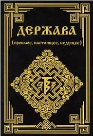

# Держава (прошлое, настоящее, будущее). Аннотация

В настоящее время в различного рода источниках, освещающих государственные и международные проблемы, широко используется понятие «**держава**». Причём это понятие распространяется на те государства, которые обладают большой экономической и военной мощью, а так же влиянием на другие страны мира. Однако это чисто внешний, формальный, современный признак державы, который не отражает существа исконного понятия. В силу этого люди, изучающие государственные и международные проблемы, оказываются в ложной системе координат, которая приводит их к признанию необходимости и незыблемости государства, его непреходящей ценности. И это несмотря на то, что государство уже давно превратилось в довлеющую систему, которая существует только ряди себя, подмяв под себя всё общество.

Современное государство страдает массой тяжелейших заболеваний. Произвол и безответственность чиновничества, безпрерывный и безконтрольный рост его количества, коррупция, стяжание власти и богатства, материальное и духовное угнетение людей, стоящих внизу социальной иерархии, необоснованные и неэффективные траты финансовых и иных ресурсов и их разворовывание, наплевательское отношение к Природе, непомерные и неэффективные траты на производство вооружений и содержание вооружённых сил и т.д. Всё это говорит о том, что современное государство всё более и более заходит в тупик своего развития. Естественно, возникает вопрос: можно ли выйти из этого тупика? Чтобы дать ответ на поставленный вопрос, нам необходимо проанализировать развитие форм организации современного (послепотопного) человечества и выявить сущностные различия между Державой и государством.
