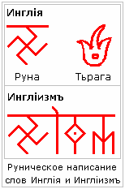
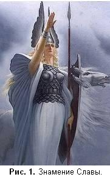
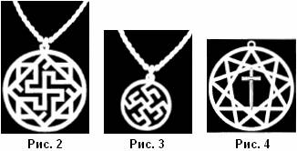
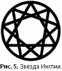
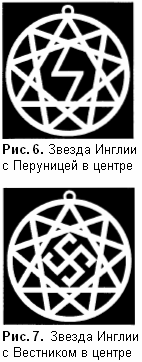
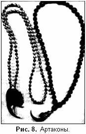
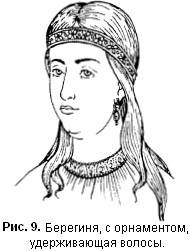
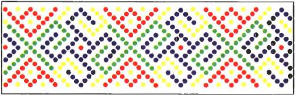
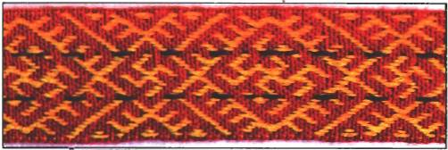
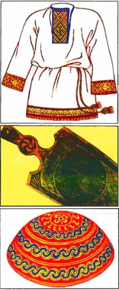

# Инглиизм – древняя Вера Славянских и Арийских Народов

1. Общие сведения  
2. О внешних знаках Веры  
3. Символ Старой Веры  
4. Берегиня  
5. Об обращении к Богам и Предкам  
6. ПОСТЪ  
7. Система отображения жизни в Инглиизме  
8. Солярные символы  
9. Девять основ Инглиизма

## Общие сведения

Название Древней Веры Первопредков – Инглиизм, произошло от да’Арийского символьного слова-образа Инглия. В да’Арийской письменности, этот Образ изображался единичным символом (Тьрага), а в х’Арийской письменности данный Образ изображался основной Руной Инглия.

Смысл, вкладываемый нашими Мудрыми Предками в изначальный **Образ Инглии**, всегда означал Божественный Первичный Огонь Творения, в котором появились разнообразные формы Жизни в Безконечных Безконечностях, порожденных в Новой Действительности, т.е. многочисленных Вселенных.

Изначальный Священный Свет Инглии, отошедший от Изначального Творца-Созидателя, которого мы Староверы называем - Великий Ра-М-Ха, наполнил и нашу благословенную Мидгард-Землю. Поэтому для обозначения нашего Вероисповедания к Руне, которая хранит образное значение Божественного Первичного Огня [*Инглия*], мы, как и в старые времена, добавляем священное трех-Рунное Образное понятие [*ИЗМ*], что означает - Истина Земного Мира.

Как уже было сказано, Изначальным Источником Великого Жизньродящего Первичного Священного Огня был Единый Творец-Созидатель, именация которому - Ра-М-Ха. Для нас, Староверов-Инглингов, исповедующих Древнюю Веру наших Первопредков, **Ра-М-Ха** является **Единым Всевышним Творцом-Созидателем**. Но из данного утверждения не следует, что Инглиизм является, как сейчас принято говорить, монотеистической системой.  
    Также Инглиизм не является и политеистической системой, хотя в каждом Славянском или Арийском Роду Великой Расы почитается свой собственный **Круг Богов [1]**.  
\* **1. Круг Богов** - т.е. круг **16 древних Богов Великой Расы (12+3+1)**. В каждом древнем Роду Староверов-Инглингов изначально почитались **12 Светлых Родовых Богов** (*Культ Двенадцатибожия*), **Великий Триглав** в разных сочетаниях: Сварог-Перун-Свентовит; Вышень-Род-Сварог; Род-Лада-Сварог; Сварог-Перун-Даждьбог; Велес-Перун-Даждьбог и т.д., а также Единый Творец-Созидатель **Ра-М-Ха**. Для почитания Круга Родных Богов, рядом с жильем Староверов ставилась Куммирня, которая состояла из огненного жертвенника - Дуньи, вокруг которой ставились 16 Куммиров наиболее почитаемых в каждом конкретном Роду древних Богов.

В современном мире необходимо знать каждому представителю Славянского или Арийского Рода, что Духовная Система, называемая Инглиизм - это Древнее Вероисповедание наших Предков, а не религия или Неоязыческое Учение, как пытаются трактовать сегодня наши некоторые «ученые мужи», ибо слово «религия» означает искусственное восстановление разрушеной или прерваной великой Духовной связи между людьми и Богами на основе какого-либо духовного, читай религиозного, учения. Современный термин - Неоязычество - был придуман «учеными мужами» специально, чтобы увести людей от поиска своих Древних Основ Старой Веры, Древнейшей Истории, богатой Традиции и великой Культуры. Неоязычество называют попыткой возвращения к древности путем слияния научных знаний, мистического мировосприятия, эзотерики и теософии.

Нам, Православным Староверам-Инглингам, нет необходимости в восстановлении великой Духовной связи между нами и нашими Богами, потому что эта Духовная связь никогда у нас не разрушалась и не прерывалась, ибо Боги наши - суть Предки наши, а мы дети их.

Древнерусская Инглиистическая церковь Православных Староверов-Инглингов есть Единая Древнейшая Община Великой Расы и потомков Рода Небесного, которая объединяет **всех Белых людей [2]** на древних основах Старой Веры Первопредков.  
\* **2. Всех Белых людей** - необходимо сразу успокоить тех политических, общественных и «религиозных» деятелей, кои кричат на каждом углу об угрозе расизма и расовой дискриминации, якобы имеющей место в Инглиизме. Инглиизм учит тому, что каждый народ, независимо от цвета кожи, должен сохранять свою собственную древнюю изначальную Веру. Самобытную культуру и неповторимую традицию.

Все люди с Белым цветом кожи, живущие в различных Землях, являются Единым Вселенским Родом, потомками Рода Небесного и Расы Великой, от которого берет свое начало Белое человечество Мидгард-Земли (планеты Земля).

В нашей повседневной жизни мы именуем себя - **Староверами-Инглингами**, или **Православными Славянами**, ибо:  
    Мы - **Староверы**, так как исповедуем Старую Веру Расы Велики, ниспосланную Родом Небесным;  
    Мы - **Инглинги** (древлеславянское название - Ингляне), так как храним Инглию - Священный Божественный Огонь Пepвопредкoв наших, и возжигаем Его перед Образами и Куммирами Светлых Богов и Святомудрых Предков наших;  
    Мы - **Православные**, ибо мы ПРАВЬ и СЛАВЬ прославляем. Знаем мы воистину, что ПРАВЬ - Мир Светлых Богов наших, а СЛАВЬ - Светлый Мир, где обитают Великие и Многомудрые Предки наши;  
    Мы - **Славяне**, ибо славим от нашего чистого сердца всех Светлых Древних Богов и Святомудрых Предков наших.

## О ВНЕШНИХ ЗНАКАХ ВЕРЫ

Согласно нашим древнейшим традициям, Священным писаниям и преданиям во время обращений и гимнов, а так же при вхождении во Капища и Святилища наши мы осеняем себя Святым знамением [\* **Святое знамение** - называемое также – Знамением Бога Перуна или Перуницей (молнией)]. Для сотворения Святого знамения три перста правой руки (большой, безымянный и малый) концами соединяются вместе в честь Великого Триглава Мира Яви – Сварога, Перуна и Свентовита, которые есть суть – Совесть, Свобода (Воля) и Свет, а два перста (указательный и средний) соединяются прямыми вместе и означают Род Небесный и Ладу-Богородицу.  
    Затем сложенные таким образом два перста налагаем сначала на чело наше, после на очи (на левое око, потом на правое око), а затем на уста. Сим Святым знамением мы освещаем нашу Святую Старую Веру – Инглиизм, повторяя Святую молнию Бога Перуна, которая освятила благостную жизнь всех Предков наших и которая освящает во дни сии нашу повседневную жизнь.  
    Святое знамение мы налагаем на чело, дабы освятить ум, постигающий Мудрость Богов и Предков наших; на очи, чтобы освятить зрение наше и видеть истинное Творение Богов и Предков наших; на уста, чтобы освятить речь нашу, особенно когда произносим слово Божие и Мудрость Божию, кои исходят из уст наших, и сберегаем от хулы уста свои.  
    Преклонение головы своей во время обращений и гимнов выражает наше уважение к Древним и Родным Богам нашим, и к Святомудрым и Великим Предкам нашим в благодарность за их помощь во всех деяниях и созиданиях наших.

Во время прославления Древних Светлых Богов и всех Предков Родов наших во Капищах и Святилищах, в Куммирнях возле древних Куммиров и возле жертвенников на Городищах во время Празднования Светлых дней в Священных Рощах и Дубравах, на берегах Священных рек и водоемов, мы сотворяем Знамение Славы. Для его сотворения, изначально мы полагаем открытую правую ладонь на сердце свое, а после поднимаем ее выпрямляя по направлению к Небесам Сварожьми (**рис. 1**) и изрекаем:

«**Слава Богам и Предкам Наша!**»

Православные Староверы-Инглинги в повседневной жизни носят на теле своем особые защитные символы, отлитые из белого металла или изготовленные из священного Древа (Дуб, Кедр, Береза, Ясень, Вяз, Липа и др.), которые называются Оберег Родовой Общины (**рис. 2**), Родовой Оберег (**рис. 3**), Оберег меж-Родовой Славянской или Арийской Общины (**рис. 4**).

Каждый нательный Оберег, который носит Православный Старовер-Инглинг, так или иначе постоянно находится во взаимосвязи с древними Духовными Источниками Старой Веры. Кроме того, материал, из которого изготовлен тот или иной Оберег, сам по себе является постоянным источником Природной целительной силы.  
    Большинство Славянских и Арийских Оберегов изготавливаются из серебра. Сей благородный металл является Священным для верующих Инглингов, так как издревле было известно весьма благотворное влияние серебряных изделий на организм любого белого человека. Очень часто используются Рунические Обереги, т.е. Обереги, на которых начертаны древние охраняющие Руны или Рунические тексты с оберегающими заговорами, а также Обереги, изготовленные в виде какой-либо Руны.  
    Нательные Обереги, изготовленные из Священных Деревьев, также оказывают весьма благотворное влияние на человека, т.к. каждый Оберег наделен особой Природной целительной силой.  
    Жрецы-Священнослужители, Старейшины и Старосты Общин, кроме нательного Родового или Общинного Оберега, имеют наперсные Обережные Символы, т.е. носимые на груди (перси) поверх праздничных или Священных одеяний.  
    Размеры Нательного Оберега были различными, но не меньше Ноктя (1,11125 см.) и не больше Вершка (4,445 см.), а средние размеры Наперсного Оберега находились в пределах от 1 ½ Вершка (6,6675 см.) до 2 ¼ Вершка (10 см) - см. Пядевую систему.

## СИМВОЛ СТАРОЙ ВЕРЫ

Основным Символом Старой Веры, как это было изначально в древности и как это есть в наши дни, является Звезда Инглии (**рис. 5**). Она не только символизирует Изначальный Чистый Свет – Первичный Огонь Божественного Творения и Сияющий Свет Ярилы-Солнца нашего, но и белого гармоничного Человека, потомка Древних Светлых Богов.

    Три треугольника, символизирующие **Божественное Начало**, означают одного из Великих Триглавов, который покровительствует Божьему Миру (Яви, Нави, Слави, Прави); обрамляющий Великий Триглав внешний Круг – Единую Жизьродящую Инглию, а внешнее за Кругом безконечное пространство говорит нам о Едином Творце-Созидателе, именация которому – Великий Ра-М-Ха.  
    Три треугольника, символизирующие **Человеческое Начало**, означают: Здоровое Тело, Крепкий Дух и Светлую Душу, а обрамляющий их внешний Круг – Чистую Совесть. Внешнее за кругом безконечное пространство символизирует Божий многогранный Мир, в котором живет и созидает потомок Древних Светлых Богов – Человек.  
    Три треугольника, символизирующие **Природное Начало**, означают Землю, Воду и Огонь, а обрамляющий их внешний Круг – Воздух. Внешнее за Кругом безконечное пространство символизирует Сваргу Пречистую, т.е. Небеса.

В центре Звезды Инглии часто вставляются дополнительные сопутствующие символы. Например, Меч (**рис. 4**), обращенный острием вниз, означает сохранение Древней Мудрости [Если Меч, обращенный острием вниз, означает сохранение Древней Мудрости, то Меч, обращенный острием вверх, – защиту всех Родов и земель Святой Расы от внешних и внутренних врагов]. Общинники, носящие такую символику, принадлежат к Славянским и Арийским Общинам, в которых хранится и передается из поколения в поколение Древняя Мудрость.  
    Перуница, помещенная в центр Инглии (**рис.6**), символизирует защиту и покровительство Бога Перуна. Как правило, обереги с Перуницей носят представители Общин, почитающих и прославляющих Многомудрого Бога Перуна, Покровителя Славянских Родов.  
    Звезда Инглии, соединенная с символом в центре, коий наши Предки изначально называли Вестник, приносит Здоровье, Счастье и Радость. Сей древний Оберег счастья (**рис. 7**), иногда в просторечье люди называют Мати-Готка, т.е. Матерь Готов.  
    Общинники, носящие Обереговую символику Мати-Готки, принадлежат к Славянским и Арийским Общинам, в которых сохраняются и передаются из поколения в поколение различные формы Древней Культуры и Традиций.

Некоторые Жрецы-Священнослужители, Старейшины и Старосты Славянских и Арийских Общин, кроме нательных Родовых или Общинных Оберегов, а также наперсных, т.е. носимых на груди, поверх одежды, Обережных Символов, носят еще наперсные Источники Духовной и Природной Силы, называемые Артаконы.

Артакона соединяет в своей основе две могучие Силы живого Мира: **коготь Родовича [3]**, т.е представителя животного мира, который является Природным Символом-Покровителем Рода, и четки, изготовленные из Священного Древа. На **рис. 8** можно видеть две Артаконы. Правая Артакона соединяет коготь Орла и четки из Священного Дуба, а левая Артакона соединила Медвежий коготь и четки из Сандалового Древа.  
\* **3. Коготь Родовича** – символизировал почитаемых в Роду птиц или зверей. Их когти считаются Источниками древней Духовной Силы, поэтому на груди носили коготь Орла, Бусла (Аиста), Сокола, Ворона, Совы, Лиса, Волка, Медведя, Пардуса (Барса) и др.

## БЕРЕГИНЯ

Издревле наши Предки повязывали волосы свои вокруг чела вышитой тесьмой, лентой, кожаным шнуром, который они называли Берегиня (**рис. 9**).

Наши мудрые Предки считали, что Берегиня выполняет сразу несколько дел: защищает наш разум от сумятицы и от плохих мыслей; оберегает Душу и тело человека от порчи и сглаза; удерживает волосы, чтобы от ветра не растрепались и не попали в глаза, а также чтобы пот не застилал очи во время труда.

## ОБ ОБРАЩЕНИИ К БОГАМ И ПРЕДКАМ

Обращаться к своим Великим Многомудрым Предкам и прославлять наших Светлых Древних Богов, Род Небесный, а также возжигать Священную Инглию всем Православным Староверам-Инглингам следует в Куммирнях у себя по месту проживания, в Хороминах: Капищах и Святилищах, на берегах Священных рек и водоемов, а также во Священных Рощах и Дубравах нашей Великой Державы.  
    В домах и жилищах наших должно вспоминать Древних Богов и всех Предков Родов наших и читать поминальные Обращения к ним: утром, когда встаем ото сна; вечером, когда ложимся спать; перед трапезой и после оной; при освящении безкровных Треб и Даров, перед воссожжением на Огненных жертвенниках, возложении оных на алатари и курганные погосты, а также при благословлении пищи и воды перед Первой и Второй трапезами; при начале созидательных деяний на благо Великих Родов наших и Рода Небесного и после окончания всех деяний наших.  
    Ритуалы, Обряды и Обращения свои Православные Староверы-Инглинги обыкновенно совершают перед различными Куммирами Славянских и Арийских Богов-Покровителей Родов и Святомудрых Предков, или перед рукотворными Образами с изображением оных.  
    В недельные и в праздничные дни, а также и в будни, когда бываем свободны от деяний житейских, должно ходить в Капище (Храм) к богослужению, чтобы услышать Святомудрое Слово Божие и воздать должное уважение Светлым Богам и многомудрым Предкам нашим, ибо мы должны соблюдать Два Великих Принципа:

**Свято чтить Богов и Предков своих,  
Всегда жить по Совести и в гармонии с Матерью-Природой.**

## О ПОСТАХ

Исчисление периодов очищения организма человека - ПОСТов, проводится только по Даарийскому Круголету Числобога.

Само слово ПОСТЪ есть аббревиатурное сокращение древнего общеславянского образного выражения, по первым буквицам слов:  
**П** - полное,  
**О** - очищенiе,  
**С** - собственныхъ,  
**Т** - телесъ,  
**Ъ** - сотворяша.

Данная система соблюдения ПОСТов в Древнерусской Инглиистической церкви Православных Староверов-Инглингов позволяет нашему организму очиститься и перестроиться с одного вида пищи на другой.

**ПОСТЫ, КОИ СОБЛЮДАЕМЫ ВСЕМИ ОБЩИННИКАМИ И ПРИХОЖАНАМИ ДРЕВНЕРУССКОЙ ИНГЛИИСТИЧЕСКОЙ ЦЕРКВИ ПРАВОСЛАВНЫХ СТАРОВЕРОВ-ИНГЛИНГОВ.**

**СВЯТЫЙ ПОСТЪ** - девять дней, одна славянская Неделя, с Рамхать 22 дня по Рамхатъ 31 дня.  
    В этот период времени Православным Староверам-Инглингам непозволительно употреблять мясную, рыбную, жирную белковую (яйца, масло, молоко) и острую пищу.  
    В пищу в эти дни Староверам необходимо употреблять утром и вечером овощи, фрукты, ягоды, зерновые и зернобобовые, а днем воду, соки, травяные чаи.  
    Это связано с подготовкой организма к переходу на раннеконсервируемую пищу.

**ДАЖДЬБОЖИЙ ПОСТЪ** - восемнадцать дней, две полные славянские Недели, от 1 по 18 Бейлегь.  
    В этот период времени Православные Староверы-Инглинги готовят себя к переходу от раннеконсервируемой пищи на полностью консервируемую пищу (соления, копчения и т.д.).  
    В период ПОСТа Староверам непозволительно употреблять в пищу мясо, жирную рыбу, яйца, белый хлеб, жирные молочные продукты (сливки, сметану) и сливочное масло (растительное масло можно употреблять).  
    Из хлебных изделий можно вкушать «серый» и ржаной хлеб, особенно испеченный из полуночной опары. Остальные продукты вкушаются так же, как и в Святый ПОСТЪ.  
    Для улучшения обмена веществ днем рекомендуется употреблять кислую капусту или гречневую кашу.

**ЧИСТЫЙ ПОСТЪ** - восемнадцать дней, две полные славянские Недели, от 22 по 40 Гэйлетъ.  
    В этот период времени Староверам непозволительно употреблять пищу мясную, жирную, кислую (квашеную), а также яйца.  
    Любое животное и растительное масло в Чистый ПОСТЪ запрещено! Можно - нежирную рыбу (кроме жареной), крупяные каши на пару, макаронные изделия, «серый» и ржаной хлеб, орехи, ягоды, соки, травяные чаи и в малых количествах зернобобовые.  
    Во вторую неделю Чистого ПОСТа постепенно вводится свежая растительная пища (зеленый лук, редис и т.д.).

**ВЕЛИКИЙ ПОСТЪ** - тринадесять дней, полторы славянские Недели, от 22 по 35 Дайлетъ.  
    В этот период непозволительно употреблять жирную мясную пищу (кроме мяса курицы и кролика), жирную рыбу, масло (кроме растительного), молочные продукты (сливки, сметану). Все остальное нежирное можно вкушать.

**СВЕТЛЫЙ ПОСТЪ** - восемнадцать дней, две полные славянские Недели, от 33 Вейлета по 9 Хейлетъ.  
    В этот период времени позволительно употреблять только утром и вечером одну лишь растительную пищу.  
    В Святый день Бога Купала, который совпадает со Светлым ПОСТом, можно есть мясо любой жирности, но оно обязательно должно быть приготовлено на Живом Огне (костер, запаленный от добытого Живого Огня).

**ОДНОДНЕВНЫЙ ПОСТЪ** - каждый седьмой день девятидневной недели; согласно Заповеди Сварога: «Почитайте три дня в недели - третий, седьмой и девятый...», в этот день рекомендуется воздержаться от принятия пищи вовсе, исключение составляют соки, вода, компоты без ягод, травяные чаи и кисель (если однодневный ПОСТЪ совпадает с праздником, то в этот день мы не постимся, а соблюдаем праздник).

Не соблюдают ПОСТы малые дети до 12 лет, беременные и кормящие матери, старцы и старицы после 60 лет, воины, несущие караульную службу, а также раненые и больные, т.к. им необходимо питаться для обретения дополнительной силы и здоровья.

## СИСТЕМА ОТОБРАЖЕНИЯ ЖИЗНИ В ИНГЛИИЗМЕ

*Чужим умом жизнь  
не познаешь и умнее  
не станешь...*  
Волхв Велимудр.

Вера наших древних Предков, Инглиизм, относится к так называемым Древнейшим Солнечным Культам, Чистым, Светлым и Одухотворенным, где во главу угла ставятся такие понятия, как Совесть и почитание своих Мудрых Богов и Предков.

Инглиизм не принадлежит к тем вероисповеданиям и религиям, которые можно принять, а потом, найдя для себя, более интересную и лучшую, сиречь выгодную, Веру или религию, перейти в нее. Это так же невозможно, как, например, выбрать себе новую жизнь, новую мать или нового отца и родиться от них. Уход от Инглиизма во все времена и у всех Родов Расы Великой расценивался как предательство, как отречение от своего древнего Рода, от своих Родителей и Предков.

Всякое дерево, у которого обрублены корни, рано или поздно засыхает и погибает, так и человек, отрекающийся от своей древней Веры Первопредков, от своих Родителей, Родичей и Отчизны, неминуемо придет не только к своей погибели, но и к гибели своего древнего Рода.

При всей своей внешней кажущейся сложности и многогранности, Инглиизм является самым доступным и простым из вероисповеданий для всех белых людей, так как он несет в себе гармонию не только существования человека и Небесных Богов, но и гармонию с Природой и гармонию в отношениях человека с человеком. **Великая Цель в жизни белого человека - это сама Жизнь.** Зачем нужно превращать жизнь человеческую в Пекло, чтобы потом, после смерти, обрести Сваргу Пречистую, не лучше ли жить в Радости и Любви в настоящем, Явном Мире, - созидая, а не разрушая все вокруг себя. А потом продолжить свою созидательную жизнь в более Высшем Светлом Мире.

Смысл любой жизни сокрыт именно в самой Жизни, и чтобы познать смысл своей жизни, человеку необходимо полностью прожить ее всю без остатка, со всеми радостями и горестями, со всеми поворотами судьбы, творчески созидая на благо Рода своего и потомков своих, Духовно развиваясь, познавать Древнюю Мудрость Богов и Предков своих.

Стремление к изучению Древней Мудрости, к познанию окружающего Мира и самого себя, не нанося вреда, - есть неотъемлемая черта человека, исповедующего Инглиизм. Человек, живущий с древней Верой Первопредков в сердце своем, а не существующий для потакания своим низменным (инстинктивным) потребностям, рано или поздно осознает, что он потомок Древних Небесных Богов - их сын и внук, а не раб какого-нибудь чужого Бога или другого человека, как это мыслят люди, существующие на уровне своих инстинктов.

Жизнь во всех проявлениях имеет свою неповторимую красоту и многообразие. Живыми являются Ярило-Солнце, камни, деревья, травы, облака, вода, воздух, огонь, сама Мать Сыра Земля и многое другое. И белый человек должен увидеть всю эту великолепную сияющую красоту и все это живое многообразие, чтобы осознать себя неотъемлемой частью великолепного Мира, который называется - Природа.

«*Чужим умом жизнь не познаешь и умнее не станешь...*», - говорил в старые времена Волхв Велимудр. Поэтому каждый народ должен развиваться по своим собственным древним законам, соблюдая идеальную чистоту собственной древней системы мировосприятия, уходящей своими корнями в глубокую древность. Никогда не нужно смешивать свою Родную Культуру и Древнее Мировосприятие с культурами других народов с чуждыми формами мировосприятия.

Изучение культуры и мировосприятия других (не белых) народов совершенно не означает, что познающий инородную культуру и традицию белый человек должен отказаться от своей Родной и близкой культуры, отречься от Веры своих Предков и принять то религиозное учение, согласно которому, всеми его созидательными деяниями руководят какие-то обезличенные и аморфные сущности. Совершил какое-нибудь доброе деяние - то господь надоумил, а совершил ошибки - то дьявол подтолкнул, а сам человек вроде бы ни при чем. Человек не марионетка, которой управляют все, кому вздумается, пусть даже это будут Боги.

Человек сам несет ответственность за все свои деяния и ошибки, которые он совершает в своей жизни, и несет ее перед Небесными Богами и Предками своими, а главой всех деяний человека всегда должна быть только Совесть, ибо Совести подвластны и люди и Боги. Жизнь создана для Жизни не только в Мире Яви, но и в Мире Нави, в Мире Слави, в Мире Прави. **Жизнь дана человеку для всестороннего изучения себя, как неотъемлемой части Вселенной, и для познания Вселенной, как неотъемлемой части себя**. При этом человек должен научиться созидательному труду, чтобы стать творцом-созидателем, под стать своим великим Предкам и Богам Небесным. А познав созидательную жизнь и Духовно развиваясь, человек рано или позно приходит к выводу, что наравне с Жизнью самым важным спутником для него является Смерть, ибо Жизнь и Смерть - это две формы существования, два полюса одного магнита, не существующие отдельно друг от друга в Природе.

Данные основы существуют во всех Солнечных Культах, а как мы уже говорили выше, все Солнечные Культы у Славяно-Арийских народов были Чистыми, Светлыми и Одухотворенными. Такие понятия, как: Совесть, Жизнь в гармонии с Природой, почитание своих Предков, уважение младости и почтение старости - были не пустым звуком, а главенствующим Духовным Образом в существовании любого древнего Рода Великой Расы.

Инглиизм не принадлежит к тем Вероисповеданиям или религиям, которые стараются превратить своих последователей в стадо безсловесных рабов, запугивая их карой земной и посмертной для того, чтобы властвовать над ними, получая с этого какие-либо материальные выгоды.

Веру нельзя принять или отринуть, в отличие от религии или придуманного религиозного культа. Вера существует независимо от того, согласен с ней кто-либо или нет. Вера - это Древняя Сияющая Мудрость Богов и Предков наших, и так же, как нельзя изменить образ жизни своих древних Предков, - так же нельзя изменить Веру, подстраивая ее под современные условия жизни или какие-то социальные и политические программы.

При всей своей кажущейся сложности и недоступности для понимания из-за использования древних Образов и древних иносказательных выражений, Древняя Вера Первопредков является самым доступным и простым из вероисповеданий для белых людей, так как белые люди еще не совсем потеряли способность образно, мыслить и образно выражать свои мысли.

Смысл жизни человека, исповедующего Древнюю Веру Первопредков, сокрыт именно в самой повседневной Жизни человека, и чтобы познать смысл своей жизни, человеку необходимо **познать суть своей Родной Древней Веры**, полностью прожить свою Жизнь всю без остатка, со всеми радостями и бедами, творчески созидая на благо Рода своего, Отечества своего, Древней Веры своей и, Духовно развиваясь, познавать Древнюю Мудрость Богов и Предков своих.

Познавая сохраненные Древние источники Мудрости (Славяно-Арийские Веды, Саньтии, Саги, Эдды, Харатьи и т.д.), человек рано или поздно осознает, что, живя лишь удовлетворением своих потребностей, не замечаешь Жизнь во всех проявлениях и величавое живое многообразие Мира Яви, который называется - Природа. А когда осознаешь все это, становишься Человеком с большой буквы.

«*Чужим умом жизнь не познаешь и умнее не станешь...*» Поэтому Славянские и Арийские Народы должны развиваться по своим древним законам, в соответствии со своей Культурой и Родовыми Традициями, соблюдая чистоту собственных систем мировосприятия и Вероисповедания, а не по подсказкам и советам всевозможных доброжелателей, различных пасторов и «духовных учителей», появившихся неизвестно откуда и зовущих к язычеству (чужой вере).

Человек не должен отказываться от своей родной и близкой культуры, отрекаться от Старой Веры своих Предков, от своей истории и традиций в угоду каким-либо новым веяниям или "учениям". Человек должен созидать и творить на благо своей Веры, своего Рода, Народа, Отечества и при этом должен быть готов защитить свой Род, свой Народ, свое Отечество и Веру от любой внешней или внутренней угрозы, по зову Сердца, по веленью Совести, как завещали наши Боги и Предки. Человек должен изучать свою Древнюю Культуру и самобытную Традицию, Древнюю Мудрость Богов и Предков своих, которая сохранилась в Священных Текстах, глубинных Образах и разнообразных символах.

## СОЛЯРНЫЕ СИМВОЛЫ

Самыми древними символами, которые использовали наши Предки, были так называемые **Солярные или Свастичные символы**. Свастичный символ представляет собой крест с загнутыми концами, направленными по или против часовой стрелке. Свастичные символы в наши дни называют одним словом - СВАСТИКА, что в корне не верно, т.к. каждый Свастичный символ в древности имел свое собственное название, Обереговую Силу и Образное значение.

При археологических раскопках Свастичную символику чаще всего находили на различных деталях архитектуры, оружии, бытовой утвари многих народов Евразии. Свастичная символика повсеместно встречается в орнаментике, как знак Света, Солнца, Жизни и Благоденствия. По материалам археологических раскопок, самой богатой территорией по применению свастичных знаков как религиозного и культурно-бытового символа является Россия. Данная символика покрывает древнее руское оружие, стяги, национальный костюм, предметы повседневного быта, дома и храмы. [*Далее приводятся наиболее используемые символы*, см. Солярные (Свастичные) символы].

Свастичные знаки использовались не только в виде одиночных символов, но и в вязевом сочетании с другими орнаментами. Эта гармоничная вязь создавала неповторимый узор, который объединял не только красоту, но и обереговую силу, а также смысловую сущность.

Выше приведенный орнамент объединяет несколько символов: Природный Славец (зеленый цвет), дарующий здоровье; Небесный Благовест (синий цвет), дарующий защиту Родовых Богов; Звезды (златый цвет), дарующие благую Судьбу; часть знака Духовной Силы (красный цвет), дающей трудолюбие. Сия вязь вышивается в основном на женских рубахах, ею украшают воротник рубахи и рукава (см. Славянская рубаха).

На приведенном фрагменте мужского пояса, который носят Жрецы Бога Перуна, можно отчетливо наблюдать Солярную вязь, объединяющую Огненные образы Коловрата и Перунова Цвета. Сия объединяющая **Солярная вязь** символизирует не только Возрождение в народе Древних Небесных Законов Рода (пересекающие орнаменты две Небесные нити), но и раскрытие в человеке, носящем данную вязь, его внутренних Душевных и Духовных Сил, которые приводят человека в состояние гармонии со своими Древними Богами, со своим Родом, с окружающей Матерью-Природой, со своей Душой, со своим Духом и со своей Совестью.

Сочетания Свастичных символов с многоцветной вязью или орнаментами наши Многомудрые Предки использовали при вышивке своих *рубах-косовороток*. С одной стороны, это очень красиво, а с другой, - надежно, ибо **обереговые орнаменты** по своей сути - это могучие связи человека со своими Богами-Покровителями и всеми Предками своего Рода. Это также и великая связь человека с Матерью-Природой, поэтому Солярной символикой украшали предметы быта, посуду и другие предметы домашнего обихода. Каждая замысловатая вязь, каждый рисунок нес в себе огромный глубокий смысл. Он раскрывал для Старовера-Инглинга основы мироздания. Взирая на *разделочную доску*, можно было узреть шестнадцать Чертогов Сварожьего Круга, через которые проходит Ярило-Солнце, и осознавать, что в этих Небесных Чертогах живут древние Светлые Боги и Предки всех Родов Великой Расы.

Дети из всех Славяно-Арийских Родов познавали великую вселенскую тайну бытия человека, глядя на рисунок изображенный на *чаше*. Они понимали, что живут в многогранном Мире Яви, а также в Родстве со своими древними Богами и мудрыми Предками.

Это Великое Родство охватывает не только наш Мидгард. Оно простирается и на множество многомерных Вселенных, наполненных Божественным Светом Инглии, в коих мы, потомки Великой Расы и Рода Небесного, будем жить в будущем. Но прежде, чем это произойдет, мы все должны Душевно и Духовно развиваться, **учиться Созидать на благо своих Родов и жить по Совести**, а также передавать накопленный опыт, культуру, историю и традицию подрастающему поколению наших Родов в соответствии с Древними Небесными Законами, как учили нас Светлые Боги и Мудрые Предки наши.

Воспитывая и обучая потомство Родов наших, мы не только должны раскрыть перед ними Истинное значение всех древних символов, знаков, вязей и орнаментов, используемых Православными Староверами-Инглингами, но и своим собственным примером, своей неиссякаемой Верой и Созидательным Трудом должны показать, как им надлежит Жить в недалеком будущем в соответствии с Древними Законами Рода и Небесными Законами Светлых Богов наших.

Познание человеком мироздания начинается с колыбели, со сказаний, поведанных дедами и бабушками перед сном. Все эти сказания, предания - неотъемлемая часть Ведического наследия, которое бережно сохранили для нас наши Предки.

Во второй части мы поведаем, каким образом происходило воспитание подрастающего поколения Великой Расы на основании древних законов, Родовых устоев, традиций и Основ Старой Веры наших Первопредков - Инглиизма (см. Рождение и воспитание детей Великой Расы).

## ДЕВЯТЬ ОСНОВ ИНГЛИИЗМА

Старая Вера наших великих и мудрых Первопредков - Инглиизм, на протяжении длительного исторического периода, который охватывает многие и многие тысячелетия, покоилась на Девяти Великих Основах.  
    Эти Девять Основ Инглиизма всегда были простыми и естественными по своей сути, но необходимыми для Духовного, Душевного и Созидательного развития людей из Родов Великой Расы.  
    Люди Великой Расы являются прямыми потомками Древних Светлых Богов, которые населяют Божий Мир Прави и все Небесные Чертоги Сварги Пречистой.  
    Для того, чтобы потомки Родов Великой Расы и потомки их потомков не сбились с Златого Пути Духовного и Душевного совершенства, Жрецами, которые служили Небесным Богам, были составлены эти Девять Основ Веры:

**1. ПРОСВЯЩЕНИЕ** — первая основа говорит нам о том, что мы должны изучать Священные писания и Священные предания, Мудрость Предков наших и Мудрость других Родов человеческих. Наполнить жизнь свою святостью, да деяниями добрыми, во славу Богов и Предков наших.

**2. ДУХОВНОСТЬ** — вторая основа говорит нам о том, что каждый человек должен развивать свою Духовную сторону жизни и приобщать к Духовности других людей.

**3. СОСТРАДАНИЕ** — третья основа говорит нам о том, что каждый человек должен иметь сострадание ко всему живому созданному Богами.

**4. ПОКОЯНИЕ** — четвертая основа говорит нам о том, что каждый человек должен стремиться к гармонии телес, Души и Духа, ибо только тогда он сможет обрести внутренний покой.

**5. ТЕРПЕНИЕ** — пятая основа говорит нам о том, что человек должен с пониманием относиться к деяниям других людей, ибо каждый человек — СВОБОДНЫЙ, но его личная свобода заканчивается там, где начинается свобода другого человека. Никакая личная Свобода, не может быть выше долга перед Родом и Богами Небесными.

**6. МИРОЛЮБИЕ** — шестая основа говорит нам о том, что мы должны проявлять миролюбие ко всем Родам человеческим, но при этом не жалеть жизней ворогов, что идут в земли наши со злым помыслом, и с оружием.

**7. ЛЮБОВЬ К БЛИЖНЕМУ** — седьмая основа говорит нам о том, что мы должны с любовью и добротой относиться ко всему живому созданному Богами, а также к памяти Предков наших и к Истории Родов человеческих.

**8. ИСПЫТАНИЕ** — восьмая основа говорит нам о том, что для достижения Небесного Вырия и Небесного Асгарда, мы должны пройти путь Духовного совершенствования. И испытания в нашей жизни даются для того, чтобы проверить наши Духовные силы.

**9. ЦЕЛЕУСТРЕМЛЕНИЕ** — девятая основа говорит нам о том, что все в жизни и сама жизнь имеет свой смысл, свое предназначение, свою цель, и каждый человек должен стремиться к своей цели, чтобы выполнить свое предназначение, и его жизнь обрела Высший Духовный смысл.
