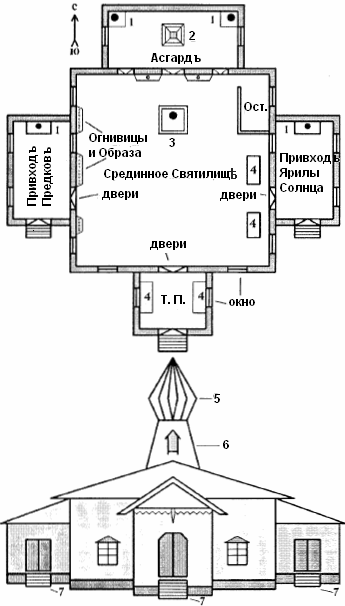
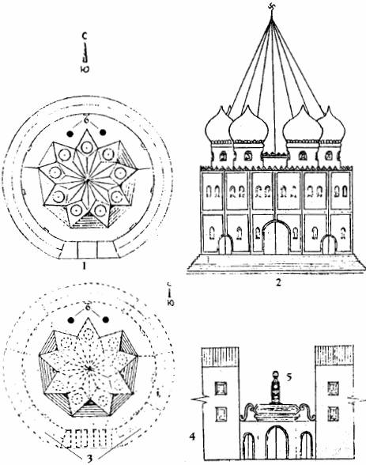

# Образный план Капища Велеса и Капища Инглии

После выхода в свет первых двух книг из серии «Славяно-Арийские Веды» было получено несколько писем, в которых наши уважаемые читатели просили опубликовать схемы, планы или чертежи Капищ, Святилищ и Куммирен. Больше всего авторы писем спрашивали о Капище Велеса и о Капище Инглии. Наверно, это все связано с популярностью в народе «Велесовой Книги», которая выдержала несколько изданий и со стремлением многих читателей вернуться к корням своей Родной Веры, культуры и древней истории, и возродить в своих родных местах почитание Изначального Огня в Капище Инглии.  
    Далее мы приводим два Образных плана Капищ. Сразу же хотелось бы указать на то, что Капища строились на местах, где находятся Источники Земной Духовной Силы. Центр такого Источника Силы является центром Капища, и над ним возводился Большой Купольный шатер.  
    По просьбе читателей готовится издание мелкоформатных книг-приложений к серии «Славяно-Арийские Веды». В одном из таких Приложений будет подробно рассказано о строительстве Капищ, Святилищ, Куммирен, Городищ и т.д.

## Капище Велеса

  
**1**. Алтарный стол с Кумиром. **2**. Огненный жертвенник. **3**. Алатырь-Камень с Куммиром Велеса. **4**. Требные столы. **5**. Купольный шатер. **6**. Звонница. **7**. Крыльцо. **Ост.** – Остров. **Т.П.** – Требный Привходъ.

## Капище Инглии

  
**1**. Капище Инглии, находящееся в центре Великого Коло, вид сверху.  
**2**. Капище Инглии, вид от ворот, с южной стороны.  
**3**. Расположение помещений, находящихся внутри Великого Коло.  
**4**. Врата, ведущие к Капищу Инглии, встроенные в Великом Коло.  
**5**. Куммир Бога Ингла.  
**6**. Огненные Жертвенники.
