# Символика в быту (одежда славян, обереги)

С древнейших времен все Православные Староверы-Инглинги носили одежды белого цвета, ибо сей цвет означал не только Свет Души и Духовную чистоту Великой Расы, но и прямую принадлежность к Небесным Божественным Родам. На каждой одежде, будь то мирская, повседневная или праздничная, или жреческий *хинтон\**, вышивался особый орнамент. Достаточно было всего одного взгляда на мирскую одежду с этим орнаментом, чтобы знать, из какой Веси или местности прибыл человек, к какому древнему Роду или Клану он принадлежит, прошел Обряд Совершеннолетия или находится под Родительской опекой, семейный он или нет, в какую касту входит и какого уровня мастерства достиг.  
\* **Хинтон** – дословно с древне-х’Арийского: **Облачение сотканное из Света Трех Лун**, т.е. Священная одежда белого цвета.

1. Женская одежда  
2. Мужская одежда  
3. Детская одежда  
4. Природные обереги  
5. Волосы

**По орнаменту** на жреческих одеяниях можно было узнать, какому Богу или Богородице служат Жрец или Жрица, из какой они Веси, при каком Капище или Святилище сохраняют Священный Огонь и приносят Безкровныe жертвоприношения и Требы.  
**По цвету пояса** Жреца можно было безошибочно определить Духовный уровень познания и занимаемое место в иерархии Древнерусской церкви Православных Староверов, а по орнаменту на поясе можно было определить, по какому Духовному Пути идет сей служитель Древних Богов.

Как уже было сказано ранее [см. Рождение и воспитание детей], детей до 12 лет не разделяли по половому признаку, поэтому детская одежда древних славян и ариев была одинакова для мальчиков и для девочек, и состояла из одной длинной, до пят, полотняной рубахи, причем, для рубахи мальчика обязательно использовалась рубаха Отца, а для рубашки девочки - рубашка матери.

## Женская одежда

В повседневной жизни всех Славянских и Арийских Родов мирская (Общинная) одежда разделялась на повседневную и праздничную. Например, на повседневной женской одежде присутствовала особая обереговая Родовая символика, а также необходимые сведения, по которым можно было узнать, замужем она или нет, какие Боги-Покровители оберегают Род, в котором она живет (**рис. 1**).

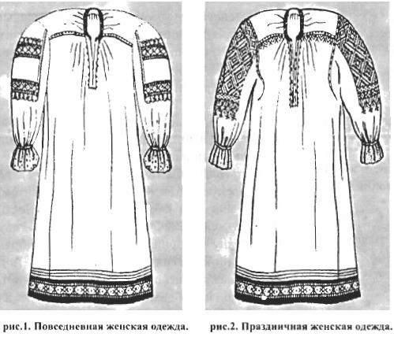

Праздничная одежда замужней женщины была более богато украшена различными символами, знаками женского и земного плодородия, обереговой вышивкой, орнаментами, из которых можно было узнать не только сведения о Роде супруга, но также, в каком древнем Роду она воспитывалась, какие Небесные Боги и Богини ей покровительствуют (**рис. 2**). Праздничная одежда незамужней девушки (**рис. 3**) зрительно отличалась от одежды замужней женщины. На платье девушки вышивка в основном была на рукавах и шла по низу подола, а у замужней женщины обереговая вышивка охватывала подол, грудь, ворот и рукава платья.

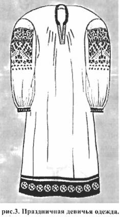Кроме того, замужняя женщина носила юбки и поневы, на которых присутствовал Родовой или Клановый орнамент с обереговой символикой, который создавал для женщины дополнительную, но весьма сильную, Божественную Родовую обережную силу. Сия могучая сила помогала женщине не только вести домашнее хозяйство, но и ухаживать за детьми. Однако самую необходимую жизненную силу замужняя женщина получала от любимого супруга. За ним она была как за каменной стеной, ибо жена была оберегаема заботливым супругом и его древним Родом, который для нее становился родным.

Это новое родство также отражалось в вышивке замужней женщины. Из старой обереговой вышивки, которая была на рубахе девушки до замужества, женщина использовала только обереговый символ Богини Покровительницы судьбы и символьный знак Бога-Покровителя своего дня рождения, а не символ своего древнего Рода, в котором она была рождена, Ибо с Любомира-Свадьбы, когда супруг на руках заносил жену в дом, считалось, что она родилась в новом Роду и для нее отныне Родители мужа - Отец и Мать.

## Мужская одежда

Мужская одежда также разделялась на повседневную (**рис. 4**) и праздничную (**рис. 5**), но при этом у мужчин была еще и ритуальная, т.е. богослужебная и воинская одежда.

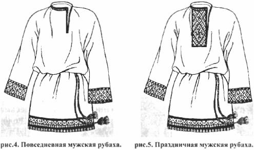

Ритуальная мужская рубаха (**рис. 6**) имела яркую, красочную обереговую Родовую вышивку, кроме того, она была длиннее, чем повседневные или праздничные рубахи и доходила до пят, ибо каждый старший мужчина в древних Славянских и Арийских Родах Великой Расы был жрецом-хранителем Священного Огня и приносил Требы и Дары на домашний Огненный жертвенник, находящийся возле Куммира Бога-Покровителя сего древнего Рода.

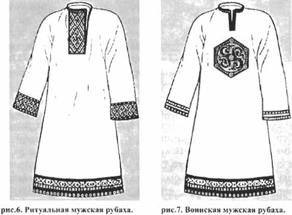

Воинская мужская рубаха (**рис. 7**) была средних размеров, длина ее доходила до колен. Она всегда изготавливалась из плотной ткани, ибо сию рубаху мужчины надевали под кольчугу или иные ратные доспехи. На ней вышивалась особая воинская Обереговая символика. Воинские рубахи мужчины одевали на собрания Общин, во время проведения Собора, Круга или Вече, а также на празднование Тризны и празднование праздников в честь Богов-Воителей. Общинная дружина носила воинские рубахи в повседневной жизни.

Неизменным дополнением к мужской рубахе был пояс. Повседневную рубаху подпоясывали тонким полвершковым \* поясом или верьвью \*\*, сплетенной из разноцветной тесьмы. Праздничную мужскую рубаху подпоясывали разноцветовым с Родовой Обереговой символикой вершковым \*\*\* поясом, а Ритуальную рубаху - широким поясом в полтора и в два вершка \*\*\*\*.  
\* **полвершковый** – 1/2 вершка, что соответствует 22,225 мм.  
\*\* **верьвью** – т.е. специально сплетенной из льна веревочкой.  
\*\*\* **вершковый** – 1 вершок – древняя Славяно-Арийская мера длины соответствует 44,45 мм.  
\*\*\*\* **полтора и в два вершка** – полтора вершка соответсвует 66,675 мм, а 2 вершка = 8,89 см.

Воинские мужские рубахи подпоясывали различными поясами, но только в том случае, если рубаху носили в повседневном обиходе. Когда воины одевали поверх рубахи ратные доспехи или кольчугу, то пояс не использовали, ибо ратные доспехи и кольчуга, сотворенные при помощи Живого Огня, несут в себе Обереговую Силу Богов, кроме того, разрез ворота на воинских рубахах был посредине.

Пояс для любого человека из Родов Великой Расы и потомков Рода Небесного символизировал Обережный Круг Богов, которые не только оберегают человека, но и направляют его по Правому Пути. Если человек появлялся в обществе без пояса или его рубаха не была подпоясана хотя бы вервью, то про него говорили, что он распоясался и может натворить немало бед, ибо он творит свои деяния не по Божескому и Родовому 3aкoнy, а под влиянием темных сил или духов.

## Детская одежда

Дети, как правило, до наступления своего совершеннолетия, т.е. до 12 лет, носили рубахи без поясов (**рис. 8.а. и 8.в.**), так как они находились под Обережной защитой своего Рода и своих Родителей. Ибо детские повседневные рубахи были перешиты, как уже говорилось ранее, из рубах Родителей, у мальчика - из рубахи Отца, а у девочки - из рубахи матери. Это связано с тем, что все рубахи Родителей несут обережную силу детям, и дети, стремясь походить на своих Родителей, до сих пор любят одевать их одежду.

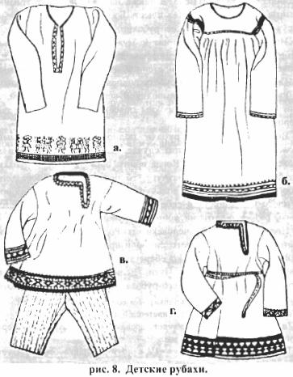

После прохождения древних Обрядов Совершеннолетия и Имянаречения многие девочки продолжали носить одежду своих матерей, но на их рубахах появлялась дополнительная Обережная символика по рукавам и на груди (**рис. 8.б.**), а мальчики, прошедшие древние Обряды, помимо того, что получали Обережную Родовую вышивку на рубаху, начинали носить пояса (**рис. 8.г.**). Далее представлены некоторые варианты Родовых Обережных орнаментов (**рис. 9 и 10**), которые использовались при вышивке рубах, поясов и других одеяний, но при этом на женских рубахах были обереги Богинь и Богородиц, а на мужских рубахах – обереги Богов-Покровителей и Богов-Воителей.

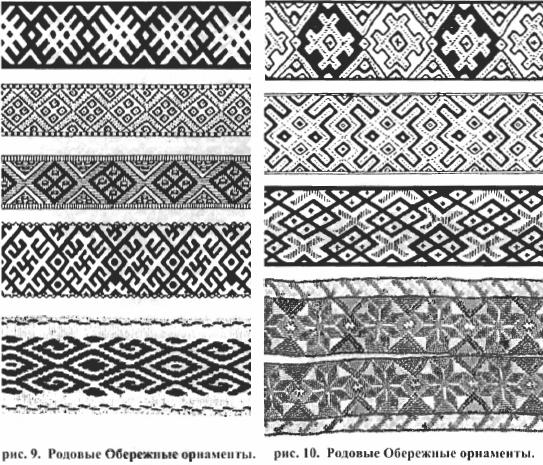

Кроме того, следует учитывать, что одни и те же символы, будучи слегка измененными, несли несколько иной образный смысл и значение. Это касается как мужских обереговых символов, так и женской обережной символики.

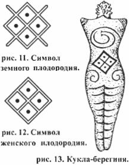Примером тому может быть обережный символ Плодородия. В одном случае он символизирует плодородие земли (**рис. 11**), т.е. засеянное поле, а в другом плодородие женщины (**рис. 12**). Ведь и в одном и в другом приведенном случае посеянное мужчиной Расы благодатное зерно новой жизни должно произрасти в плодородной почве и узреть великий Свет Божий. Зарождение новой жизни испокон веков считалось проявлением божественного деяния. Ничто и никто не родится, если на то не будет воли и благословения Небесных Богов. Поэтому к Небесным Богам обращались за благословением, чтобы на полях вырос хороший урожай и чтобы древний Род продолжался и не остался без потомства и наследника, продолжателей традиций Отцовских.

Чтобы в древнем Роду постоянно рождались только здоровые дети, мужчины для своих любимых вырезали из обломленных ветром веток Священных Деревьев небольшую кyклy-берегиню, на которую наносили символы женского плодородия и спираль зарождения жизни. Спираль зарождения жизни символизировала странствование Души будущего pe6eнкa через все Божественные Миры, в которых она обретала Мудрость Богов и притяжение ее на Мидгард-Землю призывным биением любящего и заботливого материнского сердца. Сию **кyклy-берегиню (рис. 13)** муж помещал в льняную ладанку, и женщина носила ее на поясе, чтобы Богородица Лада и Джива не забывали о ней.

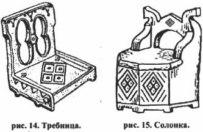Кроме того, на домашнюю утварь также наносили символы женского плодородия, чтобы почти все, к чему прикасались руки женщины, будь то резная требница для подношения Богам Треб и Даров (**рис. 14**) или солонка (**рис. 15**), говорило Небесным Богам и Богородицам, что в данном древнем Роду Великой Расы с огромным терпением и безграничной радостью ожидают появления pe6eнкa.

## ПРИРОДНЫЕ ОБЕРЕГИ

Развитие Родов Великой Расы в гармонии с Природой позволило нашим мудрым Предкам прекрасно изучить окружающий мир. Матерь-Природа давала людям пищу и различную живительную исцеляющую силу. Это отразилось не только в древних преданиях и в Вероисповедании, но и бытовом обиходе, когда люди стали использовать символические Природные изображения в обережных целях. На нательных оберегах из Священных деревьев часто изображалась солнечная символика, т.н. **солярники (рис. 16)**.

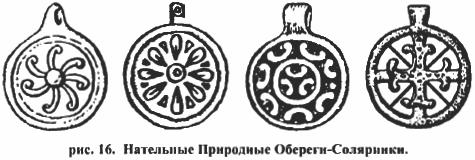

Обереги Православные Староверы-Инглинги изготавливали не только из Священных древесных материалов, они отливали их из серебра, а также различных благородных и простых металлов, кои давала щедрая Мать Сыра Земля. Наши Предки создавали различные сплавы с добавлением серебра для отливки Оберегов, а также вышивали Обережные Ладанки из кожи, плели их из бисера и разноцветных нитей. Природные Обереги и Ладанки передавали человеку могучую силу из окружающего его Мира Яви. На сих Обережных символах изображались Природные элементы: плодородие земли, озерная сила, лесная мощь и другие стихийные силы. Эти Природные обереги в народе называли **Стихийными Оберегами (рис. 17)**.

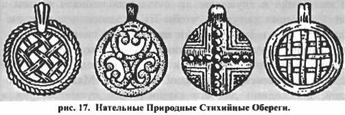

Кроме того, все белые люди из Славянских и Арийских Родов Великой Расы с огромным уважением относились к животному миру Матери-Природы. Это выразилось в появлении на нательных Природных Оберегах различных представителей животного мира: птиц, змей, диких и домашних животных, рыб, **сказочных зверей (рис. 18)**.

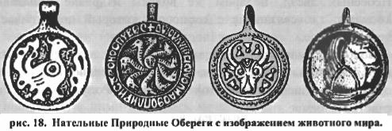

Изображая на нательных оберегах представителей животного мира Природы, Православные Староверы-Инглинги получают от Матери-Природы естественную, животную, живительную силу, которая в повседневной жизни оберегает от различных Природных напастей и от всевозможных козней, кои несут на Мидгард-Землю представители из темных миров и Пекла.

## Волосы

Но самым главным Природным источником жизненных сил для всех Православных Староверов-Инглингов являются собственные волосы. Это отражено даже в Заповеди Бога Сварога: «Не стригите свои власы русые, власы разные, да с сединами, ибо Мудрость Божию не постигнете и здоровие потеряете». С древнейших времен считается, что, обрезав волосы, у человека можно отнять силу и здоровье. Силы мpaкa и служащие им люди использовали волосы в своих темных ритуалах, чтобы из молодого человека сделать старика и даже навести на человека смерть.

Славяне и Арии с бережным уважением относились в прошлом и относятся ныне к своим волосам, ибо все, что даровано человеку Небесными Богами и Матерью-Природой, необходимо для его гармоничного существования в данном Явном Мире. Волосы испокон веков образно сравнивали с засеянным полем пшеницы: как колосья пшеницы впитывают в себя все соки и живительную силу Матери Сырой Земли и чистый свет Ярилы-Солнца и хранят их, так и волосы человека получают и сохраняют живительную силу от Небесных Богов, от Земных Родителей и Предков Рода, от Матери-Природы, от космических лучей Ярилы-Солнца и Небесных Звезд. Недаром же волосы издревле называли космами, т.е. связанные с космосом, который подпитывает человека.

Волосы символизировали множество светлых Природных и Божественных Сил, которые помогают человеку в жизни, они также означали достаток в древнем Роду, изобилие и счастье в семье. Девушкам с малолетства волосы заплетали в одну трехлучевую косу, ибо это символизировало объединение жизненных сил Миров Яви, Нави и Прави. **Коса** располагалась вдоль позвоночника и считалось, что все светлые вceленские силы через волосы переходят в позвоночник и наполняют тело, Душу и Дух девушки особой жизненной силой, подготавливая ее к будущей Священной миссии материнства.

Когда девушка выходила замуж, ее девичью косу расплетали и взамен ей заплетали две косы, ибо с этого времени она получала через волосы, собранные в косы, жизненные вceлeнcкиe силы не только для себя, но и для будущего peбeнкa.

Мужчины так же бережно относились к своим волосам, они придавали волосам большее значение, нежели женщины. Символом зрелости, мужественности и самостоятельности мужчины являлась борода. **Борода** была не просто мужским достоянием, она являлась символическим подтверждением принадлежности к Божьему Роду, т.е. носивший Бороду был потомком Древних Небесных Богов. Поэтому у Славян и Ариев сохранилось утверждение: «Боги наши, суть Отцы наши, а мы - дети их, и будем достойны Славы Богов наших, и сотворим благих деяний множество, да во славу Родов наших, троекратно более, чем влас в браде нашей».

Повреждение бороды мужчины или насильственное отрезание ее в древние времена считалось тягчайшим преступлением против всего древнего Рода Великой Расы и оскорблением Небесных Богов, покровительствующих этому Роду. Оскорбление Небесных Богов не прощалось никому, из-за этого в прошлом произошло немало войн, а подпаленная борода посла в старое время считалась объявлением начала войны.

Мужчины с древнейших времен берегли свои бороды как зеницу ока и бились с обидчиками очень жестоко, иногда насмерть, ибо лучше смерть принять в битве с супостатом, чем дать опозорить свой древний Род и своих Небесных Богов. Зрелых безбородых мужчин издревле называли женоликими, с ними старались не заключать военных и иных договоров, ибо считалось, что женоликие мужчины ведут женский образ жизни \*.  
\* **ведут женский образ жизни** – т.е. говоря современным языком, они являются людьми противоположной половой ориентации. Это подтверждается различными историческими источниками, повествующими о том, что до реформы Петра I, когда было объявлено «брить бороды и носить немецкое платье», безбородыми были именно европейцы с нетрадиционной половой ориентацией, которые окружали царя Петра I.

Но не только к волосам бороды было бережное отношение у мужчин, они берегли все волосы на голове и на теле, ибо знали, что через них получают все жизненные силы от своих Богов, Природы и Предков. И за сохранение жизненных Родовых источников нашим Предкам приходилось сражаться не на жизнь, а насмерть и принимать иные смертные муки. Поэтому, когда появились Указы императора-узурпатора Петра I «брить бороды и носить немецкое платье», а также отказаться от древних традиций своих древних Богов и Отцов и присягнуть на верность императору-узурпатору, то против насильственного острежения бород и отречения от Родных традиций и Веры нашими Пpeдкaми были подняты восстания по всей Сибири и Беловодью, которые впоследствии были подавлены войсками. Особо жестоко было подавление восстания в городе Таре, так называемый **Тарский Бунт Лета 7230** (1722 г.). За восстание и неповиновение императору-узурпатору Петру I людей вешали, четвертовали, колесовали, сжигали на кocтpax и сажали на кол. Причем казням подвергались не только Православные Староверы-Инглинги, но и поддержавшие их Праведные христиане, Старообрядцы-Раскольники.

В Европе первым организовал стрижку волос Римский император Нерон \*, а в Pycкиx землях стрижка волос начала практиковаться только с появлением христианства. Никто сейчас не сможет объяснить, зачем и для чего они подстригали последователей своего Учения и своих жрецов-священнослужителей \*\*, ежели даже в Библии повествуется о Самсоне, который не стригся и был сильным и непобедимым до той поры, пока ему не обрезали волосы (Книга Судей. Глава 17, стихи 17-19).  
\* **первым организовал стрижку волос Римский император Нерон** – Нерон приказал консулу подстричь все иностранные легионы наголо. Когда консул, командующий иностранными легионами спросил императора Нерона, для чего сие необходимо, Нерон ответил: «Я не желаю, чтобы они мыслили, для меня достаточно, чтобы они исполняли лишь мои приказы и распоряжения».  
\*\* **подстригли последователей своего Учения и своих жрецов-священнослужителей** – сие действие у последователей Христианства называется Священным Обрядом пострига в монахи.

Все вышесказанное повествует об отношении наших Предков к своим волосам. Следует добавить, что волосы, выпавшие при чесании, нельзя бросать на пол или на землю, ибо можно лишить себя жизненной силы, которую даруют нам Мать-Природа, Небесные Боги и великие Предки Родов наших. Поэтому из поколения в поколение передается древняя Мудрость, чтобы волосы сжигали или повязывали на молодое плодовое дерево для того, чтобы волосы хорошо росли и были крепкими, как дерево.

Детям до 12 лет даже кончики волос не подстригали, чтобы не состричь ум, постигающий жизнь, законы Рода и Мироздания, чтобы не лишить их жизненной силы, даруемой Природой и обереговой силы, кoию дают Боги-Пoкpoвители и Родители. Подравнивание кончиков волос на длину не больше одного ноктя \* у молодых людей старше 16 лет совершалось для того, чтобы волосы быстрее росли, и это деяние можно было совершать только в дни новолуния.  
\* **нокоть** – древняя Славяно-Арийская мера длины, соответствует одной четверти вершка, что в современных величинах = 11,1125 мм.

Расчесывание волос было своеобразным Священным ритуалом, во время которого можно было прикоснуться к космическим потокам и почувствовать в прямом смысле этого слова нисходящие с Небес потоки жизненной силы. Совершался сей Священный ритуал при помощи гребня, изготовленного либо из *Священных металлов*\*\*, либо из ветки *Священного дерева*\*\*\* . Детям в малом возрасте волосы расчесывали Родители, потом они делали это самостоятельно. Доверить расчесывать свои волосы могли только тому, кого хорошо знают и кого любят. Девушка могла позволить расчесывать свои волосы только своему избраннику или мужу.

Наши мудрые Предки учили нас содержать свои волосы в чистоте, ибо когда у человека волосы чисты, тогда у него и помыслы чисты.

\*\* **Священные металлы** – серебро, платина, ванадий и др. белые металлы и сплавы с добавлением серебра или ванадия.  
\*\*\* **Священные деревья** – береза, дуб, кедр, ясень, бук и т.д.

Культура и Традиция: Славянская рубаха
