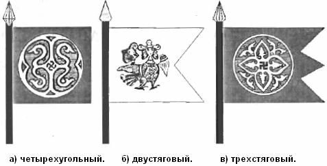
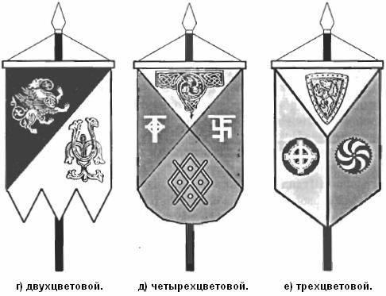
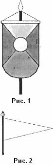

# Символы и Штанды Родов

В древнейшие времена у каждого Рода, Клана и Племени Великой Расы был свой неповторимый Родовой Символ \*, который изображался на Родовом Штанде \*\*. Каждый Род Великой Расы или каждое Племя потомков Рода Небесного имели свои собственные Имена Рода \*\*\*. Эти Имена Рода всегда отражали основу, созидательной деятельности древнего Рода, а также указывали на то, какой из Вышних Богов покровительствует данному Древнему Роду, Клану или Племени. Следует помнить, что Родовая символика в древности была неотделима от Древней Веры Первопредков также, как и Инглиизм был неотделим от повседневной Жизни.

\* **Родовой Символ** - тотем, особая символика, которая изображала Божественный Покровительственный Образ. Это могло быть изображение Священного Древа, Священного животного или птицы, Бога-Покровителя Рода или Образ мифологического персонажа.  
\*\* **Родовой Штанд** - т.е. стяг, вымпел, знамя, флаг, хоругвь с изображением Родового Символа или без оного на цветовом поле.  
\*\*\* **Имена Рода** - сии Родовые Имена давались по названию Родового Символа, по имени Бога-Покровителя Рода. В последующие времена Имя нового Рода создавалось по Имени Рода Отца или Бога-Покровителя Рода. При этом к Имени Рода добавлялись две древние Руны, читаемые, как «мак», это: Руна «мир», в символьном значении Род, Община, и Руна «ка» - союз, братство, родство, а сочетание Рун означало, что это Род сына. Сейчас, такая форма сохранилась лишь в Шотландии, например МeWales - сын Велеса. Многие люди забыли Имя своего древнего Рода, вместо них используют фамилии, смысл и значение которых современниками либо искажен, либо вовсе утрачен.

## Штанды Родов

Родовые Штанды имели различные виды и формы. Ниже показаны основные виды одноцветных Родовых Штандов, которые располагались горизонтально (рисунки а, б, в).

Были также многоцветовые Родовые Штанды, которые располагались вертикально (рисунки г, д, е).

    На двухцветовом Родовом Штанде в верхнем цветовом поле изображался символ Рода, а в нижнем поясняющий символ, к какой касте принадлежит сей Древний Род.  
    На трехцветовом Родовом Штанде, в верхнем цветовом поле изображался символ города, где проживает сей древний Род; в нижнем правом цветовом поле изображался Символ Рода, а в нижнем правом цветовом поле был символ касты.  
    Четырехцветовой Родовой Штанд, также называемый Штандом Клана, использовался в основном породненными, объединенными Родами. Штанд Клана отличается от Весевого или Державного тем, что разделение на цвета в Штанде Клана выполнено диагональными линиями, в отличие от горизонтальных и вертикальных на Весевом или Державном. На Штанде Клана в верхнем цветовом поле изображался знак, символизирующий объединение Богов-Покровителей двух Родов и рождение нового третьего Рода, т.е. созданного Клана; в правом цветовом поле изображалась Руна одного Рода, а в левом - другого Рода; а в нижнем цветовом поле изображался символ касты или нового Клана, например: Лев и Единорог с двух сторон держат щит.

В дальнейшем, когда потомство данного Клана создавало собственные Семейные Союзы, то использовался четырехцветовой Штанд Клана с добавлением в него нового элемента - центрального круга, на котором изображался Родовой Символ или Символьная Руна Рода, какого-либо отличившегося своими деяниями, достойного Сына из данного Клана. Если этот потомок становился во главе Рода, который построил и благоустроил поселение или град, то тогда в центре изображается Символ города или поселения. В дальнейшем символьные сочетания Родовых или Клановых Штандов стали изображать на гербах Родов, Кланов, Городов, Держав, Империй.

Для военной дружины Клана или Рода использовался упрощенный вариант одноцветового или многоцветового Штанда, так называемый вымпельный Штандарт, который крепился на копье воина Родовой дружины. На многих вымпельных Штандартах, как правило, изображался символ Бога-Покровителя воинов.

Кроме того, на Родовых и Клановых Штандах изображались животные или деревья и растения, которые символизировали деятельность Рода или Клана.

## Символы

Ниже приведены лишь некоторые символы и знаки, которые использовались в некоторых Родах и Кланах:  
- бобер символизировал Клан строителей;  
- белка, соболь, куница, птицы - охотников;  
- медведь - собирателей лесных даров и дикого меда;  
- пчела - пчеловодов и медоваров;  
- волк и семейство соколиных использовались воинами;  
- буйвол, конь почитался у орочей (пахарей);  
- семейство кошачьих: лев, пардус, рысь, тигр, барс, кошка и т.д. - символизировали Рода, в которых хранят Древнюю Мудрость;

У Жрецов наибольшим почитанием пользовались символы и знаки из мира Природы:  
- Перуница (молния), многолучевые звезды, ветвь омелы, дубовая ветвь, кленовый лист и различные цветы: лилия, роза, незабудка, ромашка, ландыш и др.

Из представителей животных Миров Яви и Нави: грифон, крылатый змей, крылатый конь, полкан (кентавр), русалки (девы-птицы), мавки (девы-рыбы), лось, олень, бык, мангуст, бусел (аист), филин, ворон, сова, ястреб, орел, уточка, ласточка, воробей и т.д.

Символов Каст, Кланов и Родов великое множество, невозможно перечислить их все в небольшой публикации, но до наших дней древняя символика звучит в старых руских, белоруских, украинских, южнославянских, сибирских, алтайских, марийских, польских, германских, шотландских, ирландских, исландских, и других скандинавских фамилиях.
