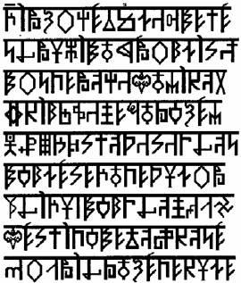

# Книга Первая – Введение

1. Введение  
2. Предисловие  
3. О книге

## Введение

Понимание великой сути Древней Мудрости, сокрытой в «Саньтиях Веды Перуна» и «Саге об Инглингах» дано лишь тем, кто сердце свое открывает для познания текстов записанных рунами Древними, кто не мудрствует лукаво и не стремится возгордиться знанием своим в понимании сокровенного древнего смысла, а тем паче не помышляет возвыситься над другими, кто влеком Душой своей и Духом своим к Древней Вере Первопредков – Инглиизму, кто стремится обрести корни свои.

Добрые люди, чистые Духом, от познания Саньтий и Саг, получают Добро себе, а злые, бездуховные и невежественные люди – Зло для себя. Поэтому, ежели зло пребывает в сердце вашем, не раскрывайте «Саньтии Веды Перуна» или древние «Саги» никогда, и тогда зло в сердце вашем не увеличится и не погубит вас.

**Форма написания текста в Саньтиях**, отличается от ныне принятой, об этом можно судить по приведенным шлокам Рунического текста из Второго Круга Саньтий Веды Перуна.  
  
Кроме того, Рунический текст «Саги об Инглингах» отличается от более древней Руники, которой были записаны «Саньтии Веды Перуна», и это не удивительно, ведь между ними лежит громадный временной период превышающий десятки тысяч лет. И конечно же от первоначального Рунического текста отличается современный текст, написанный кириллицей или латинским шрифтом, ибо современные буквы не только изменили свое изначальное начертание, но и потеряли свое первозданное, Образное значение.

В древние времена, Рунами не только передавали тайный Образ и Суть, ими также обозначали числа. Для этого, над Руной ставилась черта, указывающая, что данная Руна несет числовое значение.

Кто-то считает Саньтии и Саги подлинными историческими, кто-то увлекательными мифическими преданиями, достойными всестороннего изучения; кто-то называя их ранне-средневековой подделкой, пытается заявить о себе, как о «всезнающей и компетентной» личности, и стремится показать свою «значимость» и «ученость» в нашем непростом мире. Но все это не имеет ни малейшего значения. **Саги и Саньтии** – были, есть и будут древнейшими Священными Текстами, для всех верующих людей исповедывающих Древнюю Веру Первопредков – Инглиизм.

о. Александръ.

## Предисловие

Данное, второе издание, будет интересно если не всем, то очень многим, независимо от вероисповедания, политической ориентации, профессиональной деятельности, образовательного уровня и т.д.

Кто-то пытается понять окружающую действительность и, оглядываясь назад, всматривается в настоящее и пытается заглянуть в будущее; кто-то интуитивно или сознательно ищет путь к истинному и многогранному знанию и духовному совершенству; кто-то уже встал на этот путь и находится в его начале; а для кого-то знакомство с данным изданием будет означать не только количественное, но и качественное наполнение уже приобретенных ранее знаний.

Впечатления от прочитанного, что вполне объяснимо и понятно, будут самые разные - от ожесточенного озлобленного неприятия и желания прихлопнуть «новую ересь», до радостного волнения или полного безсилия, от новизны и широты полученной информации.

Будь осторожен, уважаемый читатель, не опускай рук! Это обманчивое ощущение. Безсилие, в данном случае, превращается в свою противоположность - силу, которая является мощным побудительным мотивом, для стремящегося познать глубокую, богатую событиями, поражающую «современного» человека совершенством знаний, Мудрость славянскую и праславянскую, Великое Наследие наших Первопредков. Тысячелетиями это Великое Наследие уничтожалось и искажалось, замалчивалось и выветривалось из нас - потомков Великой Расы, потомков Великих Священных Родов, а вместо Великого Наследия, нам навязывали историю, ту, что **из-ТОРЫ** взяли. Но Тора (Пятикнижье Моисеево), это писание чужого народа, библейского, к славянам и ариям не имеющая никакого отношения. У славян и ариев всегда было свое священное писание — Веды.

Наступает Новое Время - светлая эпоха Волка (Водолея), сменившая жестокую и суровую эпоху Лисы (Рыб). Пришло время вернуть потомкам Великих Пращуров изначальное Знание, об их очень древней и очень богатой древней Культуре и о Великом Наследии Предков. Задача проста и сложна: **Вспомнить Забытое**.

Вспомнив же, т.е. познав, обрести новое мироощущение и мировосприятие, усвоить иное мировоззрение, понять, что действительное развитие человечества возможно только и исключительно на пути **Духовного Совершенства** и в гармонии с Природой, а параллельно с ним и, главным образом, на его основе возможно достижение разумного материального благополучия. Того самого благополучия, за которым тысячелетиями гонится человечество, полагая, что достичь этой цели, значит решить проблему Выживания. И во имя всего этого, в разных формах и разными способами уничтожается окружающий Мир, включая себе подобных, количественно и качественно увеличиваются предметы удовлетворения чувственных потребностей. А предела все нет, ибо удовлетворение не наступает и не спасает идеал Золотого Тельца.

Когда безграничные потребности Духовного Совершенства не сформированы - возникает пустота. Природа не терпит пустоты. Предложенный технократический путь развития цивилизации западного образца - тупик для человечества. Необходим Духовный Путь. Главная задача - помочь человеку вернуться к своим Родовым Корням и обрести Веру в Правь, Светлый Мир Богов, и стать настоящим Православным. Мир Прави также реален, как и наш Мир Яви. Он существует в области высочайших тонких энергий и вне пределов нашего сознания. Это можно сравнить с человеком в соседней квартире. Его не видно и не слышно, но он существует независимо от нашего мнения или желания, признаем мы или нет факт его существования; он просто есть. Что нужно сделать для того, чтобы увидеть его? Ответ ясен - постучать к нему в дверь, ибо сказано: «*стучите и отворят вам*». Открытие дверей в неизведанное, это обретение качественно нового для нас Знания, но как известно: «*Новое, это хорошо забытое старое*». Информация, сохранившаяся в Древних Рунических текстах, несет в себе громадное знание Древней Мудрости Первопредков.

Этим Знанием сотни тысяч лет назад, владела мощная держава Древних Ариев - наших далеких Предков. Им были ведомы иные Миры и существование жизни в иных Галактиках, а мы сегодня пытаемся найти признаки разумной жизни во Вселенной; они знали о существовании Души и энергетическом поле человека - ученые только сегодня признали этот факт, сфотографировали поле излучаемое человеком, при помощи фотографии Кирлиана, взвесили субстанцию (Душу) и засняли серебряную нить, связующую человека и Душу в тот момент, когда она покидает тело. Древние Арии знали, все поздние мировые религии признавали, существование и противостояние двух Миров: Прави - Светлого Мира Любви и Добра, Мира Светлых Богов, и Пекла - темного Мира Зла. Сегодня ученые признали и подтвердили факт существования темного Мира, назвав его - Антимиром. Но по-прежнему не хотят признавать Светлый Мир.

Примеры можно бы и продолжать, но хочется подчеркнуть еще раз: Древние Славяне и Арии владели фундаментальными Сокровенными Знаниями о материальном и нематериальном Мирах. Они почитали своих Светлых Богов, которые дали им Жизнь и эти Знания - **Славяно-Арийские Веды**.

Об этом и рассказывает данное издание, которое до недавнего времени было доступно лишь Общинникам Староверам, и которое Вы, уважаемый читатель, теперь держите в руках. Оно является только частичкой огромного и мудрого Наследия. Не спешите, вчитывайтесь и вдумывайтесь в каждую строку, используйте комментарии, которыми богато снабжена книга. Комментарии написаны эрудированным человеком, Священнослужителем-Жрецом, одним из тех Капен-Инглингов, кто хранит Древние Славяно-Арийские Веды, и сегодня Волхвы и Жрецы Древней Веры Первопредков - Инглиизма раскрывают и возвращают нам, утерянное для нас и забытое нами **Знание**.

Спасение мира и его Духовное возрождение возможно, и оно начнется с нашей России, ибо наша Держава - земля рождающая святых подвижников, наделенных Величием и Силой Духа, неповторимого более нигде. Спасительное движение Возрождения России должно начаться со Священной земли - Беловодья, из самого центра ее - Асгарда, - современного Омска.

Так об этом предсказано в «Саньтиях Веды Перуна». И распространится движение Духовного Возрождения по всему миру, также как и свидетельствует «Сага об Инглингах» о переселении из Священного Беловодья на Запад древних Родов наших.

Есть над чем задуматься, уважаемый читатель? Есть цель, которой можно и должно посвятить свои физические и Духовные Силы? Есть Путь к светлому будущему наших детей, внуков и более отдаленных потомков?

Если прочитав Славяно-Арийские Веды, Вы, нашли ответ, и если он утвердительный - начинайте движение по пути обретения Древней Веры Первопредков - Инглиизма, Знания, Любви, Добра, Радости и Мудрости Великой.

**ВСПОМНИМ ЗАБЫТОЕ !!!**

Суриков Олег Юрьевич  
Кандидат исторических наук.

## О книге

Саньтии Веды Перуна (Книга Мудрости Перуна) одно из древнейших Славяно-Арийских Священных Преданий, сохраненных Жрецами-Хранителями Древнерусской Инглиистической церкви Православных Староверов-Инглингов.

Саньтии, в подлиннике, лишь визуально можно назвать Книгой, т.к. **Саньтии** - это пластины из благородного металла, не поддающегося коррозии, на которых начертаны Древние х’Арийские Руны.

Древние Руны, это не буквы и не иероглифы в нашем современном понимании, Руны - это тайные Образы, передающие огромный объем Древних Знаний. Эта древняя Руническая форма письма не исчезла, как другие древние алфавиты, азбуки и буквицы в глубинах веков и тысячелетий, а продолжает оставаться основной формой письма у Жрецов Древнерусской Инглиистической церкви Православных Староверов-Инглингов.

В древние времена х’Арийская Руника послужила основной базой для создания упрощенных форм письма: древнего Санскрита, Черт и Резов, Деванагари, англо-саксонской и германо-скандинавской Руники и многих других.

Чтобы х’Арийская Руническая форма письма сохранялась и далее, для наших потомков, она преподается в Духовных Семинариях Древнерусской Инглиистической церкви Првославных Староверов-Инглингов, дабы Древняя Мудрость не сгинула в Безвременьи, а передавалась из поколения в поколение.

Чтобы представить себе **как выглядят Саньтии**, нужно запомнить, что каждая Саньтия состоит из 16 шлок, каждая шлока содержит 9 строк, в каждой строке под единой чертой, называемой поднебесной начертаны 16 Рун, на каждой пластине 4 шлоки, по две с каждой стороны. Девять Саньтий на 36 пластинах - составляют Один Круг, и эти пластины, содержащие 144 шлоки, скреплены 3 кольцами, которые символизируют три Мира: Явь (Мир людей), Навь (Мир Духов и Душ Предков), Правь (Светлый Мир Славяно-Арийских Богов). Девять Кругов Саньтий, содеращие 1296 шлок, или 11664 строки, или 186624 взаимоуправляющие х’Арийские Руны, составляют смысловой Образный сборник, который называют с древнейших времен – ВЕДА, или используя латинскую форму ЭДДА.

Саньтии имеют содержательную форму диалога и были записаны около 40000 лет назад. В Первом Круге рассказывается о том, какие Заповеди дал народам Великой Расы и потомкам Рода Небесного Бог Перун; о предстоящих в будущем событиях на протяжении Сварожьего Круга и Девяносто Девяти Кругов Жизни, т.е. 40176 лет, и многое другое.

**Первый перевод на современный русский язык**, с х’Арийской Каруны (древнего х’Арийского языка), был сделан Славянскими Жрецами в Лето 7452 от Сотворения Мира в Звездном Храме, соответствующее Лету 106722 от Основания Асгарда Ирийского (1944 г. от Р.Х.), для вновь возрождаемых Славяно-Арийских и Родовых Общин на территории Беловодья или как говорится в Саньтиях – Святой земли Расы (территория от Урала до Байкала, и от Северного Океана до Монгольского Алтая). Это также было связано с тем, что в первые десятилетия советской власти, при уничтожении Славянских общин, безследно исчезли многие древнеславянские ведические книги, Харатьи и Саньтии Древних Богов, которые хранили Славянские и Родовые Общины Беловодья.

Название Беловодье произошло от древнего названия реки Ирий (совр. Иртыш - Ирий тишайший, Ир-тишь), в древнем х’Арийском языке есть Руна Ирий, образное значение которой - белая, чистая вода.

При переводе использовалась русская форма письма и орфография, а не советская, исказившая, в 20-30 годах ХХ века от рождества Христова, наш родной образный язык. Многие слова даются в первоначальной основе, т.к. ни в русском, а тем более в советском языке аналогов данным словам и образам нет.

**Первые семь изданий (1944, 1950, 1956, 1963, 1968, 1973, 1980 гг.)** включали в себя только Круг Первый «Саньтий Веды Перуна», издавались небольшим тиражом и расходились в основном по Общинам Древнерусской церкви Православных Староверов-Инглингов. Часть тиража, в 1968 году, при перевозке, была изьята компетентными органами, и «благодаря этому», попала в различные Государственные и областные архивы.

**Восьмое издание появилось в Лето 7500 (1992 г. н.э.)**, после регистрации высшего руководящего органа Древнерусской церкви – Орден Миссии «ДЖИВА – Храм Инглии» в органах юстиции. Это издание появилось в библиотеках города Омска, а также в библиотеках нескольких ВУЗов. По нему студенты пишут рефераты и курсовые работы по древней Вере славян и ариев.

**Девятое издание появилось в Лето 7507 (1999 г. н.э.)**, оно положило начало серии «Славяно-Арийские Веды», которое включает в себя углубленную версию первого перевода Круга Первого «Саньтии Веды Перуна» и перевод «Саги об Инглингах», в редакции Патер Дия о.Александра (Хиневич А.Ю.), с его комментариями к обоим тексам, а также с приложениями.

Новое, **десятое издание** «Славяно-Арийских Вед» (Второе для общего пользования), также включает в себя углубленную версию первого перевода Круга Первого «Саньтий Веды Перуна» и «Саги об Инглинках», с комментариями к обоим текстам, и исправление опечаток, которые появились в результате несовпадения компьютерных шрифтов. Кроме того, в данную Книгу вставлены некоторые дополнения и изменения.

Приложения включают в себя различную краткую информацию по Древней Вере Первопредков – Инглиизму (см. Инглиизм – краткие сведения). Данное издание также, как и предыдущие, предназначено для вновь возрождаемых Славяно-Арийских Общин, а также для тех, кто решил прикоснуться к сокровенной Древней Мудрости.

В переводе Круга Первого «Саньтии Веды Перуна» принимали участие несколько Жрецов, поэтому звучание Саньтий может показаться разнообразным, но смысл их остается неизменным. В данном издании нет полного толкования по каждой Руне, строке или шлоке, т.к. все разъяснения могут дать только Жрецы или Капены-Инглинги, т.е. Хранители Древней Мудрости в Славяно-Арийских Капищах и Святилищах, а полный перевод с полными толкованиями может составить многотомное издание, и кроме того, многое из Древней Мудрости нельзя открывать для служителей мира Тьмы…

Комментарии к наиболее непонятным местам в «Саньтиях Веды Перуна» и «Саге об Инглингах» сделаны Патер Дием Александром, Главой Древнерусской Инглиистической церкви Православных Староверов-Инглингов.

Многоточия и строки из точек означают, что в этих местах содержится такая информация, которую еще рано давать в открытой форме, т.к. Знания, предназначенные для служения Добру и Правде, нельзя использовать во Зло...

В настоящее время Жрецами Древнерусской церкви переводится Круг Второй. Мы надеемся, что в Девятой Книге серии «Славяно-Арийские Веды», вы познакомитесь с продолжением «Саньтии Веды Перуна».

Церковное издательство  
«Асгардъ» 7510 (2001 г).
