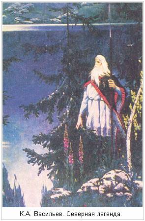

# Сага об Инглингах

## Глава I (1)

**Круг земной [2]**, где живут люди, очень изрезан заливами. Из океана, окружающего землю, в нее врезаются большие моря. Известно, что море тянется от Нервасунда до самого **Йорсалаланда [3]**. От этого моря отходит на север длинный залив, что зовется Черное море. Он разделяет трети света **[4]**. Та, что к востоку, зовется **Асией [5]**, а ту, что к западу, некоторые называют Венеей, а некоторые Энеей **[6]**. К северу от Черного моря расположена Великая, или Холодная Скифия **[7]**. Некоторые считают, что Великая Скифия не меньше Великой Страны Сарацин, а некоторые равняют ее с **Великой Страной Черных Людей [8]**. Северная часть Скифии пустынна из-за мороза и холода, как южная часть Страны Черных Людей пустынна из-за солнечного зноя. В Скифии много больших областей. Там много также разных народов и языков. Там есть великорослые люди и карлики, и смуглые люди, и много разных удивительных народов. Там есть также огромные звери и драконы. С севера с гор, что за пределами заселенных мест, течет по Скифии река, правильное название которой Рожденная в ледниках. Она называлась раньше **Танаквисль, или Ванаквисль [9]**. Она впадает в Черное море. Местность у ее устья называлась тогда Страной Ванов, или Ванахейм. Эта река разделяет трети света. Та, что к востоку, называется ныне Азией, а та, что к западу, - Европой.

## II (2)

Страна в Аcии к востоку от Танаквисля называется Страной Асов, или Жилищем Асов, а столица страны называлась Асгард. Правителем там был тот, кто звался Одином. Там было **Большое Капище [10]**. По древнему обычаю в нем было **двенадцать Верховных Жрецов [11]**. Они должны были совершать жертвоприношения и судить народ. Они назывались **Диями [12]**, или Владыками. Все люди должны были их слушать и их почитать. Один был великий воин и Великий Жрец, и много странствовал, и завладел многими державами. Он был настолько удачлив в битвах, что одерживал верх в каждой битве, и поэтому люди его верили, что победа всегда должна быть за ним. Посылая своих людей в битву или с другими поручениями, он обычно сперва возлагал руки им на голову и давал им благословение. Люди верили, что успех будет им обеспечен. Когда его люди оказывались в беде на море или на суше, они призывали его, и это им помогало. Один считался самой надежной опорой. Часто он отправлялся так далеко, что очень долго отсутствовал.

## III (3)

У Одина было два брата. Одного из них звали Be [Стар], а другого Вили [Винг]. Они правили Страной Асов, когда Один был в отлучке. Однажды, когда Один отправился далеко и долго был в отлучке, Асы потеряли надежду, что он вернется. **Тогда братья разделили его наследство и хранили его, и оба брали жить к себе его жену, Фригг [13]**. Но вскоре после этого Один возвратился домой, и он тогда вернул себе свою жену и наследство.

## IV (4)

Один пошел войной против Ванов, но они не были застигнуты врасплох и защищали свою страну, и победа была то за Асами, то за Ванами. Они разоряли и опустошали страны друг друга. И когда это и тем и другим надоело, они назначили встречу для примиренья, заключили мир и обменялись **Великими Дарами [14]**. Ваны дали своих лучших людей, Ньёрда Богатого и сына его Фрейра, Асы же дали в обмен того, кто звался Хёниром, и сказали, что из него будет хороший вождь. Он был большого роста и очень красив. Вместе с ним Асы послали того, кто звался Мимиром, очень мудрого человека, а Ваны дали в обмен мудрейшего среди них. Его звали Квасир. Когда Хёнир пришел в Страну Ванов, его сразу сделали вождем. Мимир учил его всему. Но когда Хёнир был на тинге или на Собрании Вождей и Мимира рядом не было, а надо было принимать решение, то он всегда говорил так: «пусть другие решают». Тут смекнули Ваны, что Асы обманули их. Они схватили Мимира и отрубили ему голову, и послали голову Асам. Один взял голову Мимира и натер ее травами, предотвращающими гниение, и произнес над ней заклинание, и придал ей такую силу, что она говорила с ним и открывала ему многие тайны.  
Один сделал Ньёрда и Фрейра Жрецами, и они были Диями у Асов. Фрейя была дочерью Ньёрда. Она была Жрица. Она первая научила Асов использовать ведовство, чтобы колдовать, как было принято у Ванов. Когда Ньёрд был у Ванов, он был женат на своей сестре, ибо такой был там обычай. Их детьми были Фрейр и Фрейя. А **у Асов был запрещен брак [15]** с такими близкими родичами.

## V (5)

**Большой горный хребет тянется с северо-востока на юго-запад [16]**. Он отделяет Великую Скифию от других стран. Недалеко к югу от него расположена Страна Турок. Там были у Одина большие владения. В те времена правители **Ромеев [17]** ходили походами по всему миру и покоряли себе все народы, и многие правители бежали тогда из своих владений. Так как Один был провидцем и колдуном, он знал, что его потомство будет населять северную окраину мира. Он посадил своих братьев Be [Стара] и Вили [Винга] правителями в Асгарде, а сам отправился в путь и с ним все Дии и много другого народа. **Он отправился сначала на запад в Гардарики [18]**, а затем на юг в **Страну Саксов [19]**. У него было много сыновей. Он завладел землями по всей Стране Саксов и поставил там своих сыновей правителями. Затем он отправился на север, к морю, и поселился на одном острове. Это там, где теперь называется **Остров Одина [20]** на Фьоне. Затем он послал Гевьюн на север через пролив на поиски земель. Она пришла к Гюльви, и он наделил ее пашней. Она отправилась оттуда **в Страну Ётунов [21]** и зачала там от одного ётуна четырех сыновей. Затем она превратила их в быков, запрягла их в плуг и выпахала землю в море напротив Острова Одина. Там теперь остров Селунд. С тех пор она жила там. На ней женился Скьёльд, сын Одина. Они жили в **Хлейдре [22]**. А там, где прежде была земля, стало озеро. Оно называется Лег. Заливы в этом озере похожи на мысы Селунда. **Браги Старый [23]** сказал так:

> Нарастила, Гюльви  
> Обморочив - бычьи  
> Вздулись жилы - Гевьюн  
> Край презнатно датский.  
> В восемь звезд воловьи  
> Лбы светили, быстро  
> Шли с добычей через  
> Пажить звери ражи.

А Один, узнав, что на востоке у Гюльви есть хорошие земли, отправился туда, и они с Гюльви кончили дело миром, так как тот рассудил, что ему не совладать с Асами. Один и Асы много раз состязались с Гюльви в разных хитростях и мороченьях, и Асы всегда брали верх. Один поселился у озера Лег, там, где теперь называется **Старые Сигтуны [24]**, построил там Большое Капище и совершал в нем жертвоприношения по обычаю Асов. Все земли, которыми он там завладел, он назвал Сигтунами. Он поселил там и Жрецов. Ньёрд жил в Ноатуне, Фрейр - в Уппсале, Хеймдалль - в Химинбьёрге, Тор - в Трудванге, а Бальдр - в **Брейдаблике [25]**. Всем им Один дал хорошие жилища.

## VI (6)

Рассказывают как правду, что когда Один и с ним Дии **пришли в Северные Страны [26]**, то они стали обучать людей тем искусствам, которыми люди с тех пор владеют. Один был самым прославленным из всех, и от него люди научились всем искусствам, ибо он владел всеми, хотя и не всем учил. Теперь надо рассказать, почему он был так прославлен. Когда он сидел со своими друзьями, он был так прекрасен и великолепен с виду, что у всех веселился дух. Но в бою он казался своим недругам ужасным. И все потому, что он владел искусством менять свое обличие как хотел. Он также владел искусством говорить так красиво и гладко, что всем, кто его слушал, его слова казались правдой. В его речи все было так же складно, как в том, что теперь называется поэзией. Он и его Жрецы зовутся мастерами песней, потому что от них пошло это искусство в Северных Странах. Один мог сделать так, что в бою его недруги становились слепыми или глухими или наполнялись ужасом, а их оружие ранило не больше, чем хворостинки, и **его воины бросались в бой без кольчуги [27]**, ярились, как злые собаки или волки, кусали свои щиты, и были сильными, как медведи или быки. Они убивали врагов, и ни огонь, ни железо не причиняли им вреда. **Такие воины назывались берсерками [28]**.

## VII (7)

Один мог менять свое обличье. Тогда его тело лежало, как будто он спал или умер, а в это время он был птицей или зверем, рыбой или змеей и в одно мгновение переносился в далекие страны по своим делам или по делам других людей. Он мог также словом потушить огонь или утишить море, или повернуть ветер в любую сторону, если хотел, и у него был корабль - он назывался Скидбладнир, - на котором он переплывал через большие моря и который можно было свернуть, как платок. Один брал с собой голову Мимира, и она рассказывала ему многие вести из других миров, а иногда он вызывал мертвецов из земли или сидел под повешенными. Поэтому его называли владыкой мертвецов, или владыкой повешенных. У него было два ворона, которых он научил говорить. Они летали над всеми странами и о многом рассказывали ему. Поэтому он был очень мудр. Всем этим искусствам он учил Рунами и песнями, которые называются заклинаниями. Поэтому Асов называют мастерами заклинаний.  
       Один владел и тем искусством, которое всего могущественнее. Оно называется ведовство. С его помощью он мог узнавать судьбы людей и еще не случившееся, а также причинять людям болезнь, несчастье или смерть, а также отнимать у людей ум или силу и передавать их другим. Мужам считалось зазорным заниматься этим ведовством, так что ему обучались Жрицы. Одину было известно о всех кладах, спрятанных в земле, и он знал заклинания, от которых открывались земля, скалы, камни и курганы, и он словом отнимал силу у тех, кто в них жил, входил и брал, что хотел.  
       Эти его искусства очень его прославили. Недруги Одина боялись его, а друзья его полагались на него и верили в его силу и в него самого. Он обучил Жрецов большинству своих искусств. Они уступали в мудрости и ведовстве только ему. Да и другие многому научились у него, и так ведовство очень распространилось и долго держалось. Люди почитали Одина и девятерых Диев, Верховных Жрецов, **называли их своими Богами [29] и долго верили в них [30]**.  
       **От имени Один пошло имя Аудун [31]**, и люди так называли своих сыновей, а от имени Тора пошли имена Торир или Торарин, а в сочетании с другими словами - Стейнтор или Хавтор и многие подобные.

## VIII (8)

Один ввел в своей Стране те законы, которые были раньше у Асов. Он постановил, что **всех умерших надо сжигать на костре [32]** вместе с их имуществом. Он сказал, что каждый должен прийти в **Валхаллу [33]** с тем добром, которое было с ним на костре, и пользоваться тем, что он сам закопал в землю. А пепел надо бросать в море или зарывать в землю, а в память о знатных людях надо насыпать курган, а по всем стоящим людям надо ставить надгробный камень. Этот обычай долго потом держался. **В начале зимы [34]** надо было приносить жертвы Богам за урожайный год, в середине зимы - за весеннее прорастание, а летом - за победу. По всей **Стране Свеев [35]** люди платили Одину подать, по деньге с человека, а он должен был защищать страну и приносить жертвы за урожайный год.  
       Ньёрд женился на женщине по имени Скади. Но она не захотела жить с ним и вышла потом замуж за Одина. У них было много сыновей. **Одного из них звали Сэминг [36]**. О нем сочинил Эйвинд Погубитель Скальдов такие стихи:

> Родился  
> Сеятель злата **[37]**  
> У Всеотца  
> С великаншей **[38]**.  
> Когда были  
> Диса-лыжница **[39]**  
> И родич Асов **[40]**  
> Женой и мужем.  
> Там вдвоем породили  
> Многих сынов  
> Один и Скади.

К Сэмингу возводил свой род Ярл Хакон Могучий. Эта Страна Свеев называлась Жилищем Людей, а Великая Скифия называлась Жилищем Богов. Об Асгарде есть много рассказов.

## IХ (9)

Один умер от болезни в Стране Свеев. Когда он был при смерти, он велел пометить себя острием копья и присвоил себе всех умерших от оружия. Он сказал, что отправляется в Асгард и будет там принимать своих друзей. **Свеи [41]** решили, что он вернулся в древний Асгард и будет жить там вечно. В Одина снова стали верить и к нему обращаться. Часто он являлся Свеям перед большими битвами. Некоторым он давал тогда победу, а некоторых звал к себе. И то и другое считалось благом.  
       Один был после смерти сожжен, и его сожжение было великолепным. Люди верили тогда, что, чем выше дым от погребального костра подымается в воздух, тем выше в небе будет тот, кто сжигается, и он будет тем богаче там, чем больше добра сгорит с ним.  
       Ньёрд из Ноатуна стал тогда правителем Свеев и совершал жертвоприношения. Свеи называли его своим Владыкой. Он брал с них дань. В его дни царил мир, и был урожай во всем, и Свеи стали верить, что Ньёрд дарует людям урожайные годы и богатство. В его дни умерло большинство Диев. Все они были сожжены, а потом им приносили жертвы. Ньёрд умер от болезни. **Он тоже велел посвятить себя Одину, когда умирал [42]**. Свеи сожгли его и очень плакали на его могиле.

## Х (10)

Фрейр стал правителем после Ньёрда. Его называли владыкой Свеев, и он брал с них дань. При нем были такие же урожайные годы, как и при его отце, и его так же любили. **Фрейр воздвиг в Уппсале Большое Капище [43]**, и там была его столица. Туда шла дань со всех его земель, и там было все его богатство. Отсюда пошло **Уппсальское богатство [44]** и всегда с тех пор существует. При Фрейре начался **мир Фроди [45]**. Тогда были урожайные годы во всех странах. Свеи приписывали их Фрейру. Его почитали больше, чем других Богов, потому что при нем народ стал богаче, чем был раньше, благодаря миру и урожайным годам. Его женой была Герда дочь Гюмира. Их сына звали Фьёльнир. Фрейра звали также Ингви. Имя Ингви долго считалось в его Роде почетным званием, и его Родичи, произошедшие из древних Родов, назывались Инглингами.  
       Фрейр заболел, и когда ему стало совсем плохо, люди стали совещаться и никого не пускали к нему. Они насыпали большой курган и сделали в нем дверь и три окна. А когда Фрейр умер, они тайно перенесли его в курган и сказали Свеям, что он жив, и сохраняли его там три года. Все подати они ссыпали в курган, в одно окно - золото, в другое - серебро, а в третье - медные деньги. И благоденствие и мир сохранялись.  
       Фрейя стала тогда совершать жертвоприношения, так как из Богов она одна оставалась в живых, и она тогда очень прославилась, так что ее именем стали звать всех знатных женщин, а также всякую владелицу своего имущества и всякую хозяйку, у которой есть свое добро. **Фрейя [46]** была очень непостоянна. Ее мужа звали Од. Ее дочерей звали **Хносс и Герсими [47]**. Они были очень красивы. По их имени называются самые драгоценные сокровища.  
       Когда все Свеи узнали, что Фрейр умер, а благоденствие и мир сохраняются, они решили, что так будет все время, пока Фрейр в Стране Свеев, и не захотели сжигать его, и назвали его Богом благоденствия, и всегда с тех пор приносили ему жертвы за урожайный год и мир.

## ХI (11)

Фьёльнир, сын Ингви-Фрейра, правил тогда Свеями и богатством Уппсалы. Он был могуществен, и при нем царили благоденствие и мир. В Хлейдре правил тогда **Фроди Миротворец [48]**. Фьёльнир и Фроди навещали друг друга и дружили. Раз, когда Фьёльнир отправился к Фроди на Селунд, там были сделаны приготовления к большому пиру и созваны гости со всех стран. У Фроди были просторные палаты. В них был огромный чан, высотой в много локтей и скрепленный большими бревнами. Он стоял в кладовой, и над ним был чердак, а в чердаке пола не было, так что лили прямо сверху в чан, и он был полон мёда. Это был очень крепкий напиток. Вечером Фьёльнира и его людей провели на ночлег на соседний чердак. Ночью Фьёльнир вышел на галерею за нуждой. А был он сонный и мертвецки пьяный. Возвращаясь туда, где он спал, он прошел вдоль галереи и вошел в другую дверь, оступился там и свалился в чан с медом и там утонул. Тьодольв из Хвинира говорит так:

> Рок настиг,  
> Обрек смерти  
> Фьёльнира  
> В доме Фроди.  
> Ждал конец  
> Вождя ратей **[49]**  
> В бухте безбурной  
> Бычьих копий **[50]**.

## ХII (12)

Свейгдир стал править после своего отца. Он дал обет найти древний Асгард и старого Одина. Он ездил сам по всему свету. Он побывал в Стране Турок и в Великой Скифии и встретил там много Родичей, и эта его поездка продолжалась пять лет. Затем он вернулся в Страну Свеев и жил некоторое время дома. Он женился на женщине по имени Вана. Она была из Ванахейма. Их сыном был Ванланди.  
       Свейгдир снова отправился на поиски древнего Асгарда, Жилища Богов. На востоке Страны Свеев есть большая усадьба, которая называется У Камня. Там есть камень большой, как дом. Однажды вечером после захода солнца, когда Свейгдир шел с пира в спальный покой, он взглянул на камень и увидел, что у камня сидит карлик. Свейгдир и его люди были очень пьяны. Они подбежали к камню. Карлик стоял в дверях и позвал Свейгдира, предлагая тому войти, если он хочет встретиться с Одином. Свейгдир вошел в камень, а тот сразу закрылся, и Свейгдир так никогда из него и не вышел. Тьодольв из Хвинира говорит так:

> Свейгдира раз  
> Зазвал обманом,  
> Заворожил  
> Житель скальный **[51]**,  
> Когда пред ним,  
> Наследником Дусли **[52]**,  
> Камень отверз  
> Ненавистник света **[53]**.  
> И славный вождь  
> Канул под своды  
> Пышных палат  
> Племени Мимира **[54]**.

## ХIII (13)

Ванланди, сын Свейгдира, правил после него и владел Богатством Уппсалы. Он был очень воинствен и много странствовал. Раз он остался на зиму в Стране Финнов у Сньяра Старого и женился на его дочери Дриве. Весной он уехал, оставив Дриву и обещав вернуться на третью зиму, но не вернулся и на десятую. Тогда Дрива послала за вельвой Хульд, а Висбура, сына ее и Ванланди, отправила в Страну Свеев. Дрива подкупила вельву Хульд, чтобы та заманила Ванланди в Страну Финнов либо умертвила его. Когда шла ворожба, Ванланди был в Уппсале. Ему вдруг захотелось в Страну Финнов, но друзья его и советники запретили ему поддаваться этому желанию, говоря, что его наверно наворожили финны. Тогда его стал одолевать сон, и он заснул. Но тут же проснулся и позвал к себе и сказал, что его **топчет мара [55]**. Люди его бросились к нему и хотели ему помочь. Но когда они взяли его за голову, мара стала топтать ему ноги, так что чуть не поломала их. Тогда они взяли его за ноги, но тут она так сжала ему голову, что он сразу умер. Свеи взяли его труп, и он был сожжен на реке, что зовется Скута. Тьодольв говорит так:

> Ведьма волшбой  
> Сгубила Ванланди,  
> К брату Вили **[56]**  
> Его отправила,  
> Когда во тьме  
> Отродье троллей  
> Затоптало  
> Даятеля злата **[57]**.  
> Пеплом стал  
> У откоса Скуты  
> Мудрый князь,  
> Замученный марой.

## ХIV (14)

Висбур наследовал своему отцу Ванланди. Он женился на дочери Ауди Богатого и дал ей вено - три больших двора и золотую гривну. У них было два сына - **Гисль и Эндур [58]**. Но Висбур бросил ее и женился на другой, а она вернулась к отцу со своими сыновьями. У Висбура был также сын по имени Домальди. **Мачеха Домальди [59]** велела наворожить ему несчастье. Когда сыновьям Висбура исполнилось двенадцать и тринадцать лет, они явились к нему и потребовали вено своей матери. Но он отказался платить. Тогда они сказали, что золотая гривна их матери будет гибелью лучшему человеку в его Роде, и уехали домой. Они снова обратились к вельве и просили ее сделать так, чтобы они могли убить своего отца. А вельва Хульд сказала, что сделает не только это, но также и то, что с этих пор убийство Родича будет постоянно совершаться в Роду Инглингов. Они согласились. Затем они собрали людей, окружили дом Висбура ночью и сожгли его в доме. Тьодольв говорит так:

> И в жару  
> Сгорел Висбур,  
> Пожран был  
> Родичем бури **[60]**.  
> Когда под кров  
> К нему дети  
> Пустили гостить  
> Татя леса **[61]**,  
> И в дымном дому  
> Грыз владыку  
> Гарм углей **[62]**,  
> Громко воя.

## ХV (15)

Домальди наследовал отцу своему Висбуру и правил страной. В его дни в Стране Свеев были неурожаи и голод. Свеи совершали большие жертвоприношения в Уппсале. В первую осень они приносили в жертву быков. Но голод не уменьшился. На вторую осень они стали приносить человеческие жертвы. Но голод был все такой же, если не хуже. На третью осень много Свеев собралось в Уппсалу, где должно было происходить жертвоприношение. Вожди их стали совещаться и порешили, что в неурожае виноват Домальди и что надо принести его в жертву - напасть на него, убить и обагрить алтарь его кровью. Это и было сделано. Тьодольв говорит так:

> В давние дни  
> Княжьей кровью  
> Воины поле  
> Окропили,  
> Рдяную сталь  
> От остылого тела  
> Ворога ютов **[63]**  
> Несло войско,  
> Когда закланью  
> Домальди предал  
> Свейский род **[64]**  
> Урожая ради.

## ХVI (16)

Домар, сын Домальди, правил после него. Он правил страной долго, и при нем были хорошие урожаи и мир. Про него ничего не рассказывают, кроме того, что он умер своей смертью в Уппсале и был перенесен на Поля Фюри и сожжен там на берегу реки. Там стоят его могильные камни. Тьодольв говорит так:

> Множество раз  
> Мужей премудрых  
> Я вопрошал  
> О кончине Ингви **[65]**,  
> Дабы узнать,  
> Где же Домар  
> Был отнесён  
> К убийце Хальва **[66]**.  
> И ведомо мне:  
> Сражен недугом  
> У Фюри сгорел  
> Фьёльнира родич **[67]**.

## ХVII (17)

Дюггви, сын Домара, правил страной после него, и про Дюггви ничего не рассказывается кроме того, что он умер своей смертью. Тьодольв говорит так:

> Не утаю:  
> Себе на утеху  
> Владеет Хель  
> Дюггви конунгом.  
> Выбор на нем  
> Остановила Локи дочь **[68]**,  
> Сестра Волка **[69]**.  
> И вождя Народа Ингви **[70]**  
> Нарви сестра **[71]**  
> Крепко держит.

Матерью Дюггви была Дротт, дочь князя Данпа, сына Рига, который был первым назван князем, «конунгом» на датском языке. Его родичи с тех пор всегда считали звание конунга самым высоким. Дюггви был первым из своих родичей назван конунгом. До этого **они назывались «дроттины», а жены их - «дроттинги» [72]**. Каждый из них назывался также Ингви или Ингуни, а все они вместе - Инглингами. Дротт была сестрой князя Дана Гордого, по имени которого названа была Страна Дания.

## ХVIII (18)

Даг, сын князя Дюггви, был князем после него. Он был такой мудрый, что понимал птичий язык. У него был воробей, который ему многое рассказывал. Воробей этот летал в разные страны. Однажды он залетел в Рейдготаланд в местность, что зовется **Верви [73]**. Там он сел на поле и стал клевать что-то. А хозяин подошел, взял камень и убил воробья. Князь Даг был очень недоволен тем, что воробей не возвращается. Он принес в жертву кабана, чтобы узнать, куда девался воробей, и получил ответ, что воробей убит в Верви. Тогда он собрал большое войско и направился в Страну Готов. Подъехав к Верви, он высадился со своим войском и стал разорять страну. Народ разбегался от него. К вечеру Даг повернул с войском к кораблям, перебив много народу и многих взяв в плен. Но когда они перебирались через какую-то реку — брод этот зовется **Скьотансвад, или Вапнавад [74]**, — какой-то пленник выбежал из лесу на берег реки и метнул в них вилы, и вилы попали князю в голову. Он сразу же свалился с лошади и умер. В те времена правитель, который совершал набеги, звался лютым, а его воины — **лютыми [75]**. Тьодольв говорит так:

> Знаю, какой  
> Приговор Дагу  
> Злой судьбой  
> Был уготован,  
> Когда поплыл  
> Искатель славы  
> За воробья  
> Мстить в Верви.  
> И принесли  
> Княжьи люди  
> Такую весть  
> На путь восточный **[76]**:  
> Мол, не клинок  
> Настиг князя,  
> А кол кривой  
> Конского корма **[77]**.

## ХIХ (19)

Агни, сын Дага, был князем после него. Он был могуществен и славен, очень воинствен и во всем искусен. Одним летом князь Агни отправился со своим войском в Страну Финнов, высадился там и стал разорять страну. Финны собрали большое войско и вступили в бой. **Их вождя звали Фрости [78]**. Бой был жестокий, и князь Агни одержал победу. Фрости погиб, и с ним многие. Князь Агни разорял Страну Финнов и покорил ее себе, и взял большую добычу. Он взял также Скьяльв, дочь Фрости, и **Логии [79]**, ее брата. Когда он возвращался с востока, он пристал в проливе Стокксунд. Он разбил свои шатры к югу на прибрежной равнине. Там был тогда лес. На князе Агни была тогда золотая гривна, которой когда-то владел Висбур. Князь Агни собирался жениться на Скьяльв. Она попросила его справить **Тризну [80]** по своему отцу. Он созвал многих знатных людей и дал большой пир. Он очень прославился своим походом. Пир шел горой. Когда князь Агни опьянел, Скьяльв сказала ему, чтобы он поберег гривну, которая была у него на шее. Тогда он крепко привязал гривну к шее и лег спать. А шатер стоял на опушке леса, и над шатром было высокое дерево, которое защищало шатер от солнечного жара. Когда князь Агни заснул, Скьяльв взяла толстую веревку и привязала к гривне. Ее люди опустили шесты палатки, закинули веревку на ветви дерева и потянули так, что конунг повис под самыми ветвями. Тут ему пришла смерть. Скьяльв и ее люди вскочили на корабль и уплыли. Князь Агни был там сожжен, и это место с тех пор называется Агнафит. Оно на востоке Таура и к западу от Стокксунда. Тьодольв говорит так:

> Навряд ли рать  
> Была рада  
> Тому, что Скьяльв  
> Учинила с князем,  
> Когда повис  
> Агни на гривне,  
> Вздернут у Таура  
> Сестрой Логи.  
> Тяжкий удел  
> Вождю выпал —  
> Смирять коня  
> Супруга Сигню **[81]**.

## ХХ (20)

Альрек и Эйрик, сыновья Агни, были князьями после него. Они были могущественны и очень воинственны и владели разными искусствами. У них было обыкновение ездить верхом, приучая коня идти шагом или рысью. Ездили они верхом превосходно и очень соперничали в том, кто из них лучший наездник и у кого лучше лошади. Однажды братья выехали на своих лучших лошадях, отбились от других людей, заехали в какие-то поля и назад не вернулись. Их поехали искать и нашли обоих мертвыми с проломленными черепами. У них не было с собой никакого оружия, только удила, и люди думают, что они убили друг друга удилами. Тьодольв говорит так:

> Альрек, подняв  
> Руку на Эйрика,  
> Сам от руки  
> Братней умер.  
> Да не меч,  
> А узду простую  
> Князья в бою заносили.  
> Прежде вождям  
> Не доводилось  
> Брать на брань  
> Конскую сбрую.

## ХХI (21)

Ингви и Альв, сыновья Альрека, стали затем князьями в Стране Свеев. Ингви был очень воинствен и всегда одерживал победу. Он был красив с виду, хорошо владел разными искусствами, силен, отважен в бою, щедр и любил повеселиться. Благодаря всему этому его прославляли и любили. Князь Альв, его брат, сидел дома и не ходил в походы. Его прозвали Эльвси. Он был молчалив, надменен и суров. Матерью его была Дагейд, дочь князя Дага Могучего, от которого пошел род Дёглингов. Жену Альва звали Вера. Она была очень красивая и достойная женщина и любила повеселиться. Однажды осенью Ингви сын Альрека вернулся из викингского похода в Уппсалу. Он очень тогда прославился. Он часто вечерами подолгу сидел и пировал. А князь Альв обычно рано ложился спать. Вера, его жена, часто проводила вечера за беседой с Ингви. Альв не раз говорил ей, чтобы она не ложилась так поздно спать и что он не хочет ждать ее в постели. А она отвечает, что счастлива была бы женщина, чьим мужем был бы Ингви, а не Альв. Тот очень сердился, когда она так говорила.  
       Однажды вечером Альв вошел в палату в то время, когда Вера и Ингви сидели на почетной скамье и беседовали друг с другом. У Ингви на коленях лежал меч. Люди были очень пьяны и не заметили, как вошел Альв. Он подошел к почетной скамье, выхватил из-под плаща меч и пронзил им Ингви, своего брата. Тот вскочил, взмахнул своим мечом и зарубил Альва. Оба упали мертвые на пол. Альв и Ингви были похоронены в кургане на Полях Фюри. Тьодольв говорит так:

> И сталось так,  
> Что в покоях  
> Ингви Жрец  
> Лежать остался,  
> Когда Альв,  
> Жену ревнуя,  
> Окрасил сталь  
> Кровью брата.  
> Разве не зло,  
> Что роща злата **[82]**  
> Славных владык  
> Привела к смерти,  
> И понапрасну  
> Братоубийство  
> Ради Веры  
> Они содеяли.

## ХХII (22)

Хуглейк, сын Альва, стал князем Свеев после смерти братьев, ибо сыновья Ингви были тогда еще детьми. Князь Хуглейк не был воинствен. Он любил мирно сидеть дома. Он был очень богат, но скуп. У него при дворе было много разных скоморохов, арфистов и скрипачей. Были при нем также ведуны и разные чародеи. Двух братьев звали Хаки и Хагбард. Они были очень знамениты. Они были **морскими князьями [83]**, и у них было большое войско. Иногда они ходили в поход вместе, иногда порознь. У каждого из них было много отважных воинов. Князь Хаки отправился со своим войском в Страну Свеев в поход против князя Хуглейка, а тот собрал войско, чтобы защищаться. В этом войске было два брата, Свипдаг и Гейгад, оба знаменитые витязи. У князя Хаки было двенадцать витязей. Среди них был **Старкад Старый [84]**. Сам князь Хаки тоже был великий витязь. Они сошлись на Полях Фюри. Битва была жаркой. Войско Хуглейка несло большие потери. Тогда Свипдаг и Гейгад бросились вперед, но против каждого из них выступило по шести витязей Хаки, и они были взяты в плен. Князь Хаки пробился сквозь стену из щитов к князю Хуглейку и сразил его и его двух сыновей. После этого Свеи обратились в бегство, и князь Хаки покорил страну и стал князем Свеев. Он правил страной три года, и пока он сидел мирно дома, его витязи оставили его. Они ходили в викингские походы и брали добычу.

## ХХIII (23)

Ерунд и Эйрик были сыновьями Ингви, сына Альрека. Все это время они плавали на своих боевых кораблях и воевали. Одним летом они ходили в поход в Данию и встретили там **Гудлауга князя халейгов [85]**, и сразились с ним. Битва кончилась тем, что все воины на корабле Гудлауга были перебиты, а сам он взят в плен. Они свезли его на берег у мыса Страумейрарнес и там повесили. Его люди насыпали там курган. Эйвинд Погубитель Скальдов говорит так:

> А Гудлауг  
> Изведал лихо,  
> Повис на суку  
> По воле свеев.  
> Знать, сильны  
> Сыны Ингви,  
> Что он оседлал  
> Лошадь Сигара **[86]**;  
> В память князя.  
> И на мысу  
> Машет ветвями,  
> Гнется под трупом  
> Смертное древо.  
> Стал знаменит  
> Страумейрарнес,  
> Меченный камнем.

Братьев Эйрика и Ерунда это очень прославило. Они стали знаменитыми. Вот услышали они, что Хаки, князь в Стране Свеев, отпустил от себя своих витязей. Они отправляются в Страну Свеев и собирают вокруг себя войско. А когда Свеи узнают, что это пришли Инглинги, тьма народу примыкает к ним. Затем они входят в Лег и направляются в Уппсалу навстречу князю Хаки. Он сходится с ними на Полях Фюри, и войско у него много меньше. Началась жестокая битва. Князь Хаки наступал так рьяно, что сражал всех, кто оказывался около него, и в конце концов сразил князя Эйрика и срубил стяг братьев. Тут князь Ерунд бежал к кораблям, и с ним все его войско. Но князь Хаки был так тяжело ранен, что, как он понимал, ему оставалось недолго жить. Он велел нагрузить свою боевую ладью мертвецами и оружием и пустить ее в море. Также он велел закрепить кормило, поднять парус и развести на ладье костер из смолистых дров. Ветер дул с берега. Хаки был при смерти или уже мертв, когда его положили на костер. Пылающая ладья поплыла в море, и долго жила слава о смерти Хаки.

## ХХIV (24)

Ерунд, сын князя Ингви, стал князем в Уппсале. Он правил страной, а летом часто бывал в походах. Одним летом он отправился со своим войском в Данию. Он воевал в Йотланде, а осенью вошел в Лимафьорд и воевал там. Он стоял со своим войском в проливе Оддасунд. Тут нагрянул с большим войском Гюлауг, князь халейгов, сын Гудлауга, о котором рассказано было раньше. Он вступает в бой с Ерундом, а когда местные жители видят это, они стекаются на больших и малых кораблях со всех сторон. Ерунд был разбит наголову, и все воины были перебиты на его корабле. Он бросился вплавь, но был схвачен и выведен на берег. Тогда князь Гюлауг велел воздвигнуть виселицу. Он подводит Ерунда к ней и велел его повесить. Так кончилась его жизнь. Тьодольв говорит так:

> Сгублен был  
> Убийца Годлауга  
> В былые дни  
> У Лимафьорда,  
> Когда скакун  
> Высокогрудый  
> Вознес на узде  
> Льняной Ёрунда.  
> И Хагбардов  
> Обруч бычий  
> Горло сдавил  
> Вождю дружины.

## ХХV (25)

Аун, или Ани, сын Ерунда, был князем Свеев после своего отца. Он усердно приносил жертвы и был человеком мудрым. Воевать он не любил, все сидел дома.  
       Когда эти князья правили в Уппсале, как об этом только что рассказывалось, в Дании правил сперва Дан Гордый — он дожил до глубокой старости, — потом сын его Фроди Гордый или Миролюбивый, потом его сыновья Хальвдан и Фридлейв. Они были очень воинственны. Хальвдан был старшим и первым из них во всем. Он отправился со своим войском в Страну Свеев, в поход против князя Ауна. Между ними произошло несколько битв, и Хальвдан всегда одерживал верх. В конце концов князь Аун бежал в Западный Гаутланд. К тому времени он уже пробыл двадцать лет князем в Уппсале. В Западном Гаутланде он тоже пробыл двадцать лет, пока князь Хальвдан был в Уппсале. Князь Хальвдан умер от болезни, и там ему насыпали курган. После этого князь Аун вернулся в Уппсалу. Ему было тогда шестьдесят лет. Он совершил большое жертвоприношение, прося о долголетии, и **принес в жертву Одину своего сына[87]**. Один обещал князю Ауну, что тот проживет еще шестьдесят лет. Аун пробыл князем в Уппсале еще двадцать лет. Тут нагрянул в Страну Свеев Али Смелый, сын Фридлейва, и у них с Ауном произошло несколько сражений, и Али всегда одерживал верх. Тогда князь Аун во второй раз бежал в Западный Гаутланд, оставив свои владения. Али был князем в Уппсале двадцать лет, пока Старкад Старый не убил его. После смерти Али князь Аун вернулся в Уппсалу и правил там еще двадцать лет. Он снова совершил большое жертвоприношение и принес в жертву своего второго сына. Тогда Один сказал Ауну, что, давая ему раз в десять лет по сыну, он будет жить вечно, и велел ему называть какую-нибудь область в своей стране по числу своих сыновей, которых он принес в жертву Одину. После того как он принес в жертву седьмого сына, он прожил еще десять лет, но уже не мог ходить. Его носили на престоле. Он принес в жертву восьмого сына и прожил еще десять лет, лежа в постели. Он принес в жертву девятого сына и прожил еще десять лет, и сосал рожок, как младенец. У Ауна оставался тогда еще один сын, и он хотел принести его в жертву и посвятить Одину Уппсалу и прилегающие к ней земли, назвав всю эту область **Тиундаланд [88]**. Но Свеи не позволили ему совершить жертвоприношение. Тут князь Аун умер, и **в Уппсале ему насыпали курган [89]**. С тех пор, когда кто-нибудь умирает безболезненно от старости, это называют **болезнью Ауна [90]**. Тьодольв говорит так:

> Знаю, что Аун  
> В давние годы  
> В Уппсале  
> Впал в детство.  
> И, живот  
> Свой спасая,  
> Старец стал  
> Сосать тюрю.  
> И был в руках  
> Его дряхлых  
> Турий рог,  
> Словно соска.  
> День-деньской,  
> Как младенец,  
> Князь пил  
> Из копья турья **[91]**,  
> И не под силу  
> Сыноубийце  
> Было поднять  
> Клинок бычий **[92]**.

## ХХVI (26)

Эгиль, сын Ауна Старого, был князем в Стране Свеев после своего отца. Он не любил воевать и сидел мирно дома. У него был пленник по имени Тунни, который был раньше хранителем сокровищ Ауна Старого. Когда Аун умер, Тунни закопал в землю много сокровищ. А когда Эгиль стал князем, он заставил Тунни работать с другими пленниками. Тому это очень не понравилось, и он убежал, а с ним много пленников. Они отрыли сокровища, которые Тунни закопал в землю, и тот раздал их своим людям, и они выбрали его своим вождем. К нему стеклось много отребья. Они скрывались в лесах, иногда совершали набеги, грабили людей и убивали. Эгиль князь узнал об этом и отправился со своим войском искать их. Однажды, когда он расположился где-то на ночлег, нагрянул Тунни со своими людьми и перебил много народу у князя. Когда князь Эгиль увидел, что происходит, он стал обороняться, подняв свой стяг, но многие из его людей бежали. Тунни и его люди наступали храбро. Тут Эгиль понял, что ему ничего не остается, кроме как бежать. Тунни и его люди преследовали бегущих до ближайшего леса. Затем они вернулись, разоряли и грабили, и не встречали никакого сопротивления. Все захваченное добро Тунни раздавал своим людям. Поэтому его любили и к нему шли. Князь Эгиль собрал войско и пошел против Тунни. Они сразились, и Тунни одержал верх, а Эгиль бежал и потерял много людей. Князь Эгиль и Тунни бились восемь раз, и во всех этих битвах Тунни одерживал верх. После этого князь Эгиль бежал из своей страны. Он направился в Данию, на остров Селунд, к Фроди Смелому. Он обещал князю Фроди дань со Свеев за помощь. Фроди дал ему войско и своих витязей. Князь Эгиль направился в Страну Свеев, и когда Тунни узнал об этом, он двинулся со своими войсками ему навстречу. Битва была жаркой. Тунни пал, и князь Эгиль снова стал править страной. Датчане вернулись к себе. Князь Эгиль посылал князю Фроди богатые и большие подарки каждые полгода, но не платил датчанам дани. Однако Эгиль и Фроди оставались друзьями.  
       После смерти Тунни Эгиль правил страной три года. Случилось тогда в Стране Свеев, что бык, предназначенный для жертвоприношения, стал старым и опасным для людей — так его усердно откармливали, — и когда его хотели поймать, убежал в лес и взбесился, и долго оставался в лесу, и был сущей бедой для людей. Князь Эгиль был хороший охотник. Он часто выезжал в леса охотиться. Однажды он выехал на охоту со своими людьми. Он долго преследовал одного зверя и, скача за ним по лесу, отбился от других людей. Вдруг он увидел того самого быка и подъехал к нему, чтобы убить его. Бык повернулся к нему. Князь метнул в него копье, и бык разъярился. Он боднул лошадь в бок, и она упала, а с нею — князь. Князь вскочил на ноги и взмахнул было мечом. Но бык так боднул его в грудь, что рога глубоко вонзились в тело. Тут подоспели люди князя и убили быка. Князь вскоре умер, и **в Уппсале ему насыпан курган [93]**. Тьодольв говорит так:

> Государь  
> От гнёта Тунни,  
> Славный, бежал  
> В чужие земли.  
> Но вонзил  
> Зверь свирепый  
> Лба зубец **[94]**  
> В башню Духа **[95]**.  
> Прежде он  
> Бровей крепость **[96]**  
> Долго носил  
> В лесах восточных.  
> А ныне засел  
> В сердце Эгиля  
> Турий нож **[97]**  
> Обнажённый.

## ХХVII (27)

Оттар, сын Эгиля, правил страной и был князем после него. Он и Фроди не были друзьями. Фроди послал людей к князю Оттару за данью, которую обещал ему Эгиль. Оттар отвечает, что Свеи никогда не платили дани датчанам и что он тоже не будет. Посланные вернулись назад. Фроди был очень воинствен. Одним летом Фроди отправился со своим войском в Страну Свеев, высадился там, разорял страну, перебил много народу, а иных взял в плен. Он взял там большую добычу, сжег много поселений и произвел большие опустошения. На другое лето Фроди отправился в **поход в Восточные Страны [98]**. Князь Оттар узнал, что Фроди уехал. Он садится на боевой корабль, отправляется в Данию, разоряет страну и не встречает никакого сопротивления. Он узнает, что на Селунде собралось большое войско. Тогда он направляется на запад, затем на юг, в Йотланд, входит в Лимафьорд, разоряет Вендиль, жжет там поселения и опустошает земли.  
       У Фроди были ярлы, которых звали Вётт и Фасти. Он оставил их защищать Данию в его отсутствие. Когда ярлы узнали, что князь Свеев в Дании, они собирают войско, садятся на корабли и отправляются на юг, к Лимафьорду, застают князя Оттара врасплох и сразу же вступают в бой. Свеи дают отпор. Обе стороны несут потери, но к датчанам все время подходят подкрепления из соседних мест, и к ним присоединяются все корабли, находящиеся поблизости. Битва кончилась тем, что князь Оттар погиб и большая часть его войска тоже. Датчане перенесли его тело на берег и положили на какой-то курган на растерзание зверям и птицам. Они сделали ворону из дерева и послали ее в Страну Свеев, сказав, что князь Оттар не больше ее стоит. Они потом называли Оттара вендильской вороной. Тьодольв говорит так:

> Данов сталь  
> Достала Оттара,  
> Брошен труп  
> Пернатой твари.  
> Ворон летел  
> К мертвому телу,  
> Страшной лапой  
> Цеплял князя.  
> И о делах  
> Ярлов в Вендиле,  
> Знаю, жива  
> Молва у свеев,  
> Как разбили  
> В бою конунга  
> Фасти и Вётт  
> С островов Фроди.

## ХХVIII (28)

Адильс, сын князя Оттара, был князем после него. Он долго правил страной и был очень богат. Летом он не раз ходил в викингские походы. Однажды он пришел со своим войском в Страну Саксов. Там правил тогда князь по имени Гейртьов, а жена его звалась Алов Могучая. Не рассказывается о том, были ли у них дети. Князя тогда не было в стране. Князь Адильс и его люди совершили набег на усадьбу князя и разграбили ее. Некоторые из них погнали захваченный ими скот к берегу. Скот пасли пленники и пленницы. Их всех они тоже захватили. Среди пленниц была девушка дивной красоты. Ее звали Ирса. Князь Адильс отправился домой с добычей. Ирса не была вместе с другими пленницами. Вскоре оказалось, что она умна, красноречива и во всем сведуща. Она всем очень понравилась, и всего больше — князю. Кончилось тем, что он сыграл с ней свадьбу. Ирса стала женой князя Страны Свеев, и пошла о ней добрая слава.

## ХХIХ (29)

В Хлейдре правил тогда князь Хельги, сын Хальвдана. Он приплыл в Страну Свеев с такой огромной ратью, что князю Адильсу не оставалось ничего, кроме как бежать. Князь Хельги высадился со своим войском, разорял страну и взял большую добычу. Он взял в полон Ирсу, жену князя, и увез с собой в Хлейдр, и женился на ней. Их сыном был **Хрольв Жердинка [99]**. Когда Хрольву было три года, в Данию приехала Алов. Она открыла Ирсе, что князь Хельги, ее теперешний муж, был ее отцом, а она, Алов, — ее матерью. Тогда Ирса вернулась в Страну Свеев к Адильсу и была там до конца своей жизни. Князь Хельги погиб в походе. Хрольву Жердинке было тогда восемь лет, и он был провозглашен князем в Хлейдре.  
       Князь Адильс враждовал с князем по имели Али Уппландский. Он был из Норвегии. Между ними произошла битва на льду озера Венир. Князь Али погиб в этой битве, и Адильс одержал победу. В саге о Скьёльдунгах подробно рассказывается об этой битве, а также о походе Хрольва Жердинки в Уппсалу к Адильсу. Это тогда Хрольв Жердинка посеял золото на Полях Фюри.  
       Князь Адильс очень любил хороших лошадей. У него были лучшие в то время кони. Одного его коня звали Прыткий, а другого — Ворон. Он достался Адильсу после смерти Али, и от этого коня родился другой конь, которого тоже звали Ворон. Адильс послал его в Халогаланд князю Годгесту. Князь Годгест поскакал на нем и не мог его остановить, свалился с него и разбился насмерть. Это было в Эмде в Халогаланде. Однажды во время жертвоприношения **Дисам [100]** князь Адильс ехал на коне через Капище Дисы. Вдруг конь споткнулся под ним и упал, а князь — с него и так ударился головой о камень, что череп треснул и мозги брызнули на камень. Так он погиб. **Он умер в Уппсале и был погребен там в кургане [101]**. Свеи называли его могущественным князем. Тьодольв говорит так:

> Ведом мне  
> И удел Адильса,  
> Знаю, волшба  
> Сгубила героя.  
> Грянулся князь  
> С коня наземь,  
> Достославный  
> Наследник Фрейра.  
> Из головы Высокородного  
> Брызнул мозг,  
> Мешаясь с грязью.  
> Так и умер  
> Он в Уппсале,  
> Недруг Али  
> Победоносный.

## ХХХ (30)

Эйстейн, сын Адильса, правил Страной Свеев после него. В его время пал в Хлейдре Хрольв Жердинка. В то время и датские и норвежские князья ходили походами в Страну Свеев. Многие из них были морскими князьями — у них были большие дружины, а владений не было. Только тот мог с полным правом называться морским князем, кто никогда не спал под закопченной крышей и никогда не пировал у очага.

## ХХХI (31)

Сёльви, сын Хёгни с острова Ньярдей, был морским князем, который ходил тогда в викингские походы в Восточные Страны. У него были владения в Йотланде. Он отправился со своей дружиной в Страну Свеев. Князь Эйстейн пировал тогда где-то в Ловунде. Сёльви нагрянул туда ночью, окружил дом, в котором был князь и его дружина, и сжег дом вместе со всеми людьми. Затем Сёльви отправляется в Сигтуны и требует, чтобы его провозгласили князем. Но Свеи собирают войско и хотят защищать свою страну. Произошла такая большая битва, что, как говорят, она не закончилась на одиннадцатый день. Князь Сёльви одержал победу и долго был князем Страны Свеев — до тех пор, пока Свеи не восстали против него и не убили его. Тьодольв говорит так:

> В Ловунде,  
> Знаю, норны  
> Скрыли нить  
> Жизни князя,  
> И пал Эйстейн  
> Там в палатах,  
> Ютским людом  
> Спалённый.  
> И мор травы  
> Морской склонов **[102]**  
> В жаркой ладье **[103]**  
> Вождя мучил,  
> Когда подожжён  
> Со всей дружиной  
> Рубленый струг **[104]**  
> Горел ярко.

## ХХХII (32)

Ингвар, сын князя Эйстейна, стал тогда князем Страны Свеев. Он был очень воинствен и часто ходил в морские походы, ибо на Страну Свеев тогда все время совершали набеги и датчане, и люди из Восточных Стран. Князь Ингвар заключил мир с датчанами и стал ходить в походы в Восточные Страны. Одним летом он собрал войско и отправился в Страну Эстов, и разорял ее в том месте, что называется **У Камня [105]**. Тут нагрянули эсты с большим войском, и произошла битва. Войско эстов было так велико, что Свеи не могли ему противостоять. Князь Ингвар пал, а дружина его бежала. Он погребен там в кургане у самого моря. Это в Адальсюсле. Свеи уплыли домой после этого поражения. Тьодольв говорит так:

> И, говорят,  
> Ингвар конунг  
> Жертвой стал  
> Мужей Сюслы **[106]**,  
> Эстов рать  
> Рядом с камнем  
> Разбила в бою  
> Ясноликого.  
> И океан  
> Мертвого князя  
> Песней Гюмира **[107]**  
> Услаждает.

## ХХХIII (33)

Энунд, сын Ингвара, правил после него в Стране Свеев. В его дни в Стране Свеев царил мир, и у него было очень много всякого добра. Князь Энунд отправился со своим войском в Страну Эстов, чтобы отмстить за своего отца. Он высадился там, разорил всю страну и захватил большую добычу. Осенью он вернулся в Страну Свеев. В его дни в Стране Свеев были хорошие урожаи. Из всех князей, больше всего любили князя Энунда.  
       Страна Свеев — лесная страна, и лесные дебри в ней настолько обширны, что их не проехать и за много дней. Князь Энунд затратил много труда и средств на то, чтобы расчистить леса и заселить росчисти. Он велел также проложить дороги через лесные дебри, и тогда среди лесов стало много безлесных земель, и на них стали селиться. Так страна заселялась, ибо народу, который мог бы селиться, было достаточно. Князь Энунд велел проложить дороги по всей Стране Свеев через леса, болота и горы. Поэтому его прозвали Энунд Дорога. Князь Энунд построил себе усадьбы во всех областях Страны Свеев и ездил по всей стране, и во всех местах устраивал пиры.

## ХХХIV (34)

У Энунда Дороги был сын, которого звали Ингьяльд. В то время в **Фьядрюндаланде [108]** правил князь Ингвар. У него было от его жены два сына. Одного звали Альв, другого — Агнар. Они были сверстники Ингьяльда. В те времена по всей Стране Свеев **в каждой области правил свой князь [109]**. Энунд Дорога правил в Тиундаланде. Это где Уппсала. Там тинг всех Свеев. И там Свеи справляли все большие жертвоприношения. Много князей съезжалось туда. Это бывало в середине зимы. Однажды зимой, когда много народу съехалось в Уппсалу, был там и князь Ингвар с сыновьями. Им было по шести лет. Альв, сын князя Ингвара, и Ингьяльд, сын князя Энунда, затеяли какую-то мальчишескую игру, и каждый из них должен был быть вожаком своей ватаги. Во время игры Ингьяльд оказался слабее Альва, и так разозлился, что громко заплакал. Тут подошел Гаутвид, сын его воспитателя, и отвел его к Свипдагу Слепому, его воспитателю, и рассказал тому, что стряслось и что Ингьяльд оказался слабее в игре, чем Альв, сын князя Ингвара. Свипдаг отвечал, что это большой позор. На другой день Свипдаг велел вырезать сердце у волка, изжарить его на вертеле и дал его съесть Ингьяльду. С тех пор тот стал очень злобным и коварным. Когда Ингьяльд вырос, Энунд посватал ему в жены Гаутхильд, дочь князя Альгаута. Он был сыном князя Гаутрека Щедрого, сына Гаута, по которому назван Гаутланд. Князь Альгаут был уверен, что хорошо выдает свою дочь замуж, сватая ее за сына князя Энунда, если сын нравом в отца. Девушку отправили в Страну Свеев, и Ингьяльд сыграл с ней свадьбу.

## ХХХV (35)

Однажды осенью князь Энунд ездил по своим усадьбам с дружиной и приехал в местность, которая называется **Химинхейд [110]**. Там есть несколько узких горных долин и высокие горы с обеих сторон. Шли сильные дожди, а в горах выпал снег. Огромная лавина камней и глины обрушилась на князя Энунда и его дружину. Князь погиб, и многие вместе с ним. Тьодольв говорит так:

> Знаю, стал  
> Преградой Энунду  
> Град камней  
> У Химинфьёлля,  
> И был в горах  
> В прах повержен  
> Эстов враг  
> Горем Сёрли **[111]**.  
> И земных  
> Костей **[112]** груда  
> Княжий труп  
> Тяжко давит **[113]**.

## ХХХVI (36)

Ингьяльд, сын князя Энунда, стал князем в Уппсале. В те времена, когда в Стране Свеев было много местных князей, князья в Уппсале были верховными князьями. Правители, сидевшие в Уппсале, были единовластными во всей Стране Свеев с того времени, как Один правил в Стране Свеев, и вплоть до смерти Агни. Только тогда страна была впервые поделена между братьями, как об этом было написано раньше. После этого владения и власть конунга стали распыляться в Роду по мере того, как он разветвлялся. Но некоторые князья расчищали лесные дебри, селились там и так увеличивали свои владения. Когда Ингьяльд пришел к власти и стал князем, было много местных князей, как уже написано. Князь Ингьяльд велел устроить большой пир в Уппсале, чтобы справить Тризну по князю Энунду, своему отцу. Он велел построить палаты не менее просторные и роскошные, чем палаты князя в Уппсале, и назвал их палатами семи князей. В них было приготовлено семь престолов.  
        Князь Ингьяльд послал гонцов во все концы Страны Свеев и пригласил к себе князей, ярлов и других знатных людей. На эту Тризну приехали князь Альгаут, тесть Ингьяльда; Ингвар князь Фьядрюндаланда и его два сына, Агнар и Альв; Спорсньялль князь Нерики, Сигверк князь **Аттундаланда [114]**. Гранмар, князь Судрманналанда, не приехал. Шесть князей были посажены на престолы в новых палатах. Один из престолов, приготовленных по велению князя Ингьяльда, пустовал. Все, кто приехал, были размещены в новых палатах. Ингьяльд разместил свою дружину и всех своих людей в своих палатах.  
        В то время был обычай, что, когда справляли Тризну по какому-либо князю или ярлу, тот, кто ее устраивал и был наследником, должен был сидеть на скамеечке перед престолом до тех пор, пока не вносили кубок, который назывался **Кубком Браги [115]**. Затем он должен был встать, принять кубок, дать обет совершить что-то и осушить кубок. После этого его вели на престол, который раньше занимал его отец. Тем самым он вступал в наследство после отца.  
        Так было сделано и в этот раз. Когда Кубок Браги принесли, князь Ингьяльд встал, взял в руки большой турий рог и дал обет увеличить свою страну вполовину во все четыре стороны или умереть. Затем он осушил рог. Когда вечером люди опьянели, князь Ингьяльд сказал Фольквиду и Хульвиду, сыновьям Свипдага, чтобы они и их люди вооружились, как было договорено вечером. Они вышли, отправились к новым палатам и подожгли их. Сразу же палаты запылали. В них сгорели шесть князей и все их люди. Тех, которые пытались спастись, немедля убивали. После этого князь Ингьяльд подчинил себе все те владения, которые принадлежали князьям, и собирал с этих владений дань.

## ХХХVII (37)

Князь Гранмар услышал об этих событиях то понял, что его ожидает та же участь, если он не побережется. В это самое лето в Страну Свеев приплыл со своей дружиной князь Хьёрвард, которого звали **Ильвингом [116]**, и высадился во фьорде, что называется Мирквафьорд. Когда князь Гранмар узнает об этом, он посылает к нему людей и приглашает его и всю его дружину к себе на пир. Тот принял приглашение, ибо никогда не грабил во владениях князя Гранмара. Когда он явился на пир, его очень радушно приняли. У князей, которые жили в своих владениях и устраивали пиры, был такой обычай, что вечером, когда кубки шли вкруговую, пили попарно из одного кубка, мужчина и женщина, сколько выходило пар, а остальные пили из одного кубка. А у викингов был закон пить на пирах всем вместе из одного кубка. Князю Хьёрварду был приготовлен престол напротив престола князя Гранмара, а все его люди сидели рядом на скамье. Князь Гранмар сказал Хильдигунн, своей дочери, чтобы она приготовилась подносить пиво викингам. Она была очень красивая девушка. Она взяла серебряный кубок, наполнила его, подошла к князю Хьёрварду и сказала:  
       — За здоровье всех Ильвингов и в память Хрольва Жердинки! Она выпила кубок наполовину и передала его князю Хьёрварду. Тот взял кубок и ее руку и сказал, что она должна сесть рядом с ним. Она возразила, что не в обычае викингов пить с женщинами один на один. Хьёрвард отвечал, что он охотно нарушит закон викингов и будет пить с ней вдвоем. Тогда Хильдигунн села рядом с ним, и они пили из одного кубка и много беседовали в тот вечер. На следующий день, когда князья встретились, Хьёрвард посватался и просил руки Хильдигунн.  
       Князь Гранмар рассказал об этом своей жене, Хильд, и другим знатным людям и сказал, что князь Хьёрвард был бы им надежной опорой. Его слова встретили одобрение, и все почли их разумными. Дело кончилось тем, что Хильдигунн была обручена с князем Хьёрвардом, и он сыграл с ней свадьбу. Князь Хьёрвард должен был остаться у князя Гранмара, потому что у того не было сына, который мог бы помочь ему в правлении.

## ХХХVIII (38)

Этой самой осенью князь Ингьяльд собрал войско, чтобы напасть на тестя с зятем. Это войско было из всех тех его владений, которые он себе подчинил. Когда тесть с зятем слышат об этом, они собирают войско в своих владениях, и им на подмогу приходит князь Хёгни и его сын Хильдир, которые правили в Восточном Гаутланде. Хёгни был отцом Хильд, жены князя Гранмара. Князь Ингьяльд высадился на берег со всем своим войском, и у него было много больше народу, чем у его противников. Вот войска сходятся, и начинается жестокая битва. Вскоре, однако, вожди, правившие Фьядрюндаландом, Западными Гаутами, Нерики и Аттундаландом, обратились в бегство, и все войско, собранное в этих землях, бежало на свои корабли. После этого плохо пришлось князю Ингьяльду, он получил много ран и бежал на свои корабли, а Свипдаг Слепой, его воспитатель, и оба его сына, Гаутвид и Хульвид, пали в этой битве. Князь Ингьяльд вернулся в Уппсалу очень недовольный своим походом. Он увидел, что войско, собранное им в землях, которые он подчинил силой, не будет ему верным. После этого между князем Ингьяльдом и князем Гранмаром была большая вражда. Так прошло много времени, и наконец друзьям того и другого удалось помирить их. Князья договорились о встрече, встретились и заключили мир, князь Ингьяльд и князь Гранмар и князь Хьёрвард, его зять. Мир должен был соблюдаться до тех пор, пока они живы. Он был скреплен клятвами верности. Следующей весной князь Гранмар отправился в Уппсалу, чтобы совершить жертвоприношение, так как было принято весной приносить жертвы за мир. Тут он получил предсказание, что ему не долго осталось жить, и он вернулся в свои владения.

## ХХХIХ (39)

На следующую осень князь Гранмар и князь Хьёрвард, его зять, отправились пировать в своих усадьбах на острове, что зовется Сили. В то время как они пировали, явился туда однажды ночью князь Ингьяльд со своим войском, окружил дом и сжег их в доме со всеми их людьми. После этого он подчинил себе владения князей Гранмара и Хьёрварда и поставил там правителей. Князь Хёгни и Хильдир, его сын, часто совершали набеги на Страну Свеев и убивали людей князя Ингьяльда, которых он поставил править во владениях, принадлежавших раньше князю Гранмару, их родичу. Долгое время князь Ингьяльд и князь Хёгни враждовали друг с другом. Но князю Хёгни удалось до самой смерти удержаться в своих владениях, и противостоять князю Ингьяльду.  
       У князя Ингьяльда было двое детей от его жены, дочь и сын. Дочь его звали Аса, она была старшая, а сын его был Олав Лесоруб. Гаутхильд, жена князя Ингьяльда, отослала мальчика своему воспитателю Бови, в Западный Гаутланд. Он вырос там вместе с сыном Бови, Сакси, которого прозвали Грабителем.  
       Рассказывают, что князь Ингьяльд убил двенадцать князей и всех их он обманул обещанием мира. Его прозвали поэтому Ингьяльдом Коварным. Он был князем большей части Страны Свеев. Асу, свою дочь, он выдал за Гудрёда, князя в Сканей. Она была похожа на отца нравом. Она была виной тому, что Гудрёд убил Хальвдана, своего брата. Хальвдан был отцом Ивара Широкие Объятья. Аса была виной также и смерти Гудрёда, своего мужа.

## ХL (40)

Ивар Широкие Объятья отправился в Сканей после смерти Гудрёда, своего дяди. Он сразу же собрал большое войско и двинулся в Страну Свеев. Аса Коварная еще до этого поехала к своему отцу. Князь Ингьяльд пировал в Рэнинге, когда он услышал, что войско князя Ивара близко. Он видел, что у него недостаточно войска, чтобы сражаться с Иваром. И он понимал, что, если он обратится в бегство, враги нападут на него со всех сторон. Они с Асой поступили тогда так, и об этом пошла слава: они напоили всех своих людей допьяна, а затем подожгли палаты. Сгорели и палаты, и весь народ, что был в них, вместе с князем Ингьяльдом. Тьодольв говорит так:

> В Рэнинге  
> Дымовержец **[117]**  
> Ингьяльда  
> Забил углями,  
> И вождя  
> Ворог дома **[118]**  
> Затоптал неживое тело.  
> Княжей судьбе  
> Несравненной  
> Свеи много  
> Дивились,  
> Ведь властелин  
> Достославный  
> Смертный час  
> Сам выбрал.

## ХLI (41)

Ивар Широкие Объятья подчинил себе всю Страну Свеев. Он завладел также всей Датской Страной и большей частью Страны Саксов, всей **Восточной Страной [119]** и пятой частью **Страны Инглов [120]**. От его рода произошли князья датчан и Свеев, те, которые были единовластными в своей стране. После смерти Ингьяльда Коварного Уппсальская Держава ушла из рук Инглингов, насколько можно проследить их родословную.

## ХLII (42)

Когда Олав, сын князя Ингьяльда, узнал о смерти своего отца, он отправился в поход с теми людьми, которые захотели идти с ним, ибо большая часть Свеев все как один хотели изгнать род Ингьяльда и всех его друзей. Олав отправился сначала в Нерики, но когда Свеи об этом проведали, ему нельзя было больше там оставаться. Тогда он направился на запад через леса к той реке, что впадает с севера в Венир и называется **Эльв [121]**. Там они остановились, стали расчищать и выжигать леса и потом селиться. Вскоре край был заселен. Они назвали его Вермаланд. Там были хорошие земли. Когда в Стране Свеев услышали, что Олав расчищает леса, его прозвали Лесорубом, и это было насмешкой над ним. Олав женился на девушке, которую звали Сёльвейг или Сёльва. Она была дочерью Хальвдана Золотой Зуб с запада из Солейяр. Хальвдан был сыном Сёльви, сына Сёльвара, сына Сёльви Старого, который первый расчистил лес в Солейяр. Мать Олава Лесоруба звали Гаутхильд, а ее матерью была Алов, дочь Олава Ясновидящего, князя Нерики. У Олава и Сёльви было два сына Ингьяльд и Хальвдан. Хальвдан вырос в Солейяр у Сёльви, своего дяди по матери. Его прозвали Хальвдан Белая Кость.

## ХLIII (43)

Очень многие бежали из Страны Свеев, будучи объявлены Иваром вне закона. Они слышали, что у Олава Лесоруба в Вермаланде хорошие земли, и к нему стеклось так много народу, что земля не могла всех прокормить. Случился неурожай, и начался голод. Люди сочли, что виноват в этом князь, ибо Свеи обычно считают, что князь — причина как урожая, так и неурожая. Князь Олав пренебрегал жертвоприношениями. Это не нравилось Свеям, и они считали, что отсюда и неурожай. Они собрали войско, отправились в поход против князя Олава, окружили его дом и сожгли его в доме, отдавая его Одину и принося его в жертву за урожай. Это было у Венира озера. Тьодольв говорит так:

> И у волны словно на Кроде… **[122]**  
> Олава опалило пламя,  
> И волк стволов **[123]**  
> Жгучепалый  
> Сорвал плащ  
> С вождя свеев.  
> Сын владык высокородный,  
> Уппсалу он давно оставил.

Те из Свеев, что были умнее, однако, видели: голод из-за того, что народу больше, чем земля может прокормить, и князь тут ни при чем. Было решено двинуться со всем войском на запад через лес Эйдаског и неожиданно появиться в Солейяр. Там они убили князя Сёльви и полонили Хальвдана Белая Кость. Они сделали его своим вождем и дали ему звание князя. Тогда он подчинил себе Солейяр. Затем он двинулся с войском в Раумарики, воевал там и подчинил себе этот край силой оружия.

## ХLIV (44)

Хальвдан Белая Кость был могущественным князем. Он был женат на Асе, дочери Эйстейна Сурового, конунга жителей Упплёнда. Он правил Хёйдмёрком. У Асы с Хальвданом было два сына, Эйстейн и Гудрёд. Хальвдан захватил большую часть Хейдмёрка, Тотн, Хадаланд и большую часть Вестфольда. Он дожил до старости, умер от болезни в Тотне, и тело его было перевезено в Вестфольд, где он был погребен в кургане в Скирингссале, в месте, которое называется Скерейд. Тьодольв говорит так:

> Хальвдан князь,  
> Всякий знает,  
> Давно как сынов  
> Земных покинул,  
> И в свой чертог  
> Его из Тотна  
> Взять захотела  
> Хозяйка павших **[124]**.  
> И Скерейд  
> В Скирингссале  
> Плачет теперь  
> По государю.

## ХLV (45)

Ингьяльд, брат Хальвдана, был князем в Вермаланде, но после его смерти князь Хальвдан подчинил себе Вермаланд и до самой своей смерти брал с него дань и назначал туда ярлов.

## ХLVI (46)

Эйстейн, сын Хальвдана Белая Кость, был князем после него в Раумарики и Вестфольде. Он был женат на Хильд, дочери Эйрика, Агнарова сына, который был князем в Вестфольде. Агнар, отец Эйрика, был сыном Сигтрюгга князя из Вендиля. У Эйрика не было ни одного сына. Он умер, когда князь Хальвдан Белая Кость еще жил. Тогда Хальвдан со своим сыном Эйстейном завладели всем Вестфольдом. Эйстейн правил Вестфольдом до самой своей смерти. Тогда в Варне был князь, которого звали Скьёльд. Он был очень сведущ в ведовстве. Князь Эйстейн приплыл с несколькими боевыми кораблями в Варну и стал грабить там. Он брал, что ему попадалось: одежду и всякое добро и орудия бондов. Скот они резали на берегу. Потом они уплывали. Когда князь Скьёльд вышел на берег со своим войском, князь Эйстейн уже переплыл через фьорд. Скьёльд еще видел их паруса. Он взял свой плащ, развернул его и дунул в него. Когда они проплывали мимо острова Ярлсей, князь Эйстейн сидел у руля, а другой корабль плыл рядом. Были волны, и рея другого корабля сбросила князя за борт. Так он погиб. Его люди выловили его труп. Его отвезли в Борро и там погребли его в кургане на каменистой гряде у реки Вадлы. Тьодольв говорит так:

> И ненароком Рея Эйстейна  
> Прямо к сестре Нарви отправила.  
> Спит давно Он под курганом,  
> Гордый князь, на гряде гранитной.  
> А мимо вождя льдяные воды  
> Вадла река вдаль уносит.

## ХLVII (47)

Хальвдан, сын князя Эйстейна, стал князем после него. Его прозвали Хальвданом Щедрым на Золото и Скупым на Еду. Рассказывают, что его люди получили столько золотых монет, сколько у других князей люди получают серебряных, но жили впроголодь. Он был очень воинствен, часто ходил в викингские походы и добывал богатство. Он был женат на Хлив, дочери Дага князя Вестмара. Его главной усадьбой был Хольтар в Вестфольде. Там он умер от болезни и был погребен в кургане в Борре. Тьодольв говорит так:

> И в третий раз **[125]** сестра Волка  
> К себе на тинг позвала князя.  
> Тот, кто сидел на престоле в Хольте,  
> Не убежал Норн приговора.  
> И над ним, над Хальвданом,  
> В Борре мужи курган сложили.

## ХLVIII (48)

Гудрёд, сын Хальвдана, был князем после него. Его прозвали Гудрёдом Великолепным, но некоторые звали его Князем Охотником. Он был женат на Альвхильд, дочери Альварика, князя из Альвхейма, и взял за ней половину Вингульмёрка. Их сыном был Олав, прозванный потом Альвом Гейрстадира. Альвхеймаром называлась тогда область между Раум-Эльвом и Гаут-Эльвом.  
       Когда Альвхильд умерла, князь Гудрёд послал своих людей на запад в Агдир к князю, который там правил, его звали Харальд Рыжебородый, — чтобы посвататься к Асе, его дочери, но Харальд отказал ему. Посланцы вернулись и рассказали князю об этом. Через некоторое время князь Гудрёд спустил свои корабли на воду и поплыл с большим войском в Агдир. Он явился туда совсем неожиданно, высадился на берег и ночью подступил к усадьбе князя Харальда. Когда тот увидел, что нагрянуло войско, он вышел со всеми людьми, которые были при нем. Произошла битва. У Гудрёда был большой перевес сил. Харальд и Гюрд, его сын, пали. Князь Гудрёд взял большую добычу. Он увез с собой Асу, дочь Харальда князя, и сыграл с ней свадьбу. У них был сын, которого звали Хальвдан.  
       В ту осень, когда Хальвдану исполнился год, князь Гудрёд поехал по пирам. Он стоял со своим кораблем в Стивлусунде. Пир шел горой, и князь был очень пьян. Вечером, когда стемнело, князь хотел сойти с корабля, но когда он дошел до конца сходен, на него бросился какой-то человек и пронзил его копьем. Так он погиб. Человека же этого сразу убили. А утром, когда рассвело, его опознали. Это был слуга Асы, жены князя. Она не стала скрывать, что это она его подослала. Тьодольв говорит так:

> И Гудрёд Благородный  
> Предан был в дни былые.  
> Коварная мысль о кровавой мести  
> Смерть несла Властелину,  
> Когда во тьме Вождя хмельного  
> Нашло копье холопа Асы.  
> Сталь у брега Стивлусунда  
> Пленник вонзил в грудь героя.

## ХLIХ (49)

Олав стал князем после смерти своего отца. Он был могуществен и воинствен, очень красив с виду и высок ростом. Ему принадлежал только Вестфольд, ибо Альвгейр князь подчинил себе тогда весь Вингульмёрк и поставил там князем Гандальва, своего сына. Отец и сын очень разоряли тогда Раумарики и подчинили себе большую часть этого края. Сына Эйстейна Могущественного, князя жителей Упплёнда, звали Хёгни. Эйстейн подчинил себе тогда Хейдмёрк, Тотн и Хадаланд. В то время и Вермаланд ушел из рук сыновей Гудрёда и стал платить дань князю Свеев. Олаву было двадцать лет, когда умер князь Гудрёд. Когда князь Хальвдан, его брат, стал править вместе с ним, они поделили Вестфольд между собой. Олаву досталась его западная часть, а Хальвдану — внутренняя. Князь Олав жил в Гейрстадире. У него заболела нога, и от этого он умер. Он погребен в кургане в Гейрстадире. Тьодольв говорит так:

> **Трора [126]** ветвь  
> Разрасталась  
> Всё мощней  
> В стране норвежской,  
> В Вестмаре  
> В прежние годы  
> Олав землёй  
> Великой правил,  
> Пока вождя  
> У края Фольда  
> Больная нога  
> Не свела в могилу.  
> Ныне лежит  
> Он под курганом,  
> Славный герой,  
> В Гейрстадире.

Рёгнвальд сын Олава был князем в Вестфольде после своего отца. Его прозвали Достославным. В его честь Тьодольв из Хвинира сложил Перечень Инглингов. Он говорит в нем так:

> Но, по мне,  
> Под синим небом  
> Лучшего нет  
> Прозвания князю,  
> Нежели то,  
> Которым Рёгнвальда  
> Достославного  
> Величают.

Снорри Стурлусон. Круг Земной  
Сага об Инглингах — комментарии
