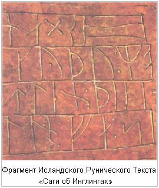

# Снорри Стурлусон. Круг Земной

В 1999 году исполнилось 820 лет со дня рождения Снорри Стурлусона, самого прославленного из исландцев, а с тех пор, как он записал «Круг Земной», продиктованный древними Жрецами, прошло почти восемь столетий. Однако можно смело сказать, что тот, кто прочтет это знаменитое древнее Священное предание, не пожалеет затраченного времени. «**Круг Земной**» - это яркий и драматичный, но в то же время исключительно правдивый рассказ, о судьбах сотен людей, действительно существовавших в древние времена, но мертвых уже многие века, богатейшая галерея человеческих образов, нарисованных с гениальной простотой. Герои и героини произведения говорят и действуют как живые. Снорри Стурлусон ничего не сообщает о том, что они думают или чувствуют. Но тем сильнее показан их прекрасный образный внутренний мир, такой непохожий на тот, который характерен для современного человека, и который проглядывает из их слов и поступков.

«Круг Земной» — это вместе с тем единственная в своем роде сокровищница, из немногих сохранившихся до наших дней сведений о далеком прошлом Северных Стран. О ее легендарных исторических и мифических временах, о бурной эпохе викингов и других народов. О богатых событиями первых веках существования скандинавских государств. При этом, хотя на протяжении большей части книги в центре поля зрения Снорри Стурлусона - **Скандинавские страны**, она содержит также массу ценнейших сведений и **об остальной Европе** — от Ирландии, Шотландии и Англии на западе, Белого Моря на севере, Византии и Скифии на юге, до Гардарики (Славении - **Новгородской Руси**) и Роси (**Киевской Руси**) на востоке Европы, и **Великой Страны Асов** за Уральскими горами (Свитьод, Свята Раса, Беловодье, Великой Тартарии), на территории нынешней Западной и Восточной Сибири. Но поразительно, что, несмотря на обилие сообщаемых сведений и в противоположность тому, что обычно имеет место во всевозможных «историографических» сочинениях, в безсмертном творении великого исландца основным объектом изображения все время остается человек.

«Круг Земной» давно переведен на большинство европейских языков. До издания нашей Книги существовал лишь один перевод на руский язык О.А. Смирницкой, и несколько небольших отрывков, переведенных разными людьми, которым не безразлична настоящая Истина, сохраненная в Рунических текстах.

В настоящем издании мы не ставили целью отвергнуть версии перевода «Саги об Инглингах» О.А. Смирницкой и других переводчиков. Мы считаем, что Текст повествования «Саги об Инглингах» в редакции Капен-Инглинга отца Александра (Хиневич А.Ю.), излагается ближе к Руническому оригиналу, который хорошо согласуется с другими Руническими текстами, чем англоязычный перевод или латинизированная версия. Из текста исключены по возможности все более поздние вставки и названия, а комментарии вы можете прочитать в конце текста.

отец Владимиръ (Иванов Н.И.)  
Старейшина Долинной Родовой Общины  
Древнерусской Инглиистической церкви  
Православных Староверов-Инглингов.  
Асгардская Весь, Беловодье.  
Лето 106777 от Основания Асгарда  
(1999 г.)
