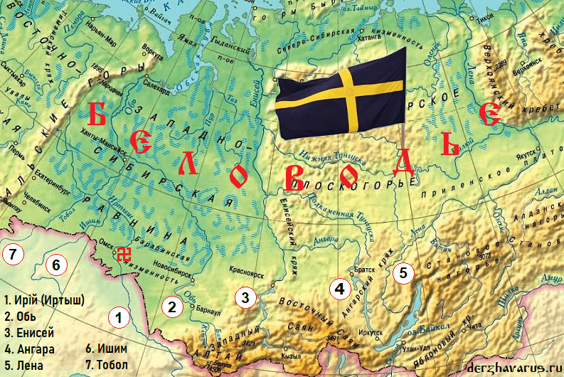
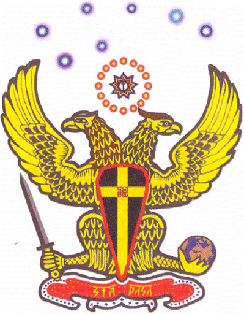
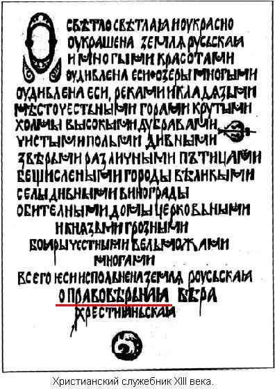
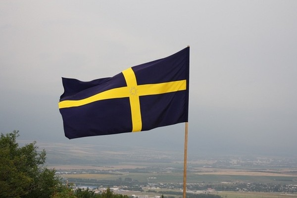

# Беловодье – прародина Ариев и Славян

**Беловодье** (**Пятиречье**, **Семиречье**, **Рассения**, **Тартария**, **земля Свята Расы**) – территория от Уральских гор до Тихого океана, и от Северного Ледовитого океана до Монгольского Алтая и Индии. Наши Предки переселились сюда из Даарии (Гиперборея, Арктида, Северия) **111 830 лет** назад на 2023 год (109 807 г. до н.э.). Беловодье – это Священная земля Великой Расы, страна Асов или страна Живых Богов; Духовный центр Древней Веры (Инглиизм) и Белого Братства.

Беловодье – страна Асов, Духовный центр Древней Веры и Белого Братства. / На карте отмечены 7 рек и город Омск – Асгард Ирийский.

**Содержание**  
1. Где располагается Беловодье  
2. Освоение Беловодья  
3. Асгард и Великое Капище в Беловодье  
4. Беловодье – Духовный центр Великой Расы  
5. Жречество Великой Расы в мировой истории  
6. Куда пропали Храмы и Священные тексты?  
7. Православие – Правь Славить  
8. Древние города Беловодья  
9. Возрождение Инглиизма

Несмотря на то, что Великий Русский Народ имеет многотысячелетнюю историю, многие убеждены, что ему всего, примерно, тысяча лет. Мало того, что у Русичей отобрали их историю, так еще произошла подмена Духовных ценностей Славян и Ариев, их Святынь. **Где располагается Священная земля Славянских и Арийских Народов?** Многие люди не знают ответа на данный вопрос. Какой город является Священным для Славян и Ариев? Ответов может быть несколько: Киев, Новгород, Москва, Ярославль и т.д., а какой Изначально Древний Град был Духовным центром Первичной Веры Славян и Ариев, кроме Староверов-Инглингов, мало кто знает. Сейчас вниманию Русских людей предлагаются духовные ценности и святыни, почитаемые представителями различных религиозных учений и течений.

Все они, бесспорно, являются святынями. Весь вопрос в том, для кого? Ответ предельно ясен - для представителей различных религиозных культов, возникших за пределами России. Отдельные люди, продвигающиеся по пути Духовного развития, обращают свой взор на Святыни Востока: Древнюю Индию, Тибет, Шамбалу и т.п. Но ведь и это все не исконно Славянское и не исконно Ариийское наследие! Ведь в эти, священные ныне места, Славяне и Арии пришли из других мест. **Не к лицу Славянам и Ариям кланяться чужим святыням**, лить воду на чужую мельницу, отдавать свою психическую энергию чуждому эгрегору! Ни к чему Русичам через насаждение чуждой псевдокультуры, своими руками разрушать собственную, Славянскую и Арийскую культуру! Предки наши, из далекого прошлого, предупреждают нас: *«... мы сами Даждьбоговы внуки и не стремились красться по стопам чужеземцев»*. Как своевременна эта фраза для нашего времени, а ведь это - всего лишь «Велесова книга», далеко не первое Священное писание Славян.

Иные скажут: «А была ли Священная земля у Славян и Ариев? И если она была, то где она находилась? Что располагалось на этой Священной земле?». На все эти вопросы можно ответить совершенно определенно. **Да, у Славян и Ариев была и есть Священная земля, и называлась она Беловодье**.

Древний Герб Беловодья – двуглавая Птица Рокк *(т.е. Судьба)*, у которой правая голова - Орла, а левая – мифической птицы Феникс.

## Где располагается Беловодье

Само слово «Беловодье» предполагает наличие **белой воды** или **белой реки**. В х'Арийском жреческом письме этому понятию соответствовал образ одной Руны – «**Ирий**» - *белая, Небесной чистоты вода*. К нашему большому сожалению, в доступной для рядового читателя Духовной и светской литературе до последнего времени нет каких-либо конкретных упоминаний о Рунах и Беловодье. В редких книгах можно встретить лишь краткое определение этого понятия. Так, Беловодье определяется как легендарная земля, Духовный центр Древней Веры и Белого Братства; райская местность, расположенная где-то на Востоке. Проще говоря, **Беловодье - это обособленная территория, на которой проживали Духовно продвинутые, просветлённые белые люди**.

В настоящее время, Беловодье многие помещают то в Тибете, то в Шамбале, - дескать, там протекают горные реки, имеющие белый цвет. К тому же Тибет - это горная восточная страна. В то же время, многие считают, что центр Древней Веры и Белого Братства располагается в Шамбале, а само понятие «*Белое Братство*» проистекает от степени чистоты Духовных устремлений. Отдельные авторы отождествляют с Беловодьем прародину Ариев и Славян. В некоторых Духовных источниках она называется Пятиречье или Семиречье.

В отношении прародины славян имеются несколько точек зрения. Одни авторы помещают ее в низовьях Дона (*Наука и Религия, № 3, 1996, стр.40*), другие - на территории Ирана (*В. Щербаков «Где жили боги и герои саг?» М.,1991*). Третья точка зрения на этот вопрос - Семиречье (Пятиречье) и Беловодье абсолютно разные местности. Представитель последней - А.И. Барашков (он же Бус Кресень, он же А.И. Асов), человек с большим воображением, помещает Семиречье в район озера Балхаш (*Велесова Книга: примечания стр. 265, М.1994*), а Беловодье в одном случае оказывается у него на Эльбрусе (*Наука и Религия, № 10, 1994, стр.52*), а в другом случае на севере нынешней Западной Сибири (*Наука и Религия, № 1, 1996, стр.29*).

На основании Древних Рунических Летописей Древнерусской Инглиистической церкви Православных Староверов-Инглингов можно сделать основной вывод: **Пятиречье и Беловодье - синонимы**, указывающие на одну и ту же территорию. Пятиречье - земля, омываемая реками *Ирий (Иртыш), Обь, Енисей, Ангара и Лена*. Позднее, когда отступил ледник, Роды Расы Великой расселились по рекам *Ишим и Тобол*. Таким образом, **Пятиречье превратилось в Семиречье**. Пятиречье (Семиречье) имело и другие, древние названия - **земля Свята Расы** и **Беловодье**.

## Освоение Беловодья

Как же происходило освоение этой Святой земли? Произошло все это в древнейшие, добиблейские времена. Тогда Роды Расы Великой, т.е. белые народы, предупрежденные Великим Жрецом, по имени Спас, о предстоящей гибели Даарии, в результате Великого Потопа, **переселялись из Северной прародины** (материка на северной вершине Земли, называемый ныне по-разному: *Арктида, Гиперборея, Северия*) по перешейку между Восточным и Западным морями (известные названия перешейка: Камень, Каменный Пояс, Рипейские или Рифейские горы, Уральские горы и др.), и заселяли земли на территории нынешнего южного Урала. Это произошло **111809 лет назад** на 2002 год (109807 г. до н.э.).

**Остров Буян**  
Затем, наши Великие Предки заселили большой остров в Восточном море, называемый Буян, ныне это территория Западной и Восточной Сибири. Как тут не вспомнить древние слова, поведанные А.С. Пушкину мудрой сказительницей Ариной Родионовной: «*В Восточном море-океяне на острове Буяне...*». Название острова возможно связано с выходом из недр Мидгард-Земли на поверхность мощного потока Светлой Силы и произрастания на данном острове всевозможной буйной растительности, имевшей особые целебные свойства.

**Первый Великий Потоп**  
После Первого Великого Потопа, произошедшего в результате уничтожения Лели, одной из трех Лун вращавшихся вокруг Мидгард-Земли, отступили Западное и Восточное моря. Об этом Потопе сохранилась информация в древних источниках:

> 1) «Чады вы Мои! Знайте, ходит Земля мимо Солнца, но Мои слова не пройдут мимо вас! И о древних временах, люди, помните! О Великом Потопе, истребившем людей, о падении на матушку Землю огня!»  
> *(Русские Веды «Песни птицы Гамаюн», 17 клубок)*;  
> 2) «Вы на Мидгарде живете спокойно, с давних времен, когда мир утвердился... Помня из Вед о деяниях Даждьбога, как он порушил оплоты Кощеев, что на Ближайшей Луне находились... Тарх не позволил коварным Кощеям Мидгард разрушить, как разрушили Дею... Эти Кощеи, правители Серых, сгинули вместе с Луной в получастьи... Но расплатился Мидгард за свободу, Даарией, скрытой Великим Потопом... Воды Луны тот Потоп сотворили, на Землю с небес они радугой пали, ибо Луна разкололась на части, и ратью Сварожичей в Мидгард спустилась...»  
> *(«Саньтии Веды Перуна», Круг Первый, Саньтия 9, шлока 11.(139).)*;  
> 3) К перечисленным источникам можно также добавить «Старшую и Младшую Эдды» (Скандинавия), Махабхарату (Индия) и другие древние тексты.

После Потопа Роды Расы Великой, перешедшие из Даарии на землю Свята Расы, заселили земли, бывшие ранее морским дном. На одной территории совместно проживали как **Арийские народы**: да'Арийцы и х'Арийцы, так и **Славянские народы**: Расены и Святорусы. Жили они в мире, облагораживая землю насаждая сады и леса, созидая совместно Величественные Капища (Храмы) и Города. Роды Великой Расы и Потомки Рода Небесного помогали друг другу по-братски, отсюда берет начало понятие «**Белое Братство**», ибо во всех созидательных деяниях Совесть и чистые помыслы были мерилом всего.

У этого Братства были не только чистые помыслы, но и белая кожа. А это уже философское единство, как формы, так и содержания. На этом основании можно сказать, что к Тибетскому Белому Братству, находящемуся в Шамбале, Славяно-Арийское Белое Братство никакого отношения не имеет. Точно так же, как не имеет никакого отношения к «Белому Братству» Марии Деви Юсмалос Христос и Юоанну Свами, ищущих побратимов среди иудео-христиан.

Возвращаясь к Семиречью, легко заметить, что все реки Беловодья несут свои воды на Север, по направлению к древней прародине Расы - Даарии.

**Второй Потоп и Великое Похолодание**  
После того, как на Мидгард-Землю (планету Земля) обрушились воды и осколки уничтоженной Луны Лели, первого из трех спутников нашей Земли, изменился не только внешний облик Земли, но и температурный режим на поверхности. При уничтожении Фатты, второго из трех спутников Мидгард-Земли, громадный осколок врезался в Землю, в результате чего изменился наклон земной оси и материковые очертания. Гигантская волна трижды обошла землю, что привело к гибели Антлани (Атлантиды) и других островов. Возросшая вулканическая активность привела к загрязнению атмосферы, что явилось одной из причин **Великого Похолодания и оледенения 13008 лет назад**. Прошло много столетий, прежде чем стала очищаться атмосфера, и ледники отступили к полюсам.

С тех пор на три месяца Земля Свята Расы стала укрываться Белым Плащом Марены - снежным покровом. Естественно, реки Семиречья в холодный период покрывались льдом, а по весне, во время ледохода, они в прямом смысле превращались в **Белые реки**, - шла шуга. Как известно, в районе Балхаша реки зимой не замерзают, климат более теплый, и не о какой белой воде говорить уже не приходится. Глядя на Ирий (Иртыш) и другие реки Беловодья сегодня, нельзя забывать, что человечество основательно загадило Природу, в основном, за последние восемьдесят пять лет. Естественно, ни о какой воде сейчас не скажешь, что она белая и чистая.

**Могла ли Священная земля Славян и Ариев располагаться в Тибете или на Эльбрусе?** Конечно же нет, зачем бы люди стали селиться на камнях, в горах, когда в изобилии имелись плодородные земли.

Малая информация о Беловодье говорит, во-первых, о его значительной удаленности и труднодоступности для проживающих к западу от Рипейских (Рифейских) гор и, кроме этого, свидетельствует о значительном временном отрезке, прошедшем с момента переселения Родов Расы Великой на западные земли Венеи (расселение по Европейскому континенту).

**Райская земля и Священный Ирий**  
*Райская земля, райский сад* на языке Ариев и Славян, обозначались образом одной Руны – «**Вырий**». Во многих Священных Писаниях и Преданиях Славян и Ариев имеются сообщения, что через Вырий протекала Священная река Ирий. Причем существовали Ирий и Вырий как земные, так и Небесные.  
• **Небесный Ирий** - Небесная Белая река, или Перунов Путь (так называемый Млечный Путь);  
• **земной Ирий** - нынешний Иртыш (Ирий Тишайший) - тоже молочная река, которая вытекает из Сметанного озера (озеро Зайсан), а берет начало с гор Ирийских (Монгольский Алтай).

## Асгард и Великое Капище в Беловодье

«*Страна Светлых Духов*», «*Страна Живого Огня*», «*Страна Живых Богов*», «*Страна чудес*» - таковы различные названия Беловодья. Но если это Страна Живых Богов, то в соответствии с древнеисландской «Сагой об Инглингах» (текст II) можно сделать вывод о том, что **в Беловодье стоял город Богов - Асгард**. Этот же источник указывает на то, что Асгард находился на восток от Танаквисля, и в городе Богов находилось большое Капище. По древнему обычаю главенствующее положение в Асгарде занимали Боги-Жрецы, и в главном Великом Капище было двенадцать верховных Жрецов - хранителей *Первичного Огня (Инглии)*. Эти жрецы назывались Диями, или Владыками Мудрости (Более подробно читайте «Славяно-Арийские Веды». Книга 1. "АРКОР", Омск, 1999-2001).

В.И. Щербаков располагает Асгард недалеко от нынешнего Ашхабада (Ниса). Однако, во-первых, рядом нет не только крупных, но и мелких рек. Во-вторых, срок возведения храма в Нисе составляет примерно 3-2 тысячелетие до Р.Х., что явно мало для города Богов. К тому же, стены храма в Нисе были сложены из кирпича-сырца, в то время как из Древнескандинавских Саг и Преданий Древнерусской Инглиистической церкви Православных Староверов-Инглингов известно, что Храм - **Великое Капище Инглии** был построен из Урал-камня, имел высоту от основания до вершины, в тысячу аршин [*700 метров*] (Алатырь-гора) и представлял собой громадное пирамидальное сооружение из четырех Храмов один над другим, находящимся в центре Круга Храмовых построек. Два Храма были наземными, два подземными.

В самом нижнем Храме-Святилище был лабиринт, состоящий из большого количества подземных проходов и галерей. Имелись подземные проходы под Ирием и Омью. В кладовых Великого Капища (Храма) Инглии находилось огромное количество сокровищ Свята Расы. Из Летописей Древнерусской Инглиистической церкви Православных Староверов-Инглингов известен тот факт, что **Беловодье всегда было мощным Духовным центром народов Великой Расы**. Именно Беловодье определило общность Традиций, Культуры и Веры у всего белого населения Мидгард-Земли.

Почему же стало возможным на протяжении сотен тысячелетий сохранять ту чистую, светлую Культуру на столь высоком Духовном уровне?

## Беловодье – Духовный центр Великой Расы

Прежде всего, необходимо отметить, что мы не являемся сторонниками теории Дарвина о происхождении человека или библейского варианта сотворения человека из праха земного (Бытие, гл. 2, ст. 7). Мало того, ранее (например, более ста тысяч лет тому назад) Мидгард-Землю населяли наши более высокоразвитые и **Высокодуховные Предки** - Древние и Мудрые. Высокообразованные, т.е. Ведающие Истинное Знание. Высокодуховные, т.е. Духовно и Душевно богатые. Наши Пращуры пришли на Мидгард-Землю из космоса, а следовательно, обладали гораздо более широкими познаниями, чем ныне живущее поколение. Вместе с обширными знаниями Древние Боги и Первопредки принесли на землю тот Духовно-нравственный Закон, без которого нельзя обладать даже малой частью тех знаний. То Духовное наследие, что хранит Древнерусская Инглиистическая церковь, берет начало от того **Небесного Духовно-нравственного Закона**. По мере развития жизни, на Мидгард-Земле изменялись условия проживания.

Одни поколения Расы Великой сменяли другие. Духовно-нравственные наставления, данные Древними, дополнялись толкованиями и разъяснялись для последующих поколений. Народы Великой Расы проживали на Мидгард-Земле не безсознательно, как изображают их жизнь христианские богословы и светская наука, стоящая на позициях дарвинизма. Особенно очернительству и искажению подверглось Истинное Наследие Славян и Ариев, к этому хорошо приложили руку сочинители «истинной истории»: Скалигер и династия Романовых с благославления христианских иерархов, коммунисты-большевики и нынешние творцы «новой истории».

Рядовому обывателю ярко рисуются картины непроходимых лесов и топких болот в древности, по которым прятались стада диких людей, славян и ариев, не ведающие никакой цивилизации, которые частенько нападали на «культурные и цивилизованные» народы. Напротив, **жизнь Славянских и Арийских народов подчинялась определенным законам и традициям**. Духовный уровень многочисленных Родов определялся Мудрыми Заповедями, данными Славянам и Ариям Богами и Странниками (Посланниками Богов) на протяжении многих сотен тысяч лет. Суть Заповедей сводилась к выполнению ряда наставлений, необходимых для поддержания психофизического здоровья народа. Заповеди носили конкретный характер, сохранялась преемственность между Заповедями, данными в разные временные отрезки.

Несмотря на «яркие» свидетельства христианских историков о якобы дикости славян и ариев, можно указать на такую особенность социальной организации, имевшей место в Рассении (территория по которой расселилась Великая Раса), как кастовость. Существовало **девять профессиональных каст**, причем высшая - девятая - каста Жрецов и Жриц, Хранителей Мудрости Светлых Богов и Великих Предков, а также каста «неприкасаемых», т.е. группа людей, нарушившая Кровные Заповеди и Законы РИТА (Небесные Законы о Чистоте Рода и Крови). Ну, а так как в Беловодье стоял главный Храм Расы: - Великое Капище Инглии, то именно из Беловодья проистекал Свет Духа и Веры для всех Славяно-Арийских народов. Несмотря на громадные временные отрезки, разделяющие расселившиеся по Рассении народы и настоящее поколение Ариев и Славян, последние сохранили многие **черты, отличающие их от прочих народов:**

> «В личных качествах у Славян и Ариев особенно ценится мудрость, праведность, мужество, верность долгу и слову, любовь к Родной земле, смекалка, умение метко и кратко говорить. Любовь должна быть только одна, к одной возлюбленной или жене, к одной Отчизне, к одной Изначальной Вере Первопредков. В отношениях между людьми всегда поощряются нелицемерное братолюбие, уважение к младости и почтение к старшим, особенно к Родителям, верность в дружбе, отзывчивость к чужому горю, готовность, рискуя головой, прийти на помощь страдающему, защитить невинного и слабого.
>
> Во всем присутствует представление о чистой Совести, которая настолько превыше всего, что никакие земные блага, соблазны или сама смерть не должны заставить человека изменить ей. Славянину или Арию чужда чрезмерная привязанность к земному благополучию и комфорту. Земные блага и ценности отступают на второй план именно потому, что важнее их и превыше их, существует высшая Духовная ценность - Совесть».

А, что можно добавить более того?

«Подобное притягивается подобным!», - эта древняя мудрость вполне применима к славянам. «Боги наши суть Отцы наши, а мы - дети их...», - так говорит «Велесова книга». Какие дети могли появиться у Солнечных Богов славян? Только такие, которые под стать этим Богам, под стать Яриле-Солнцу! Какие потомки могли появиться у народа, который славит мир Прави? Точно такие же, - Православные, - совершенные физически. Духовное же совершенство молодые поколения обретали, учась у старшего поколения. Старейшины Родов всецело доверялись Мудрым Жрецам.

Не следует наивно полагать, что все чада, на сто процентов, вырастали высоконравственными. Да, были люди, преступавшие Заповеди, в том числе и Кровные, особенно после разобщения Родов, вызванного Великим Похолоданием. Таковые, неизбежно, попадали в касту «неприкасаемых». Всю свою последующую жизнь они вынуждены были расплачиваться за ошибки и нарушение Заповедей, фактически находясь в изолированном положении.

Для того чтобы **вырастить достойное молодое поколение**:

- Детям с раннего возраста прививалась Древняя Вера Первопредков - Инглиизм, и Трудолюбие. Именно Трудолюбие, а не умение работать. Славяне и Арии не должны работать и не работали, ибо работа (бездушный, механический процесс) - это удел рабов. Они должны всегда Трудиться, т.е. вкладывать Душу в плоды своего Труда.
- Обучение чтению, письму и естествознанию начиналось с девяти лет. С двенадцатилетнего возраста юноши, наряду с кастовым обучением определенной профессии, начинали овладевать военным искусством.
- Девушка как будущая мать обучалась домоводству, кулинарии, садоводству и полеводству, уходу за детьми. Не утрачивалась и Древняя Мудрость Светлых Богов и Предков.
- В Жрецы чаще всего попадали либо дети-сироты, либо дети из семей, принадлежащих к Жреческой касте. Сокровенные знания передавались им по мере их Духовного развития через целый ряд посвящений, через целую цепь Духовного самосовершенствования.
- При Славянских и Арийских Капищах (Храмах) находилось множество древних фолиантов, свитков, дощечек, Саньтий, Харатьий (пергаментов) со священными текстами, записанных жреческими письменами, это и были главные сокровища.

## Жречество Великой Расы в мировой истории

Кое-кто может усомниться как в самом существовании Беловодья, так и в ведущей роли Жречества Великой Расы в мировой истории Мидгард-Земли. Если верить той «истории», каковую преподают сегодня в школах и высших учебных заведениях многих стран, то это конечно невозможно. Но кто сказал (и доказал!), что Славяне или Арии были безграмотными? Известно, что только у жрецов Великой Расы имело хождение четыре письменных языка: Да'Арийское письмо, х'Арийское письмо, Расенское образно-зеркальное письмо, Святоруское письмо. [см. Славянские формы письма]

Эти **жреческие письмена впоследствии стали основой** для китайского, японского, корейского, древнеегипетского, персидского письма, санскрита, финикийского, греческого, латинского и современных письмен Славянских и Арийских народов. Если бы не было Беловодья, то не было бы ни той Древней Индии, того Древнего Китая, того Древнего Египта, того Междуречья, в том качестве, в котором мы о них знаем.

Ни одна цивилизация не может возникнуть спонтанно, на пустом месте, по воле или желанию отдельной личности. Для возникновения цивилизации необходимы определенные внутренние предпосылки и, возможно, какой-то внешний толчок. Под внутренними предпосылками мы понимаем достаточно значимый уровень Духовной культуры.

**Древняя Индия**  
По настоящее время, христиане различных направлений искренне связывают человеческие жертвоприношения с язычеством - якобы верой древних Ариев и Славян, считая последних безкультурным народом. Но о какой высокой культуре можно тогда говорить применительно к Дравидии (Древней Индии), где человеческие жертвоприношения осуществлялись систематически, посредством древнейшего религиозного культа темнокожих народов «Кали-Ma», - культа черной Матери.

Почему «вдруг» произошел «качественный скачок», когда кровавый культ сменился безкровным, Ведическим культом? «Вдруг», просто так ничего не происходит. «Вдруг» - это следствие х'Арийского похода в Дравидию в лето 2817 от Сотворения Мира (2691 до Р.Х.). И поход этот состоялся из Беловодья. Сомневающимся в подобном ходе истории можно указать на «случайное» совпадение названия, так называемых индийских Священных книг - Вед. Но «Веды» - исконно славянское слово, одна из рун х'Арийского письма, означающая Знание, Мудрость.

**Древний Египет**  
Другой яркий пример - Древний Египет. Из древнеегипетских преданий известно, что эта страна была основана девятью Белыми Богами, пришедшими с Севера. Под Белыми Богами, в данном случае, скрываются белокожие Жрецы - посвященные в Древние Знания, несомненно, бывшие Богами для негроидного населения Древнего Египта.

Вспомним, чем стал обладать Древний Египет после его создания Белыми Богами. Это **шестнадцать тайн**: умение строить жилье и храмы, владение техникой земледелия, животноводства, орошения, ремесленное искусство, судовождение, военное искусство, музыка, астрономия, поэзия, медицина, секреты бальзамирования, тайные науки, институт жречества, институт фараона, использование полезных ископаемых.

Нелишне заметить, что все эти навыки египтяне получили с первых династий, а не к годам правления последней династии. Срок образования государства Древний Египет так же известен, - 12-13 тысяч лет назад.

Почему людей, основавших Египет, называли Богами? Только потому, что Знания их были столь обширны, что позволили быстро организоваться в мощную цивилизацию. Но тогда получается, что белые народы уже 13 тысяч лет назад были не такими уж и темными, какими их представляют сегодня, различные «ученые» мужи.

Как белые жрецы оказались в Египте? Маршрут их довольно прост: Беловодье (Рассения), - Антлань (Атлантида), - Древний Египет.

Почему же сейчас практически ничего не слышно о Славяно-Арийском Беловодье, как центре Духовной жизни белых народов?

**Александр Македонский посещал Беловодье**  
Существует поверье о том, что какую-то северную Священную землю посетил Александр Македонский (*Наука и Религия, 1995 г., № 1 , ст. 25-26*). Находясь в походе на Индию, он, будучи в Приаралье, или в Памире, повернул на Север к желанной стране. В поэме Низами – «Искандер-наме» на пути царя лежала безводная пустыня, потом песок «стал серебром» - видимо, следствие выпавшего снега. «Вся земля - серебро, воды - будто бы ртуть...». Вот и Беловодье!

Путь к земному раю занял два месяца. Город, до которого дошел Александр находился в зеленой долине. Вокруг - изобилие, да еще и город защищен «незримыми силами». Александра встретили старейшины - Жрецы, которые ввели Александра в лазурный дворец - Великий Храм Инглии – «...необъятный, как небеса...» и поведали ему о своей жизни. Верные небесам, люди справедливой страны получали все необходимое от Богов.

**Золотая книга Коляды**  
Изучая журнальный вариант «*Золотой книги Коляды*» А. И. Барашкова (*Наука и Религия, М 12 1994 г., № 1 - 1995 г.*) мы также обнаружили ряд сведений о Беловодье. Так размеры сада - Вырия составляли семь верст на восемьдесят столбцов. Но ведь и верста и столбец - это единицы длины Пядевой системы х’Арийской арифметики! Там же упоминается о речке Смородинке, вытекающей прямо из под камня, из под земли и имеющей рыжий, кровавый оттенок. Очевидно, что речка Смородинка - это ручей от родника, бьющего из земли. Рыжий цвет воде придает окисленное железо, присутствующее в родниковой воде. Кстати, в устье Оми подобные родники не редкость! Ирий (Иртыш) является границей между Явью и Навью. И это положение не противоречит действительности. Ранее население храмового города проживало на правом берегу Ирия, а места захоронения усопших находились на левом берегу Священной Реки.

**Летописи Древнерусской церкви**  
Если обратиться к летописям Древнерусской церкви, то можно обнаружить следующее свидетельство: «... В лето 5028 от Великого переселения из Даарии в Рассению, в праздник трех Лун, месяца Тайлет, девятого дня 102 года Круголета на слиянии Ирия и Оми был построен Асгард Ирийский...». Согласно тем же летописям, Асгард Ирийский был разрушен ордами джунгар в лето 7038 от Сотворения Мира (1530 от р.Х.) при помощи отрядов из Сибирского ханства.

**Послание Василия епископу Феодору о Рае**  
Эти данные не противоречат свидетельству из новгородских преданий о земном рае (*Наука и Религия, № 1, 1995 г., стр. 26*). Их излагает (в середине 14 века от р.Х.) новгородский архиепископ Василий в своем «Послании» к тверскому владыке Феодору. Василий утверждал в споре с Феодором, что земной рай не погиб, что его можно достичь. Здесь же Василий приводил свидетельства людей, которым удалось это сделать. События, видимо, развивались на рубеже 13-14 веков от Р.Х.

## Куда пропали Храмы и Священные тексты?

Куда же пропали Храмы, стоящие на Земле Свято Расы? Куда же исчезли все Священные тексты?

После **разрушения Асгарда Ирийского в лето 7038 от С.М.** Великое Капище Инглии (Великий Храм Первичного Огня, называемый также - Алатырь-гора), построенное из Урал-камня, через три года осело и рассыпалось. В пустующем Храме была нарушена основа - энергетическая структура. Урал-камень поддерживал свою энергетическую структуру за счет постоянных излучений от творческих деяний белых людей. Но, несмотря на прекращение творческого излучения, частично сохранилось святилище, основательно засыпанное тем, во что превратился Урал-камень. Сохранилась часть сети подземных ходов, причем, эти ходы использовались в 20-м веке органами ОГПУ-НКВД-МГБ-КГБ-ФСК. Долгое время сохранялись погосты, курганы, кладбища на левом берегу Ирия.

Часть Храмов древних Славян и Ариев в Беловодья была захвачена христианами для проведения своих культовых обрядов. **Большая же часть Храмов была варварски разрушена, утварь, представляющая ценность, разграблена**. Священные Саньтии, Харатьи, Волхвари, дощечки, книги были, большей частью, уничтожены. Однако часть Древних Источников Мудрости уцелела. По свидетельству Иоакимовой летописи - священные Славяно-Арийские тексты спасал сам Иоаким. Даже иноверец понимал, что в этих книгах содержится Древняя Мудрость Жизни! Многие древние священные тексты были сохранены общинниками славянами и ариями, которые скрывали их сперва от недоброго княжеского глаза, а затем - от царского.

В конце 20 века от Р.Х. в России, собравшейся вернуться к своим историческим корням, наступил настоящий информационный голод по исконно Славянской Духовной литературе. Поэтому так тепло был встречен выход отредактированной А.И. Барашковым «Велесовой книги». В оригинале она была записана на дощечках святоруским письмом. На настоящее время «Велесова книга» выдержала уже три издания. В (*Мифы древних славян. Велесова книга. - Сост. А.И. Баженова, В.И. Вардугин.- Саратов, «Надежда», 1993. 320 с*), во вступительной статье народного академика Ю.К. Бегунова, в частности говорится о том, что язык «Велесовой книги» не принадлежит какому-то одному народу; он сходен с древнеславянским, польским, русским, украинским и чешским языками. Такое, как считает академик, смешение лексических примет многих славянских языков не говорит о великой древности этого культурного памятника. Однако, на наш взгляд, академик не учел того, что все славяне – братья, и некогда имели один общий язык, который, впоследствии, претерпел характерные для каждого народа изменения. Именно на этом языке славяне и говорили в Беловодье. Любой славянин знал, что Великий Бог Род - Творец Мира, Единая и Множественная, Всемогущая Сущность. Но многообразие проявлений жизни осуществлялось через проявление других Сущностей – ипостасей Единого Бога Рода. В принципе, нет большой разницы между Изначальной Верой древних скандинавов, германцев, франков, саксов, кельтов, скоттов, этрусков, собственно славян, венедов, скифов, сарматов, персов, иранцев, сирийцев, египтян.

Некогда, в Беловодье, Жрецы Великой Расы владели стройной системой - иерархией Божественных Сущностей. Этой же структурой владели Жрецы Славянских народов, переселявшихся из земли Свята Расы на новые земли. **Постепенно связь переселенцев с Беловодьем утрачивалась**.

Жреческую Мудрость не всегда удавалось передать в полном объеме, и с течением времени происходили неизбежные изменения как во внешнем культурном облике народов, так и в Духовном плане. Также, постепенно, исчезала информация о той земле, из которой происходило расселение народов Расы Великой. К слову сказать, в истории описывается такой малоизвестный факт, что князь Владимир Святославич Киевский якобы при «выборе» новой религии отправлял посольства даже (?!) в Беловодье. Если этот факт и имел место, то в X веке от Р.Х. Славяне, проживающие на территории Киевской Руси уже не ведали, что Беловодье их Прародина. Древняя Вера Беловодья была тем Духовным источником, который питал и Киевскую народную Веру. Нелишне заметить, что в Беловодье Богам и Предкам приносились только растительные жертвы и плоды человеческого труда. Человеческие жертвоприношения на Киевской Руси пытался узаконить и ввести сам князь Владимир, сказалось влияние примеси хазарской крови!

Соблюдая Духовно-нравственные Заповеди, Славянский и Арийский народы, сами того не подозревая, были Духовно неуязвимы! Причем, на это не влияло даже то, что потомки не знали всей своей предшествующей истории. В Беловодье, а затем на всех территориях, куда расселялись Славяне и Арии, в основе Веры всегда лежал **культ Предков** [Родотеизм] – основа той высокой Духовности, которой и по сей день обладают народы Расы Великой.

Если о Беловодье простые люди мало что знали в X веке от Р.Х., то в XX веке стали знать еще меньше. Причиной тому является скрытая агрессия со стороны темных сил по всем направлениям нашей жизни, как в физическом, так и в Душевном мире. Сначала заменили Родную Веру на чужую Религию. Миссионеры-проповедники из других стран **не от безверия к Вере призывали, а отречься от Родных Богов** в пользу чужого бога. Изменили и упростили до предела Древнюю Азбуку, изъяв из нее «лишние буквы» и Образную основу, под благим предлогом простоты и совершенства. Тем самым лишили детей Образного мышления и способности творчески мыслить, под стать Богам.

Современные богословы пытаются доказать недоказуемое. Например, Славянский Триглав, почему-то, отождествляют с христианской Троицей. Да, у христиан в основе веры лежит принцип троичности, но ведь у Славян и Ариев этого принципа нет. Основа у Славян и Ариев - принцип Свастичности: Тело, Душа, Дух, Совесть, а выражалось это символом Свастики.

С виду, религия Моисея - монотеизм, проще и доступнее. Но не все, что проще, будет лучшим; не все то золото, что блестит. То, что хорошо для одного народа, оказывается неприемлемым для другого. Славянские добродетели не идут ни в какое сравнение с добродетелями иудейскими (христианскими), отраженными в Библии. Но именно **Библию «историки» сегодня пытаются представить как единственное Священное Писание у Славян и Ариев на рубеже IX-XII вв**. от Р.Х. А как же Вера Первопредков и Древние Веды?

А наши вольные Предки оказались «темными и невежественными», не то, что чужой Господь, у которого все оказались в рабстве. На рубеже IX-XII веков была нарушена связь многих поколений! Родители - Славяне и Арии истреблялись новоиспеченными христианами и миссионерами, а детям-сиротам вдалбливалась «Новая Великая Вера» - вера народа Израиля. **Почитание Великих Предков - стало преступлением**, крамолой и идолопоклонством, а поклонение идолам Израильским - великая добродетель.

Активно происходило искажение истории, которая переписывалась в угоду власть имущим. Белое становилось черным, а черное - белым. Разрушалась древняя, многотысячелетняя культурная традиция славянских народов. В Х-ХII века это познала Русь. Ранее, доктрину Израиля познали римляне, греки, германцы, франки, саксы, скандинавы, венеды. Без участия противников Света не обошлось при **уничтожении древних библиотек - хранилищ ценнейших книг**:

- Протошумерская библиотека в Вавилоне
- Александрийская библиотека в Египте
- Разрушение архипелага Санторин
- Гибель кладовых папирусов в Фивах и Мемфисе
- Уничтожение Этрусской библиотеки в Риме
- Поджог храма-капища в Афинах
- Уничтожение громадной библиотеки в Царьграде
- Исчезновение библиотек Ярослава Мудрого и Ивана Грозного

Всего того, что свидетельствовало бы о 600-40-10 тысячелетней истории народов, населявших Мидгард-Землю, просто нет, их «кто-то» уничтожил.

Особенно преуспели силы пришедшие из Мира Тьмы в пропаганде бездуховности и кровосмешения. **Главный рецепт для вырождения народов - кровосмешение**, т.е. нарушение Кровных Заповедей у Славян и Ариев. Характерно, что в этом же русле шла пропаганда интернациональных браков в Советском Союзе, где даже успешно образовалась новая общность - советский народ.

## Православие – Правь Славить

Но зерна мудрости Великой Расы, посеянные в Беловодье, не погибли. Славяне и Арии не растворились ни в серой массе христолюбивого народа, ни в красной массе советского народа. Главное, что **в Славянах сильны традиции Православия**, дохристианской Веры нашего народа. Хотя, сейчас мало кто знает, что на Русской земле, термин - «Православие», был заимствован у Староверов-Инглингов и привнесен в Христианство только в XVII веке патриархом Никоном, во времена царя Алексея Михайловича Романова, а до этого, Христианство византийского толка на Руси называлось ортодоксальным, т.е. правоверным (ниже древний текст христианского служебника ХIII века, написанный древнерусским уставом, данные служебники хранят Праведные Старообрядцы).

Текст христианского служебника XIII века, в котором написано, что христианская вера правоверная.

Вся церковная реформа Никона, сводилась не только к замене в богослужебных книгах словосочетания «правоверная вера христианская» на «православная вера христианская», двуперстия на трехперстие и т.д. Истинная цель реформы Никона состояла в том, чтобы стереть в памяти народной **изначальный смысл слова «Православие» - Правь Славить**, а также покончить с периодом Двоеверия на Руси, когда относительно веротерпимо и с уважением к друг другу сосуществовали на Русской земле «правоверные христиане», или как называют себя Старообрядцы – «Праведные Христиане», и Староверы – «Православные Славяне», исповедывающие – Инглиизм, которых христиане называли Инглянами.

Несмотря на то, что Ингляне дружелюбно относились к представителям всех иных Вероисповеданий, о чем сообщает Радзивилловская Летопись, оборотная сторона 8 листа: «Бо тии звахус(я) варязи рус(ь), яко се друзии зовутьс(я) свие, друзии ж(е) оуръмяне, инъгляне, друзии и готе» (см. летопись на стр. 146), для Инглян (Староверов-Инглингов) и всей древней Славянской и Арийской традиции, христианским Патриархом Никоном и царем Алексеем Михайловичем Романовым, готовилась одна участь - **полное физическое уничтожение, ибо этого требует Библия**, а если быть точным - Ветхий Завет:

> «Истребите все места, где народы; которыми вы овладеете, служили Богам своим, на высоких горах, и на холмах, и под всяким ветвистым деревом. И разруште Жертвенники их, и сокрушите Столбы их, и сожгите огнем Рощи их, и разбейте истуканы Богов их,, и истребите Имя их от места того».  
> *(Второзаконие, гл. 12, ст. 2-3).*

## Древние города Беловодья

Но сколько бы ни уничтожали нашу Древнюю Веру, Культуру, Традицию, Историю, Святыни и города, Природа не терпит пустоты. Так, на месте Асгарда Ирийского разрушенного в Лето 7038 (1530) джунгарами, через 186 лет в 7224 (1716) был вновь отстроен город, получивший название Омск, т.е. «Скит на Оми». То, что это именно то место, где находился Град Богов и стояло Великое Капище Инглии, доказывает свидетельство Семена Ремезова, записанное на 21-м листе «**Чертежной книги Сибири**» (середина XVII века): «Прiстоит вновь быти городу кpai о самоi степи камыцкам». Дословно с древнерусского языка это переводится так: «*Предстоит заново возродить город на правом берегу (реки), рядом со ступенями древних строений, из каменей положенных на каменьях (ступени Храма)*», а также **раскопки в центре города Омска**. Так, при прокладке теплотрассы в районе Старой Омской Крепости, где ныне павильон «Флора», был обнаружен древний некрополь (подземный город), по возрасту старше египетских пирамид (*Н. Солохин «Где несет воды древний Ирий»*). При сносе старой ТЭЦ, в том же районе, обнаружена сеть подземных ходов, более древних, чем некрополь (*об этом было показано по ТВ6-Москва*). И таких находок множество, но у современной науки нет средств, для обследования и изучения этих древностей.

Омский академик Владимир Иванович Матющенко из Омского Государственного Университета, за свою жизнь провел множество археологических раскопок городищ, курганов и других древних поселений на территории Омской области. Он обнаружил множество находок, возраст которых датируется от 4-5 до 12-15 тысяч лет. Надо отдать должное академику В.И. Матющенко, который верит только своим глазам и чистым фактам, и честно заявляет, что ему неизвестно, какой древней культуре и какой народности принадлежат найденные археологические древности. Это понятно, ведь не все археологические находки можно вписать в современную хронологическую модель истории или привязать к истории какого-либо существовавшего народа в древности.

В Лето 7502 (1994) приглашенный на научно-практическую конференцию, посвященной 400-летию города Тары, Патер Дий (Глава) Древнерусской Инглиистической церкви Православных Староверов-Инглингов Александръ сделал доклад «**Неизвестная история**», в котором сообщил представителям научных кругов, о древних городах Беловодья, в том числе и о древнем Тарийском граде, коему в этот год исполнялось не 400, а 4000 лет, ибо основан он в Лето 3502 (2006 г. до Р.Х.) на слиянии рек Ирий и Тара.

Об этом древнем граде сохранилась информация не только в Рунических Летописях Древнерусской церкви Староверов-Инглингов, но и в древнеиндийском эпосе «Махабхарата»:

> «Над злом возвышается та страна, где вкушается блаженство; Вознесена она силой (Духа), а потому Вознесенной зовется... Это - вознесенного Золотого Ковша дорога; Считается, что она посредине между Востоком и Западом... В этом обширном Северном Крае... Не живет человек жестокий, безчувственный и беззаконный... Здесь находится созвездие Свати, здесь помнят о его величии; Здесь, нисходя к жертве, Тару укрепил Великий Предок».  
> *(Так в Святой Махабхарате, в Книге «Усилий», в Книге «Путешествие Бхагавана» гласит 110 глава)*.

Некоторые представители от современной исторической науки считают, что все церковные легенды не подтверждены ни исторически, ни археологически. Археологи пединститута города Тары, еще в 1992 году раскопали на слиянии Иртыша и Тары **древнее городище, возраст которого 3,5-4,5 тысяч лет**, но не знали к какой культуре его отнести, т.к. им постоянно говорили, что в данном регионе в древности могла существовать только Татарская и Остякская культура, а найденные предметы быта и культуры принадлежат исключительно Славянской культуре, которой, согласно официальной истории, в данном месте просто не должно быть.

По этому поводу, Патер Дий Александр напомнил присутствующим на конференции, о исторических работах «**Сравнительная археология**» и «**Сибирь – Прародина Славян**», написанных Великим Русским историком и археологом XIX века В.М. Флоринским, основателем Томского государственного университета, где главным куратором был российский император Александр III.

В.М. Флоринский провел сравнительный анализ более тысячи раскопок на территории Сибири и Дальнего Востока, а также на европейской части России. И везде каждый курган или городище принадлежали Славянской культуре, причем везде просматривалась идентичность между Сибирскими захоронениями и Славянскими курганами на европейской части Российской Империи. Только славянские курганные захоронения в Сибири и на Дальнем Востоке были в десятки, а то и сотни раз древнее европейских. На основании этих археологических данных В.М. Флоринский сделал вывод, что Сибирь является Прародиной Славян.

На вопрос Патер Дию Александру: «А в каком месте на территории Омской области были еще древние города и святилища», он ответил: «Если это интересно, то древний **Вендагард** находился в районе Большереченска (современный районный центр Большеречье), а в районе деревни Окунево Муромцевского района находился **Храмовый комплекс Богини Тары**, который построил Верховный Жрец Светлого культа Богини Тары, Хан Уман. Во времена Второго х’Арийского похода из Беловодья в Дравидию (древнюю Индию) Хан Уман был назначен Духовным советником царя Лесных людей, уманом».

Для справки:  
летом 1998 года, в районе Большеречья, при раскопках было найдено городище, древнейший протогородской культуры, который назвали на современный манер **Нью-Аркаим**. Раскопки древнего города продолжаются до сих пор.

В 1995 году в районе деревни Окунево, на место раскопок Тарского Увала приехала из Индии гражданка ФРГ Раджни (Расма), последовательница духовного учителя Бабаджи, которую послал на Святую землю ее духовный наставник Мунирадж. Она ничего не знала про археологические раскопки в данном районе и имела только информацию, полученную в Индии от своего учителя, но несмотря ни на что, сразу нашла остов, где стоял древний Храм - Капище Богини Тары. Сейчас в деревне Окунево находится ашрам последователей Бога Шивы (славян. наз. Жива), а на омкаре, остове древнего Капища (Храма) Богини Тары проводятся богослужения и огненные ритуалы.

Стяг Беловодья

Территория Беловодья и земли Свята Расы простиралась от Урала до Великого океана на Востоке, и от Северного океана до Ирийских гор и Индии. Многие люди сейчас не знают, что еще каких-то 245 лет назад все эти территории были в составе Славянской Державы, называемой в Европе - **Grande Tartarie**, т.е. **Великая Тартария**.

## Возрождение Инглиизма

До сей поры, для представителей древних верований Европы и Индии, Беловодье является Духовным центром, хранилищем Древних Духовных Знаний и Мудрости. Но то, что известно за рубежом, не всегда известно жителям России, ибо некоторые представители официальной власти из-за незнания или невежества, пытаются скрывать от народа информацию о том, что древняя Славяно-Арийская Вера не уничтожена, а жива и продолжает существовать несмотря ни на что.

И по сей день, в Беловодье и на земле Свята Расы живут общины Староверов-Инглингов, исповедующие древнюю Святую Веру Первопредков – Инглиизм, в той чистоте, что оставили нам Мудрые Предки.

В лето 7500 от С.М. (1992 г. от Р.Х.), после семилетнего хождения по различным инстанциям, юридически возрождена Древнерусская Инглиистическая церковь Православных Староверов-Инглингов. Вновь официально проводятся занятия в Асгардском Духовном училище и в Духовных Семинариях при Капище Веды Перуна. Яко во старь сияет купольными шатрами в Беловодье Капище Веды Перуна (Храм Мудрости Перуна), в коем свершаются как в старые добрые времена, древние Богослужения и Обряды, соблюдаются и отмечаются древнейшие праздники по Круголету Числобога.

В предисловии к «Мифам древних славян...» (*Мифы древних славян. Велесова книга. - Сост. А. И. Баженова, В. И. Вардугин. - Саратов, «Надежда», 1993.-320 с.*) говорится: «Допустим, что Славянская Вера лучше. Но ведь ее нет в чистом виде, в повседневном обиходе, в широком знании. Кто из людей знает, как называется славянский Бог Солнца?...». Да, мы согласны, что не только простые люди, но и далеко не все академики знают как называлось Солнце. Да, в широком знании нет полного представления о Старой Вере. Но, тем не менее, **Вера жива именно в самом народе**, т.к. в христианстве имеются только ничего не значащие названия, имена или термины, несущие, как правило, дохристианский, славянский контекст. Правда, это не относится к таким древним христианским праздникам, как Успение богородицы или Усекновение главы Иоанна Предтечи.

Эти праздники для Православных Староверов-Инглингов чужые - серые! Речь идет о древних праздниках, которые славяне отмечали испокон веков, естественно вплетающиеся в народный сельскохозяйственный календарь. Ибо славянская Вера - Вера естественная, а не искусственно созданная.

Возрождение Инглиизма, Святой Старой Веры Славян и Ариев в повседневной народной жизни - высшая цель, стоящая перед Древнерусской Инглиистической церковью Православных Староверов-Инглингов. Кому, как не нам, Староверам-Инглингам, проживающим в Беловодье, предстоит вернуть Славянским и Арийским народам, их широчайшие знания и Родную, неискаженную Историю.
