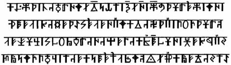

# Книга Света (Харатьи 1-4)

1. Харатья 1 – Начало  
2. Харатья 2 – Рождение  
3. Харатья 3 – Великая Асса  
4. Харатья 4 – Устроение Миров

## Харатья 1 – Начало

В Лето Жрицы Огня, на Пятьсот Семьдесят Шестом Круге Жизни от Великого Переселения из Даарии, по Круголету Числобога нашего [**1**], в День Трёх Лун [**2**], почитаемом в Асгарде Ирийском [**3**], изведайте, чада Расы Великой и потомки Рода Небесного, о временах стародавних, о Мудрости Древней Жрецами хранимой, о Начале всего людям ведаемого и для грядущих времён в Харатьи [**4**] Света начертанного Даррунгом [**5**] Вирритом. Во Славу Богов, во Величие Рода, да постигнете вы сердцем вашим величие Мира, через то, что поведает песнь волхва Сладагора, в да’Арийском Роде Парда [**6**] хранимая.

**1. В Лето Жрицы Огня, на Пятьсот Семьдесят Шестом Круге Жизни от Великого Переселения из Даарии, по Круголету Числобога нашего** - Лето 83075 от Великого Переселения из Даарии, или Лето 78047 от Основания Асгарда Ирийского, что соответствует 26731 году до современного Летоисчисления (с.л., н.э., Р.Х.).  
**2. В день Трёх Лун** - Праздник Трёх Лун, в день, когда Три Луны соединились на небосводе, было начато строительство Асгарда Ирийского и Великого Капища Инглии (Великого Храма Священного Первичного Огня), этот день считается днём основания Священного Города Богов на слиянии рек Ирий и Омь.  
**3. Асгард Ирийский** – Ас – Бог живущий на Земле; гард – город. Город Богов на реке Ирий (совр. Иртыш) был построен в Лето 5028 от Великого Переселения из Даарии (104778 г. до с.л.), на его месте в настоящее время находится современный город Омск, который также расположен на слиянии рек Омь и Иртыш (др.славян. наз. Ирий. В переводе с древне-х’Арийского: Ирий – белая, чистая вода. От этого смыслового значения появилось название территории – Беловодье).  
**4. Харатьи** - Священные Тексты, Духовно-философские трактаты и исторические повествования, записанные на пергаментных листах.  
**5. Даррунг** – даррунгом назывался человек, наделённый даром соединять Рунические Образы, описывающие происходящие события, способный записать соединённый Образ событий в шлоки, которые наносились на деревянные дощечки, кожу, пергаментные листы (Харатьи) и пластины из благородного металла (Саньтии). Даррунгом также назывался человек, пишущий летописи - Летописец.  
**6. Пард** – Пард или Пардус, животное семейства кошачьих, существовавшее в древности на территории России, по своему виду был похож на снежного барса.  
…………………………….  
…………………………….

Некогда, вернее тогда, когда ещё не было времён, не было Миров и Реальностей, нами, людьми, воспринимаемых, был, не воплощаясь, один только Великий Ра-М-Ха [**7**]. Он проявился в Новую Действительность и от восприятия Новой Безкрайней Безконечности, озарился Великим Светом Радости. И тогда появилась Безконечная Новая Вечность в Новой Действительности родившаяся, и безконечное число её проявлений появилось. Так появилось то, что мы, люди, как пространства Миров Яви, Нави и Прави воспринимаем.

**7. Великий Ра-М-Ха** - (Рамха, санскр. Брамо) - Изначальная Единая Непознаваемая Сущность, излучающая Жизньродящий Свет Радости и Первичный Огонь Мироздания (Инглию), из которого появились все существующие Вселенные, а также все обитаемые Миры и Реальности.  
…………………………..  
…………………………..

Как только Великий Ра-М-Ха проявился в Новую Действительность, в Безконечной Новой Вечности появилось сверхвеликое абсолютное Нечто, а так как оно было не тем, чем является Великий Ра-М-Ха, то сверхвеликое абсолютное Нечто таило в себе начаток зла, ибо всё, что с высшей точки зрения Всесовершенного несовершенно, является относительным злом. И когда Великий Ра-М-Ха озарился Великим Светом Радости, от Него полился Великий поток Инглии [**8**], Первозданного Живого Света, то есть дыхание Его несказанное, хлынул Свет несказанный и зазвучал в Нечто Великом.

**8. Великий поток Инглии** - Жизньродящий Свет и Первичный Огонь Мироздания, в котором появились Вселенные и наша система Ярилы-Солнца с Мидгард-Землёй.  
………………………  
………………………

В тот миг, когда Первозданный Живой Свет отошёл не менее чем на одну мирную долю линии от Великого Источника Инглии, то Первозданный Живой Свет перестал быть частью Того, кого мы люди именуем Великий Ра-М-Ха, как свет от Ярилы-Солнца или лучины горящей не является Ярилой-Солнцем или лучиной. Первозданный Живой Свет гнал перед собою мглу сверхвеликого абсолютного Нечто, Божественного Света лишённого, а в некоторых местах он пронизывал её, не оставляя следа; в других местах сиял ярчайшим Светом, Великие Пространства заливал, и всё дальше и дальше лился поток Света ослепительного.  
………………………  
………………………

Но чем дальше отходил Первозданный Живой Свет от Того, кого мы, люди, нарекаем Великий Ра-М-Ха, тем менее ярок был Свет Инглии, всё чаще и чаще раздвигавший и отодвигавший мглу небытия, мглу пустоты.

В каждом скоплении Первозданного Живого Света множество Миров и Реальностей появилось. И вот далеко-далеко от Того, кого мы, люди, именуем Великий Ра-М-Ха, в последний раз разлился Первозданный Живой Свет Его, как Скопления Великие. В этом Первозданном Живом Свете появились живые существа, ибо Жизньродящей была Инглия.  
………………………  
………………………  
………………………

Часть Первозданного Живого Света излилась в низы глубокие и там с тьмой и мглой смешалась. Появились Первозданные Сполохи, из которых наша Вселенная и Вселенные, выше расположенные, родились. Но везде, и в верхах, и в низах, как река голубая, шла полоса Первозданного Живого Света, с мглою не смешивающаяся, называемая Золотым Путём или Небесным Ирием.

Сверху донизу в Новой Действительности от поверхности Небесного Ирия отражались Миры различные, а в них развивались Реальности особые, особыми существами населённые.  
………………………  
………………………

Чем выше расположены Реальности, тем большим числом чувств одарены существа, их населяющие; и в каждой местности Золотого Пути далеко не одна Реальность была расположена, а множество разнообразных Реальностей, причём существа, их населяющие, имели одинаковое количество чувств, но разные были чувства существ в этих Реальностях, рядом друг с другом лежащих. Такова наша Безконечная Новая Вечность в Новой Действительности, и в ней горят ещё Великие Скопления Первозданного Живого Света, слабым отсветом которого наши Солнца являются.  
………………………  
………………………

Первозданный Живой Свет соединял множество Реальностей порождая Великие Древа Миров [**9**]. Как ветви дерева соединил Первозданный Живой Свет листочки-Реальности с могучими сияющими стволами, а стволы Мировых Деревьев уходили корнями своими в Безконечную Новую Вечность порождённую в Новой Действительности, и Светлую Силу они получают из Светлых Вод Небесного Ирия [**10**]. Так создан был Вырий Сад [**11**], что занимает пол-Сварги Небесной.

**9. Великие Древа Миров** - Вселенские Мировые структуры. На Земле эти Вселенские Мировые структуры воплотились в образы Священных Деревьев, до сей поры почитаемых у белых людей: Игга (Иггадрасиля), Дуба, Берёзы, Ясеня и др. Эти Священные Деревья также олицетворялись со Светлыми Богами: Игг – с Богом-Воином Одином; Дуб – с Богом-Громовержцем Перуном; Берёза – со светлоликой Ладой-Богородицей, а Ясень – с щедрым Тархом Даждьбогом.  
**10. Небесный Ирий** – Небесным Ирием в древние времена называли Золотой Путь Духовного Развития, кроме того Небесным Ирием также называли Млечный Путь.  
**11. Вырий Сад** - Небесные Обители, где живут Светлые Боги и Многомудрые Предки всех Славяно-Арийских Родов, которые населяют ныне Мидгард-Землю.  
………………………  
………………………

Иначе сложились другие Безконечности в нашей безконечной Инглии существующие. И там, высоко в верхах, но далеко от Того, кого мы, люди, именуем Великий Ра-М-Ха, там, где разлились великие скопления Первозданного Живого Света, там находятся Вышние Боги, одного из которых мы Сварогом [**12**] называем, и кто Богом Миров и Реальностей нашей Безконечности является.

**12. Сварог** - Светлый Славянский Вышний Бог, управляющий Небесами и Жизнью в нашей Вселенной.  
………………………  
………………………

Сварожичей больше, чем Безконечностей в нашей Безконечной Инглии существующих. Те из Светлых Богов, которые не являются Вышними Богами Безконечностей, в сияющем Мире Духовной Силы [**13**] пребывают. Безконечно Велики и Безконечно Мощны по сравнению с нами Сварожичи: мы можем говорить о Них, как о Всесовершенных, Всемогущих, Всеблагих и Всезнающих.

**13. Мир Духовной Силы** - Многомерный и многообразный Мир, находящийся на более высших уровнях Златого Пути по сравнению с Явным Миром Мидгард-Земли.  
………………………  
………………………

Мы правы, ставя Вышних Богов превыше всего нам доступного, нами постигаемого. Но любое из живущих в любом из нас существ на мельчайшей частице, вокруг изначальной основы вращающемся, так же относится по мощности своей к Сварогу, как Сварог относится к Тому, кого мы именуем Великий Ра-М-Ха. Каждая мельчайшая частица нашего тела, камня, дерева является своеобразной Солнечной системой, Ярилой-Солнцем, окружённым Землями [**14**], на которых живут миллиарды мыслящих существ, иногда по своему умственному и нравственному развитию нас, людей, превышающих.

**14. Землями** – Землями славяне и арийцы называли Небесные объекты, вращающиеся вокруг центрального Светила – Солнца или Звезды.  
………………………  
………………………

Важнее ныне сказанного может быть то, что в Безконечной Новой Вечности в Новой Действительности родившейся, внизу такая же безграничная непознаваемая бездна, как и вверху, и то, что внизу, является подобием тому, что вверху, а то, что вверху, является Основой для подобия того, что внизу, по первоначальной воле Того Изначального, кого мы, люди, именуем Великий Ра-М-Ха.  
………………………  
………………………  
………………………

## Харатья 2 – Рождение

На истоке Лета Жрицы Огня, на Пятьсот Семьдесят Шестом Круге Жизни от Великого Переселения из Даарии, по Круголету Числобога нашего, в День Любомира, когда Многомудрые Жрецы благословляют Священные Семейные Союзы между Великими Родами, во всех Весях Свята Расы и в Асгарде Ирийском. И в сей прекрасный вечер услышьте, чада Расы Великой и потомки Рода Небесного, о временах стародавних и прекрасных, о Мудрости Древней, Жрецами хранимой. О Рождении Миров Яви, Нави и Прави, и для грядущих времён в Харатьи Света начертанной Даррунгом Вирритом. Вознеся Славу всем Вышним Богам, и Величию Рода Небесного, да постигнет всяк сердцем своим величие Миров, через то, что поведает песнь волхва Сладагора, в да'Арийском Роде Парда хранимая.  
………………………

В истинном Изначалье, вернее, тогда, когда в Безконечной Новой Вечности разлилась Великим мощным потоком Жизньнесущая сияющая Инглия, Первозданный Жизньпорождающий Свет, в Новой Действительности рождены были разнообразные Пространства и Реальности Миров Яви, Нави и Прави.  
………………………

И чем ближе к Изначальному Источнику Света располагались эти Пространства и Реальности в различных сияющих Мирах, тем большими мерностями эти Величайшие Пространства и Реальности были наполнены. А в них рождались Жизньнесущие Древние Боги-Покровители Миров и Величайших Пространств и Реальностей, которые, развиваясь в Божественном Свете Первозданной чистейшей Инглии, познавали и обустраивали свои безкрайние Пространства и Реальности, и чем многомернее были Обители Жизни, тем большим числом чувств были одарены Древние Боги, Обители Жизни населяющие. Так рождён был Высочайший и безгранично многомерный Светлый Мир Прави.  
………………………  
………………………

Ниже Наивысшего Мира Прави, в каждой сияющей Обители Жизни на Пространствах Золотого Пути, далеко не одна Реальность была расположена, а множество Реальностей, причём существа, Обители Жизни населяющие, имели одинаковое количество чувств, но разные были чувства существ в этих Реальностях, рядом друг с другом лежащих. И для разных мыслящих существ различные Солнца и Звёзды сияли. Первозданный Животворящий Свет Инглии соединял сияния разных Солнц и Звёзд из множеств многообразных Реальностей, порождая Великие Древа Миров.  
………………………  
………………………

Как ветви Древа соединил Первозданный Животворящий Свет Листочки-Реальности нашего Мирового Древа с могучим сияющим стволом. И каждый Листочек-Реальность сиял безмерно, переливаясь ярким Светом различных Солнц, а ствол Мирового Древа уходил многочисленными корнями своими в Безконечную Новую Вечность, порождённую в Новой Действительности.  
………………………  
………………………  
………………………

И вот высоко в верхах, на Листочках-Реальностях, под радужными ослепительными сияниями Великих Солнц и Звёзд, рождены были Новые Обители Жизни, в коих Древние Боги-Покровители наших Великих Родов появились. Они обживали Новые Обители Жизни, неся существам, рождённым и живущим там, Красоту, Созидание с Гармонией. Преображая Земли в Новых Обителях Жизни в цветущие благоухающие Сады под яркими разноцветными Солнцами и Звёздами.  
………………………  
………………………

Наполнив всевозможными благами сияющие Новые Обители Жизни, они отправлялись в иные Реальности и там также вновь созидать продолжали, помогая жителям данных Реальностей. Природа в тех Светлых Землях оставалась нетронутой, но жизнь в Землях тех Красотою наполнилась. Там Мудрость извечная в Мир изливалась и наполняла Жизнь мерой безмерною. Так расцветали Обители Жизни, что рождены были в Новой Действительности.  
………………………  
………………………

Обители Жизни в сияющем Мире, развились в Гармонии и Совершенстве. Во всех отношеньях, в деяниях и в жизни лишь Совесть и Мудрость мерилом являлись, их дополняли Любовью и Верой, что к совершенству Сознание приводят. Мудрость и Труд вдохновляют Сознание и укрепляют деяния славные. Преображались те Земли цветущие, и взор к Небесам существа обращали.  
………………………  
………………………

Устремляя свой ясный взор к Небесам, существа всей Душой стремились в те дальние дали, откуда прибыли на Земли их, в различных Реальностях расположенные, Многомудрые Древние Боги-Покровители. Первозданный Свет Инглии развивал полёт мысли, порождая Великое Созидание во всех Гармоничных Светлых Мирах. И разнообразные формы Жизни, благодаря Чистой и Ясной Мысли, а также Великому Созиданию, покинули Цветущие Земли и устремились в Небеса, наполняя новые Пространства и Реальности в различных многомерностях. Так рождены были Величайшие и многомерные Пространства и Реальности Светлого Мира Нави.  
………………………  
………………………

Распространяясь по разноплановым Пространствам и Реальностям, Мудрые мыслящие существа, ведомые Древними Богами-Покровителями, обживали прекраснейшие незаселённые Новые Земли Светлого Мира Нави, а после вновь в Небеса отправлялись. Так заселялись гармоничные Миры Яви и Нави, порождённые в Первозданном Живом Свете Радости, который излучает Изначальный Великий Ра-М-Ха.  
………………………  
………………………

## Харатья 3 – Великая Асса

На истоке Лета Жрицы Огня, на Пятьсот Семьдесят Шестом Круге Жизни от Великого Переселения из Даарии, по Круголету Числобога нашего, в День Великой Инглии, когда Многомудрые Жрецы зажигают Священный Живой Огонь, во всех Весях Свята Расы и в Асгарде Ирийском.  
………………………

Поведано будет вам, чада Расы Великой и потомки Рода Небесного, о временах стародавних и прекрасных, о Мудрости Древней Жрецами хранимой. О Великой Ассе между Светом и Тьмой, которая охватила Миры Яви, Нави и Прави, и для грядущих времён в сии Харатьи Света начертанной Даррунгом Вирритом. Вознеся Славу всем Светлым Вышним Богам, и Величию Рода Небесного, да узрите вы сердцем своим, величие Миров Света, через то, что поведает песнь волхва Сладагора, в да'Арийском Роде Парда хранимая.  
………………………

Мирны лет тому назад, а может быть, и вчера, ибо Вечность не знает ограниченности во времени, в Светлом Мире Арлегов, который охватывает двести пятьдесят шесть измерений, произошла Великая Асса, Великая битва Сил Света и Тьмы.  
………………………  
………………………

Один из Благородных Арлегов - Чернобог, решил, при помощи хитрости, обойти установленные Богом Сварогом Вселенские Законы восхождения по Золотому Пути Духовного Развития. И глаголил он собратьям своим: Если, мы, Благородные Арлеги, снимем Охранные Печати с Сокровенной Древней Мудрости своего Мира для Миров низших. Тогда снимутся по Закону Божественного Соответствия и для нас Охранные Печати с Сокровенной Древней Мудрости всех Миров Высочайших. И откроется свободный проход вверх по Золотому Пути Духовного Развития для нас, Благородных Арлегов, а также поможет Знание сие всем Духам и Душам из различных Миров, находящихся ниже Мира Арлегов, познать Сокровенную Древнюю Мудрость всех Миров, а познавши, встать рядом с Богом Сварогом и другими Сварожичами...  
………………………  
………………………

Но встретил Арлег Чернобог достойный отпор в лице Благородного Арлега - Белобога, Верховного Хранителя Сокровенной Древней Мудрости Мира Арлегов, охраняющего Охранные Печати с Сокровенной Древней Мудрости данного Мира, и не удался хитрый замысел Чернобога. Зазвенел тогда по всем Мирам, Пространствам и Реальностям, лежащим по Золтому Пути, призывный клич Чернобога. Легов звал он к себе на помощь.  
………………………  
………………………

И явился на зов Чернобога весь многомерный Мир Легов, и незванными прилетели к нему Тёмные Леги, Тёмные Арлеги и Кощеи, правители Пекла, а с ними всё воинство Пекла прилетело к нему. Не мог Белобог один противостоять таким великим Тёмным силам. И сорвал Чернобог первую Охранную Печать, Печать с Древнего Знания Мира Арлегов, и Знание широко разлилось по Мирам, ниже Мира Арлегов лежащим, вплоть до самых глубин Пекла.  
………………………  
………………………

В свою очередь, зазвучал тогда зов мудрого Белобога, увидавшего, что не может он один сохранить Охранные Печати с Сокровенной Древней Мудростью Мира Арлегов. Позвал он на помощь Вышние Миры, и к Хранителям Мира Познания обратился Он. Но безучастными остались Хранители Сокровенной Древней Мудрости Мира Познания, так как не хотели они с Чернобогом сражаться, считая его свободным в выборе своих деяний.  
………………………  
………………………

На призыв Благородного Белобога откликнулись только Хранители Сокровенной Древней Мудрости Миров Начинаний, а также Боги-Защитники из всех Вышних Миров и Реальностей. И окружили они весь Мир Арлегов плотным энергетическим куполом Ледяного Безмолвия, и началась Великая Асса между Светлыми и Тёмными силами, и в Мирах остановилось время. Великая Битва охватила многие Земли Миров Яви и Нави, от самого Пекла до Мира Нирваны.  
………………………  
………………………

Но не пожелали Благородные Арлеги ни в Великой Ассе участвовать, ни сражаться против Богов-Защитников из всех Вышних Миров и Реальностей, ни внутри плотного энергетического купола Ледяного Безмолвия, созданного Хранителями Сокровенной Древней Мудрости Миров Начинаний оставаться. Своими искусственными Солнцами растопили они прилегающую часть купола Ледяного Безмолвия и спустились в Мир Легов и в Миры Промежуточные, а Чернобог, тоже не захотевший внутри купола Ледяного Безмолвия оставаться, спустился и нашёл себе убежище в Мире Тёмных Арлегов.  
………………………

От начала Великой Ассы как бы над Миром Арлегов поднялся Белобог, ибо объединил он зовом своим Светлые Силы и вёл их на борьбу против ратей Тёмных Миров. Побеждённых Тёмных Легов и Тёмных Арлегов отправляли в те Миры, откуда они пришли, взяв с них великую клятву не нарушать Законы восхождения по Золотому Пути Духовного Развития, установленные Богом Сварогом. Лишь Кощеи, правители Пекла, с остатками воинств своих устремились к проходу в куполе Ледяного Безмолвия, который создали Благородные Арлеги. И скрылись в Пекле своём, сознавая, что Светлые Силы не проникают в чужие Миры и Реальности, неся на стягах своих Тьраги Войны.  
………………………  
………………………

По воле Сварога Боги-Защитники из всех наивышних Миров и Реальностей создали Рубеж, Свет и Тьму разделяющий, чтобы не могли проникать силы тёмные в Светлые Земли Сварги Великой. Рубеж проложили по Землям во Яви, чтоб отделить Свет от Тьмы Мира Нави. Явный Рубеж разделил все Реальности Нави, и Тёмную Навь совлекли ниже Яви. Явь расширялась, росла и окрепла, собою перекрыв все проходы для Пекла. А также для Тёмных Арлегов и Легов, что супротив Белобога сражались и в Сварге Пречистой зло учиняли.  
………………………  
………………………

Явь безграничная, как межа, отделила Мир Пекла и Тьмы, где главенствует сила, от Мудрости Древней Познания Мира, где Совесть главенствует, Свет, а не сила. Но Тёмные силы, вкусившие Знания, свой взор устремляют к Мирам Созидания.  
………………………  
………………………  
………………………

## Харатья 4 – Устроение Миров

На самом истоке Лета Жрицы Огня [**15**], на Пятьсот Семьдесят Шестом Круге Жизни от Великого Переселения из Даарии [**16**], по Круголету Числобога нашего, после Дня Великой Инглии, когда Многомудрые Жрецы зажигали Священный Живой Огонь во всех Весях Свята Расы [**17**] и в Асгарде Ирийском. Поведано будет вам, чада Расы Великой и потомки Рода Небесного, о временах стародавних и прекрасных, о Мудрости Древней Жрецами хранимой. О Устроении различных Миров и новой Великой Ассе [**18**] промежду Светом и Тьмой, коия охватила Четыре Чертога Сварги [**19**] и Мидгард-Землю [**20**], и для грядущих времён в сии Харатьи Света начертанной Даррунгом Вирритом. Вознеся Славу всем Светлым Вышним Богам, и Величию Рода Небесного, да узрите вы сердцем своим Величие Жизни в Мирах, через то, что поведает песнь волхва Сладагора, в да'Арийском Роде Парда хранимая.

**15. Лето Жрицы Огня** – 131 год на Круголете Числобога.  
**16. Даария** - Священная страна, находилась на затонувшем в северном океане материке. Даарию различные народы называли по-своему: Арктида, Гиперборея, Северия, Арктогея и др.  
**17. Во всех Весях Свята Расы** - т.е. во всех 16 областях Беловодья, называемого также Семиречье.  
**18. Великая Асса** - Небесная битва между Светлыми и Тёмными Силами.  
**19. Четыре Чертога Сварги** - четыре созвездия: Макошь - Большая Медведица; Рада - Орион; Раса - малый и большой Лев; Свати - нет аналогов в современных созвездиях.  
**20. Мидгард-Земля** - древнее Славяно-Арийское название планеты Земля.  
………………………

В великой стране Та-Кеми [**21**], что находилась на востоке от Антлани [**22**] и на юге от Великой Венеи [**23**], проживали многочисленные племена с кожей цвета Мрака [**24**] и племена с кожей цвета Заходящего Солнца [**25**]. Среди этих племён существовали две могущественные касты Жрецов, и имели они три Духовных Учения, которые им дали х’Арийцы, пришедшие из страны Антов.

**21. Та-Кеми** - древнее название страны, существовавшей на севере Африканского континента, на территории современного Египта.  
**22. Антлань** - Страна Антов, находилась на большом острове, который затонул в Атлантическом океане около 13000 лет назад. Древние греки называли Страну Антов Атлантидой.  
**23. Великая Венея** - Страна, в которой проживают Роды и Племена Венедов, территория современной Европы.  
**24. Племена с кожей цвета Мрака** - негроидные народы севера Африканского континента.  
**25. Племена с кожей цвета Заходящего Солнца** - предки отдельных семитских народов, в частности арабов.  
………………………

Одно Духовное Учение - внешнее, не представляющее тайны, данное народам Та-Кеми Жрецами начальной касты и не признававшееся самими Жрецами истинной Верой, гласило, что Душа каждого человека после смерти переселяется в тело человека той или иной касты, иногда великолепного Вождя или даже Верховного Жреца. Когда высока и достойна была жизнь умершего человека. А также в тело животного, насекомого или даже растения, когда недостойно была прожита человеком его собственная жизнь. Но сами Жрецы данной касты исповедовали другое Духовное Учение.  
………………………  
………………………

Они искренне думали и верили, что переселение человеческих Душ совершается не только на нашей Мидгард-Земле, но что Души умерших людей уходят и на другие Земли нашей Вселенной, где воплощаются в тела людей или животных иных Миров, в зависимости от их поступков в Явной жизни на Мидгард-Земле. И этот закон они называли Кармой, в честь Великой Богини Карны, которая следит за соблюдением Закона Духовного Совершенства.  
………………………  
………………………  
………………………

Однако среди Жрецов второй касты была группа ещё более высоко посвящённых, мало кому из Жрецов низших каст известная, и имела она другое Духовное Учение, сильно отличавшееся от предыдущих. Гласило это Духовное Учение, что наш окружающий Явный Мир, Мир жёлтых Звёзд и Солнечных Систем, только песчинка в Безконечной Вселенной. Что существуют Звёзды и Солнца белые, голубые, лиловые, розовые, зелёные, Звёзды и Солнца цветов, нами невиданных, нашими чувствами не постигаемых. И безконечно велико их число, безгранично их разнообразие, безконечны Пространства их разделяющие. И все эти разнообразные Миры – только лишь Огненные светильники, стоящие у привхода в Чертог Создателя, именация которому – Великий Ра-М-Ха. И все эти разнообразные Миры - ничто перед иными Мирами, вне нашей Вселенной лежащими, и снова безгранично велико их число и неизмеримо велико их разнообразие. Безконечности Безконечностей разделяют все эти разно- и многообразные Миры.  
………………………

И учили эти Многомудрые Жрецы, что в нашей Вселенной есть Золотой Путь Духовного Восхождения, ведущий вверх и именуемый - Свага, по которому расположены Гармоничные Миры, и следуют они один за другим: Мир Людей, Мир Легов, Мир Арлегов, Миры Аранов, Миры Сияний, Мир Нирваны, Миры Начинаний, Мир Духовной Силы, Мир Познания, Мир Гармонии, Мир Духовного Света, Миры Духовного Достояния, Мир Закона, Миры Созидания, Мир Истины, Миры Покровителей, и множество других до самого Величайшего Мира Прави. Некоторые из Высочайших Носителей Духовного Достояния в нашей Вселенной по благости своей спустились и раположили Миры свои между Мирами Арлегов и Аранов, дабы ближе к нуждающимся в помощи расположить станы свои.  
………………………

Миры, по Золотому Пути расположенные, это те, о которых говорится в Древних Ведах. Если Мир Людей четырёхмерен, то Миры, расположенные по Золотому Пути, имеют следующее число измерений:  
Мир Легов - 16,  
Мир Арлегов - 256,  
Миры Аранов - 65.536,  
Миры Сияний - 65.536(2),  
Мир Нирваны - 65.536(4),  
Миры Начинаний - 65.536(8),  
Мир Духовной Силы - 65.536(16),  
Мир Познания - 65.536(32),  
Мир Гармонии - 65.536(64),  
Мир Духовного Света - 65.536(128),  
Миры Духовного Достояния - 65.536(256),  
Мир Закона - 65.536(512),  
Миры Созидания - 65.536(1024),  
Мир Истины - 65.536(2048),  
Миры Покровителей - 65.536(4096).  
*\* В скобках – степень числа.*

Существуют также Миры промежуточные: пяти, семи, девяти, двенадцати и меньших по числу измерений. В конце Сваги проходит Рубеж, за которым начинается Величайший Мир Прави. Кроме Гармоничных и промежуточных Миров, расположенных по Золотому Пути, существуют реальности привходящие: времени, пространства, блуждающих Духов, меняющихся образов, теней, звуков, цифирей, Мир Тьмы, называемый также Пеклом, бездна, куда вошли самые тяжёлые частицы первозданного мрака.  
………………………  
………………………

Миры, по Золотому Пути расположенные, более гармонизированы и более завершены в своих проявлениях, чем Реальности промежуточные: так, хотя в Реальности пяти измерений имеется больше возможностей для развития Духов, чем в нашем Мире Яви, но из-за вечной неустроенности в Реальности пяти измерений часто взрываются частицы первозданного мрака.  
………………………  
………………………

Примером Пространств и Реальностей меньших по числу измерений могут служить Миры звуков, теней, зеркальных отображений, вечно меняющихся образов, где происходят постоянные превращения. Там цветок может стать через мгновение Свитком Харатьи, затем червяком, рысью и т.д. И все эти Миры и Реальности вовсе не расположены отдельно, а проникают друг в друга. Так что там, где в одной Реальности бушуют великие волны моря, в другой Реальности шумит лес или стоят высокие горы, покрытые вечными снегами.  
………………………  
………………………

Причина перехода из одной Реальности в другую, новую Реальность, изменение силовых линий Духов и Закон Богини Карны. А Безконечные Пространства, Реальности эти разделяющие, являются, как бы улицами в большом городе, где в своём изначальном виде могут встречаться Духи различных Миров. Но тогда, когда Духи входят в чужой Мир или Реальность, они должны подчиняться существующим в данном Мире Законам.  
………………………

Особенностью Мировой структуры является то, что все Миры, все Реальности, независимо от определяющего их числа измерений, находятся в одном и том же месте, применительно к человеческому разумению и к той Безконечной замкнутости, при этом заполняя всю нашу Вселенную. Но между Мирами и Реальностями разных измерений существуют преграды, преодолеть которые и приобщиться к жизни иного Мира или Реальности можно, только получив то количество чувств и те качества, которые такому Миру или Реальности свойственны.  
………………………

Некоторые Миры или Вселенные с одинаковым количеством измерений существуют рядом друг с другом, в то время как Реальности проникают одна в другую. Но имеющие качественно различные чувства или разные формы и условия жизни, жители этих Реальностей, существуя в единой мерно-пространственной структуре, между собою не сталкиваются и порой даже не подозревают о существовании друг друга.  
………………………

И в каждой такой Реальности существует своя Природа, течёт своё Время, существуют свои собственные Законы, присущие только этой Реальности. Многие из таких Законов трудны для восприятия человека, живущего в нашем Явном Мире, ибо они не укладываются в общепринятые рамки человеческого восприятия, в рамки данной формы существования, а в следствие этого человеку становится непонятен и смысл Законов чуждой Реальности.  
………………………

Познание окружающего мира Природы и своего внутреннего Мира приводит человека к осознанию себя как неотъемлемой части Вселенной. И если познание дополняется умением созидать, то это открывает перед человеком возможность познавать не только свой Мир Яви, но и иные Миры и Реальности, подчас лежащие за порогом человеческого восприятия и понимания.  
………………………

Переход в другой Мир или Реальность возможен, однако для этого необходимо переступить через порог, который связан с потерей тела данной мерности. Такой переход в Мире Яви людьми именуется смертью. Если Высшие существа иных Миров и Реальностей попадают в данный Мир, то они начинают восприниматься здесь не в своей изначальной, истинной сути, а в формах восприятия данного Мира, которые только и доступны его жителям и обитателям. Чем сложнее структура Мира или Реальности на определённой местности Золотого Пути, тем больше шансов для обитателей этой местности отразиться в сознании Миров или Реальностей меньшей сложности.  
………………………

В основании Золотого Пути находится Мир Людей, и подъём человека в более Высокий Мир или Высшую Реальность возможен только в результате Духовного Развития. Для этого в Мир Людей приходили Боги и приходят Учителя человечества. Это существа более Высокого порядка сложности, которые спускаются для руководства и передачи Высших Знаний и Заповедей. Ведь над развитием Духовной и Душевной сущности человека работает не только он сам, но и Вселенские Силы, возвышающие или задерживающие его Духовное и Душевное развитие.  
………………………

Восхождение обитателей из одной Реальности в более Высшую не обязательно происходит постепенно. Если в своём развитии личность получает возможность приобщиться к пониманию сложности ближайшего гармонизированного Мира по Золотому Пути, то это скачком переносит его в Вышний Мир, минуя разнообразные Миры и Реальности промежуточных измерений. Судьба каждой Духовной сущности во многом целиком зависит от Богини Карны, которая способствует или препятствует её развитию и восприятию принципиально новых структур и форм более Вышних Миров.  
………………………

Освободившись от физического тела, личность избирает ту Реальность, которая наиболее соответствует её Духовному и Душевному развитию. Эти Реальности относятся к той же Безконечности, что и соответствующие им местности на Золотом Пути, но структурные формы и содержание представлены в них в иных сочетаниях. Ничто во Вселенной не препятствует восхождению Духа, кроме него самого. Попадая в определённую местность Сваги, в зависимости от собственного уровня Духовного развития, личность начинает жить по Законам Мира данной Безконечности.  
………………………  
………………………

В ряде Безконечностей имеется одна, представляющая собой более чем гигантский шар, поверхность которого является границей данной Безконечности. Кое-где этот шар почти соприкасается с другими Безконечностями, тоже являющимися в виде шаров, а в местах, где образовались конусообразные пространства между шарообразными Безконечностями, имеются Миры, представляющие собой как бы пирамиды или конусы, три стороны которых и основания представляют собой вогнутые поверхности.  
………………………  
………………………

На одном из таких сверхгигантских шаров живут высокоодарённые существа, которых по земным меркам можно назвать людьми, хотя они только отдалённо напоминают людей. Некоторые их жилища напоминают деревья, другие - гигантские грибы или прекрасные исполинские цветы, ко входу в которые они поднимаются на специальных летательных машинах, похожих на земные Вайтманы.  
………………………

Встречаются и более странные обители: как будто столб дыма поднимается там широкой и длинной спиралью, а в пустотах этой спирали живут люди. Все они питаются разнообразной пищей, приготовленной из сгустков энергий того обитаемого Мира. Эта пища легко извлекается, когда необходимо, из почвы и воздуха, и в крайне малых количествах поглощается ими. Люди одеваются в великолепные ткани, созданные из различных потоков энергий. Ничего похожего на нужду они не знают. Эти люди располагают всевозможными машинами и механизмами, всем Родам сообща принадлежащим, и молодые люди охотно работают на них, изготовляя из сгустков энергий всё нужное или желательное.  
………………………

Иногда личность попадает в Миры, которые находятся вне всякой связи с Золотым Путём, это Реальности привходящие: времени, пространства, кармы, безумия, блуждающих Духов и Мира Тьмы, именуемого также Пекельным Миром. Кроме того, он может попасть в промежуточные Реальности Сваги, которые отличаются неопределённостью, нарушением причинно-следственных связей. В них происходит то, что обитатели Гармоничного Мира воспринимают как чудо. Однако для жителей промежуточных Реальностей это крайне неудобно: никогда нельзя достоверно предсказать результат своих действий.  
………………………

На протяжении всего Золотого Пути действует Единственный Истинный и Безусловный Закон Мироздания: Любовь ко всему существующему и Созидание, а Рождению Любви предшествует Мудрое Знание. Путём Любви и Знания каждая Духовная сущность развивается, поднимаясь к Созидателю и постепенно постигая Его творение, а познав, начинает созидать нечто своё, наполненное Любовью. Высшим же проявлением Любви становится самопожертвование для помощи низшим. Так поступают Леги, ведущие людей, и Высочайшие Носители Духовного Достояния, которые несут людям Знание о Высшей, совершенной Любви. Любовь учит пониманию, милосердию и жертвенности. Эти качества готовят человека к служению остальным и к творчеству, которое рассматривается как борьба со злом, как соучастие в деяниях преображения Мира.  
………………………

Необходимо правильно рассматривать борьбу со злом. Зло не абсолютно. Зло - всего лишь проявление неразвитости и незнания. Даже Бесы, низшие сущности тёмного Мира, не лишены надежды на Духовный подъём в отдалённом будущем, на освобождение от грязи и злобы в результате длительного пути развития под руководством Высших Духовных Наставников Золотого Пути.  
………………………  
………………………

Поступок любой Духовной сущности в первую очередь сказывается на ней самой. Поскольку любая индивидуальность обладает абсолютной свободой выбора, её решение воздействует на её структуру. От выбора зависит её дальнейшая судьба: одними действиями развивающаяся личность способствует своему подъёму вверх по различным местностям Золотого Пути, другими отягощает себя, укрепляет связи, которые тормозят развитие, а то и увлекают вниз, в Тёмные Миры. Это и есть Закон Богини Карны, в случае невозможности подъёма возникает необходимость пройти заново весь Круг Жизни, но уже по другим Реальностям, для совершения необходимой работы над своей Духовной сущностью.  
………………………

В примитивном человеческом восприятии Закон Богини Карны отразился как идея Трёх Великих Судов после смерти, называемых также Страшный Суд. На самом деле никакого Страшного Суда нет, есть только задержка восхождения, да и то лишь временная, потому что всё подчинено Единому Закону Восхождения от низшего к высшему. Зло, пусть даже невольно созданное, всегда отягощает своего создателя. Только там, где Духовные сущности настолько высоки, что подъём является естественным условием их жизни, которая сама направлена на содействие восхождению более низших существ, там Карма, как неизбежная закономерность движения в Духовном Мире, уступает иному действующему началу, проступающему в виде Любви.  
………………………  
………………………

Обитатели различных Миров и Реальностей ищут максимально полного соответствия образа Жизни и собственной сути. Так, Духи Стихийных Сил видят счастье в обретении мощи и победе над стихиями; Духи Звёзд Знания, понимают счастье как накопление Мудрости, как постижение Миров и самих себя; для Духов Смерти счастье существует в переходе из Реальности в Реальность; Духи Пространства счастливы, преодолевая его.  
………………………

Полнота счастья может быть только в постоянной борьбе со злом, которое препятствует обитателям тёмных Земель, его жителям, начать восхождение по различным местностям Золотого Пути. Это возможно только лишь одним путём: в общении с другими обитателями своей Реальности, в воспитании Духовной сущности человека к восприятию всеобщего жизненного начала, которое проявляет себя во всех местностях Золотого Пути.  
………………………  
………………………  
………………………

Наставления Высочайших Носителей Духовного Достояния, несущих Божественный Свет обитателям всех Реальностей, едины в своих основных положениях. Для подъёма важно только осознать своё единство, нерасторжимое Родство с другими сущностями, положив между собою и ими Любовь к равным и сострадание к низшим формам Жизни. Милосердие и Вера во всеисцеляющее чувство Любви и Добра способны в будущем преобразить даже Бесов - этих, казалось бы, извечных врагов Божественного Света, животных Мира Тьмы, которые проповедуют среди людей Явного Мира: вседозволенность, жестокость, жадность, эгоизм и конечность существования.  
………………………  
………………………  
………………………

Бесы, низшие сущности тёмного Мира, возникли при Рождении Миров «во мгле», причём были подобны Легам, от которых отличаются только изначальным отсутствием Божественного Света. Подлинными властелинами Тёмных Миров являются: тёмные Леги, тёмные Арлеги и Кощеи - Князья Тьмы. Они возникли в изначальной Тьме, когда попали в их Миры частицы Великой Инглии, Первозданного Жизньродящего Света. Но их активное развитие началось во времена Великой Ассы, в тех тёмных Реальностях, куда упали семена Древнего Знания, когда порушил Охранные Печати с Сокровенной Древней Мудрости Мира Арлегов Чернобог. Обретя Древнее Знание Мира Арлегов, некоторые из Реальностей Миров Тьмы тотчас начали борьбу с Мглой и Тьмой и начали подъём в верха по Золотому Пути.  
………………………  
………………………

Однако обладая мощью и Древним Знанием, они не научились различать Добро и Зло, неся в себе неизжитые частицы изначального первичного мрака. Начало власти, принуждения и подчинения пронизывает все Тёмные Миры и Реальности. И эту низменную форму они пытались ввести в приграничных с Миром Тьмы областях, в которые попали Чертоги Макоши, Рады и Расы, а также Рукав Чертога Свати, где находятся Ярило-Солнце и наша Мидгард-Земля. Всё это привело к началу новой Великой Ассы. Это произошло потому, что Араны не пропускали Тёмных в верха по Золотого Пути, предлагая им сначала преобразиться в Светлых, и для этого провели Рубеж через Земли Явного Мира.  
………………………  
………………………

Во времена новой Великой Ассы тёмных изгнали из всех Земель, что находились в Чертогах Макоши, Рады и Расы, а поэтому Путь тёмных Духов и Душ стал проходит только через Мир Людей, живущих на Землях в Рукаве Чертога Свати, и только через Мир Людей стало возможно восхождение в верха по Золотому Пути. Особенно важную роль стала занимать Мидгард-Земля, находящаяся посредине между Светом и Тьмой. Из-за этого Тёмные Силы решили дать власть над людьми Бесам. Вот почему на Мидгард-Земле происходит борьба между Тёмными и Светлыми силами, в которой участвуют люди из различных Родов и Народов.  
………………………  
………………………  
………………………
