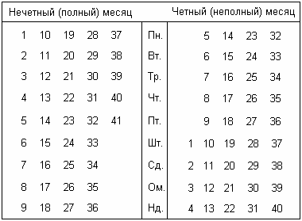
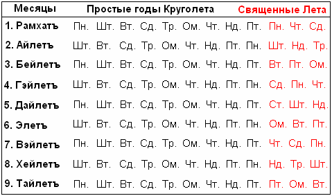

# Круголет Числобога: Таблицы и примеры перевода дат на Славяно-Арийские

*После выхода первой книги из серии «Славяно-Арийские Веды», мы получили множество писем, в которых читатели просили подробней рассказать о Древнем Славяно-Арийском Календаре, о том, как высчитать свой день рождения по этому календарю, Лето рождения по Даарийскому Круголету, и о том, как провести в соответствие и согласовать те различия, которые существуют между современным (григорианским) календарем и Древним Славяно-Арийским, а также для того, чтобы знать в какие дни по современному Летоисчислению соблюдать ПОСТы и отмечать Древние Праздники.*

1. Различия современного и Славяно-Арийского календарей  
2. Таблица 1. Даарийский Круголет Числобога  
3. Таблица 2. Начало месяца по Славяно-Арийскому Календарю  
4. Таблица 3. Месяцы в Славяно-Арийском календаре  
5. Таблица 4. Нечетные и четные месяцы, а также дни Недели на 1 Лето  
6. Таблица 5. Дни Недели, с которых начинаются Лета Круголета  
7. Таблица 6. Дни Недели, с которых начинаются месяцы Лет Круголета  
8. Примеры перевода дат

## Различия современного и Славяно-Арийского календарей

В начале необходимо знать о различиях, существующих во времяизмерительных и календарных системах. Например: в современном Летоисчислении 4 времени года: Зима, Весна, Лето и Осень, а в Славяно-Арийском – 3: Оусень, Зима, Весна, и эти все три времени называются – Лето. Далее, в современном Летоисчислении исторический счет ведется Веками (периодами по 100 лет), а в Славяно-Арийском – Кругами Жизни (циклами по 144 Лета). Также имеются и другие различи:

|  |  |  |
| --- | --- | --- |
| . | Современное | Славяно-Арийское |
| **Новый год (Новолетие)** | 1 января (2 месяц Зимы) | 1 Рамхатъ (Осеннее равноденствие) |
| **Дней в году (в Лете)** |  |  |
| в простом | 365 | 365 |
| в високосном (**Священном**) | 366 | 369 |
| **Високосный, каждые** | 4 года | - |
| **Священное Лето, каждое** | - | 16 Лето |
| **Месяцев в году (Лете)** | 12 | 9 |
| **Дней в Месяце** |  |  |
| в полном | 31 | 41 |
| в неполном | 30, 28 (29) | 40 |
| **в Священное Лето** | - | 41 |
| **Дней в Неделе** | 7 | 9 |
| **Часов в сутках** | 24 | 16 |

## Таблица 1. Даарийский Круголет Числобога

|  |  |  |  |  |  |  |  |  |  |  |  |  |  |  |  |  |  |  |
| --- | --- | --- | --- | --- | --- | --- | --- | --- | --- | --- | --- | --- | --- | --- | --- | --- | --- | --- |
| Стихия | Земля | | Звезда | | Огонь | | Солнце | | Древо | | Свага | | Океан | | Луна | | Бог | |
| . | Черный | | Красный | | Алый | | Златый | | Зеленый | | Небесный | | Синий | | Фиолет | | Белый | |
| Странник (Путь) | 1 |  | 129 |  | 113 |  | 97 |  | 81 |  | 65 |  | 49 |  | 33 |  | 17 |  |
| Жрец |  | 2 |  | 130 |  | 114 |  | 98 |  | 82 |  | 66 |  | 50 |  | 34 |  | 18 |
| Жрица (Дева) | 19 |  | 3 |  | 131 |  | 115 |  | 99 |  | 83 |  | 67 |  | 51 |  | 35 |  |
| Мир (Явь) |  | 20 |  | 4 |  | 132 |  | 116 |  | 100 |  | 84 |  | 68 |  | 52 |  | 36 |
| Свиток | 37 |  | 21 |  | 5 |  | 133 |  | 117 |  | 101 |  | 85 |  | 69 |  | 53 |  |
| Феникс |  | 38 |  | 22 |  | 6 |  | 134 |  | 118 |  | 102 |  | 86 |  | 70 |  | 54 |
| Лис (Навь) | 55 |  | 39 |  | 23 |  | 7 |  | 135 |  | 119 |  | 103 |  | 87 |  | 71 |  |
| Дракон |  | 56 |  | 40 |  | 24 |  | 8 |  | 136 |  | 120 |  | 104 |  | 88 |  | 72 |
| Змей | 73 |  | 57 |  | 41 |  | 25 |  | 9 |  | 137 |  | 121 |  | 105 |  | 89 |  |
| Олел |  | 74 |  | 58 |  | 42 |  | 26 |  | 10 |  | 138 |  | 122 |  | 106 |  | 90 |
| Дельфин | 91 |  | 75 |  | 59 |  | 43 |  | 27 |  | 11 |  | 139 |  | 123 |  | 107 |  |
| Коньи |  | 92 |  | 76 |  | 60 |  | 44 |  | 28 |  | 12 |  | 140 |  | 124 |  | 108 |
| Пес | 109 |  | 93 |  | 77 |  | 61 |  | 45 |  | 29 |  | 13 |  | 141 |  | 125 |  |
| Тур (Корова) |  | 110 |  | 94 |  | 78 |  | 62 |  | 46 |  | 30 |  | 14 |  | 142 |  | 126 |
| Хоромы (Дом) | 127 |  | 111 |  | 95 |  | 79 |  | 63 |  | 47 |  | 31 |  | 15 |  | 143 |  |
| Капище (Храм) |  | 128 |  | 112 |  | 96 |  | 80 |  | 64 |  | 48 |  | 32 |  | 16 |  | 144 |

Для того, чтобы высчитать, в какое именно Лето по Славяно-Арийскому календарю Вы родились, и какой Символьный год был по Даарийскому Круголету Числобога (таблица1), необходимо обязательно учитывать следующие данные: до дня Осеннего равноденствия родился человек или после оного, а также, какое было время на момент рождения человека, до 18:00 (19:00) часов или после этого времени.

Учитывать временные рамки необходимо, т.к. сутки по современному календарю начинаются в полночь (24:00 или 00:00), и чередуют: ночь, утро, день, вечер. A сутки по Славяно-Арийскому календарю начинаются с Вечера (18:00 или 19:00 при переходе на летнее время), и чередуют: вечер, ночь, утро, день.

Соотношение календарных дат в двух календарях следующее, например: 1 дню месяца Рамхатъ соответствует 22-23 сентября, т.е. Славяно-Арийские сутки включают вечер и часть ночи 22 сентября, и остаток ночи, утро и день 23 сентября. Поэтому для простоты записи, в таблицах соответствий, принято указывать тот из двух дней, который имеет большую продолжительность по времени, т.е. 23 число.  
    Наши Мудрые Предки не зря говорили, что: «Утро вечера мудреней», ибо за три четверти суток познать можно больше, чем за одну треть.

## Таблица 2. Начало месяца по Славяно-Арийскому Календарю

Соответствие дней григорианского календаря, на начало каждого месяца Славяно-Арийского Календаря.

|  |  |  |  |  |  |  |  |  |
| --- | --- | --- | --- | --- | --- | --- | --- | --- |
| . | **1,2,3** | **4** | **5,6,7** | **8** | **9,10,11** | **12** | **13,14,15** | **16** |
| **1 Рамхатъ** | 23.09 | 23.09 | 22.09 | 22.09 | 21.09 | 21.09 | 20.09 | 20.09 |
| **2 Айлетъ** | 03.11 | 03.11 | 02.11 | 02.11 | 01.11 | 01.11 | 31.10 | 31.10 |
| **3 Бейлетъ** | 13.12 | 13.12 | 12.12 | 12.12 | 11.12 | 11.12 | 10.12 | 11.12 |
| **4 Гэйлетъ** | 23.01 | 23.01 | 22.01 | 22.01 | 21.01 | 21.01 | 20.01 | 21.01 |
| **5 Дайлетъ** | 04.03 | 03.03 | 03.03 | 02.03 | 02.03 | 01.03 | 01.03 | 02.03 |
| **6 Элетъ** | 14.04 | 13.04 | 13.04 | 12.04 | 12.04 | 11.04 | 11.04 | 12.04 |
| **7 Вэйлетъ** | 24.05 | 23.05 | 23.05 | 22.05 | 22.05 | 21.05 | 21.05 | 23.05 |
| **8 Хейлетъ** | 04.07 | 03.07 | 03.07 | 02.07 | 02.07 | 01.07 | 01.07 | 03.07 |
| **9 Тайлетъ** | 13.08 | 12.08 | 12.08 | 11.08 | 11.08 | 10.08 | 10.08 | 13.08 |

Несоответствие в датах, между Новым годом и Новолетием, создало некоторые затруднения для простых людей, при вычислении даты начала Славяно-Арийских месяцев и праздников, используя современный календарь, т.к. каждые четыре года происходит «смещение» древних дат на один день, из-за 29 февраля в високосных годах (см. таб. 2).

Верхние числа в таблице 2, от 1 до 16, соответствуют Летам Круголета Числобога: 1 - Странник; 2 - Жрец; 3 - Дева (Жрица); 4 - Мир (Явь) и т.д.

Простые годы Даарийского Круголета Числобога объединены в подгруппы - (1, 2, 3), (5, 6, 7), (9, 10, 11) и (13, 14, 15). Високосные годы григорианского календаря выделены в самостоятельные подгруппы - (4), (8), (12), (16). Кроме того, подгруппа (16), выделена особо, т.к. 16 Лето - Священное, и во всех его месяцах по 41 дню. Название и значение месяцев Славяно-Арийского Календаря смотрите в таблице 3.

## Таблица 3. Месяцы в Славяно-Арийском календаре

|  |  |
| --- | --- |
| 1. Рамхатъ | - месяц Божественного Начала. |
| 2. Айлетъ | - месяц Новых Даров. |
| 3. Бейлетъ | - месяц Белого Сияния и Покоя Мира. |
| 4. Гэйлетъ | - месяц Вьюг и Стужи. |
| 5. Дайлетъ | - месяц Пробуждения Природы. |
| 6. Элетъ | - месяц Посева и Наречения. |
| 7. Вэйлетъ | - месяц Ветров. |
| 8. Хейлетъ | - месяц Получения Даров Природы. |
| 9. Тайлетъ | - месяц Завершения. |

В простом Лете, по Славяно-Арийскому Календарю, Четные (неполные) месяцы (2, 4, 6, 8) имеют по 40 дней, а Нечетные (полные) месяцы (1, 3, 5, 7, 9) содержат по 41 дню (таб. 4).

## Таблица 4. Нечетные и четные месяцы, а также дни Недели на 1 Лето

Из таблицы 4 видно, что все дни в двух месяцах, нечетном и четном, составляют девять полных Недель. Поэтому, в каждом простом Лете, все нечетные месяцы начинаются в один день недели, а все четные - в другой. Например: если в простое Лето, месяц Рамхатъ начался с Понедельника, то и все оставшиеся Нечетные (полные) месяцы, также начнутся с Понедельника. Если второй месяц этого Лета начался с Шестицы, то и остальные Четные (неполные) месяца начнутся с Шестицы. Кроме того, Каждое Лето на Круголете Числобога начинается в строго определенный день Недели. Благодаря этому можно без особого труда узнать, какой был день Недели в определенную дату, а также, с какого дня Недели начинался тот или иной год, на Круголете Числобога (таблица 5), в глубокой древности, столетия и тысячелетия назад.

## Таблица 5. Дни Недели, с которых начинаются Лета Круголета

|  |  |
| --- | --- |
| Понедельникъ | 1, 10, 20, 29, 29, 48, 49, 58, 68, 77, 87, 96, 97, 106, 116, 125, 135, 144 |
| Вторникъ | 3, 12, 22, 31, 99, 41, 51, 60, 70, 79, 89, 108, 118, 127, 137 |
| Тритейникъ | 5, 14, 24, 34, 43, 53, 62, 72, 82, 91, 101, 110, 120, 130, 139 |
| Четвергъ | 7, 16, 17, 26, 36, 45, 55, 64, 65, 74, 84, 93, 103, 112, 113, 122, 132, 141 |
| Пятница | 9, 19, 28, 38, 47, 57, 67, 76, 86, 95, 105, 115, 124, 134, 143 |
| Шестица | 2, 11, 21, 30, 40, 50, 59, 69, 78, 88, 98, 107, 117, 126, 136 |
| Седмица | 4, 13, 23, 32, 33, 42, 52, 61, 71, 80, 81, 90, 100, 109, 119, 128, 129, 138 |
| Осьмица | 6, 15, 25, 35, 44, 54, 63, 73, 83, 92, 102, 111, 121, 131, 140 |
| Неделя | 8, 18, 27, 37, 46, 56, 66, 75, 85, 94, 104, 114, 123, 133, 142 |

Определив по таблице 5 день недели, с которого началось Лето Круголета, мы сразу узнаем, в какой день недели начинается, тот или иной месяц данного года (таблица 6).

## Таблица 6. Дни Недели, с которых начинаются месяцы Лет Круголета

## Примеры перевода дат

Узнав необходимые краткие сведения, относительно древнего Славяно-Арийского Летоисчисления, можно перевести любую историческую дату, с современного календаря на древний Славяно-Арийский, взяв за основу Летоисчисление от Сотворения Мира в Звездном Храме (дата подписания мирного договора, после победы Великой Расы над Великим Драконом).

Рассмотрим всем известные даты:  
1) 5 декабря 1936 года - Принятие Сталинской Конституции Советского Союза;  
2) 22 июня 1941 года – Начало Великой Отечественной войны;  
3) 30 декабря 1947 года – Послевоенная отмена карточек на продуктовые и промышленные товары;  
4) сентябрь-октябрь 1993 года - Трагические события в Москве.

Напоминаем, что разница между Летоисчислениями составляет 5508 лет, при расчетах до Осеннего равноденствия, и 5509 после оного.

**Первая дата: 5 декабря 1936 года** (дата после дня Осеннего равноденствия). Вначале высчитываем год: 1936 + 5509 = Лето 7445 от С.М.З.Х. Получив необходимую дату Славяно-Арийского Летоисчисления, высчитываем год Круголета Числобога. Для этого, от Лета 7445 отнимаем 7376 (144 год на Круголете Числобога в прошлом цикле), получаем 69 год на Круголете Числобога. Находим в таблице 1, чему соответствует 69 год: *Лунный Свиток* (сущность данного года, смотрите в 1 книге Славяно-Арийские Веды); 5 простое Лето. Из таблицы 5, мы узнаем, что год начался в Шестицу, а из таблицы 6, мы узнаем, в какой день недели начинается необходимый Месяц.  
    Продолжаем далее. В таблице 2, находим в подгруппе (5,6,7) месяц, в который попадает 5 декабря. Это месяц Айлетъ [Четный (неполный) месяц], который начинается со 2 ноября, и согласно таблицы 3, означает - *Месяц Новых Даров*. Так если 1 Айлетъ соответствует 2 ноября (точнее 1-2 ноября), то согласно таблице 4, день 5 декабря выпадает на 34 число месяца Айлетъ, а день недели на Осьмицу.  
    Таким образом, дата принятия Сталинской конституции, 5 декабря 1936 года, приходится на Лето 7445, месяц Айлетъ, 34 день, Осьмицу.

**Следующий пример: 22 июня 1941 года** (дата до дня Осеннего равноденствия). Высчитываем год: 1941 + 5508 = Лето 7449 от С.М.З.Х. Получив необходимую дату Славяно-Арийского Летоисчисления, высчитываем год Круголета Числобога. Для этого, от Лета 7449 отнимаем 7376 (144 год на Круголете Числобога в прошлом цикле), получаем 73 год на Круголете Числобога. Находим в таблице 1, чему соответствует 73 год: *Черный Змей* (см. сущность данного года); 9 простое Лето. Из таблицы 5, мы узнаем, что год начался в Осьмицу, а из таблицы 6, мы узнаем, в какой день недели начинается необходимый Месяц.  
    Продолжаем далее. В таблице 2, находим в подгруппе (9,10,11) месяц, в который попадает 22 июня. Этот месяц Вэйлетъ [Нечетный (полный) месяц], который начинается с 22 мая, и согласно таблице 3, означает – *Месяц Ветров*. Так если 1 Вэйлетъ соответствует 22 мая (точнее 21-22 мая), то согласно таблице 4, день 22 июня выпадает на 32 число месяца Вэйлетъ, а день недели на Тритейникъ.  
    Таким образом, дата начала Великой Отечественной Войны, 22 июня 1941 года, приходится на Лето 7449, месяц Вэйлетъ, 32 день, Тритейникъ.

**Следующий пример: 30 декабря 1947 года** (дата выпавшая на Священное Лето). Как и ранее, вначале высчитываем год: 1947 + 5509 = Лето 7456 от С.М.З.Х. Получив необходимую дату, высчитываем год Круголета Числобога. Далее, от Лета7456 отнимаем 7376 (144 год на Круголете Числобога в прошлом цикле), получаем 80 год на Круголете Числобога. Находим в таблице 1, чему соответствует 80 год: *Храм Солнца* (смотрим сущность данного года); 16 – Священное Лето. Из таблицы 5, мы узнаем, что данный год начался в Седьмицу, а из таблицы 6, мы узнаем, в какой день недели начинается необходимый Месяц.  
    В таблице 2, находим в подгруппе (16) месяц, в который попадает 30 декабря. Это месяц Бейлетъ [Полный месяц], который начинается с 11 декабря и согласно таблице 3, означает – *Месяц Белого Сияния и Покоя Мира*. Так если 1 Бейлетъ соответствует 11 декабря (точнее 10-11 декабря), в таблице 4, мы видим, что 30 декабря выпадает на 20 день месяца Бейлетъ, а день недели указывает на Неделю.  
    Таким образом, дата Послевоенной отмены карточек на продуктовые и промышленные товары 30 декабря 1947 года приходится на Лето 7456, месяц Вейлетъ, 20 день, Неделю.

**Последний пример: сентябрь-октябрь 1993 года** (день Осеннего Равноденствия): Трагические события в Москве, расстрел здания Верховного Совета РСФСР - сентябрь-октябрь 1993 г. Данные события произошли на стыке двух годов, т.е. события и сущность одного года повлияли на события последующего года. Поэтому, чтобы узнать причины событий, необходимо узнать сущность обоих годов.  
    Высчитываем 1 год: 1993 + 5508 = Лето 7501 от С.М.З.Х. Высчитываем 2 год: 1993 + 5509 = Лето 7502 от С.М.З.Х. И от полученных дат отнимаем 7376 (144 Лето на Круголете Числобога в прошлом цикле), получаем 125 и 126 годы на Даарийском Круголете Числобога. Находим в таблице 1, чему соответствуют полученные годы, а также их сущность: 125 - **Белый Пес**. 13 простое Лето. Сущность данного года: «Год псевдореформ, которые проводятся на словах, а не на деле (в народе говорят: «Собака лает ветер носит»). В этот год, темные силы пытаются всячески расшатать экономику и уничтожить средства производства, особенно сельское хозяйство. Но, как правило, все эти неблаговидные дела поднимают народ на восстание против темных сил, ибо народу нужна стабильность, а не пустые разговоры правителей. 126 - **Белый Тур**. 14 простое Лето. Сущность данного года: «Год народных выступлений против тирании темных сил. В этот год, как правило, проливается очень много крови невинных людей и совершаются ритуальные убийства, с человеческими жертвоприношениями».  
    Далее. В таблице 2 находим в подгруппе (13,14,15) начало 1 месяца. Первый день месяца Рамхать, соответствует 20 сентября (т.е. 19-20 сентября). Этот день, проводит рубеж между событиями 125 и 126 годов на Круголете Числобога. Реальные происходившие события соответствовали сущности годов Круголета Числобога. До 19 сентября противоборство между ветвями власти происходили на уровне словесных взаимообвинений. Но вот, 125 год сменяет 126, наступило 20 сентября и противостоящие стороны перешли от слов к действиям. Президент издает знаменитый указ № 1400, распускает Верховный Совет, а последний в свою очередь объявляет об отстранении от должности президента и о том, что вся власть в стране переходит в руки вице-президента. Словесная борьба между двумя ветвями власти, перешла в вооруженный конфликт, в результате которого погибли невинные мирные граждане у телецентра Останкино, а также было расстреляно из танков и БТРов здание Верховного Совета.

**Годы Тура**, а 126 один из них, наступают каждые 16 лет. Эти годы указывают на то, что в эти периоды тёмные силы, проникающие во власть, проливают кровь невинных людей.  
    В XVIII веке ярким проявлением кровожадности темных сил, было вооруженное подавление народного восстания, против тирании и антируских указов Петра I (брить бороды, носить «немецкое» платье, вместо руской одежды и т.д.), которое подняли Староверы и Старообрядцы в Сибирском городе Таре, в Лето 7230 (1722). Это так называемые Тарские бунты. А об физическом уничтожении Старообрядцев по всей Российской Империи, можно и не напоминать.  
    События XX века всем известны, достаточно привести несколько исторических дат:  
Лето 7422 (1914) - начало Первой Мировой войны;  
Лето 7438 (1930) - расказачивание и раскулачивание;  
Лето 7470 (1962) - расстрел рабочих в Новочеркасске;  
Лето 7502 (1993) - кровавые события в Москве.

Мы надеемся, что этих кратких сведений для начала достаточно. Более подробно о Даарийском Круголете Числобога и о Славяно-Арийском Календаре, а также о Древних Праздниках в одной из книг серии «Славяно-Арийские Веды».
