# Свастика - знак Света, Солнца, Жизни

У многих людей, в настоящее время, Свастика ассоциируется с Фашизмом и Адольфом Гитлером. Это мнение вбивалось в головы людей последние 70 лет. Мало кто сейчас помнит, что на советских деньгах в период с 1917 по 1923 годы изображена была Свастика, что на нарукавных нашивках солдат и офицеров Красной Армии, в этот же период, тоже была Свастика в лавровом венке, а внутри Свастики были буквы Р.С.Ф.С.Р. Существует даже такое мнение, что Свастику, как партийный символ, Адольфу Гитлеру подарил сам товарищ И.В. Сталин в 1920 году. Вокруг этого древнего символа скопилось столько легенд и домыслов, что мы решили поподробней рассказать об этом древнейшем солярном культовом свастическом символе.

1. Свастика. Исторические корни  
2. Свастика в Верованиях и религиях  
3. Свастика на щите Вещего Олега  
4. Свастика на деньгах и в Армии  
5. Свастика в христианстве  
6. Свастика как талисман  
7. Происхождение слова «Свастика»  
8. Свастичные Руны  
9. Свастика – фашистский символ?  
10. Свастика – ковыль, заяц, конь…  
11. Запрет использования Свастики

## Свастика. Исторические корни

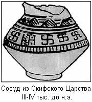Свастичный символ представляет собой крест с загнутыми концами, направленными по или против часовой стрелки. Как правило, сейчас все Свастичные символы называют одним словом — СВАСТИКА, что в корне неверно, т.к. каждый Свастичный символ в глубокой древности имел своё собственное название, Обереговую Силу и образное значение.

При археологических раскопках Свастичную символику чаще всего находили на различных деталях архитектуры, оружии, одежде, бытовой утвари многих народов Евразии. Свастичная символика повсеместно встречается в орнаментике как **знак Света, Солнца, Жизни**. Старейшие археологические артефакты с изображением свастики датируются приблизительно 10-15 тысячелетием до н.э. По материалам археологических раскопок самой богатой территорией по применению свастики, как религиозного, так и культурно-бытового символа является Россия - ни Европа, ни Индия не могут сравниться с Россией в изобилии свастичных символов, покрывающих **руское оружие, стяги, национальный костюм, дома, предметы повседневного быта и храмы**. Раскопки древних курганов и поселений говорят сами за себя - многие древние славянские городища имели четкую форму Свастики, сориентированной по четырем сторонам света. Свастичными символами обозначали календарные знаки еще во времена Великого Скифского царства (*изображен сосуд из Скифского Царства 3-4 тыс. до н.э.*)

Свастика и Свастичные символы являлись главными и, можно даже сказать, почти единственными элементами древнейших **праславянских орнаментов**. Но это вовсе не означает, что славяне и арии были плохими художниками. Во-первых, разновидностей изображения Свастичных символов было очень много. Во-вторых, в древности ни один узор не наносился просто так, каждому элементу узора соответствовало определенное культовое или охранное (обереговое) значение.

Но не только Арии и Славяне верили в магическую силу этого узора. Этот символ обнаружен на глиняных сосудах из Самарры (территория современного Ирака), которые датируются V тысячелетием до нашей эры. Свастичные символы в левовращательной и правовращательной форме встречаются в доарийской культуре Мохенджо-Даро (бассейн реки Инд) и древнем Китае около 2000 г. до н.э. В Северо-восточной Африке археологи нашли погребальную стелу царства Мероз, которое существовало во II-III веках нашей эры. Фреска на стеле изображает женщину, вступающую в загробный мир, на одежде усопшей красуется Свастика. Вращающийся крест украшает и золотые гирьки для весов, принадлежавшие жителям Ашанты (Гана), и глиняную утварь древних индейцев, прекрасные ковры, сотканные персами и кельтами.

## Свастика в Верованиях и религиях

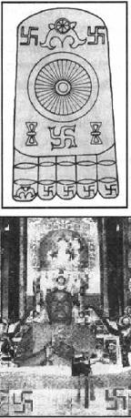Свастичная символика была Обереговой почти у всех народов на территории Европы и Азии: у славян, немцев, поморов, скалвов, куршей, скифов, сарматов, мордвы, удмуртов, башкиров, чувашей, индусов, исландцев, шотландцев и многих других народов.

Во многих древних Верованиях и религиях Свастика является самым важным и самым светлым культовым символом. Так, в древнеиндийской философии и **буддизме** (рис. слева Стопа Будды) Свастика — символ вечного круговорота вселенной, символ Закона Будды, которому подвластно всё сущее. (Словарь «Буддизм», М., «Республика», 1992); в **тибетском ламаизме** Свастика — охранный символ, символ счастья и талисман. В Индии и Тибете Свастика изображается повсеместно: на воротах храмов, на каждом жилом здании, на тканях, в которые заворачивают все священные тексты, на погребальных покровах.

Лама Беру-Кинзе-Римпоче, в наше время один из самых великих учителей официального буддизма. *На фотографии заснят обряд сотворения им ритуальной мандалы*, то есть, чистого пространства, в Москве в 1993 году. На переднем плане фотографии расположена танка, священное изображение рисуемое на ткани, с изображением Божественного пространства мандалы. По углам Свастичные символы, защищающие священное Божественное пространство.

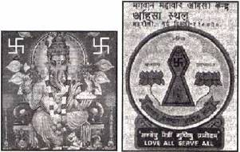 Как религиозный символ (!!!) Свастику всегда использовали последователи **Индуизма, Джайнизма** и Буддизма на Востоке, Друиды Ирландии, Шотландии, Скандинавии, представители **Натур-религиозных конфессий** Европы и Америки на Западе.

Слева – Ганеша, сын Бога Шивы, Бог из индуистского Ведического пантеона, его лик освещают два Свастичных символа.  
Справа – Мистическая Священная диаграмма, взятая из Джайнистского молитвенника. В центре диаграммы, мы также можем видеть Свастику.

В России Свастичные символы и элементы встречаются у сторонников Древних Родовых и **Ведических культов**, а также у Православных Староверов-Инглингов, исповедующих Веру Первопредков – Инглиизм, в Славянских и Арийских общинах Родового Круга и, где бы вы думали, **у христиан**…

## Свастика на щите Вещего Олега

На протяжении многих и многих тысячелетий славяне использовали символ Свастики. Этот символ наши Предки изображали на оружии, стягах, одежде, на предметах быта и культа. Все знают, что Вещий Олег прибил свой щит на врата Царьграда (Константинополя), но мало кому из современного поколения известно, что на щите было изображено. Тем не менее, описание символики его щита и доспехов можно найти в исторических хрониках. Вещие люди, т.е., обладающие Даром Духовного Предвидения и ведающие Древнюю Мудрость, которою оставили людям Боги и Предки, наделялись Жрецами многообразными символами. Одним из таких наиболее заметных в истории людей был Славянский князь — **Вещий Олег**. Кроме того, что он был князем и великолепным военным стратегом, он был еще и Жрецом Высокого Посвящения. Символика, которая изображалась на его одеждах, оружии, доспехах и княжеском стяге, рассказывает об этом во всех подробных образах.  
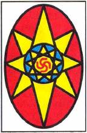**Огненную Свастику** (символизирующую землю Предков) в центре девятиконечной Звезды Инглии (символ Веры Первопредков) окружал Великий Коло (Круг Богов-покровителей), который излучал восемь лучей Духовного Света (восьмая степень Жреческого посвящения) к Сварожьему Кругу. Вся эта символика говорила о громадной Духовной и физической силе, которая направляется на защиту Родной земли и Святой Веры. Когда Вещий Олег прибил свой щит с такой символикой на ворота Царьграда, он хотел образно, наглядно показать коварным и двуликим византийцам то, что в последствии другой Славянский князь Александр Ярославович (Невский) словами объяснит тевтонским рыцарям: «*Кто к нам с мечом придет, от меча и погибнет! На том стояла, стоит, и будет стоять Земля Руская!*»

## Свастика на деньгах и в Армии

При царе Петре I, стены его загородной резиденции были украшены свастичными узорами. Потолок тронного зала в Эрмитаже, также покрыт этими священными символами.

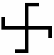В конце XIX, начале ХХ века, среди высших сословий европейских государств в Западной и Восточной Европе, а также в России, **Свастика** (слева) стала самым распространенным и даже модным символом. Это сказалось влияние «Тайной доктрины» Е.П. Блаватской и ее Теософского общества; Оккультно-мистических учений Гвидо фон Листа, Германского рыцарьского Ордена Туле и прочих спиритических кружков.

Простой народ, и в Европе и в Азии, на протяжении тысячелетий использовал Свастичные орнаменты в бытовом обиходе, и лишь в начале нынешнего столетия, интерес к Свастичным символам появился и у власть имущих.

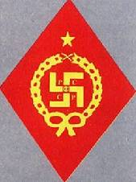В молодой Советской России **нарукавные нашивки** бойцов Красной Армии Юго-восточного фронта с 1918 г. украшала свастика, с аббревиатурой Р.С.Ф.С.Р. внутри. Например: знак для командования и административного состава вышивался золотом и серебром, а для красноармейцев был трафаретный.

После свержения в России самодержавия, Свастичный орнамент появляется на новых денежных купюрах Временного правительства, а после переворота 26 октября 1917 года на денежных знаках большевиков.

Сейчас мало кому известно, что матрицы денежной купюры достоинством 250 рублей, с изображением Свастического символа – **Коловрат** на фоне двуглавого орла, были изготовлены по специальному заказу и эскизам последнего Российского царя – Николая II.

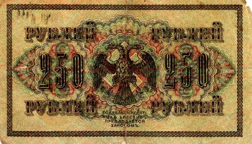

Начиная с 1918 года, большевиками в обращение вводятся новые купюры, достоинством 1000, 5000 и 10000 рублей, на которых изображен уже не один Коловрат, а три. Два Коловрата поменьше в боковых вязях переплетаются с крупными цифрами 1000 и крупный Коловрат посредине.

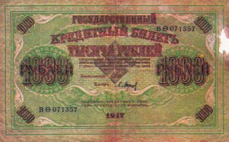

Деньги со Свастикой-Коловратом печатались большевиками и были в обиходе, вплоть до 1923 года, и только после образования Союза Советских Социалистических Республик были выведены из обращения.

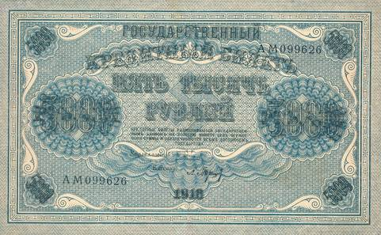

В национальных: руских, украинских и белорусских костюмах, на сарафанах, рушниках и других вещах, Свастичная символика была главной и, практически единственной из существующих древнейших оберегов и орнаментов, вплоть до первой половины ХХ века.

Наши пращуры очень любили как-нибудь в летний вечерок собраться на околице деревни и под протяжные напевы **станцевать… свастику**. Аналог символа был и в руской танцевальной культуре – танец Коловрат. На празднике Перуна славяне водили, и до сих пор водят, **хороводы вокруг двух горящих свастик**: «Фаша» и «Агни», выложенных на земле.

## Свастика в христианстве

«Коловрат» богато украшал храмы на Руских землях; он ярко сиял на священных предметах Древнего Солнечного культа Первопредков; а также на белых одеяниях Священнослужителей Старой Веры. И даже на одеяниях служителей христианского культа в IX-XVI вв. изображались Свастичные символы. Они украшали Образа и Куммиры Богов, фрески, стены, иконы и т.д.

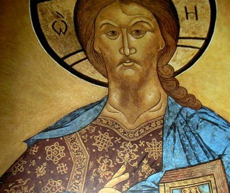  
Например, на фреске изображающей Христа Пантократора – Вседержителя, в Софийском соборе Новгородского Кремля, так называемые, левая и правая Свастики с коротко загнутыми лучами, а правильно **«Чароврат» и «Посолонь», помещены прямо на груди христианского Бога**, как символы начал и конца всего сущего.

На святительском чине в Софийском соборе города Киева, в древнейшем христианском храме, построенном на Руской земле еще Ярославом Мудрым, изображены пояса, в которых чередуются: *«Свастика», «Суасти» и прямые Кресты*. Христианские богословы в средние века, комментировали эту роспись, таким образом: «Свастика» символизирует первое пришествие в Мир сына Божьего Иисуса Христа, для спасения людей от их грехов; далее прямой Крест – его земной путь, закончившийся страданиями на Голгофе; и наконец, левая Свастика – «Суасти», символизирует воскрешение Иисуса Христа и его второе пришествие на Землю в Силе и Славе.

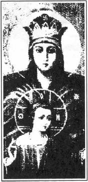В Москве, в Коломенском храме Усекновения главы Иоанна Крестителя, в день отречения царя Николая II от престола, была обнаружена в подвалах храма **икона «Богоматерь-Державная»** (фрагмент слева) на головном уборе христианской Богоматери изображен Свастичный Обереговый символ – «Фаш».

Об этой древней иконе напридумывали множество легенд и слухов, например: якобы по личному приказу И.В. Сталина, на линию фронта был совершен молебен, крестный ход, и благодаря этому войска Третьего Рейха не взяли Москву. Полный абсурд. В Москву немецкие войска не вошли, совершенно по другой причине. Им заградили дорогу на Москву народное ополчение и дивизии Сибиряков, наполненных Духовной Силой и Верой в Победу, а не сильные морозы, руководящая сила партии и правительства, или какая-то икона. Сибиряки не только отбили все атаки врага, но и перешли в наступление и выиграли войну, потому что в сердце живет древний принцип: «Кто к нам с мечом придет, от меча и погибнет».

**В средневековом христианстве Свастика символизировала также Огонь и Ветер** - стихии, воплощающие в себя Святой Дух. Если Свастика, даже в христианстве, действительно считалась божественным знаком, то лишь неразумные люди могут говорить, что Свастика символ фашизма!  
\* Для справки: Фашизм в Европе, существовал только в Италии, Испании. И у фашистов этих государств не было Свастичной символики. Свастику как партийную и государственную символику использовала Гитлеровская Германия, которая была не фашистская, как это трактуют сейчас, а национал-социалистическая. Для тех, кто сомневается, прочтите статью И.В. Сталина «Руки прочь от Социалистической Германии». Данная статья печаталась в газетах «Правда» и «Известия» в 30-х годах.

## Свастика как талисман

В Сватику верили как в талисман, «притягивающий» удачу и счастье. На Древней Руси считалось, что если нарисовать Коловрат на ладошке, то обязательно повезет. Даже современные студенты чертят Свастику на ладони перед экзаменами. Свастику рисовали и на стенах дома, чтобы там царило счастье, и в России, и в Сибири, и в Индии.

В Ипатьевском доме, где расстреляли семью последнего руского императора Николая II, императрица Александра Федоровна изрисовала все стены этим божественным символом, но против безбожников Свастика не помогла Романовым, слишком много зла на Руской земле сотворила эта династия.

В наши дни философы, лозоходцы и экстрасенсы предлагают **строить городские кварталы в виде Свастик** - такие конфигурации должны генерировать положительную энергию, кстати, эти выводы уже подтверждены современной наукой.

## Происхождение слова «Свастика»

Общепринятое название Солярного символа - Свастика, по одной версии, происходит от санскритского слова *Суасти. Су* - прекрасный, добро, и *асти* - быть, то есть «Быть добру!», или по-нашему «Всего хорошего!». По другой версии, это слово имеет **древнеславянское происхождение**, что является более вероятным (что подтверждено архивами Древнерусской Инглистической Церкви Православных Староверов-Инглингов), так как известно, что Свастичную символику в различных вариация, и ее название в Индию, Тибет, Китай, Европу принесли древние Арии и Славяне. Тибетцы и индийцы до сих пор утверждают, что Свастику, этот вселенский символ благоденствия и счастья, им принесли из-за высоких северных гор (Гималаи) Белые Учителя.

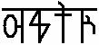В древние времена, когда наши Предки пользовались х’Арийскими Рунами, слово Свастика (*см. слева*) переводили как Пришедшая с Небес. Так как Руна **СВА** означала Небеса (отсюда и Сварог - Небесный Бог), **С** - Руна направления; Руна **ТИКА** [две последние руны] - движение, пришествие, течение, бег. Наши дети до сих пор произносят слово тикать, т.е. бежать, а мы его встречаем в словах Арктика, Антарктика, мистика и т.д.

Древние Ведические источники, говорят нам о том, что даже наша галактика имеет форму Свастики, а наша система Ярилы-Солнца находится в одном из рукавов этой Небесной Свастики. А так как, мы находимся в галактическом рукаве, вся наша галактика, ее древнее название Свастики, воспринимается нами как Перунов Путь или Млечный Путь.

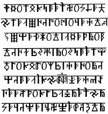Древние названия Свастичных символов в России, в основном сохранились в обиходе Православных Староверов-Инглингов и Праведных Старообрядцев-раскольников. На Востоке у последователей Ведического Вероисповедания, где Древняя Мудрость записана в Священные Писания на древних языках: санскрит и х’Арийском. В х’Арийской письменности используются **Руны в форме Свастики** (см. текст слева).

Санскрит, более правильно **Самскрыт** (Samskrita), т.е. Самостоятельный скрытный, используемый современными индийцами произошел от древнего языка Ариев и Славян, он был создан как упрощенный вариант х’Арийской Каруны, для сохранности Древних Вед жителями Дравидии (древней Индии), и поэтому сейчас возможны неоднозначные трактовки происхождения слова «Свастика», но прочитав приведенные в данной статье материалы, неглупый человек, чье сознание еще не успели окончательно забить лживыми стереотипами убедится в несомненном древнеславянском и древнеарийском, что собственно одно и тоже, происхождении этого слова.

Если почти во всех иностранных языках различные начертания Солнечного Креста с изогнутыми лучами называются одним словом Swastika – «Свастика», то в руском языке для различных вариантов Свастичных символов существовало и существует поныне **144 (!!!) названия**, что тоже говорит о стране происхождения этого Солярного символа. Например: *Свастика, Коловрат, Посолонь, Свята Дар, Свасти, Сваор, Сваор-Солнцеврат, Агни, Фаш, Мара; Инглия, Солнечный Крест, Солард, Ведара, Светолет, Цветок Папоротника, Перунов Цвет, Свати, Раса, Боговник, Сварожич, Яроврат, Одолень-Трава, Родимич, Чароврат* и т.д. У славян, в зависимости от цвета, длины, направления загнутых концов Солярного Креста, этот символ назывался по-разному и имел различные образные и обереговые значения (см. примеры начертания).

## Свастичные Руны

Различные вариации Свастичных символов, с не менее различными значениями, встречаются не только в культовых и обереговых символах, но и в виде Рун, которые как и буквы в древние времена имели свое Образное значение. Так, например, в древней х`Арийской Каруне, т.е. Руническом алфавите, было четыре Руны с изображением Свастичных элементов.

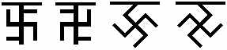  
**Руна Фаш** – имела образное значение: мощного, направленного, разрушающего Огненного потока (термоядерный огонь)…  
**Руна Агни** – имела образные значения: Священный Огонь домашнего очага, а также Священный Огонь Жизни находящейся в теле человека и др. значения…  
**Руна Мара** – имела образное значение: Ледяного Пламени охраняющего Покой Мироздания. Руна перехода из Мира Яви в Мир Светлой Нави (Слави), воплощения в Новой Жизни… Символ Зимы и Сна.  
**Руна Инглия** – имела образное значение Первичного Огня Творения Мироздания, из этого Огня появилось множество разнообразных Вселенных и различные формы Жизни…

Свастичные символы несут в себе огромный тайный смысл. В них заложена огромная Мудрость. Каждый Свастичный символ открывает пред нами Великую картину мироздания. Древняя Славяно-Арийская Мудрость гласит о том, что **наша галактика имеет форму Свастики и называется СВАТИ**, а система Ярилы-Солнца, в которой совершает свой путь наша Мидгард-Земля, находится в одном из рукавов этой Небесной Свастики.

Познание Древней Мудрости не приемлет стереотипного подхода. К изучению древних символов, Рунических письмен и древних Преданий необходимо подходить с открытым сердцем и чистой Душой. Не корысти ради, а познания для!

## Свастика – фашистский символ?

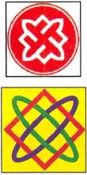Свастичные символы в России, в политических целях использовали не только большевики и меньшевики, гораздо раньше них Свастику стали использовать представители Черной Сотни. Сейчас, Свастичную символику использует Руское Национальное Единство. **Знающий человек никогда не молвит, что Свастика это немецкий или фашистский символ**. Так молвят только суть неразумные и невежественные люди, ибо они отвергают то, что не в состоянии понять и познать, а также пытаются выдать желаемое за действительное. Но если невежественные люди отвергают какой-либо символ или какую-либо информацию, это все равно не означает, что данный символ или информация не существуют. Отрицание или искажение истины в угоду одних, нарушает гармоничное развитие других. Даже древний символ Величия Плодородия Матери Сырой Земли, называемый в глубокой древности – СОЛАРД (см. выше), а ныне используемый Руским Национальным Единством, некоторые некомпетентные люди, причисляют к немецко-фашистской символике, символ, который появился за многие сотни тысяч лет до возникновения германского национал-социализма. При этом даже не берется в расчет то, что СОЛАРД у Руского Национального Единства совмещен с восьмиконечной **Звездой Лады-Богородицы** (*изображение 2*), где воедино соединились Божественные Силы (Златое поле), Силы Первичного Огня (красный), Небесные Силы (синий) и Силы Природы (зеленый). Единственное различие между изначальным Символом Матери-Природы и знаком, который использует общественное движение «Русское Национальное Единство», это многоцветие Первоначального Символа Матери-Природы и двухцветный у представителей Руского Национального Единства.

## Свастика – ковыль, заяц, конь…

У простых людей были свои названия Свастичных символов. В деревнях Рязанской губернии ее называли «**ковылем**» — воплощением Ветра; на Печоре «**зайцем**» - здесь графический символ воспринимали как частичку Солнечного света, лучик, Солнечный зайчик; кое-где Солярный крест именовали «**конём**», «коневой голяшкой» (конской головой), ведь давным-давно коня считали символом Солнца и Ветра; назывались Свастики-Солярники и «**огнивцами**», опять же, в честь Ярилы-Солнца. Народ очень верно чувствовал и Огненную, Пламенную Природу символа (Солнце), и его Духовную суть (Ветер).

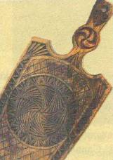Старейший мастер хохломской росписи Степан Павлович Веселов (1903-1993) из деревни Могушино Нижегородской области, соблюдая традиции, рисовал на деревянных тарелках и чашах Свастику, называя ее «*рыжиком*», Солнцем, и пояснял: «Это ветер травинки колеблет, шевелит». На приведенных фрагментах можно увидеть Свастичные символы даже на таких бытовых приборах используемых рускими людьми как прялка и разделочная доска.

На селе до сей поры, на праздники одевают женщины нарядные сарафаны и рубахи, а мужчины косоворотки вышитые свастичными символами различной формы. Пекут пышные караваи и сладкое печенье, украшенные поверху Коловратом, Посолонью, Солнцеворотом и др. Свастичными узорами.

## Запрет использования Свастики

Как уже говорилось ранее, до наступления второй половины XX века, основными и почти единственными узорами и символами, бытовавшими в славянской вышивке, были Свастичные орнаменты. Но враги Ариев и Славян **во второй половине XX века, стали решительно искоренять этот Солярный символ**, и искореняли его точно так же, как ранее искореняли: древнюю народную Славянскую и Арийскую Культуру; Древнюю Веру и Народные Традиции; Истинную, неискаженную правителями Историю, да и сам многострадальный Славянский Народ, носитель древней Славяно-Арийской Культуры.

Да и сейчас, в правительстве и на местах, многие чиновники пытаются запретить любые виды вращающихся Солярных крестов - во многом те же самые люди, или их потомки, но используя уже другие предлоги: если раньше это делали под предлогом классовой борьбы и антисоветскими заговорами, то сейчас это противники всего Славянского и Арийского, **обзывают фашистской символикой и Руским шовинизмом**.

Для тех, кому не безразлична древняя Культура, приводится несколько (очень малое количество снимков, из-за ограничения объема статьи) типичных узоров в славянской вышивке, на всех увеличенных фрагментах вы можете сами увидеть Свастичные символы и орнаменты.

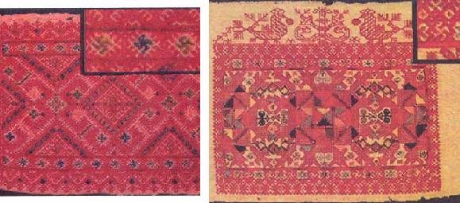  
Применение свастичных символов в орнаментах на Славянских землях просто неисчислимо. Академик Б.А. Рыбаков называл Солярный символ — Коловрат, связующим «звеном между палеолитом, где он появился впервые, и современной этнографией, дающей неисчислимое количество примеров свастичных узоров в тканях, вышивке и плетении».

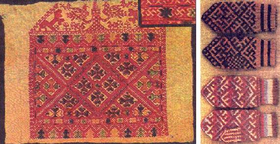  
Но после Второй Мировой войны, в которой Россия, а также все Славянские и Арийские народы понесли огромные потери, враги Арийской и Славянской Культуры, стали ставить знак равенства между фашизмом и Свастикой. При этом абсолютно забыли (?!), что фашизм, как политическая и государственная система в Европе, существовала лишь в Италии и Испании, где символ Свастики не использовали. Свастика, как партийный и государственный символ был принят только в национал-социалистической Германии, именуемой в тот период Третьим Рейхом.

Славяне использовали этот Солярный знак на протяжении всего своего существования (по новейшим научным данным это минимум 15 тысяч лет), а президент Третьего Рейха Адольф Гитлер всего около 25 лет. **Поток лжи и вымыслов, относительно Свастики, переполнил чашу абсурда**. «Учителя» в современных школах, лицеях и гимназиях России, преподают детям полный бред, что Свастика и любой Свастичный символ – это немецко-фашистские кресты, составленный из четырех букв «Г», обозначающих первые буквы руководителей нацистской Германии: Гитлера, Гиммлера, Геринга и Геббельса (иногда его заменяют Гессом). Слушая таких «учителей», можно подумать, что Германия во времена Адольфа Гитлера использовала исключительно Руский алфавит, а вовсе не латинский шрифт и немецкую Рунику. Разве в немецких фамилиях: HITLER, HIMMLER, GERING, GEBELS (HESS), есть хоть одно Руская буква «Г» — нет! Но поток лжи не прекращается.

Свастичные узоры и элементы используются народами, что подтверждается учеными-археологами на протяжении последних 5-6 тысяч лет. А сейчас к человеку, носящему древние Славянские обереги или варежки с изображением Свастичных символов, сарафан или косоворотку со Свастичной вышивкой, люди прошедшие обучение у советских «учителей», по незнанию относятся настороженно, а иногда даже агрессивно. Древние мыслители не зря говорили: «**Развитию человека мешают две беды: незнание и невежество**». Наши Предки были знающими и ведающими, и поэтому использовали в обиходе различные Свастичные элементы и орнаменты, считая их символами Ярилы-Солнца, Жизни, Счастья и благоденствия.

Лишь недалекие и невежественные люди, могут очернять все чистое, светлое и доброе, что осталось у Славянских и Арийских народов. Не будем же им уподобляться! Не закрашивать же Свастичные символы в древних Славянских Капищах и христианских храмах, на Куммирах Светлых Богов и Образах Многомудрых Предков, а также на старейших христианских иконах Богоматери и Христа. Не разрушать же, по прихоти невежд и славяноненавистников, так называемую «советскую лестницу», и потолки Эрмитажа, или купола московского храма Василия Блаженного, только потому, что на них уже не одну сотню лет нарисованы различные варианты Свастики.

*Одно поколение сменяет другое, рушатся государственные системы и режимы, но до той поры, пока Народ помнит о своих древних корнях, чтит традиции своих Великих Предков, сохраняет свою Древнюю культуру и символы, до того времени Народ ЖИВ и будет ЖИТЬ!*
