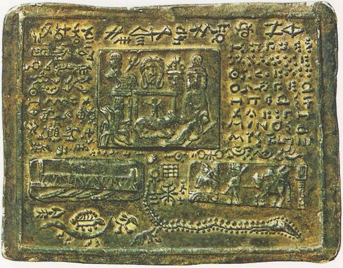
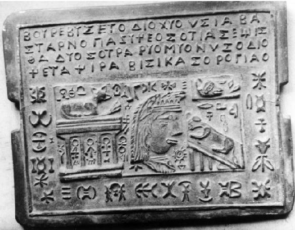
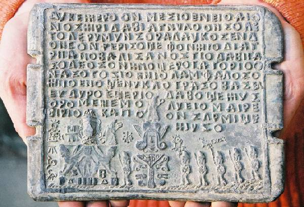

# Саньтии Даков

Когда вышла первая книга Славяно-Арийских Вед «Саньтии Веды Перуна», мало кто поверил в существование самих *Саньтий* - древнего прообраза современной книги. Многие ошибочно полагают, что письменные источники появились на славянских землях благодаря пришествию греческих «просветителей». На самом деле это далеко не так.  
\* **Саньтии** - пластины из благородного металла, не поддающиеся коррозии, на которых начертаны древние письмена.

Обнаружение Дакских Саньтий связано с первым королём Румынии Карлом Первым. Карл Первый был этническим германцем и принадлежал роду Гогенцоллернов-Сигмарингенов. Он возглавил два княжества - Молдовское и Мунтянское (Восточная Валахия), которые и образовали Румынское королевство. Излюбленным местом отдыха Карла Первого и его семьи был монастырь в одном из живописнейших мест Румынии под названием Синая.  
\* **Синая** – современное название этой местности, данное в честь горы Синай, а древнее название, к сожалению, не сохранилось в памяти местных жителей. Синая находится в 150 км к северу от Бухареста.

Этот монастырь был построен в XVII веке на месте древнего Ведического Капища, которое существовало на этом месте многие сотни, а может быть, тысячи лет. Однажды в 1875 году, во время возведения хозяйственной пристройки к монастырю, были обнаружены золотые пластины с древними письменами общим числом около четырёхсот, которые сразу были переданы королю.

В начале своего правления Карл Первый был достаточно беден, так как семья ему не помогала. Дабы пополнить королевскую казну, Карл принял решение переплавить большую часть золотых пластин, и на вырученные от продажи золота средства был построен в Синае дворец для королевской семьи, один из самых красивых в Европе. К счастью, Карл Первый, перед тем как расплавить пластины, приказал сделать их точную копию на свинце. Так как это историческое событие является в Румынии общеизвестным, уже 80 лет не утихают споры о том, кому же принадлежит дворец - государству Румыния или роду Гогенцоллернов-Сигмарингенов.

В настоящее время из четырёхсот Саньтий доступны для изучения порядка ста, которые хранятся в различных румынских музеях и спецхранах. Они не представлены на обозрение посетителям музеев, и к ним допускают только научных специалистов с оформленным разрешением.

По поручению Института Археологии Академии Наук РФ Национальный Фонд Древнерусской Ведической Культуры «**СВАРОГ**» провёл архивно-разыскные работы, и представитель Фонда в Румынии Виталий Устурой по специальному разрешению Министерства Культуры Румынии был допущен ознакомиться с Саньтиями, увидел их и даже держал в руках. Виталию Устурою также были предоставлены фотографии Саньтий, сделанные в различных хранилищах группой молодых исследователей во главе с Ауророй Петан (ведущим лингвистом Румынской Академии Наук). Эти изображения были переданы Институту Археологии и Фонду «**СВАРОГ**». В ближайшее время самая полная коллекция изображений Дакских Саньтий будет размещена на сайте Фонда – www.swarog-fond.ru. Небольшое количество Саньтий уже сейчас можно увидеть на сайте www.dacia.org и www.dacii.ro. На этих румынских сайтах представлена очень скудная информация о Саньтиях, и это является отражением позиции официальных научных кругов Румынии, которые так и не пришли ни к какому внятному заключению по этому вопросу. Создаётся впечатление, что в Румынии эта тема сознательно «замалчивается». И ещё есть мнение, что остальные триста Саньтий не утеряны, а хранятся в частных коллекциях собирателей древностей и у наследников рода Гогенцоллернов-Сигмарингенов.

Немногие сохранившиеся золотые оригиналы Саньтий были подвергнуты радиоуглеродному анализу в Институте ядерных исследований Румынии для определения их возраста, данные анализа показали, что Саньтиям более двух тысяч лет.

Исследованные Саньтии делятся на три категории: целиком состоящие из золота (правильнее сказать, что это особый сплав с золотом, так как чистое золото не может храниться долго); состоящие в середине из тёмного металла и покрытые сверху золотом и более поздние свинцовые пластины. На пластинах можно увидеть множество Тьраг, Рун, а также знаков других древних видов письменности. На некоторых пластинах, очевидно, был сделан перевод записей с древних языков на более поздний.

Все желающие могут попробовать себя в расшифровке текстов, увековеченных на Саньтиях. Обоснованные гипотезы можно присылать на электронный адрес swarog.fond@mail.ru, лучшие из исследований будут опубликованы на сайте Фонда и отправлены научным специалистам в Румынии.

Особая ценность Саньтий заключается ещё и в том, что они открывают далёкие страницы летописей, связанные с Даками - благородными Предками Румын Славяно-Арийского происхождения. Наши древние родственные связи проявляются не только в письменности, но и в топонимике Московии и Карпат. Множество сёл в Московской области имеет то же название, что и сёла в Карпатах. Название реки Истра является древним названием реки Дунай, так же, как древнее название Волги - Ра. А понятие «дача» как участок собственной земли существует, кроме руского, только в румынском языке.
